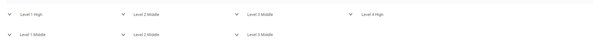
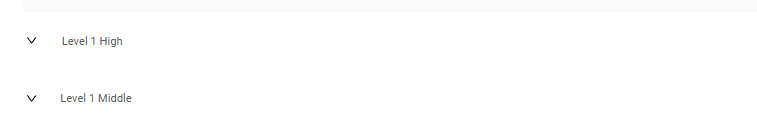
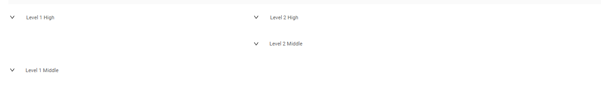
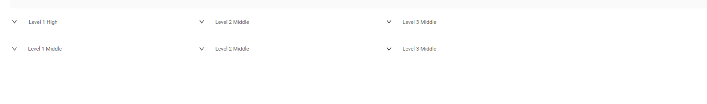

# defaultGroupingHierarchy()
 
`defaultGroupingHierarchy()` — этот метод задаёт иерархию по умолчанию для виджета "GroupingHierarchy", которая отображается всегда (даже когда у виджета нет данных с бэкенда).

**Методы для уровней 1-4**
Для уровней с 1 по 4 методы обеспечивают соответствие между справочниками (enum/dictionary) и списком полей DTO.
Эти методы проверяют, что поле каждого уровня соответствует определённому справочнику.

**Метод для создания иерархий из 5 и более уровней**
Для иерархий из 5 и более уровней метод не выполняет проверку соответствия.
Будьте внимательны: несоответствующие поля могут привести к неожиданному поведению

Группировка определяется полями DTO, указанными в вызове метода fields.defaultGroupingHierarchy(...).

Порядок перечисления полей важен, так как он определяет последовательность группировки, начиная с верхнего уровня (крайнее левое поле)
и заканчивая самым глубоким уровнем (крайнее правое поле).

Предположим, у вас есть четыре уровня иерархии, определённые так:

* `Level 1`: CustomFieldDictionaryEnum
* `Level 2`: CustomFieldDictionaryLevelTwoEnum
* `Level 3`: CustomFieldDictionaryLevelThreeEnum
* `Level 4`: CustomFieldDictionaryLevelFourEnum


 

Эту иерархию можно настроить в вызове метода:

```
fields.defaultGroupingHierarchy(
    MyExampleDTO_.customFieldDictionary,
    MyExampleDTO_.customFieldDictionaryLevelTwo,
    MyExampleDTO_.customFieldDictionaryLevelThree,
    MyExampleDTO_.customFieldDictionaryLevelFour,
```

* field1 – ПЕРВОЕ поле, указанное в .widget. json -> "options" -> "groupingHierarchy" -> "fields"
* field2 – ВТОРОЕ поле, указанное в .widget. json -> "options" -> "groupingHierarchy" -> "fields"
* field3 – ТРЕТЬЕ поле, указанное в .widget. json -> "options" -> "groupingHierarchy" -> "fields"
* field4 – ЧЕТВЁРТОЕ поле, указанное в .widget. json -> "options" -> "groupingHierarchy" -> "fields"

Это гарантирует последовательное развитие иерархии от уровня 1 до уровня 4.

**Структура**:

    Level 1 (CustomFieldDictionaryEnum):
    
        Level 2 (CustomFieldDictionaryLevelTwoEnum):
    
            Level 3 (CustomFieldDictionaryLevelThreeEnum):
    
                Level 4 (CustomFieldDictionaryLevelFourEnum).


Лямбды (lvl -> lvl.add(...)) позволяют настраивать каждый уровень группировки. Они задают значения перечисления для конкретного уровня.

## Примеры { #examples }
### Уровень 1 { #level-1 }

#### Как это выглядит? { #how-does-it-look }
 

#### Как добавить? { #how-to-add }

`Шаг 1`  Добавьте поле DTO

`Шаг 2`  Добавьте уровни

```
     fields.defaultGroupingHierarchy(
        MyExampleDTO_.customFieldDictionary,
            lvl -> lvl
                .add(CustomFieldDictionaryEnum.LEVEL_1_HIGH)
                .add(CustomFieldDictionaryEnum.LEVEL_1_MIDDLE)
    );

```

Пример структуры иерархии:

    Level 1 (High):
    Level 1 (Middle).

### Уровень 2 { #level-2 }

#### Как это выглядит? { #how-does-it-look_1 }


#### Как добавить? { #how-to-add_1 }

`Шаг 1`  Добавьте список полей DTO

`Шаг 2`  Добавьте уровни
```
    fields.defaultGroupingHierarchy(
                    MyExampleDTO_.customFieldDictionary,
                    MyExampleDTO_.customFieldDictionaryLevelTwo,
                    lvl -> lvl
                            .add(
                                    CustomFieldDictionaryEnum.LEVEL_1_HIGH,
                                    lvl2 -> lvl2
                                            .add(CustomFieldDictionaryLevelTwoEnum.LEVEL_2_MIDDLE)
                                            .add(CustomFieldDictionaryLevelTwoEnum.LEVEL_2_HIGH)
                            )
                            .add(
                                    CustomFieldDictionaryEnum.LEVEL_1_MIDDLE
                            )
            );
        }
```

Пример структуры иерархии:

    Level 1 (High):
        Level 2 (High):
        Level 2 (Middle).
    Level 1 (Middle).

### Уровень 3 { #level-3 }

#### Как это выглядит? { #how-does-it-look_2 }


#### Как добавить? { #how-to-add_2 }

`Шаг 1`  Добавьте список полей DTO

`Шаг 2`  Добавьте уровни

```
	fields.defaultGroupingHierarchy(
				MyExampleDTO_.customFieldDictionary,
				MyExampleDTO_.customFieldDictionaryLevelTwo,
				MyExampleDTO_.customFieldDictionaryLevelThree,
				lvl -> lvl
						.add(
								CustomFieldDictionaryEnum.LEVEL_1_HIGH,
								lvl2 -> lvl2
										.add(
												CustomFieldDictionaryLevelTwoEnum.LEVEL_2_MIDDLE,
												lvl3 -> lvl3
														.add(CustomFieldDictionaryLevelThreeEnum.LEVEL_3_MIDDLE)
										)
						)
						.add(
								CustomFieldDictionaryEnum.LEVEL_1_MIDDLE,
								lvl2 -> lvl2
										.add(
												CustomFieldDictionaryLevelTwoEnum.LEVEL_2_MIDDLE,
												lvl3 -> lvl3
														.add(CustomFieldDictionaryLevelThreeEnum.LEVEL_3_MIDDLE)
										)
						)
		);

```

Пример структуры иерархии:

    Level 1 (High):
        Level 2 (Middle):
            Level 3 (Middle).
    Level 1 (Middle):
        Level 2 (Middle):
            Level 3 (Middle).


### Уровень 4 { #level-4 }
#### Как это выглядит? { #how-does-it-look_3 }


#### Как добавить? { #how-to-add_3 }

`Шаг 1`  Добавьте список полей DTO

`Шаг 2`  Добавьте уровни

```
  fields.defaultGroupingHierarchy(
                MyExampleDTO_.customFieldDictionary,
                MyExampleDTO_.customFieldDictionaryLevelTwo,
                MyExampleDTO_.customFieldDictionaryLevelThree,
                MyExampleDTO_.customFieldDictionaryLevelFour,
                lvl -> lvl
                        .add(
                                CustomFieldDictionaryEnum.LEVEL_1_HIGH,
                                lvl2 -> lvl2
                                        .add(
                                                CustomFieldDictionaryLevelTwoEnum.LEVEL_2_MIDDLE,
                                                lvl3 -> lvl3
                                                        .add(
                                                                CustomFieldDictionaryLevelThreeEnum.LEVEL_3_MIDDLE,
                                                                lvl4 -> lvl4.add(CustomFieldDictionaryLevelFourEnum.LEVEL_4_HIGH)
														)
                                        )
                        )
                        .add(
                                CustomFieldDictionaryEnum.LEVEL_1_MIDDLE,
                                lvl2 -> lvl2
                                        .add(
                                                CustomFieldDictionaryLevelTwoEnum.LEVEL_2_MIDDLE,
                                                lvl3 -> lvl3
                                                        .add(CustomFieldDictionaryLevelThreeEnum.LEVEL_3_MIDDLE)
                                        )
                        )
        );
```

Пример структуры иерархии:

    Level 1 (High):
        Level 2 (Middle):
            Level 3 (Middle):
                Level 4 (High).
    Level 1 (Middle).
        Level 2 (Middle):
            Level 3 (Middle).

### Уровень 5 { #level-5 }
#### Как это выглядит? { #how-does-it-look_4 }


#### Как добавить? { #how-to-add_4 }

`Шаг 1`  Добавьте список полей DTO

`Шаг 2`  Добавьте уровни

```
        fields.defaultGroupingHierarchy(
                List.of(
                        MyExampleDTO_.customFieldDictionary,
                        MyExampleDTO_.customFieldDictionaryLevelTwo,
                        MyExampleDTO_.customFieldDictionaryLevelThree,
                        MyExampleDTO_.customFieldDictionaryLevelFour,
                        MyExampleDTO_.customFieldDictionaryLevelFive
                ),
                new Hierarchy<Object, Hierarchy<Object, Hierarchy<Object, Hierarchy<Object, Hierarchy<Object, ?>>>>>()
                        .add(
                                CustomFieldDictionaryEnum.LEVEL_1_HIGH,
                                lvl2 -> lvl2.add(
                                        CustomFieldDictionaryLevelTwoEnum.LEVEL_2_MIDDLE,
                                        lvl3 -> lvl3.add(
                                                CustomFieldDictionaryLevelThreeEnum.LEVEL_3_MIDDLE,
                                                lvl4 -> lvl4.add(
                                                        CustomFieldDictionaryLevelFourEnum.LEVEL_4_MIDDLE,
                                                        lvl5 -> lvl5.add(
                                                                CustomFieldDictionaryLevelFiveEnum.LEVEL_5_HIGH)))
                                )
                        )
                        .add(
                                CustomFieldDictionaryEnum.LEVEL_1_MIDDLE,
                                lvl2 -> lvl2.add(
                                        CustomFieldDictionaryLevelTwoEnum.LEVEL_2_MIDDLE,
                                        lvl3 -> lvl3.add(CustomFieldDictionaryLevelThreeEnum.LEVEL_3_MIDDLE)
                                )
                        )
        );
```

Пример структуры иерархии:

    Level 1 (High):
        Level 2 (Middle):
            Level 3 (Middle):
                Level 4 (Middle):
                    Level 5 (High).
    Level 1 (Middle).
        Level 2 (Middle):
            Level 3 (Middle).


## Добавление через cfg { #add-with-cfg }
###  Раскрыто по умолчанию { #default-expanded }
Параметр defaultExpanded определяет, раскрыта или свёрнута группа в иерархии по умолчанию.

* true:
  Группа раскрыта по умолчанию независимо от количества вложенных в неё элементов. Все уровни сразу полностью видны.
* false:
  Свёрнута, если группа содержит более одного элемента.
* null или отсутствует:
  По умолчанию (аналогично false)

 подробнее см. [GroupingHierarchy.defaultExpanded](/ru/widget/type/groupinghierarchy/groupinghierarchy/#default-groupinghierarchy)