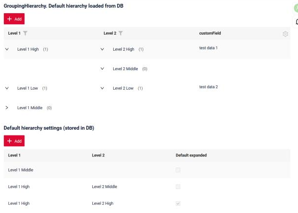

# defaultGroupingHierarchy() with Hierarchy.toHierarchy()

[:material-play-circle: Live Sample]({{ external_links.code_samples }}/ui/#/screen/myexample3296){:target="_blank"} ·
[:fontawesome-brands-github: GitHub]({{ external_links.github_ui }}/{{ external_links.github_branch }}/src/main/java/org/demo/documentation/widgets/groupinghierarhy/defaultgroupinghierarchy/dynamic){:target="_blank"}

`defaultGroupingHierarchy()` sets the default hierarchy of the "GroupingHierarchy" widget. The widget always shows it, even when the backend returns no data
(see [defaultGroupingHierarchy()](/environment/meta/buildindependentmeta/defaultgh/defaultgh)).

In the basic case the default hierarchy is written in code **explicitly**, node by node:

```java
lvl -> lvl
    .add(CustomFieldDictionaryEnum.LEVEL_1_HIGH, lvl2 -> lvl2.add(CustomFieldDictionaryLevelTwoEnum.LEVEL_2_HIGH))
    .add(CustomFieldDictionaryEnum.LEVEL_1_MIDDLE)
```

Sometimes the structure is not known at compile time. For example, an admin configures it in the UI, so it is read from a DB table or a microservice.
Then the hierarchy is built **dynamically**: you collect a stream of external values with the `Hierarchy.toHierarchy...` collectors.

## How does it look?


In the sample the lower table holds the default hierarchy settings, stored in DB (one row is one node).
The `GroupingHierarchy` widget gets the hierarchy from this table on each request of the row meta, so the change is visible without restarting the application:

* `Level 1 High` → `Level 2 High`, `Level 2 Middle` and `Level 1 Middle` come from the settings table. Groups with no data have counter `(0)`;
* `Level 1 Low` → `Level 2 Low` comes from the data. Data and the default hierarchy are merged;
* `Level 1 High` is expanded by default: `Default expanded` is set in its settings row.

## Collectors

All collectors are static methods of `org.cxbox.api.data.dto.hierarhy.grouping.Hierarchy`.
Each one turns a `Stream<E>` of external elements (DB rows, map entries, enum values, DTOs of a microservice) into one level of the hierarchy.

| Collector                                                    | What it creates                                    |
|--------------------------------------------------------------|----------------------------------------------------|
| `toHierarchy(valueMapper)`                                   | Level without children (leaf nodes)                |
| `toHierarchyWithCfg(valueMapper, optionsMapper)`             | Level without children, with node settings         |
| `toHierarchy(valueMapper, subTreeMapper)`                    | Level with children                                |
| `toHierarchyWithCfg(valueMapper, optionsMapper, subTreeMapper)` | Level with children and with node settings      |

Parameters:

* `valueMapper` — `Function<E, T>`. Returns the node value from an external element. The value type must match the type of the grouping DTO field of this level (usually an Enum or a String).
* `optionsMapper` — `BiFunction<E, Cfg, Cfg>`. Returns the node settings: `cfg.defaultExpanded(...)` (see [Default Expanded](/environment/meta/buildindependentmeta/defaultgh/defaultgh/#default-expanded)) and `cfg.options(Map<String, String>)` (custom properties for project customizations of the widget).
* `subTreeMapper` — `BiFunction<E, Hierarchy, Hierarchy>`. Returns the children of the node. Usually it collects the next level with a `toHierarchy...` collector again.

!!! info
    The collectors are combined with explicit `add(...)`/`addWithCfg(...)` calls: inside `subTreeMapper` you can build the next level explicitly, and vice versa.

!!! warning
    Values that are not in the external source are not shown in the default hierarchy. They appear only when the backend returns data with these values.

## Examples
### Level 1

Grouping by one field. The level is collected from enum values.

```java
fields.defaultGroupingHierarchy(
        MyExampleDTO_.customFieldDictionary,
        lvl -> Arrays.stream(CustomFieldDictionaryEnum.values())
                .filter(value -> value != CustomFieldDictionaryEnum.LEVEL_1_LOW)
                .collect(Hierarchy.toHierarchy(value -> value))
);
```

With node settings:

```java
fields.defaultGroupingHierarchy(
        MyExampleDTO_.customFieldDictionary,
        lvl -> Arrays.stream(CustomFieldDictionaryEnum.values())
                .collect(Hierarchy.toHierarchyWithCfg(
                        value -> value,
                        (value, cfg) -> cfg.defaultExpanded(value == CustomFieldDictionaryEnum.LEVEL_1_HIGH)
                ))
);
```

Example Hierarchy Structure:

    Level 1 (High):
    Level 1 (Middle).

### Level 2

Grouping by two fields. The external source is a `Map`: level 1 value → set of level 2 values.

```java
Map<CustomFieldDictionaryEnum, Set<CustomFieldDictionaryLevelTwoEnum>> external = Map.of(
        CustomFieldDictionaryEnum.LEVEL_1_HIGH, Set.of(
                CustomFieldDictionaryLevelTwoEnum.LEVEL_2_HIGH,
                CustomFieldDictionaryLevelTwoEnum.LEVEL_2_MIDDLE
        ),
        CustomFieldDictionaryEnum.LEVEL_1_MIDDLE, new HashSet<>()
);
fields.defaultGroupingHierarchy(
        MyExampleDTO_.customFieldDictionary,
        MyExampleDTO_.customFieldDictionaryLevelTwo,
        lvl1 -> external.entrySet().stream().collect(Hierarchy.toHierarchy(
                Map.Entry::getKey,
                (entry, lvl2) -> entry.getValue().stream().collect(Hierarchy.toHierarchy(value -> value))
        ))
);
```

Example Hierarchy Structure:

    Level 1 (High):
        Level 2 (High):
        Level 2 (Middle).
    Level 1 (Middle).

### Level 2. Hierarchy loaded from DB

#### How to add?

`Step 1` Create a table (entity) for the hierarchy settings. One row is one node: level 1 value, level 2 value (empty for a level 1 group without children) and settings of the node.

```java
--8<--
{{ external_links.github_raw_doc }}/widgets/groupinghierarhy/defaultgroupinghierarchy/dynamic/MyEntity3296Config.java
--8<--
```

`Step 2` Add the grouping fields to `options.groupingHierarchy.fields` of the corresponding **.widget.json**. The order of the fields defines the levels.

```json
--8<--
{{ external_links.github_raw_doc }}/widgets/groupinghierarhy/defaultgroupinghierarchy/dynamic/myexample3296gh.widget.json
--8<--
```

`Step 3` In `buildIndependentMeta` of the corresponding **FieldMetaBuilder** read the settings and collect them to the hierarchy:

* group the rows by the level 1 value;
* `toHierarchyWithCfg` creates level 1: the value is the map key, `defaultExpanded` comes from the settings;
* `subTreeMapper` collects level 2 values of the group with `toHierarchy`.

```java
--8<--
{{ external_links.github_raw_doc }}/widgets/groupinghierarhy/defaultgroupinghierarchy/dynamic/MyExample3296Meta.java:buildIndependentMeta
--8<--
```

`Step 4` (optional) If the settings are edited on the same view, refresh the `GroupingHierarchy` business component after saving, so that the widget requests the new row meta.

```java
return new ActionResultDTO<>(entityToDto(bc, entity))
        .setAction(PostAction.refreshBc(CxboxMyExample3296Controller.myexample3296));
```

Example Hierarchy Structure (settings of the sample):

    Level 1 (High):            defaultExpanded = true
        Level 2 (High):
        Level 2 (Middle).
    Level 1 (Middle).

[:material-play-circle: Live Sample]({{ external_links.code_samples }}/ui/#/screen/myexample3296){:target="_blank"} ·
[:fontawesome-brands-github: GitHub]({{ external_links.github_ui }}/{{ external_links.github_branch }}/src/main/java/org/demo/documentation/widgets/groupinghierarhy/defaultgroupinghierarchy/dynamic){:target="_blank"}

### Level 3 and more

Nest the collectors: `subTreeMapper` of level N collects level N + 1.

```java
fields.defaultGroupingHierarchy(
        MyExampleDTO_.customFieldDictionary,
        MyExampleDTO_.customFieldDictionaryLevelTwo,
        MyExampleDTO_.customFieldDictionaryLevelThree,
        lvl1 -> external.stream().collect(Hierarchy.toHierarchy(
                Level1Node::getValue,
                (l1, lvl2) -> l1.getChildren().stream().collect(Hierarchy.toHierarchy(
                        Level2Node::getValue,
                        (l2, lvl3) -> l2.getChildren().stream().collect(Hierarchy.toHierarchy(Level3Node::getValue))
                ))
        ))
);
```

For 5 and more levels use `defaultGroupingHierarchy(List<DtoField>, Hierarchy)`
(see [Level 5](/environment/meta/buildindependentmeta/defaultgh/defaultgh/#level-5)): the hierarchy passed to it can be collected the same way.
