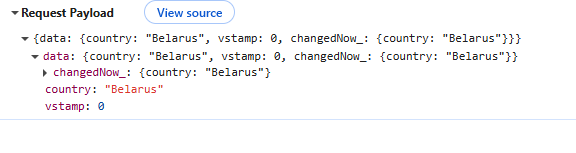
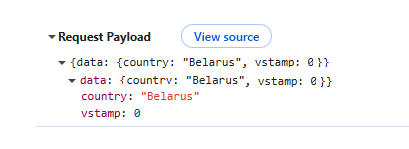

# `isFieldChangedNow()`
[:material-play-circle: Живой пример]({{ external_links.code_samples }}/ui/#/screen/myexample4901/view/myexample3420FA){:target="_blank"} ·
[:fontawesome-brands-github: GitHub]({{ external_links.github_ui }}/{{ external_links.github_branch }}/src/main/java/org/demo/repository/metabuilder/buildrowdependentmeta/isfieldchangenow){:target="_blank"}

Доступно начиная с [v2.0.14](/ru/new/version2014/)

Метод `isFieldChangedNow()` проверяет, было ли конкретное поле изменено пользователем
в ходе текущего взаимодействия с фронтендом (только в этой итерации).

```java
public <V> boolean isFieldChangedNow(RowDependentFieldsMeta<T> fields, DtoField<? super T, V> field)
```

Параметры:

* `fields` – текущее состояние метаданных полей
* `field` – проверяемое поле DTO

Возвращает (boolean):

* `true`, если поле было изменено в интерфейсе в ходе этого взаимодействия
* `false`, если оно не было изменено


✅ Рекомендуемое использование

Используйте этот метод только для проверки изменений в зависимых полях.
Рекомендуем размещать `isFieldChangedNow()` в начале `buildRowDependentMeta`, чтобы сначала обновить все зависимые значения, а затем устанавливать setHidden, setRequired и другие свойства полей.


## Как добавить? { #how-to-add }
[:material-play-circle: Живой пример]({{ external_links.code_samples }}/ui/#/screen/myexample4901/view/myexample3420FA){:target="_blank"} ·
[:fontawesome-brands-github: GitHub]({{ external_links.github_ui }}/{{ external_links.github_branch }}/src/main/java/org/demo/repository/metabuilder/buildrowdependentmeta/isfieldchangenow){:target="_blank"}

??? Example "Пример"

    **buildRowDependentMeta** 

     ```java
     --8<--
     {{ external_links.github_raw }}/repository/metabuilder/buildrowdependentmeta/isfieldchangenow/anysource/MyExample3420Meta.java:buildRowDependentMeta
     --8<--
     ```

## Как это работает? { #how-it-works }

На стороне фронтенда появился новый тег `changedNow_`.
Этот тег хранит только поля, **изменённые в текущей пользовательской сессии**, до их отправки на бэкенд.

=== "После: row-meta/ (POST) (v2.0.14+)"
    

=== "До: row-meta/ (POST) "
    

**Когда отправляется `changedNow_`?**

row-meta/ (POST)

* Когда пользователь покидает поле с `forceActive = true`.
* При вызове виджета FormPopup

=== "Поведение после (v2.0.14+)"

    | Сценарий                                                                                                                   | Вызывается Meta Builder | Запускается обновление полей   |
    | -------------------------------------------------------------------------------------------------------------------------- | ------------------- | ------------------------------ |
    | Редактирование поля с `forceActive`                                                                                        | ✅ Да                | ✅ Да                           |
    | `forceActive` → стандартная кнопка Save (для перечисленных ниже полей, где `row-meta` не вызывается, пока пользователь не покинет поле) | ❌ Нет               | ❌ Нет                          |
    | `forceActive` → пользовательская кнопка (для перечисленных ниже полей, где `row-meta` не вызывается, пока пользователь не покинет поле) | ❌ Нет               | ❌ Нет                          |
    | Открытие `FormPopup`                                                                                                       | ✅ Да                | ✅ Да                           |
    | Нажатие только стандартной кнопки Save                                                                                     | ❌ Нет               | ❌ Нет                          |
    | Нажатие только пользовательской кнопки                                                                                     | ❌ Нет               | ❌ Нет                          |
    | Нажатие Delete                                                                                                             | ❌ Нет               | ❌ Нет (запись только удаляется) |

=== "Поведение до"

    | Сценарий                                                                                                                   | Вызывается Meta Builder                             | Запускается обновление полей               |
    | -------------------------------------------------------------------------------------------------------------------------- | --------------------------------------------------- | ------------------------------------------ |
    | Редактирование поля с `forceActive`                                                                                        | ✅ Да                                                | ✅ Да                                       |
    | `forceActive` → стандартная кнопка Save (для перечисленных ниже полей, где `row-meta` не вызывается, пока пользователь не покинет поле) | ✅ Да (через `/row-meta` → затем запрос сохранения)  | Обновление происходит в рамках события `/row-meta` |
    | `forceActive` → пользовательская кнопка (для перечисленных ниже полей, где `row-meta` не вызывается, пока пользователь не покинет поле) | ✅ Да (через `/row-meta` → затем пользовательское действие) | Обновление происходит в рамках события `/row-meta` |
    | Открытие `FormPopup`                                                                                                       | ✅ Да                                                | ✅ Да                                       |
    | Нажатие только стандартной кнопки Save                                                                                     | ❌ Нет                                               | ❌ Нет                                      |
    | Нажатие только пользовательской кнопки                                                                                     | ❌ Нет                                               | ❌ Нет                                      |
    | Нажатие Delete                                                                                                             | ❌ Нет                                               | ❌ Нет (запись только удаляется)            |


**Поведение по типам полей**

Обозначения:

* ✅ — `forceActive` (`row-meta`) вызывается сразу при выборе значения.
* ❌ — `row-meta` не вызывается, пока не нажата кнопка или пользователь не покинет поле.
* `noValid` — поле не поддерживает изменение значения на месте.

| Тип поля              | `forceActive` вызывается сразу?       | Примечания                                          |
| --------------------- | ------------------------------------ | --------------------------------------------------- |
| `input`               | ❌ Нет                                | Вызывается при клике вне поля или по кнопке         |
| `date`                | ✅ Да                                 |                                                     |
| `dateTime`            | ✅ Да                                 |                                                     |
| `dateTimeWithSeconds` | ✅ Да                                 |                                                     |
| `number`              | ❌ Нет                                | Вызывается при клике вне поля или по кнопке         |
| `percent`             | ❌ Нет                                | Вызывается при клике вне поля или по кнопке         |
| `hidden`              | `noValid`                            | Не редактируется                                    |
| `text`                | ❌ Нет                                | Вызывается при клике вне поля или по кнопке         |
| `radio`               | ✅ Да                                 |                                                     |
| `checkbox`            | ✅ Да                                 |                                                     |
| `money`               | ❌ Нет                                |                                                     |
| `dictionary`          | ✅ Да                                 |                                                     |
| `fileUpload`          | ✅ Да                                 |                                                     |
| `pickList`            | ✅ Да                                 |                                                     |
| `inlinePickList`      | ✅ Да                                 | Сохранение вызывается, только если выбран элемент   |
| `hint`                | `noValid`                            | Не редактируется                                    |
| `multifield`          | ✅ Да                                 |                                                     |
| `multivalueHover`     | `noValid`                            | Не редактируется                                    |
| `multivalue`          | ✅ Да                                 |                                                     |
| `multipleSelect`      | ✅ Да                                 |                                                     |
| `suggestionPickList`  | ✅ Да                                 | Сохранение вызывается, только если выбран элемент   |


## `isFieldChanged()` vs  `isFieldChangedNow()`

В отличие от `isFieldChanged()`, который проверяет, менялось ли поле **когда-либо ранее** (например, по накопленному тегу `data`), `isFieldChangedNow()` смотрит именно на **текущее взаимодействие** на основе тега `changedNowParam`.

Это различие важно при использовании `forceActive` или при работе с зависимыми полями:

* `isFieldChanged()` может обнаружить более ранние изменения из предыдущих взаимодействий.
* `isFieldChangedNow()` обнаруживает только непосредственный ввод пользователя в текущей клиентской сессии.