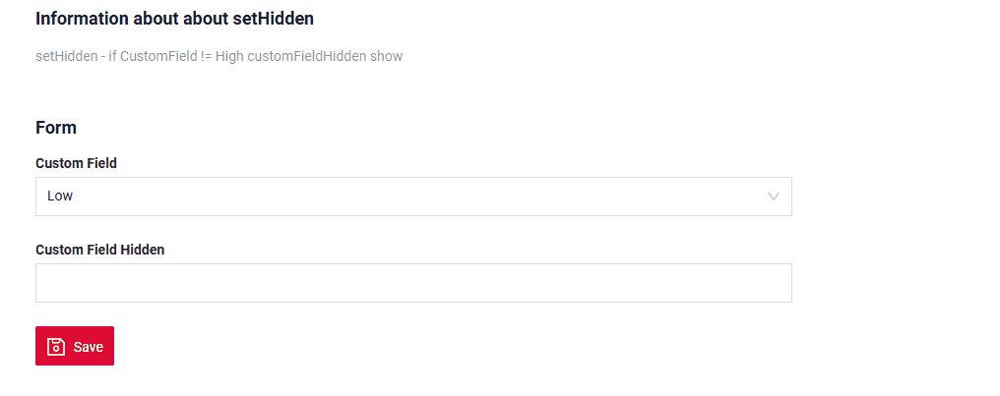

# `setHidden()`
[:material-play-circle: Живой пример]({{ external_links.code_samples }}/ui/#/screen/myexample5010){:target="_blank"} ·
[:fontawesome-brands-github: GitHub]({{ external_links.github_ui }}/{{ external_links.github_branch }}/src/main/java/org/demo/repository/metabuilder/buildrowdependentmeta/sethidden/basic){:target="_blank"}

Метод `setHidden()` задаёт состояние скрытости для указанных полей DTO.

```java
public final void setHidden(DtoField<? super T, ?>... fields)
```

Параметры:

* `fields` – поля DTO

Применяется к:

*   [виджету AdditionalInfo](/ru/widget/type/additionalinfo/additionalinfo)
*   [виджету Form](/ru/widget/type/form/form)
*   [виджету FormPopup](/ru/widget/type/formpopup/formpopup)
*   [виджету Info](/ru/widget/type/info/info)
 

### Как это выглядит? { #how-does-it-look }


!!! info
    [:material-play-circle: Живой пример]({{ external_links.code_samples }}/ui/#/screen/myexample5019){:target="_blank"} ·
    [:fontawesome-brands-github: GitHub]({{ external_links.github_ui }}/{{ external_links.github_branch }}/src/main/java/org/demo/documentation/widgets/property/sethidden){:target="_blank"}

    *Работа с полями в табличных виджетах*

    Применяется к:

    * [Виджет AdditionalList](/ru/widget/type/additionallist/additionallist)
    * [Виджет AssocListPopup](/ru/widget/type/assoclistpopup/assoclistpopup)
    * [Виджет GroupingHierarchy](/ru/widget/type/groupinghierarchy/groupinghierarchy)
    * [Виджет List](/ru/widget/type/list/list)
    * [Виджет PickListPopup](/ru/widget/type/picklistpopup/picklistpopup)

    1. Динамическое скрытие полей (setHidden)
    
    Для всех табличных виджетов динамическое скрытие полей через setHidden не влияет на то, какие колонки отображаются в таблице.
    setHidden может работать внутри форм создания/редактирования (если они есть у виджета), но не может изменить видимые колонки самой таблицы.
    
    2. Управление колонками таблицы (fields в widget.json)
    
    Набор видимых колонок таблицы определяется только массивом fields в widget.json.
    Никакие изменения во время выполнения (setHidden, условия, роли и т. д.) не могут изменить набор колонок.
    
    **Поведение по типам виджетов** : [виджет GroupingHierarchy](/ru/widget/type/groupinghierarchy/groupinghierarchy), [виджет List](/ru/widget/type/list/list)
 
    В режиме создания / редактирования (<create> / <edit>) массив fields влияет только на форму создания/редактирования.
    
    Он не влияет на то, какие колонки отображаются в списке.
    
    **Поведение по типам виджетов** [виджет AdditionalList](/ru/widget/type/additionallist/additionallist)
    
    В режиме чтения (<read>) массив fields не влияет ни на таблицу, ни на форму просмотра.
    Поведение фиксировано и определяется реализацией виджета.

    Пример для всех типов виджетов:
    [:material-play-circle: Живой пример]({{ external_links.code_samples }}/ui/#/screen/myexample5019){:target="_blank"} ·
    [:fontawesome-brands-github: GitHub]({{ external_links.github_ui }}/{{ external_links.github_branch }}/src/main/java/org/demo/documentation/widgets/property/sethidden){:target="_blank"}

## Как добавить? { #how-to-add }
[:material-play-circle: Живой пример]({{ external_links.code_samples }}/ui/#/screen/myexample5010){:target="_blank"} ·
[:fontawesome-brands-github: GitHub]({{ external_links.github_ui }}/{{ external_links.github_branch }}/src/main/java/org/demo/repository/metabuilder/buildrowdependentmeta/sethidden/basic){:target="_blank"}

??? Example "Пример"

    **buildRowDependentMeta** 
     ```java
     --8<--
     {{ external_links.github_raw }}/repository/metabuilder/buildrowdependentmeta/sethidden/basic/MyExample5010Meta.java:buildRowDependentMeta
     --8<--
     ```
 
    [:material-play-circle: Живой пример]({{ external_links.code_samples }}/ui/#/screen/myexample5010){:target="_blank"} ·
    [:fontawesome-brands-github: GitHub]({{ external_links.github_ui }}/{{ external_links.github_branch }}/src/main/java/org/demo/repository/metabuilder/buildrowdependentmeta/sethidden/basic){:target="_blank"}
 