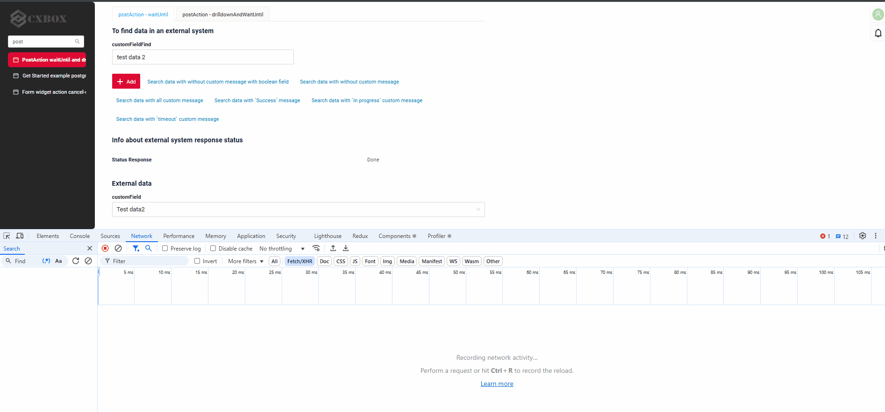
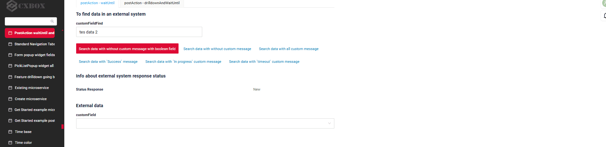
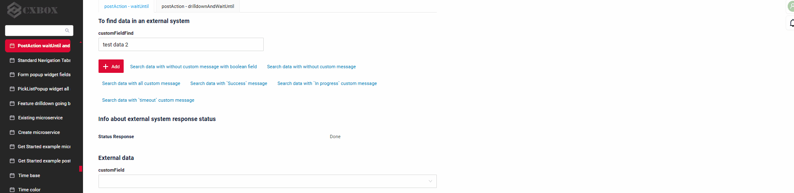
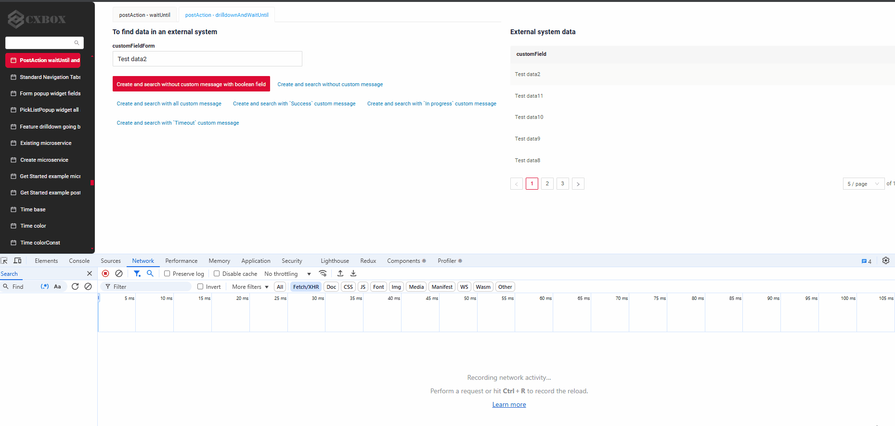
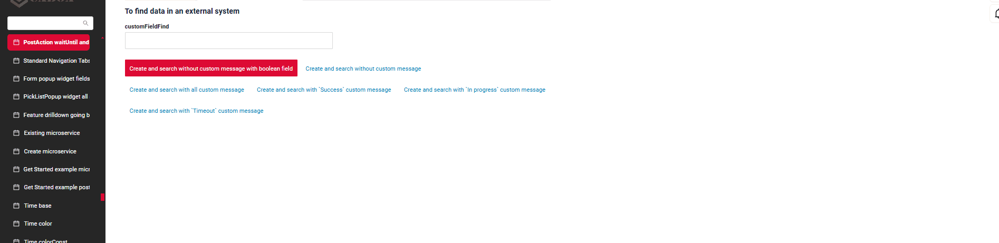
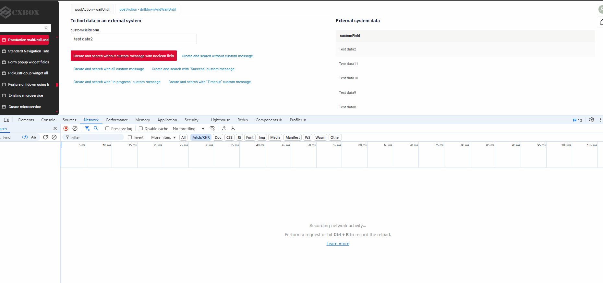

# waitUntil and drillDownAndWaitUntil
 
## waitUntil
[:material-play-circle: Живой пример]({{ external_links.code_samples }}/ui/#/screen/myexample3231/view/myexample3233asyncform){:target="_blank"} ·
[:fontawesome-brands-github: GitHub]({{ external_links.github_ui }}/{{ external_links.github_branch }}/src/main/java/org/demo/documentation/feature/postaction/waituntil){:target="_blank"}

Этот механизм полезен для реализации длительных операций, когда пользователя нужно информировать о ходе выполнения и результате.

### Как это выглядит? { #how-does-it-look }
=== "Без пользовательского сообщения"
    
=== "С пользовательскими сообщениями `Success` и `In progress`"
    
=== "С пользовательским сообщением `Timeout`"
    


```java
PostAction.waitUntil(
    MyExampleDTO_.statusResponse, 
    StatusEnum.DONE)                
   .timeoutMaxRequests(6)          
   .timeout(Duration.ofSeconds(12))  
   .inProgressMessage("In Progress custom message")  
   .successMessage("Success custom message")       
   .timeoutMessage("Timeout custom message")      
   .build()
```
**Параметры `waitUntil`**:

* (Обязательно) **Поле для проверки условия**:
    `MyExampleDTO_.statusResponse` — поле, которое проверяется на выполнение условия. Может иметь тип boolean, string, Dictionary, Enum, LOV.
   Поле, которое сравнивается с ожидаемым значением. Это поле должно присутствовать на экране (может быть скрытым).

* (Обязательно) **Ожидаемое значение**:
    `StatusEnum.DONE` — значение, которого фронтенд будет ожидать в поле `statusResponse`.
   Когда поле примет это значение, диалог ожидания закроется.

**Дополнительная настройка**:

* (Необязательно) **Максимальное количество запросов**:
     `timeoutMaxRequests(6)` — максимальное количество запросов, которые фронтенд отправит на бэкенд для проверки условия. Если после 6 запросов условие не выполнено, срабатывает таймаут.
        По умолчанию `timeoutMaxRequests` равен 3.
 
* (Необязательно) **Таймаут**:
      `timeout(Duration.ofSeconds(12))` — общее время, в течение которого фронтенд ожидает выполнения условия. В данном случае это 12 секунд. Интервал между запросами вычисляется как `общее время / количество запросов`. Здесь интервал между запросами составит `12 секунд / 6 запросов = 2 секунды`.
   По умолчанию `timeout` равен 5 секундам.
* (Необязательно) **Сообщение о выполнении**:
    `inProgressMessage("In Progress custom message")` — пользовательское сообщение, которое отображается на фронтенде во время ожидания выполнения условия.
      По умолчанию отображается стандартное сообщение: Operation in progress.
* (Необязательно) **Сообщение об успехе**:
      `successMessage("Success custom message")` — пользовательское сообщение, которое отображается при выполнении условия (то есть когда `statusResponse` равно `StatusEnum.DONE`).
      По умолчанию стандартное сообщение не отображается.
* (Необязательно) **Сообщение о таймауте**:
    `timeoutMessage("Timeout custom message")` — пользовательское сообщение, которое отображается, если условие не выполнено до истечения таймаута (то есть после 6 запросов за 12 секунд).
      По умолчанию стандартное сообщение не отображается.

Как это работает:

- Фронтенд начинает отправлять запросы на бэкенд с интервалом 2 секунды (12 секунд / 6 запросов).
- При каждом запросе проверяется значение поля `statusResponse`.
- Если поле становится равным `StatusEnum.DONE`, отображается `Success custom message`, и процесс завершается.
- Если после 6 запросов условие не выполнено, отображается `Timeout custom message`, и процесс завершается по таймауту.
- Во время выполнения запросов отображается `In Progress custom message`.


###  <a id="Howtoaddbacis">Как добавить?</a>
??? Example "Пример"

    **Шаг 1** Добавьте **PostAction.waitUntil** в соответствующий **VersionAwareResponseService**.

    ```java
       --8<--
       {{ external_links.github_raw_doc }}/feature/postaction/waituntil/basic/MyExample3233Service.java:getActions
       --8<--
    ```
    [:material-play-circle: Живой пример]({{ external_links.code_samples }}/ui/#/screen/myexample3231/view/myexample3233asyncform){:target="_blank"} ·
    [:fontawesome-brands-github: GitHub]({{ external_links.github_ui }}/{{ external_links.github_branch }}/src/main/java/org/demo/documentation/feature/postaction/waituntil){:target="_blank"}

 
## drillDownAndWaitUntil
[:material-play-circle: Живой пример]({{ external_links.code_samples }}/ui/#/screen/myexample3231/view/myexample3234form){:target="_blank"} ·
[:fontawesome-brands-github: GitHub]({{ external_links.github_ui }}/{{ external_links.github_branch }}/src/main/java/org/demo/documentation/feature/postaction/drilldownandwaituntil){:target="_blank"}
Этот метод полезен в сценариях, когда нужно перейти на экран, дождаться выполнения определённого условия (например, смены статуса) и информировать пользователя в процессе.

Создаёт post-action, который выполняет INNER drill-down, а затем ожидает выполнения заданного условия.

### Как это выглядит? { #how-does-it-look_1 }
=== "Без пользовательского сообщения"
    
=== "С пользовательскими сообщениями `Success` и `In progress`"
    
=== "С пользовательским сообщением `Timeout`"
    

```java
PostAction.drillDownAndWaitUntil(
    "/screen/myexample/view/myexampleresultform/" +
    CxboxMyExampleController.myexample + "/" + myEntity.getId(),
    CxboxMyExampleController.myexample,
    MyExampleDTO_.statusResponse,
    StatusEnum.DONE
)
.inProgressMessage("In Progress custom message")
.successMessage("Success custom message")
.timeoutMessage("Timeout custom message")
.timeoutMaxRequests(6)
.timeout(Duration.ofSeconds(12))
.build();
```

**Параметры `drillDownAndWaitUntil`**:

* (Обязательно) **Путь к экрану**:
    `"/screen/myexample/view/myexampleresultform/" +
     CxboxMyExampleController.myexample + "/" + myEntity.getId()` — путь к экрану, на который будет выполнен переход.

* (Обязательно) **Бизнес-компонент для проверки условия**:
    `CxboxMyExampleController.myexample` — бизнес-компонент, в котором будет проверяться поле, сравниваемое с ожидаемым значением.
  Этот бизнес-компонент должен присутствовать (может быть скрытым) на экране, на который выполняется переход.

* (Обязательно) **Поле для проверки условия**:
  `MyExampleDTO_.statusResponse` — поле, которое проверяется на выполнение условия. Может иметь тип boolean, string, Dictionary, Enum, LOV.
  Поле, которое сравнивается с ожидаемым значением. Это поле должно присутствовать на экране (может быть скрытым).

* (Обязательно) **Ожидаемое значение**:
    `StatusEnum.DONE` — значение, которого фронтенд будет ожидать в поле `statusResponse`.
     Когда поле примет это значение, диалог ожидания закроется. Это поле должно присутствовать (может быть скрытым) на экране, на который выполняется переход.

**Дополнительная настройка**:

* (Необязательно) **Максимальное количество запросов**:
    `timeoutMaxRequests(6)` — максимальное количество запросов, которые фронтенд отправит на бэкенд для проверки условия. Если после 6 запросов условие не выполнено, срабатывает таймаут.
   По умолчанию `timeoutMaxRequests` равен 3.
* (Необязательно) **Таймаут**:
    `timeout(Duration.ofSeconds(12))` — общее время, в течение которого фронтенд ожидает выполнения условия. В данном случае это 12 секунд. Интервал между запросами вычисляется как `общее время / количество запросов`. Здесь интервал между запросами составит `12 секунд / 6 запросов = 2 секунды`.
   По умолчанию `timeout` равен 5 секундам.
* (Необязательно) **Сообщение о выполнении**:
    `inProgressMessage("In Progress custom message")` — пользовательское сообщение, которое отображается на фронтенде во время ожидания выполнения условия.
     По умолчанию отображается стандартное сообщение: Operation in progress.
* (Необязательно) **Сообщение об успехе**:
    `successMessage("Success custom message")` — пользовательское сообщение, которое отображается при выполнении условия (то есть когда `statusResponse` равно `StatusEnum.DONE`).
     По умолчанию стандартное сообщение не отображается.
* (Необязательно) **Сообщение о таймауте**:
     `timeoutMessage("Timeout custom message")` — пользовательское сообщение, которое отображается, если условие не выполнено до истечения таймаута (то есть после 6 запросов за 12 секунд).
     По умолчанию стандартное сообщение не отображается.
 
Как это работает:

- Фронтенд переходит на указанный экран (`/screen/myexample/view/myexampleresultform/...`). Отображается `In Progress custom message`.
- Начинается проверка поля `statusResponse` в `MyExampleDTO_` на значение `StatusEnum.DONE`.
- Фронтенд выполняет до 6 запросов с интервалом 2 секунды (всего 12 секунд).
- Если условие выполнено:
  Отображается `Success custom message`, и процесс завершается.
- Если после 6 запросов условие не выполнено:
  Фронтенд переходит на указанный экран (`/screen/myexample/view/myexampleresultform/...`).
  Отображается `Timeout custom message`, и процесс завершается по таймауту.

###  <a id="Howtoaddbacis">Как добавить?</a>
??? Example "Пример"

    **Шаг 1** Добавьте **PostAction.drillDownAndWaitUntil** в соответствующий **VersionAwareResponseService**.

    ```java
       --8<--
       {{ external_links.github_raw_doc }}/feature/postaction/drilldownandwaituntil/basic/MyExample3234Service.java:getActions
       --8<--
    ```
    [:material-play-circle: Живой пример]({{ external_links.code_samples }}/ui/#/screen/myexample3231/view/myexample3234form){:target="_blank"} ·
    [:fontawesome-brands-github: GitHub]({{ external_links.github_ui }}/{{ external_links.github_branch }}/src/main/java/org/demo/documentation/feature/postaction/drilldownandwaituntil){:target="_blank"}
     