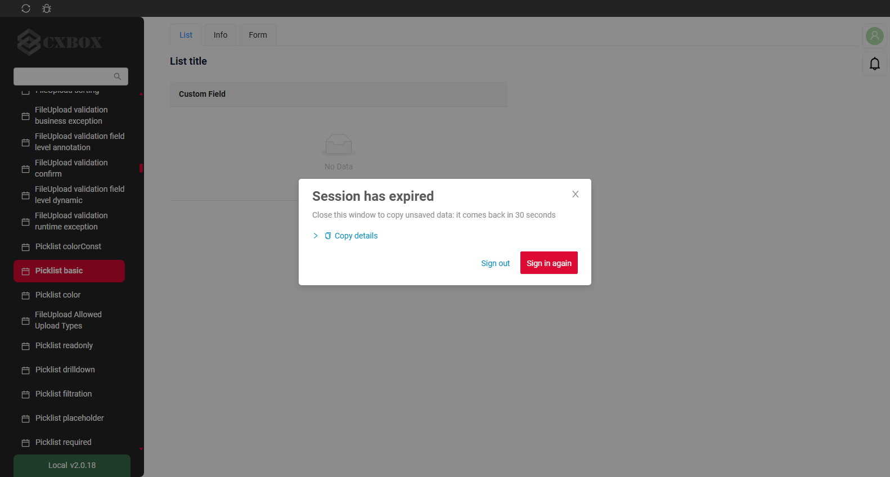
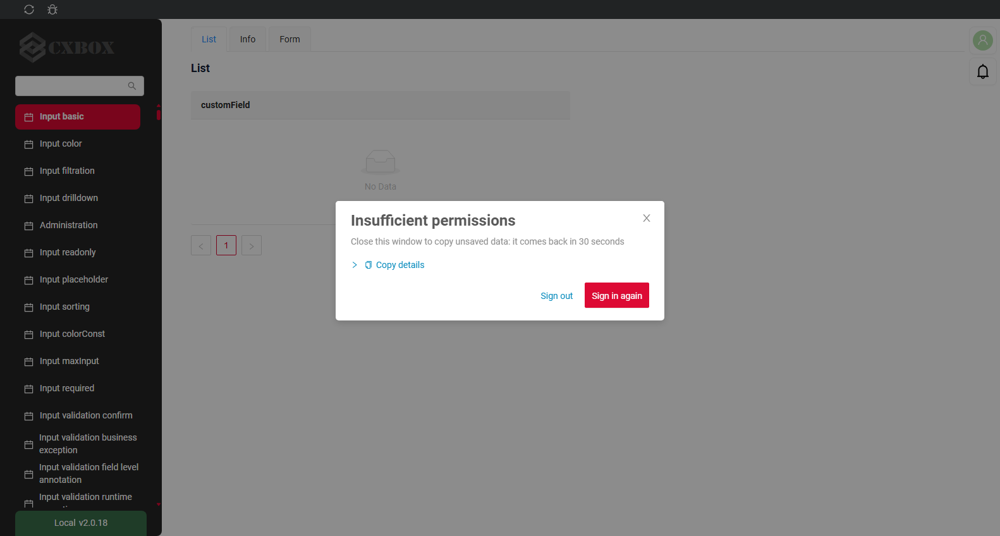
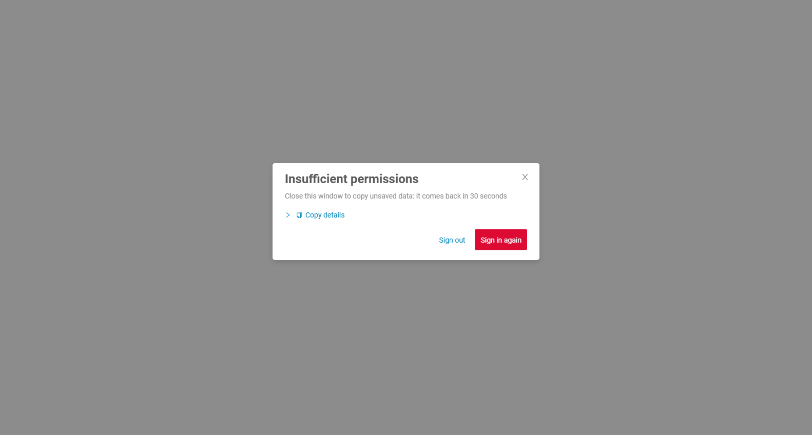
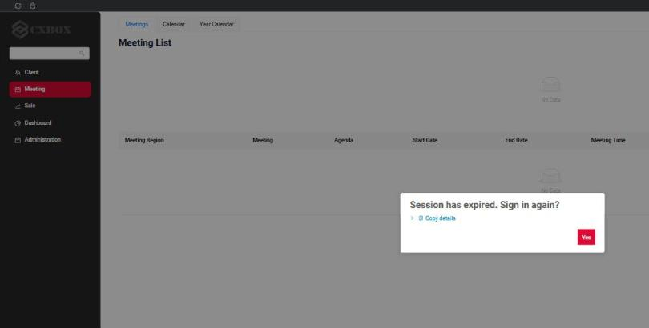

# Keycloak Authorization
It is default authorization.
see more [keycloak](https://www.keycloak.org/)

## <a id="signInAgain">Session expired or no roles: "Sign in again" popup</a>
Available since [v3.0.2](/new/version3002/)

When the backend answers `401 Unauthorized` (the session has expired) or `403 Forbidden` (the user has no roles), the user sees a popup instead of empty widgets and endless spinners.

The popup has two buttons and a cross:

* **Sign in again** goes to the OIDC provider and back to the same screen. While the SSO session of the provider is alive, no password is asked. If it is over, the login page opens.
* **Sign out** does the same as the **Log out** button in the user menu.
* The cross closes the popup, so the user can copy unsaved data. The popup does not come back for 30 seconds (`AUTH_ERROR_SNOOZE_SECONDS`), even if more requests fail.
* If the OIDC provider is not reachable, both buttons leave the popup open and it says so. What the user has typed is not lost, and the user can try again.

### How does it look?
=== "Session has expired (401)"
    
=== "Insufficient permissions (403)"
    
=== "Sign in of a user without roles"
    The application has not loaded yet, so there is nothing behind the popup but the empty start page. **Sign out** lets the user sign in as someone else.  
    

### How to configure?
Three constants in `ui/src/constants/index.ts`. They do not depend on each other, and the application works with any combination. The second and the third are the way back to the old behavior if something goes wrong at your OIDC provider.

| Constant                     | Values                                                                                                                                                                                                                                                                  |
|------------------------------|-------------------------------------------------------------------------------------------------------------------------------------------------------------------------------------------------------------------------------------------------------------------------|
| `AUTH_ERROR_MODE`            | `soft` (default): the popup can be closed with the cross. <br> `strict`: no cross, the user either signs in again or signs out.                                                                                                                                          |
| `USER_MANAGER`               | `rotationSafe` (default): `RotationSafeUserManager`, see [token renewal](#tokenRenewal). <br> `original`: `UserManager` of oidc-client-ts with the settings as before 3.0.2. The token is renewed only in the background, in every tab. A request with an expired token opens the popup. |
| `SIGN_IN_CALLBACK_DETECTION` | How the page learns at load that the OIDC provider returned the browser to it. <br> `oidcResponse` (default): by the response of the provider in the URL, `state` with `code` or `error`. <br> `signInCallbackParam`: by our `sign_in_callback` parameter from `redirect_uri`, as before 3.0.2. It stands after `#`, and a provider may drop it.  |

`USER_MANAGER` and `SIGN_IN_CALLBACK_DETECTION` can also be switched for one browser, without a rebuild: the autotests compare the two values of each this way, and the support team can switch one user. Reload the page after it; `removeItem()` brings the build constant back.

```js
localStorage.setItem('cxbox.userManager', 'original')
localStorage.setItem('cxbox.signInCallbackDetection', 'signInCallbackParam')
```

=== "soft"
    The popup with the cross.  
    
=== "strict"
    The popup without the cross.  
    

## <a id="tokenRenewal">Access token renewal</a>
Available since [v3.0.2](/new/version3002/)

All tabs of the application in one browser share the stored user and therefore one refresh token (`localStorage`). With refresh token rotation in the OIDC provider (Keycloak *Revoke Refresh Token*, Blitz, Auth0, Okta; recommended by [RFC 9700](https://www.rfc-editor.org/rfc/rfc9700)) a refresh token works once. A second use looks like theft: the provider rejects it and can close the whole session. The user sees 401 errors, and clearing the browser cache "helps".

`oidc-client-ts` does not protect against this. The issue is open since 2022: [oidc-client-ts #430](https://github.com/authts/oidc-client-ts/issues/430), the fix [PR #434](https://github.com/authts/oidc-client-ts/pull/434) was never merged, the same within one tab: [#1618](https://github.com/authts/oidc-client-ts/issues/1618). Keycloak considers it the client's job: [keycloak #16081](https://github.com/keycloak/keycloak/issues/16081).

Before 3.0.2 the same refresh token was sent twice:

* by two tabs at the same moment: the background timer of `oidc-client-ts` fires in every tab;
* after F5 or a closed tab in the middle of a renewal: the new page sent the token that was already on its way;
* by the websocket of notifications, which called `signinSilent()` on its own before every reconnect;
* and an expired token was sent as is, because `getUser()` does not renew anything: the backend answered 401 and the widgets were left empty.

### How it works
Since 3.0.2 the new class `RotationSafeUserManager` (`ui/src/auth/rotationSafeUserManager`) is used instead of `UserManager`. It extends `UserManager`, overrides its methods and adds none. The folder depends only on `oidc-client-ts` and can be copied to any project as it is; see `README.md` in the folder.

* **The invariant.** Each refresh token is sent to the provider at most once: for all tabs, after any page reload.
* **The guard.** Before a tab sends a refresh token, it writes a lock for this token to IndexedDB. The write is atomic for all tabs and survives F5 and a browser crash. A tab that finds the token locked sends nothing and takes the tokens that the sender stored.
* **A burnt token.** The token was sent, but no new tokens came: a refusal, a timeout, a lost answer, F5, a closed tab. Nobody knows if the provider used it, so it is never sent again. The session goes on with the SSO cookie of the provider, see the table below.
* `getUser()` renews a token that expires within 5 seconds before it returns it, the way `keycloak.updateToken(5)` did before `oidc-client-ts`. The request interceptor and the websocket take the token through it, nobody calls `signinSilent()` on its own.
* The renewal ahead of expiry (60 seconds before) still starts in every tab, but the token is sent once.
* A [Web Lock](https://developer.mozilla.org/docs/Web/API/Web_Locks_API) only lets a tab wait for the tab that is renewing. It is not the guard: without Web Locks (plain http) the token is still never sent twice.
* The websocket reconnects without a limit, the delay doubles after every failure up to 30 seconds (`maxReconnectDelay` in `ui/src/constants/notification.ts`). Without a valid token no handshake is sent: the popup is shown with the websocket request in its details, and the client tries again after the delay.
* When a renewal fails, the browser console gets a warning, and the reasons go to **Copy details** of the popup, for example `Refresh token: invalid_grant. Hidden iframe: IFrame timed out without a response`.

### What the user sees

| Scenario                                                        | The provider shares the site with the application (the hidden iframe works) | The provider is on another site                                                                       |
|-----------------------------------------------------------------|-------------------------------------------------------------------------------|-------------------------------------------------------------------------------------------------------|
| Two tabs renew at the same time                                 | One tab sends the token, the other takes the result. Nothing is seen.         | The same.                                                                                             |
| The provider is slow, the user presses F5 or closes the tab during a renewal | The token is burnt, the renewal goes through the hidden iframe. Nothing is seen. | The token is burnt. When the access token expires, the popup opens. **Sign in again** needs no password. |
| A network failure or a lost answer during a renewal             | The same as above.                                                            | The same as above.                                                                                    |
| F5 during the sign in, while the code is exchanged for tokens   | The sign in restarts by itself, no password. After 2 restarts in a row the popup opens, so a broken provider does not cause endless redirects. Before 3.0.2: an endless spinner. | The same.                                                                                             |
| The browser has no IndexedDB                                    | The application creates the `original` `UserManager` for this browser, whatever `USER_MANAGER` says: the locks of `RotationSafeUserManager` live in IndexedDB. **Copy details** shows it as `indexedDb: false`. | The same.                                                                                             |

Nothing in the application is switched off to test any of this. The UI tests in `cxbox-code-samples` provoke the races from the outside and read the refresh tokens out of the requests the browser really sent: the network of a tab is held or slowed down, a tab is frozen the way a browser freezes a background tab, the page is reloaded in the middle of a renewal, a refresh token is spent from the test itself. The same scenario runs with both values of `USER_MANAGER` and of `SIGN_IN_CALLBACK_DETECTION`, and the expected result of each value is written in the test (`TokenRenewalAcrossTabsTest`, `SignInAgainPopupTest`, `WebSocketSessionTest`).

### Timings
Their ratio matters when a project tunes its OIDC provider:

* The token is renewed ahead of expiry 60 seconds before it expires (`accessTokenExpiringNotificationTimeInSeconds`, the library default).
* `getUser()` renews a token that expires within 5 seconds.
* A request with the refresh token waits for the answer up to 50 seconds (`SILENT_REQUEST_TIMEOUT_SECONDS`), so it ends before the token expires. The other requests to the provider wait up to 60 seconds (`OIDC_REQUEST_TIMEOUT_SECONDS`). A renewal that ends by this timeout burns the token, so a stand with a slow provider may make both longer through `app.oidc` (`silentRequestTimeoutInSeconds`, `requestTimeoutInSeconds`), but cannot remove them.
* The hidden iframe is given 30 seconds: it loads the page of the provider and then the application itself at `silent_redirect_uri`. Where the provider forbids frames no answer comes at all.
* The closed popup stays closed for 30 seconds (`AUTH_ERROR_SNOOZE_SECONDS`).

### Recommended settings of the OIDC provider
Keycloak names are in brackets:

* Access token lifetime (*Access Token Lifespan*, demo containers: 2 minutes, demo.cxbox.org: 5 minutes): not less than 2 minutes. It has to stay well above the 60 second renewal margin, otherwise every freshly renewed token is already "expiring" and is renewed in a loop.
* Idle timeout of the session (*SSO Session Idle*, demo: 30 minutes) and the refresh token lifetime derived from it: longer than the access token lifetime. It is the time a user may stay idle before the next request ends in the popup.
* Refresh token rotation (*Revoke Refresh Token*, on in the demo containers): allowed.
* Signing keys of the realm (*Realm settings - Keys*): the realm needs an HMAC key for HS512, and not only the HS256 an older export may carry. Keycloak signs the cookie that restarts a login with it, and when the key is missing it makes one at the first sign in - several first sign ins at once each start making their own, the cookie signed in one state is verified against another, and the log fills with `cookie_not_found` and `invalid_code` while the sign in hangs until its timeout. It cost the demo containers exactly that until the key was added to the realm export.

## <a id="rolesSync">Roles synchronization</a>
Available since [v3.0.2](/new/version3002/)

The roles of a user are taken from the token of the OIDC provider and kept in the database (`user_roles`). When a user loses all roles in the provider, the roles are deactivated in the database on the next request. When the roles are returned in the provider, they are reactivated on the next login: only active roles of the database take part in the comparison with the roles of the token.

## <a id="merge">How to update an existing project?</a>
Available since [v3.0.2](/new/version3002/)

| What                                                                                                   | How                                                                                                                                                                         |
|--------------------------------------------------------------------------------------------------------|-----------------------------------------------------------------------------------------------------------------------------------------------------------------------------|
| `ui/src/auth/rotationSafeUserManager/`, `ui/src/auth/platformSession.ts`, `ui/src/components/AuthErrorPopup/`, `ui/src/components/ui/RequestErrorDetails/`, `ui/src/utils/requestErrorInfo.ts` | New files: copy.                                                                                                                                                            |
| `ui/src/auth/index.ts`                                                                                 | `Auth.init` builds one `UserManager` for callers that start together; `USER_MANAGER` chooses the class. The settings of the provider are as before.                          |
| `ui/src/api/index.ts`                                                                                  | The request interceptor is `platformSession.authorizeRequest`.                                                                                                              |
| `ui/src/epics/session.ts`                                                                              | `ssoAuthEpic` and `logoutEpic` call `platformSession`. New `httpError401Epic` and `httpErrorDefaultEpic` open the popup on 401 and 403.                                     |
| `useNotificationClient.ts`                                                                             | The handshake token comes from `platformSession.authorizeWebSocketUrl`.                                                                                                     |
| `AppLayout.tsx`, `constants/index.ts`, `actions`, `reducers/session.ts`, `reducers/view.ts`, `ErrorPopup`, i18n | The popup is mounted, its state and texts, the three constants.                                                                                                             |
| Project code that calls `Auth.getInstance().getUser()` or `signinSilent()`                             | Keeps working: the methods are overridden, not replaced. ESLint warns about an import of `oidc-client-ts` outside `src/auth`: a `UserManager` created by hand has no guard. |
