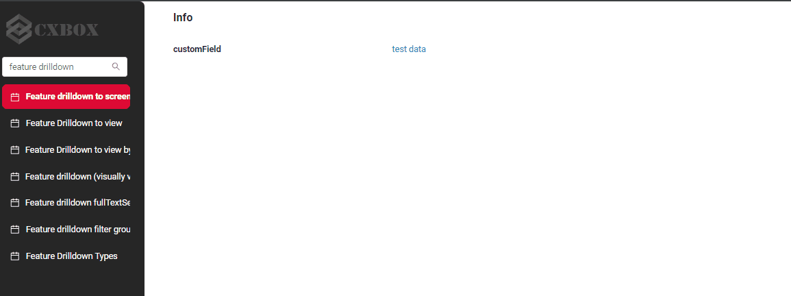
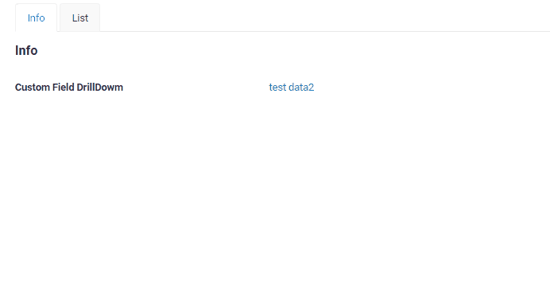
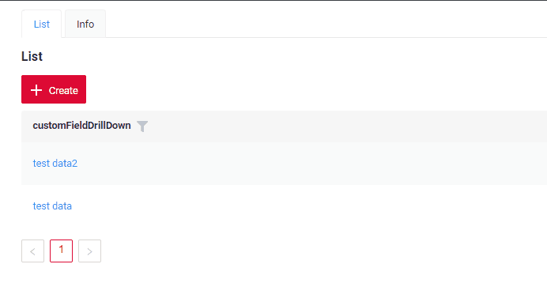
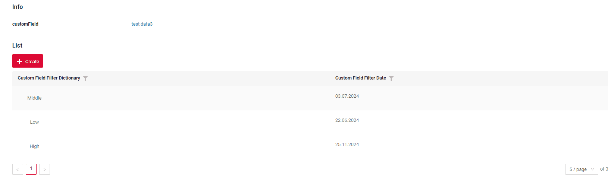
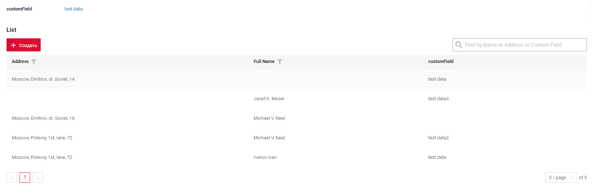
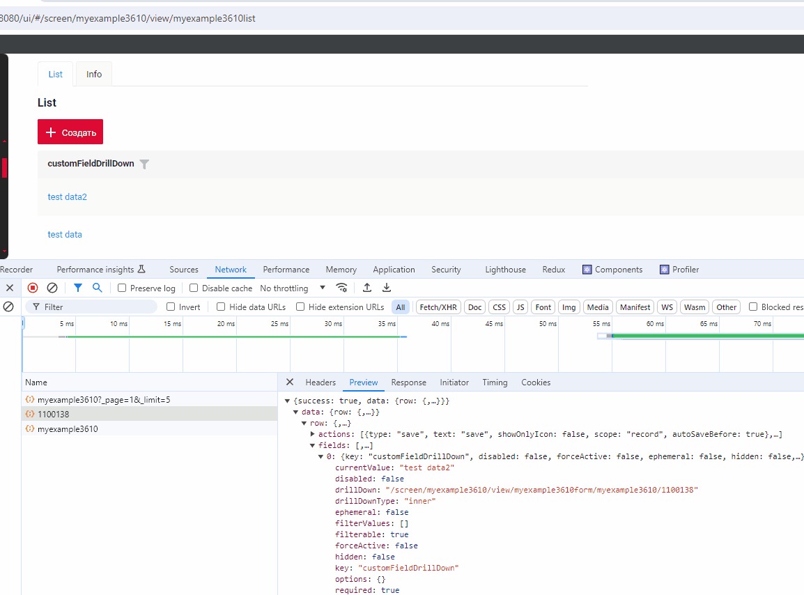
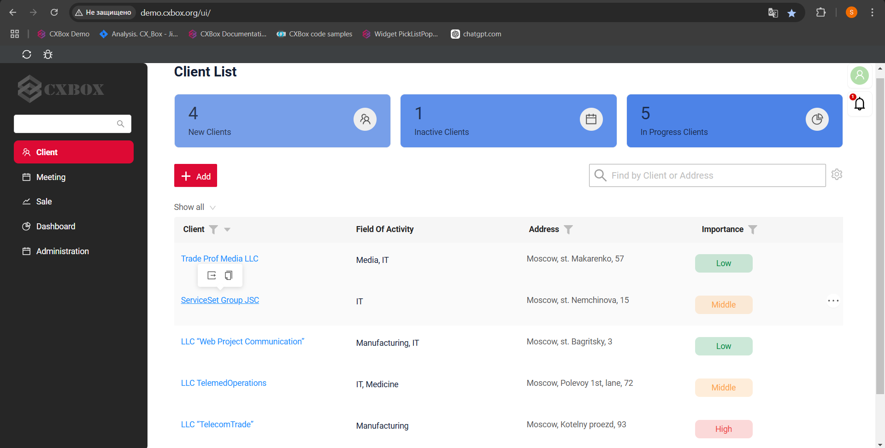
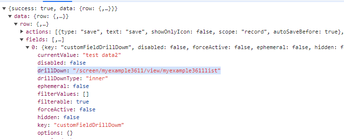
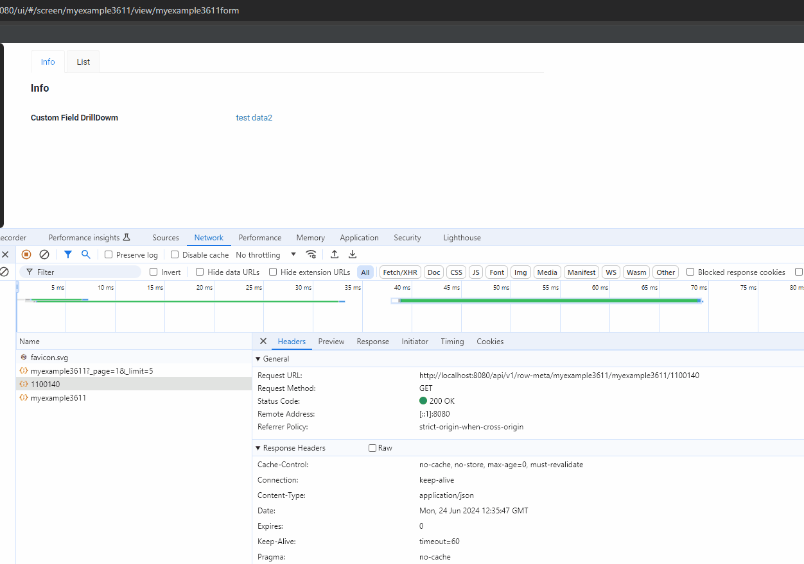

# DrillDown
`DrillDown link` is an element that lets the user navigate to another view by tapping it.

DrillDown functionality is used when we need to navigate from one place to another.

The following transition formats are possible:
 
* [To screen](#to_screen) to a screen without focusing on specific data
* [To view without id](#to_view) to a view without focusing on specific data
* [To view by bc record id](#to_view_id).The most popular option.Transition to viewing by transmitting the ID record.
* [To view with fields filtration](#to_view_with_fields_filtration) Apply a filter using additional fields (visually visible).

To open a `drilldown` in a new browser tab or copy its link, see [Drilldown tooltip](#drilldown_tooltip).
 
## <a id="Transitionformats">Transition formats</a>
### <a id="to_screen">To screen</a>
[:material-play-circle: Live Sample]({{ external_links.code_samples }}/ui/#/screen/myexample3619){:target="_blank"}
[:fontawesome-brands-github: GitHub]({{ external_links.github_ui }}/{{ external_links.github_branch }}/src/main/java/org/demo/documentation/feature/drilldown/byscreen){:target="_blank"}

Simple transition to a screen without focusing on specific data.

The link is formulated as follows:  `/screen/nameScreen`

Example request: `/screen/myexample3610`

##### How does it look?


##### How to add?

??? Example

    The availability of this function depends on the type. See more [field types](/widget/fields/fieldtypes/)

    `Step1`  Add **fields.setDrilldown** to corresponding **FieldMetaBuilder**.

    `field` - field with drilldown
    
    `drillDownType` - [DrillDown Types](/features/element/drilldown/drilldowntype)
    
    `drillDown` - link

    ```java
    --8<--
    {{ external_links.github_raw_doc }}/feature/drilldown/byscreen/MyExample3619Meta.java:buildRowDependentMeta
    --8<--
    ```

    `Step2`  Add **drillDown** to corresponding **.widget.json**.
    ```json
    --8<--
    {{ external_links.github_raw_doc }}/feature/drilldown/byscreen/myexample3619info.widget.json
    --8<--
    ```


### <a id="to_view">To view</a>
#### <a id="to_view_without_id">To view without id</a>
[:material-play-circle: Live Sample]({{ external_links.code_samples }}/ui/#/screen/myexample3611){:target="_blank"}
[:fontawesome-brands-github: GitHub]({{ external_links.github_ui }}/{{ external_links.github_branch }}/src/main/java/org/demo/documentation/feature/drilldown/simple){:target="_blank"}

Simple transition to a view without focusing on specific data.

The link is formulated as follows:  `/screen/nameScreen/view/nameView`

Example request: `/screen/myexample3611/view/myexample3611list`

##### How does it look?


##### How to add?

??? Example
    The availability of this function depends on the type. See more [field types](/widget/fields/fieldtypes/)

    `Step1`  Add **fields.setDrilldown** to corresponding **FieldMetaBuilder**.

    `field` - field with drilldown
    
    `drillDownType` - [DrillDown Types](/features/element/drilldown/drilldowntype)
    
    `drillDown` - link

    ```java
    --8<--
    {{ external_links.github_raw_doc }}/feature/drilldown/simple/MyExample3611Meta.java:buildRowDependentMeta
    --8<--
    ```

    `Step2`  Add **drillDown** to corresponding **.widget.json**.
    ```json
    --8<--
    {{ external_links.github_raw_doc }}/feature/drilldown/simple/myexample3611form.widget.json
    --8<--
    ```

 
#### <a id="to_view_id">To view by bc record id</a>
[:material-play-circle: Live Sample]({{ external_links.code_samples }}/ui/#/screen/myexample3610){:target="_blank"}
[:fontawesome-brands-github: GitHub]({{ external_links.github_ui }}/{{ external_links.github_branch }}/src/main/java/org/demo/documentation/feature/drilldown/drilldownviewid){:target="_blank"}

The most popular option.Transition to viewing by transmitting the ID record.
Retrieve data on this entity and all its dependent entities without filtering.

The link is formulated as follows: `/screen/nameScreen/view/nameView/bc/id`

Example request: `screen/myexample3610/view/myexample3610form/myexample3610/1100178`

##### How does it look?


##### How to add?
??? Example

    `Step1`  Add **fields.setDrilldown** to corresponding **FieldMetaBuilder**.

    `field` - field with drilldown
    
    `drillDownType` - [DrillDown Types](/features/element/drilldown/drilldowntype)
    
    `drillDown` - link

    ```java
    --8<--
    {{ external_links.github_raw_doc }}/feature/drilldown/drilldownviewid/MyExample3610Meta.java:buildRowDependentMeta
    --8<--
    ```

    `Step2`  Add **drillDown** to corresponding **.widget.json**.
    ```json
    --8<--
    {{ external_links.github_raw_doc }}/feature/drilldown/drilldownviewid/myexample3610list.widget.json
    --8<--
    ```
 
### <a id="to_view_with_fields_filtration">To view with fields filtration</a>
#### By fields (visually visible)
[see more about filtration](/widget/type/property/filtration/filtration)

[:material-play-circle: Live Sample]({{ external_links.code_samples }}/ui/#/screen/myexample3612){:target="_blank"}
[:fontawesome-brands-github: GitHub]({{ external_links.github_ui }}/{{ external_links.github_branch }}/src/main/java/org/demo/documentation/feature/drilldown/advancedonebcfilter){:target="_blank"}

The link is formulated as follows: `/screen/nameScreen/view/nameView/bc?+SearchSpec`

Example request: `screen/myexample3610/view/myexample3610form/myexample3610/11001782?_page=1&_limit=5&customFieldFilterDictionary.equalsOneOf=%5B%22Low%22%2C%22Middle%22%5D`

##### How does it look?

 
##### How to add?
??? Example

    !!! tips
        To write this drilldown, follow these steps:
        
        * Add a filter function for fields that require filtering.
        * Visually fill in the necessary filters in the interface.
        * Open the developer panel.
        * Locate the required request.
        * Use this query to substitute in your code to get a reference  

    The link consists of two parts:
    ```java
    --8<--
    {{ external_links.github_raw_doc }}/feature/drilldown/advancedonebcfilter/MyExample3612Meta.java:url
    --8<--
    ```
    
    `Step 1`  Create a link to the required widget. 
    The link is formulated as follows:  `/screen/nameScreen/view/nameView/nameBC`    
    
    ```java
    --8<--
    {{ external_links.github_raw_doc }}/feature/drilldown/advancedonebcfilter/MyExample3612Meta.java:urlBC
    --8<--
    ```
    `Step 2`  Create a link with filter.
    
    ```java
    --8<--
    {{ external_links.github_raw_doc }}/feature/drilldown/advancedonebcfilter/MyExample3612Meta.java:urlFilter
    --8<--
    ```
    `Step 3`  Create a link for drilldown.
    
    ```java
    --8<--
    {{ external_links.github_raw_doc }}/feature/drilldown/advancedonebcfilter/MyExample3612Meta.java:url
    --8<--
    ```


#### By fulltextsearch
[see more about FullTextSearch](/widget/type/property/filtration/filtration/#by_fulltextsearch)

[:material-play-circle: Live Sample]({{ external_links.code_samples }}/ui/#/screen/myexample3615){:target="_blank"}
[:fontawesome-brands-github: GitHub]({{ external_links.github_ui }}/{{ external_links.github_branch }}/src/main/java/org/demo/documentation/feature/drilldown/advancedfulltextsearchfilter){:target="_blank"}


When the user enters a search query in the full-text search input area, the widget filters and displays strings that match the search criteria.

The link is formulated as follows: `/screen/nameScreen/view/nameView/bc+SearchSpec`

Example request: `screen/myexample3610/view/myexample3610form/myexample3610/1100178?_page=1&_limit=5&_fullTextSearch=Moscow%2C+Dmitrov`
 
##### How does it look?

 
##### How to add?
??? Example

    !!! tips
        To write this drilldown, follow these steps:
    
        * Add a filter function for fields that require filtering.
        * Visually fill in the necessary filters in the interface.
        * Open the developer panel.
        * Locate the required request.
        * Use this query to substitute in your code to get a reference  
    
    The link consists of two parts:
    ```java
    --8<--
    {{ external_links.github_raw_doc }}/feature/drilldown/advancedfulltextsearchfilter/MyExample3615Meta.java:url
    --8<--
    ```
    
    `Step 1`  Create a link to the required widget. 
    The link is formulated as follows:  `/screen/nameScreen/view/nameView/nameBC`    
    
    ```java
    --8<--
    {{ external_links.github_raw_doc }}/feature/drilldown/advancedfulltextsearchfilter/MyExample3615Meta.java:urlBC
    --8<--
    ```
    `Step 2`  Create a link with filter.
    
    ```java
    --8<--
    {{ external_links.github_raw_doc }}/feature/drilldown/advancedfulltextsearchfilter/MyExample3615Meta.java:urlFilter
    --8<--
    ```
    `Step 3`  Create a link for drilldown.
    
    ```java
    --8<--
    {{ external_links.github_raw_doc }}/feature/drilldown/advancedfulltextsearchfilter/MyExample3615Meta.java:url
    --8<--
    ```

#### By filter group
_not applicable_
<!-- 

#### by personal filter group
### <a id=" AdvanceddrillDownmMultiBC"> Advanced drillDown multi bc</a>
[:material-play-circle: Live Sample]({{ external_links.code_samples }}/ui/#/screen/myexample3612){:target="_blank"}
[:fontawesome-brands-github: GitHub]({{ external_links.github_ui }}/{{ external_links.github_branch }}/src/main/java/org/demo/documentation/feature/drilldown/advancedonebcfilter){:target="_blank"}

The link is formulated as follows: `/screen/nameScreen/view/nameView/bc1/id1/bc2/id2`

Example request: `screen/myexample3610/view/myexample3610form/myexample3610/1100/myexample3611/1101`

#### How does it look?


#### How to add?
??? Example
    The link consists of two parts:
    ```java
    --8<--
    {{ external_links.github_raw_doc }}/feature/drilldown/advancedonebcfilter/MyExample3612Meta.java:url
    --8<--
    ```

    `Step 1`  Create a link to the required widget. 
    The link is formulated as follows:  `/screen/nameScreen/view/nameView/nameBC`    
    
    ```java
    --8<--
    {{ external_links.github_raw_doc }}/feature/drilldown/advancedonebcfilter/MyExample3612Meta.java:urlBC
    --8<--
    ```
    `Step 2`  Create a link with filter.
 
    ```java
    --8<--
    {{ external_links.github_raw_doc }}/feature/drilldown/advancedonebcfilter/MyExample3612Meta.java:urlFilter
    --8<--
    ```

<!-- 

3.2) передать фильтра по доп полям (визуально видимый) сразу на несколько сущностей


4) "совсем странные случаи"
   4.1) ?filters по родители и ребенку
   по идее должно работать для parentChild, но визуально это таблица под таблицей (иначе нет смысла накидывать фильтры), что бывает редко

4.2) по родителю по id, а по ребенку filters -- ДОЛЖНО РАБОТАТЬ ПРОВЕРИТЬ!

по родителю
screen/meeting/view/meetingview/meeting/1100012

по ребенку
+ ?filters =
  
-->
## <a id="drilldown_tooltip">Drilldown tooltip: open in a new tab and copy link</a>
[:material-play-circle: Live Sample]({{ external_links.code_samples }}/ui/#/screen/myexample3626){:target="_blank"}
[:fontawesome-brands-github: GitHub]({{ external_links.github_ui }}/{{ external_links.github_branch }}/src/main/java/org/demo/documentation/feature/drilldown/drilldowntooltip){:target="_blank"}

The browser context menu item "Open link in new tab" does not work for `drilldown` fields:
the link is not present in the HTML, it is built by the frontend only after the record is selected and the `drilldown` is clicked.

To open a `drilldown` in a new tab, a tooltip can be turned on. It appears when the user hovers over a field with `drilldown` and has two buttons:

* :material-export: **Open link in new tab** - opens the `drilldown` in a new browser tab, regardless of the [drilldown type](/features/element/drilldown/drilldowntype).
* :material-content-copy: **Copy link address** - copies the `drilldown` link to the clipboard.

The link is built the same way as when the user selects the record and clicks the `drilldown`. No additional requests to the backend are made.

### How does it look?
=== "drill-down-tooltip: newAndCopy"
    
=== "drill-down-tooltip is not set"
    

### Setting
The tooltip is turned on in `application.yml` with the `cxbox.ui.drill-down-tooltip` parameter.
The frontend receives it in the `featureSettings` of the `/api/v1/login` response with the key `drillDownTooltip`
(the same way as the sorting and filtration settings).

| `drill-down-tooltip` value | Behavior                                                                                    |
|----------------------------|---------------------------------------------------------------------------------------------|
| *not set* / `null`         | Default. The tooltip is never shown.                                                        |
| `false`                    | The tooltip is never shown.                                                                 |
| `newAndCopy`               | The tooltip with the **Open link in new tab** and **Copy link address** buttons is shown on hover.     |

### How to add?
??? Example

    **Step 1** Add the `drill-down-tooltip` parameter to `application.yml`

    ```yml
    cxbox:
      ui:
        drill-down-tooltip: newAndCopy
    ```

    **Step 2** Pass the parameter to the frontend in `featureSettings` (`LoginServiceImpl`)

    ```java
    public Collection<SimpleDictionary> getFeatureSettings() {
        return Stream.of(
                feature(
                        UIProperties.DRILL_DOWN_TOOLTIP_NAME,
                        uiProperties.getDrillDownTooltip()
                )
                // other feature settings
        )...
    }
    ```

    **Step 3** Add **fields.setDrilldown** to corresponding **FieldMetaBuilder** and **drillDown** to corresponding **.widget.json** as usual.
    Nothing else is needed for a field: the tooltip is shown for every field with `drilldown`.

    ```java
    --8<--
    {{ external_links.github_raw_doc }}/feature/drilldown/drilldowntooltip/MyExample3626Meta.java:buildRowDependentMeta
    --8<--
    ```

    ```json
    --8<--
    {{ external_links.github_raw_doc }}/feature/drilldown/drilldowntooltip/myexample3626list.widget.json
    --8<--
    ```

### Supported widgets
The tooltip is supported for:

* [List](/widget/type/list/list/) and [AdditionalList](/widget/type/additionallist/additionallist/)
* [Info](/widget/type/info/info/) and [AdditionalInfo](/widget/type/additionalinfo/additionalinfo/)
* [Form](/widget/type/form/form/)
* notifications with links: in the popup and in the notification bell

### Limitations

* [StatsBlock](/widget/type/statblocks/statblocks/) widget: the tooltip is not shown.
* `drilldown` [to view with fields filtration](#to_view_with_fields_filtration) (by fields and by fulltextsearch):
  the tooltip is shown, but its buttons do not open or copy the link.
  A warning is shown in the corner of the screen instead:
  *"Opening drill-downs with non-ID-based filtering in a new tab is currently not supported. Please contact your administrator"*.
  See the `Drill-down with fields filtration` field in the sample.

## The operation mechanism of drilldown
The operation mechanism of drilldown works as follows:

* REST.Backend. A link is generated within this property and sent to the frontend as metadata  `../api/v1/row-meta/..`

  

* REST.Frontend. The front end then generates a GET \data request with parameters based on specific rules. See more [Transition formats](#Transitionformats)

  

  
 