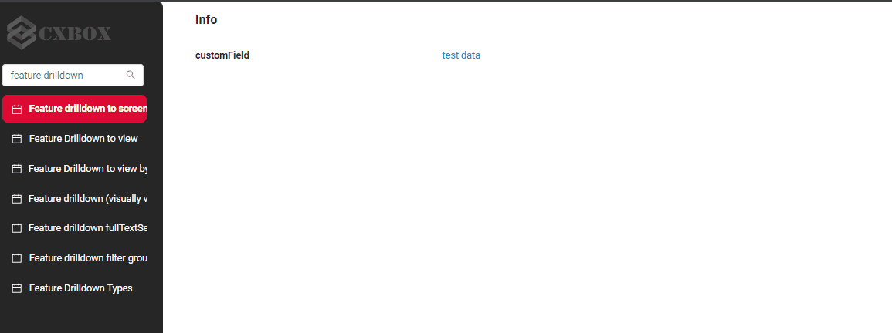
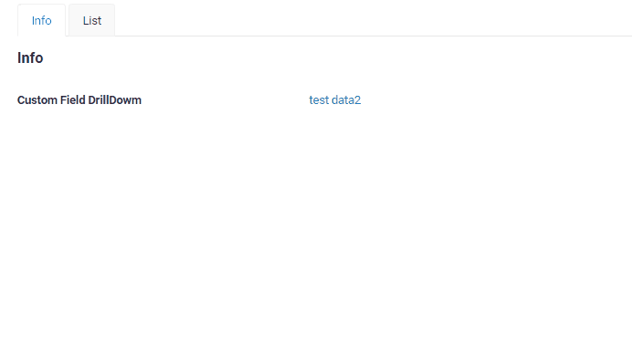
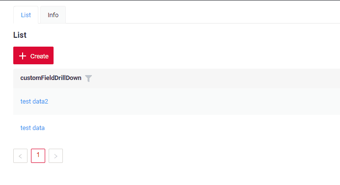
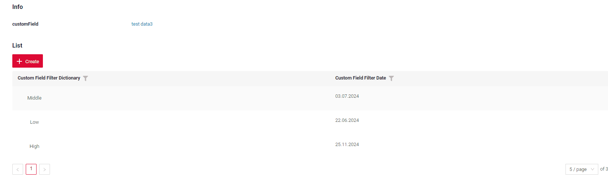
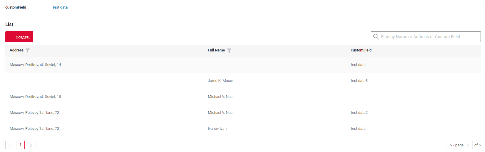
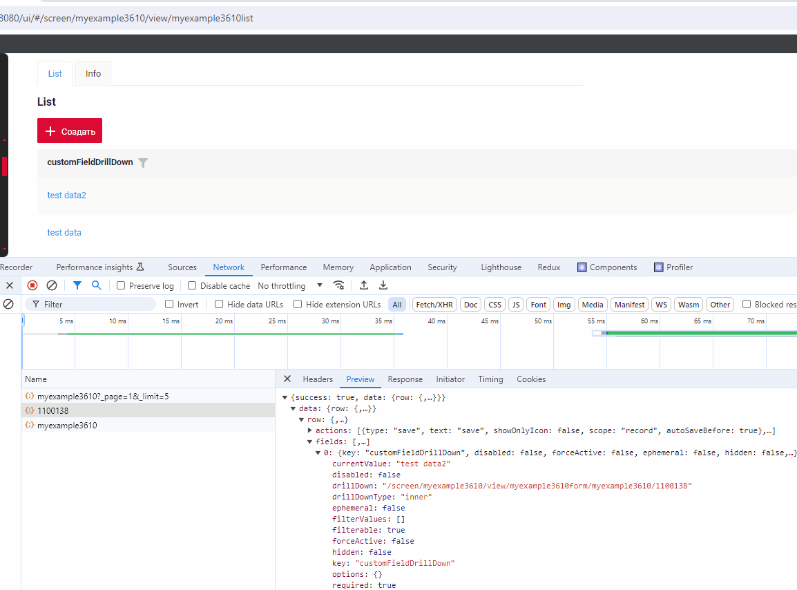
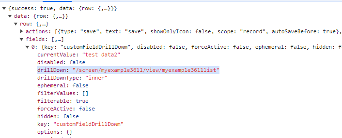
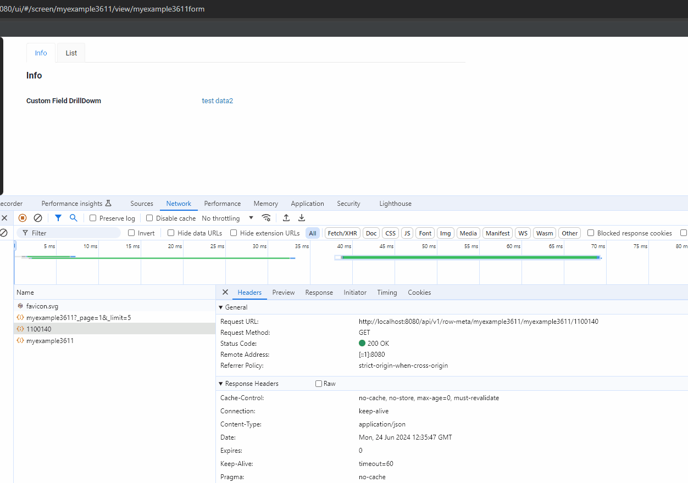

# DrillDown
`DrillDown link` — элемент, который позволяет пользователю перейти в другое представление, нажав на него.

Функциональность DrillDown используется, когда нужно перейти из одного места в другое.

Возможны следующие форматы перехода:
 
* [На экран](#to_screen) — на экран без фокуса на конкретных данных
* [В view без id](#to_view) — в представление без фокуса на конкретных данных
* [В view по id записи bc](#to_view_id). Самый популярный вариант. Переход к просмотру с передачей ID записи.
* [В view с фильтрацией по полям](#to_view_with_fields_filtration) — применение фильтра по дополнительным полям (видимым в интерфейсе).
 
## <a id="Transitionformats">Форматы перехода</a>
### <a id="to_screen">На экран</a>
[:material-play-circle: Живой пример]({{ external_links.code_samples }}/ui/#/screen/myexample3619){:target="_blank"}
[:fontawesome-brands-github: GitHub]({{ external_links.github_ui }}/{{ external_links.github_branch }}/src/main/java/org/demo/documentation/feature/drilldown/byscreen){:target="_blank"}

Простой переход на экран без фокуса на конкретных данных.

Ссылка формируется так:  `/screen/nameScreen`

Пример запроса: `/screen/myexample3610`

##### Как это выглядит? { #how-does-it-look }


##### Как добавить? { #how-to-add }

??? Example "Пример"

    Доступность этой функции зависит от типа поля. Подробнее см. [типы полей](/ru/widget/fields/fieldtypes/)

    `Шаг 1`  Добавьте **fields.setDrilldown** в соответствующий **FieldMetaBuilder**.

    `field` — поле с drilldown
    
    `drillDownType` — [типы DrillDown](/ru/features/element/drilldown/drilldowntype)
    
    `drillDown` — ссылка

    ```java
    --8<--
    {{ external_links.github_raw_doc }}/feature/drilldown/byscreen/MyExample3619Meta.java:buildRowDependentMeta
    --8<--
    ```

    `Шаг 2`  Добавьте **drillDown** в соответствующий **.widget.json**.
    ```json
    --8<--
    {{ external_links.github_raw_doc }}/feature/drilldown/byscreen/MyExample3619Info.widget.json
    --8<--
    ```


### <a id="to_view">В view</a>
#### <a id="to_view_without_id">В view без id</a>
[:material-play-circle: Живой пример]({{ external_links.code_samples }}/ui/#/screen/myexample3611){:target="_blank"}
[:fontawesome-brands-github: GitHub]({{ external_links.github_ui }}/{{ external_links.github_branch }}/src/main/java/org/demo/documentation/feature/drilldown/simple){:target="_blank"}

Простой переход в представление без фокуса на конкретных данных.

Ссылка формируется так:  `/screen/nameScreen/view/nameView`

Пример запроса: `/screen/myexample3611/view/myexample3611list`

##### Как это выглядит? { #how-does-it-look_1 }


##### Как добавить? { #how-to-add_1 }

??? Example "Пример"
    Доступность этой функции зависит от типа поля. Подробнее см. [типы полей](/ru/widget/fields/fieldtypes/)

    `Шаг 1`  Добавьте **fields.setDrilldown** в соответствующий **FieldMetaBuilder**.

    `field` — поле с drilldown
    
    `drillDownType` — [типы DrillDown](/ru/features/element/drilldown/drilldowntype)
    
    `drillDown` — ссылка

    ```java
    --8<--
    {{ external_links.github_raw_doc }}/feature/drilldown/simple/MyExample3611Meta.java:buildRowDependentMeta
    --8<--
    ```

    `Шаг 2`  Добавьте **drillDown** в соответствующий **.widget.json**.
    ```json
    --8<--
    {{ external_links.github_raw_doc }}/feature/drilldown/simple/MyExample3611Form.widget.json
    --8<--
    ```

 
#### <a id="to_view_id">В view по id записи bc</a>
[:material-play-circle: Живой пример]({{ external_links.code_samples }}/ui/#/screen/myexample3610){:target="_blank"}
[:fontawesome-brands-github: GitHub]({{ external_links.github_ui }}/{{ external_links.github_branch }}/src/main/java/org/demo/documentation/feature/drilldown/drilldownviewid){:target="_blank"}

Самый популярный вариант. Переход к просмотру с передачей ID записи.
Получение данных этой сущности и всех зависимых от неё сущностей без фильтрации.

Ссылка формируется так: `/screen/nameScreen/view/nameView/bc/id`

Пример запроса: `screen/myexample3610/view/myexample3610form/myexample3610/1100178`

##### Как это выглядит? { #how-does-it-look_2 }


##### Как добавить? { #how-to-add_2 }
??? Example "Пример"

    `Шаг 1`  Добавьте **fields.setDrilldown** в соответствующий **FieldMetaBuilder**.

    `field` — поле с drilldown
    
    `drillDownType` — [типы DrillDown](/ru/features/element/drilldown/drilldowntype)
    
    `drillDown` — ссылка

    ```java
    --8<--
    {{ external_links.github_raw_doc }}/feature/drilldown/drilldownviewid/MyExample3610Meta.java:buildRowDependentMeta
    --8<--
    ```

    `Шаг 2`  Добавьте **drillDown** в соответствующий **.widget.json**.
    ```json
    --8<--
    {{ external_links.github_raw_doc }}/feature/drilldown/drilldownviewid/MyExample3610List.widget.json
    --8<--
    ```
 
### <a id="to_view_with_fields_filtration">В view с фильтрацией по полям</a>
#### По полям (видимым в интерфейсе) { #by-fields-visually-visible }
[подробнее о фильтрации](/ru/widget/type/property/filtration/filtration)

[:material-play-circle: Живой пример]({{ external_links.code_samples }}/ui/#/screen/myexample3612){:target="_blank"}
[:fontawesome-brands-github: GitHub]({{ external_links.github_ui }}/{{ external_links.github_branch }}/src/main/java/org/demo/documentation/feature/drilldown/advancedonebcfilter){:target="_blank"}

Ссылка формируется так: `/screen/nameScreen/view/nameView/bc?+SearchSpec`

Пример запроса: `screen/myexample3610/view/myexample3610form/myexample3610/11001782?_page=1&_limit=5&customFieldFilterDictionary.equalsOneOf=%5B%22Low%22%2C%22Middle%22%5D`

##### Как это выглядит? { #how-does-it-look_3 }

 
##### Как добавить? { #how-to-add_3 }
??? Example "Пример"

    !!! tips "Совет"
        Чтобы написать такой drilldown, выполните следующие шаги:
        
        * Добавьте функцию фильтрации для полей, которые нужно фильтровать.
        * Заполните нужные фильтры в интерфейсе.
        * Откройте панель разработчика.
        * Найдите нужный запрос.
        * Подставьте этот запрос в свой код, чтобы получить ссылку

    Ссылка состоит из двух частей:
    ```java
    --8<--
    {{ external_links.github_raw_doc }}/feature/drilldown/advancedonebcfilter/MyExample3612Meta.java:url
    --8<--
    ```
    
    `Шаг 1`  Создайте ссылку на нужный виджет.
    Ссылка формируется так:  `/screen/nameScreen/view/nameView/nameBC`
    
    ```java
    --8<--
    {{ external_links.github_raw_doc }}/feature/drilldown/advancedonebcfilter/MyExample3612Meta.java:urlBC
    --8<--
    ```
    `Шаг 2`  Создайте ссылку с фильтром.
    
    ```java
    --8<--
    {{ external_links.github_raw_doc }}/feature/drilldown/advancedonebcfilter/MyExample3612Meta.java:urlFilter
    --8<--
    ```
    `Шаг 3`  Создайте ссылку для drilldown.
    
    ```java
    --8<--
    {{ external_links.github_raw_doc }}/feature/drilldown/advancedonebcfilter/MyExample3612Meta.java:url
    --8<--
    ```


#### По полнотекстовому поиску { #by-fulltextsearch }
[подробнее о FullTextSearch](/ru/widget/type/property/filtration/filtration/#by_fulltextsearch)

[:material-play-circle: Живой пример]({{ external_links.code_samples }}/ui/#/screen/myexample3615){:target="_blank"}
[:fontawesome-brands-github: GitHub]({{ external_links.github_ui }}/{{ external_links.github_branch }}/src/main/java/org/demo/documentation/feature/drilldown/advancedfulltextsearchfilter){:target="_blank"}


Когда пользователь вводит запрос в поле полнотекстового поиска, виджет фильтрует и отображает строки, соответствующие критериям поиска.

Ссылка формируется так: `/screen/nameScreen/view/nameView/bc+SearchSpec`

Пример запроса: `screen/myexample3610/view/myexample3610form/myexample3610/1100178?_page=1&_limit=5&_fullTextSearch=Moscow%2C+Dmitrov`
 
##### Как это выглядит? { #how-does-it-look_4 }

 
##### Как добавить? { #how-to-add_4 }
??? Example "Пример"

    !!! tips "Совет"
        Чтобы написать такой drilldown, выполните следующие шаги:
    
        * Добавьте функцию фильтрации для полей, которые нужно фильтровать.
        * Заполните нужные фильтры в интерфейсе.
        * Откройте панель разработчика.
        * Найдите нужный запрос.
        * Подставьте этот запрос в свой код, чтобы получить ссылку
    
    Ссылка состоит из двух частей:
    ```java
    --8<--
    {{ external_links.github_raw_doc }}/feature/drilldown/advancedfulltextsearchfilter/MyExample3615Meta.java:url
    --8<--
    ```
    
    `Шаг 1`  Создайте ссылку на нужный виджет.
    Ссылка формируется так:  `/screen/nameScreen/view/nameView/nameBC`
    
    ```java
    --8<--
    {{ external_links.github_raw_doc }}/feature/drilldown/advancedfulltextsearchfilter/MyExample3615Meta.java:urlBC
    --8<--
    ```
    `Шаг 2`  Создайте ссылку с фильтром.
    
    ```java
    --8<--
    {{ external_links.github_raw_doc }}/feature/drilldown/advancedfulltextsearchfilter/MyExample3615Meta.java:urlFilter
    --8<--
    ```
    `Шаг 3`  Создайте ссылку для drilldown.
    
    ```java
    --8<--
    {{ external_links.github_raw_doc }}/feature/drilldown/advancedfulltextsearchfilter/MyExample3615Meta.java:url
    --8<--
    ```

#### По группе фильтров { #by-filter-group }
_неприменимо_
<!-- 

#### По персональной группе фильтров { #by-personal-filter-group }
### <a id=" AdvanceddrillDownmMultiBC"> Расширенный drillDown по нескольким bc</a>
[:material-play-circle: Живой пример]({{ external_links.code_samples }}/ui/#/screen/myexample3612){:target="_blank"}
[:fontawesome-brands-github: GitHub]({{ external_links.github_ui }}/{{ external_links.github_branch }}/src/main/java/org/demo/documentation/feature/drilldown/advancedonebcfilter){:target="_blank"}

Ссылка формируется так: `/screen/nameScreen/view/nameView/bc1/id1/bc2/id2`

Пример запроса: `screen/myexample3610/view/myexample3610form/myexample3610/1100/myexample3611/1101`

#### Как это выглядит? { #how-does-it-look_5 }


#### Как добавить? { #how-to-add_5 }
??? Example "Пример"
    Ссылка состоит из двух частей:
    ```java
    --8<--
    {{ external_links.github_raw_doc }}/feature/drilldown/advancedonebcfilter/MyExample3612Meta.java:url
    --8<--
    ```

    `Шаг 1`  Создайте ссылку на нужный виджет.
    Ссылка формируется так:  `/screen/nameScreen/view/nameView/nameBC`
    
    ```java
    --8<--
    {{ external_links.github_raw_doc }}/feature/drilldown/advancedonebcfilter/MyExample3612Meta.java:urlBC
    --8<--
    ```
    `Шаг 2`  Создайте ссылку с фильтром.
 
    ```java
    --8<--
    {{ external_links.github_raw_doc }}/feature/drilldown/advancedonebcfilter/MyExample3612Meta.java:urlFilter
    --8<--
    ```

<!-- 

3.2) передать фильтра по доп полям (визуально видимый) сразу на несколько сущностей


4) "совсем странные случаи"
   4.1) ?filters по родители и ребенку
   по идее должно работать для parentChild, но визуально это таблица под таблицей (иначе нет смысла накидывать фильтры), что бывает редко

4.2) по родителю по id, а по ребенку filters -- ДОЛЖНО РАБОТАТЬ ПРОВЕРИТЬ!

по родителю
screen/meeting/view/meetingview/meeting/1100012

по ребенку
+ ?filters =
  
-->
## Механизм работы drilldown { #the-operation-mechanism-of-drilldown }
Механизм работы drilldown следующий:

* REST.Backend. В этом свойстве формируется ссылка и передаётся на фронтенд в составе метаданных  `../api/v1/row-meta/..`

  

* REST.Frontend. Затем фронтенд формирует запрос GET \data с параметрами по определённым правилам. Подробнее см. [Форматы перехода](#Transitionformats)

  

  
 