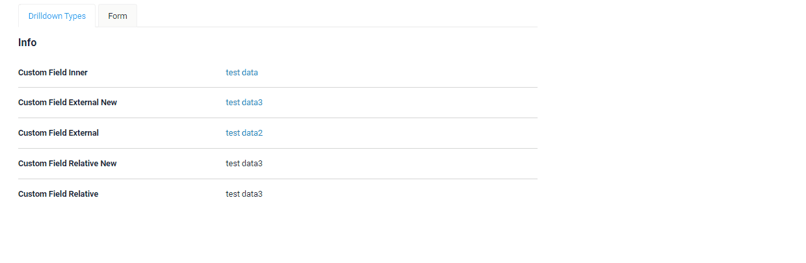
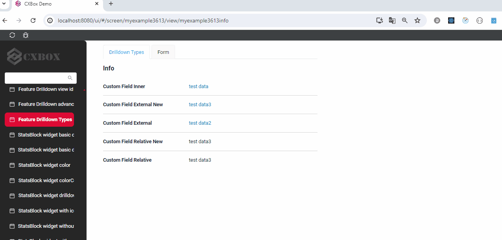
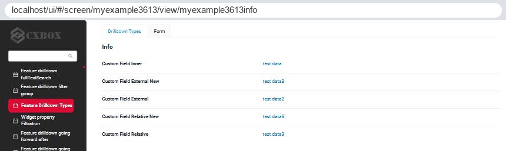
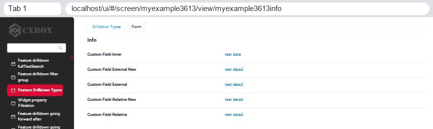

# Типы DrillDown { #drilldown-types }
[:material-play-circle: Живой пример]({{ external_links.code_samples }}/ui/#/screen/myexample3613){:target="_blank"}
[:fontawesome-brands-github: GitHub]({{ external_links.github_ui }}/{{ external_links.github_branch }}/src/main/java/org/demo/documentation/feature/drilldown/drilldowntypes){:target="_blank"}

Существует несколько типов drilldown:

* [INNER](#INNER)  Переход внутри приложения.

* [EXTERNAL](#EXTERNAL)  Переход по абсолютной ссылке на внешний ресурс. Текущая вкладка

* [EXTERNAL_NEW](#EXTERNAL_NEW)  Переход по абсолютной ссылке на внешний ресурс. Новая вкладка

* [RELATIVE](#RELATIVE) Переход по относительной ссылке с сохранением протокола, хоста, порта. Текущая вкладка

* [RELATIVE_NEW](#RELATIVE_NEW) Переход по относительной ссылке с сохранением протокола, хоста, порта. Новая вкладка
 
## <a id="INNER">INNER</a>
DrillDownType.INNER — переход внутри приложения.
### Как это выглядит? { #how-does-it-look }


### Как добавить? { #how-to-add }

??? Example "Пример"
    Доступность этой функции зависит от типа поля. Подробнее см. [типы полей](/ru/widget/fields/fieldtypes/)

    `Шаг 1` Добавьте fields.setDrilldown с типом **DrillDownType.INNER** в соответствующий **FieldMetaBuilder**.
    ```java
    --8<--
    {{ external_links.github_raw_doc }}/feature/drilldown/drilldowntypes/MyExample3613Meta.java:buildRowDependentMetaINNER
    --8<--
    ```
## <a id="EXTERNAL">EXTERNAL</a>
DrillDownType.EXTERNAL — переход по абсолютной ссылке на внешний ресурс. При нажатии ссылка откроется в той же вкладке.

### Как это выглядит? { #how-does-it-look_1 }


### Как добавить? { #how-to-add_1 }
??? Example "Пример"
    Доступность этой функции зависит от типа поля. Подробнее см. [типы полей](/ru/widget/fields/fieldtypes/)

    `Шаг 1` Добавьте fields.setDrilldown с типом **DrillDownType.EXTERNAL** в соответствующий **FieldMetaBuilder**.
    ```java
    --8<--
    {{ external_links.github_raw_doc }}/feature/drilldown/drilldowntypes/MyExample3613Meta.java:buildRowDependentMetaEXTERNAL
    --8<--
    ```
 
## <a id="EXTERNAL_NEW">EXTERNAL_NEW</a>
DrillDownType.EXTERNAL_NEW — переход по абсолютной ссылке на внешний ресурс. При нажатии ссылка откроется в новой вкладке.
### Как это выглядит? { #how-does-it-look_2 }


### Как добавить? { #how-to-add_2 }
??? Example "Пример"
    Доступность этой функции зависит от типа поля. Подробнее см. [типы полей](/ru/widget/fields/fieldtypes/)

    `Шаг 1` Добавьте fields.setDrilldown с типом **DrillDownType.EXTERNAL_NEW** в соответствующий **FieldMetaBuilder**.
    ```java
    --8<--
    {{ external_links.github_raw_doc }}/feature/drilldown/drilldowntypes/MyExample3613Meta.java:buildRowDependentMetaEXTERNAL_NEW
    --8<--
    ```

## <a id="RELATIVE">RELATIVE</a>
DrillDownType.RELATIVE — переход по относительной ссылке с сохранением протокола, хоста, порта.
### Как это выглядит? { #how-does-it-look_3 }


### Как добавить? { #how-to-add_3 }
??? Example "Пример"
    Доступность этой функции зависит от типа поля. Подробнее см. [типы полей](/ru/widget/fields/fieldtypes/)

    `Шаг 1` Добавьте fields.setDrilldown с типом **DrillDownType.RELATIVE** в соответствующий **FieldMetaBuilder**.
    ```java
    --8<--
    {{ external_links.github_raw_doc }}/feature/drilldown/drilldowntypes/MyExample3613Meta.java:buildRowDependentMetaRELATIVE
    --8<--
    ```
## <a id="RELATIVE_NEW">RELATIVE_NEW</a>
DrillDownType.RELATIVE_NEW — переход по относительной ссылке с сохранением протокола, хоста, порта. Новая вкладка

### Как это выглядит? { #how-does-it-look_4 }


### Как добавить? { #how-to-add_4 }
??? Example "Пример"
    Доступность этой функции зависит от типа поля. Подробнее см. [типы полей](/ru/widget/fields/fieldtypes/)

    `Шаг 1` Добавьте fields.setDrilldown с типом **DrillDownType.RELATIVE_NEW** в соответствующий **FieldMetaBuilder**.
    ```java
    --8<--
    {{ external_links.github_raw_doc }}/feature/drilldown/drilldowntypes/MyExample3613Meta.java:buildRowDependentMetaRELATIVE_NEW
    --8<--
    ```
