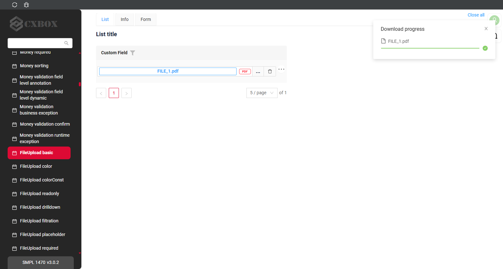

# FileStorage

**FileStorage** is a mechanism that allows the system to upload, store, retrieve, and manage files.

Business Examples:

* users upload documents or images into the system;
* the application generates files (reports, exports, templates);
* external systems send files that must be stored;
* workflow steps require attaching or retrieving documents;
* files need to be stored in different storages depending on business rules.

You can provide a source parameter during upload, which lets your business processes decide dynamically where a file should be stored storages depending on workflow rules.

This flexibility enables you to configure storage strategies that align with your domain logic without changing the user-facing behavior.

## <a id="download_retry">Download and open of a file: one automatic retry</a>
Available since [v3.0.2](/new/version3002/)

Sometimes the download or the opening of a file ended with `502 Bad Gateway`, although the file was in place and the second attempt worked (the reason is a known bug of Spring Security, [spring-security #15510](https://github.com/spring-projects/spring-security/issues/15510)).

Now the application repeats the file request once by itself if the first attempt ends with a network error or with `502`, `503` or `504`. The user gets the file and does not see the error. If the second attempt fails too, the error is shown: for a download in the line of the file in the [Download progress](#download_progress) window, for the opening of a file as before.

* Only requests to the file controller of the application are repeated; other requests are not affected.
* The retry is written to the browser console as a warning (`[file retry]`), so the support team can see it.

See also [errors of a file upload](/widget/type/property/multiupload/multiupload/#upload_errors).

## <a id="download_progress">Download progress</a>
Available since [v3.0.2](/new/version3002/)

When the user downloads a file, the **Download progress** window opens at once, in the top right corner. The user sees that the download has started and does not click the file again and again.



It is the same window as the [Upload progress](/widget/type/property/multiupload/multiupload/) window of an upload, with a download arrow:

* each file gets its own line, several downloads are shown together;
* the line fills up as the file comes; after a [retry](#download_retry) it starts again;
* green - the file is downloaded and saved by the browser; the line disappears in 5 seconds, while the mouse is over the window it stays;
* red - the file is not downloaded. The tooltip of the line shows the reason received from the server, as for an [upload error](/widget/type/property/multiupload/multiupload/#upload_errors). There is no error popup, and a `postAction` of a `BusinessException` is not run, as for an upload. Only `401` and `403` open the window of the lost session, as for any request.

The window works for every download of the application:

* a file of a [fileUpload](/widget/fields/field/fileUpload/fileUpload/) field (List, Form, Info, comparison of versions);
* the Download button of a file preview;
* an action that gives a file: `PostAction.downloadFile`, `PostAction.downloadFileByUrl`. While the server prepares the file, the button of the action spins; the window opens when the server answers.

Closing the window does not stop the download. A page reload stops it.

!!! info
    The file controller gives files only with the token of the user. So the application downloads the file itself and passes the ready file to the browser. The download panel of the browser shows the file only at the end; the **Download progress** window shows the whole way.

## How to add?
(since [release 2.0.9](https://doc.cxbox.org/new/version209/))

### extends AbstractCxboxFileController

`AbstractCxboxFileController` is a base controller that provides REST endpoints for uploading, downloading, and deleting files.
It delegates all file-handling operations to `CxboxFileService`.

This class implements `CxboxFileController` and should be extended by concrete controllers rather than used directly.

Extend this abstract class and annotate the subclass with @RestController and a request mapping:

```java 
@RestController
@RequestMapping("/api/files")
public class MyFileController extends AbstractCxboxFileController {
}
```
 

### implements CxboxFileService

`CxboxFileService` is an abstraction for file handling.
The service provides a unified interface for uploading, downloading, and deleting files, regardless of where the files are physically stored.

All operations work with a unique file identifier returned during upload.
Purpose of the Interface `CxboxFileService` acts as an extension point. Concrete implementations determine, where and how files are physically stored, how unique file IDs are generated,
which storage strategy is used.

This allows switching the storage backend without modifying the application's business logic.

Methods:

* `upload` - Uploads a file to the storage and returns a unique file identifier.
* `download` - Retrieves a file by its unique ID and returns it as a streaming response.
* `remove` - Deletes a previously uploaded file using its unique identifier.

!!! info
    If your business processes require uploading files to different storage locations, you can separate this logic by passing a `source` parameter.
    Based on this parameter, the system can decide which storage backend to use.

   
### Examples

* [minio](/features/element/filestorage/minio)
