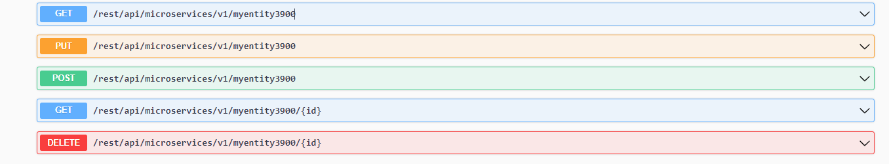
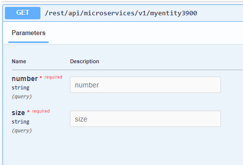
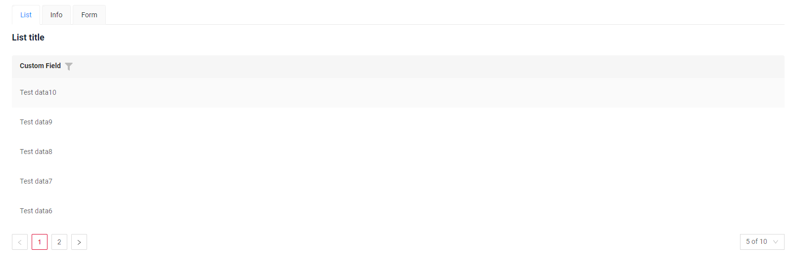

# Подключение существующих микросервисов { #connecting-an-existing-microservices }
В этом примере рассматривается сценарий, когда нужно интегрироваться с существующим микросервисом, отвечающим за операции с данными.

## Архитектура существующего микросервиса { #architecture-existing-microservice }
Опишем входные данные, которые принимает наш микросервис:

[:fontawesome-brands-github: GitHub]({{ external_links.github_ui }}/{{ external_links.github_branch }}/src/main/java/org/demo/documentation/feature/microservice/microservicestoringdata/controller/ExistingMicroserviceStoringDataController.java){:target="_blank"}



Параметры **get** `/myentity3900`:



[swagger]({{ external_links.code_samples }}/swagger-ui/index.html#/)

Получившийся интерфейс будет выглядеть так:

[:material-play-circle: Живой пример]({{ external_links.code_samples }}/ui/#/screen/myexample3800){:target="_blank"} 




## Шаги разработки на cxbox { #steps-for-developing-on-cxbox }
Разработка простого взаимодействия с существующей архитектурой микросервиса.
### **Шаг 1** Создайте DTO для интеграции с микросервисом { #step1-create-dto-for-integrating-with-microservice }

Создайте DTO для интеграции с микросервисами, через который данные будут отправляться в микросервис

??? Example "Пример"

    ```java
    --8<--
    {{ external_links.github_raw_doc }}/feature/microservice/existingmicroservices/MyEntity3800OutServiceDTO.java
    --8<--
    ```

### **Шаг 2** Создайте **DAO** { #step-2-create-dao }

Создайте **DAO**, наследующий **AbstractAnySourceBaseDAO** и реализующий **AnySourceBaseDAO**

Переопределите методы:

* **Создание** : метод create

??? Example "Пример"
    ```java
    --8<--
        {{ external_links.github_raw_doc }}/feature/microservice/existingmicroservices/MyEntity3800Dao.java:create
    --8<--
    ```
* **Удаление**: метод delete

??? Example "Пример"
     ```java
     --8<--
     {{ external_links.github_raw_doc }}/feature/microservice/existingmicroservices/MyEntity3800Dao.java:delete
     --8<--
     ```
* **Обновление существующих записей**:  метод update

??? Example "Пример"
     ```java
     --8<--
     {{ external_links.github_raw_doc }}/feature/microservice/existingmicroservices/MyEntity3800Dao.java:update
     --8<--
     ```
* **Получение всех данных**: метод getList

    Размер страницы:

    ```java
    String page = bc.getParameters().getParameter("_page");
    ```   
     
    Лимит:
    ```java
    String limit = bc.getParameters().getParameter("_limit");
    ```
  
    Сортировка по полю CustomField:
    ```java
        List<String> sortCustomField = getSortFieldName(queryParameters, "customField");
        Optional<String> sort = sortCustomField.isEmpty() ? Optional.empty() : Optional.of(sortCustomField.get(0));
    ```    
    
    Фильтр по полю CustomField:
    ```java
     List<String> filterCustomField = getFilterFieldName(queryParameters, "customField", "contains");
     Optional<String> filter = filterCustomField.isEmpty() ? Optional.empty() : Optional.of(filterCustomField.get(0));
    ```  

??? Example "Пример"
     ```java
     --8<--
     {{ external_links.github_raw_doc }}/feature/microservice/existingmicroservices/MyEntity3800Dao.java:getList
     --8<--
     ```

* **Получение данных по ID**:  метод getByIdIgnoringFirstLevelCache

??? Example "Пример"
     ```java
     --8<--
     {{ external_links.github_raw_doc }}/feature/microservice/existingmicroservices/MyEntity3800Dao.java:getByIdIgnoringFirstLevelCache
     --8<--
     ```

### **Шаг 3** Создайте **DTO** { #step-3-create-dto }

Создайте **DTO**, наследующий **DataResponseDTO**

??? Example "Пример"
    ```java
    --8<--
    {{ external_links.github_raw_doc }}/feature/microservice/existingmicroservices/MyExample3800DTO.java
    --8<--
    ```

### **Шаг 4** Создайте **MetaBuilder** { #step4-create-metabuilder }

Создайте **MetaBuilder**, наследующий **AnySourceFieldMetaBuilder**

??? Example "Пример"
     ```java
     --8<--
     {{ external_links.github_raw_doc }}/feature/microservice/existingmicroservices/MyExample3800Meta.java
     --8<--
     ```

### **Шаг 5** Создайте **Service** { #step5-create-service }

Создайте **Service**, наследующий **AnySourceVersionAwareResponseService**

??? Example "Пример"
     ```java
     --8<--
     {{ external_links.github_raw_doc }}/feature/microservice/existingmicroservices/MyExample3800Service.java
     --8<--
     ```

### **Шаг 6** Создайте **Controller** { #step6-create-controller }

Создайте **Controller**, реализующий **EnumBcIdentifier**

??? Example "Пример"
    ```java
    --8<--
     {{ external_links.github_raw_doc }}/feature/microservice/existingmicroservices/PlatformMyExample3800Controller.java
    --8<--
    ```

### **Шаг 7** Создайте **widget.json** { #step7-create-widgetjson }

??? Example "Пример"

    ```json
    --8<--
    {{ external_links.github_raw_doc }}/feature/microservice/existingmicroservices/MyExample3800List.widget.json
    --8<--
    ```
### **Шаг 8** Создайте **view.json** { #step8-create-viewjson }

??? Example "Пример"

    ```json
    --8<--
    {{ external_links.github_raw_doc }}/feature/microservice/existingmicroservices/myexample3800list.view.json
    --8<--
    ```

### **Шаг 9** Создайте **screen.json** { #step9-create-screenjson }

??? Example "Пример"

    ```json
    --8<--
    {{ external_links.github_raw_doc }}/feature/microservice/existingmicroservices/myexample3800.screen.json
    --8<--
    ```