# Работа с DAO { #work-with-dao }

<!-- 
## Действия пользователя { #user-actions }

* [Открытие экрана](#openlistscreen)
* [CRUD-операции](#crudoperations)
* [Клик ...](#click)
* [Force Active](#forceactive)
* [открытие Assoc](#openPopup)
* [открытие Popup](#openPopup)
* [открытие Form Popup](#openformpopup)
* пагинация =  [Открытие экрана со списком](#openlistscreen) со следующей страницей
* пользовательское действие (Post api/v1/custom-action)
* обновление экрана = [Открытие экрана со списком](#openlistscreen)
* родитель-потомок
* условие отображения
-->

GET

count (только для пагинации: default, nextAndPreviousWithCount)

| Операция              | `/row-meta`      | `/row-meta-new` | `/row-meta/id` | `/data/` |`/count` |
|-----------------------|------------------|-----------------|----------------|--------------|-------------|
| Открытие экрана       | ✅ без записей | ❌             | ✅            | ✅           | ✅          |
| Создание              | ❌                | ✅             | ❌             | ❌          | ❌          |
| Сохранение            | ❌                | ❌             | ✅             | ❌          | ❌          |
| Удаление              | ✅ без записей | ❌             | ✅             | ✅          | ❌          |
| Клик ..               | ✅                | ❌             | ❌             | ❌          | ❌          |
| Открытие Assoc, Popup | ✅                | ❌             | ❌             | ✅          | ✅          |
| Открытие Form Popup   | ❌                | ❌             | ❌             | ❌          | ❌          |
| Force Active          | ❌                | ❌             | ❌             | ❌          | ❌          |

Прочее

    
| Операция              | POST  `/row-meta/id` | PUT  `/data/id` | DELETE  `/data/id` |
|-----------------------|---------------------|---------------|------------------|
| Открытие экрана       | ❌                  | ❌            | ❌            |
| Создание              | ❌                  | ❌            | ❌            |
| Сохранение            | ❌                  | ✅            | ❌            |
| Удаление              | ❌                  | ❌            | ✅            |
| Клик ..               | ❌                  | ❌            | ❌            |
| Открытие Assoc, Popup | ❌                  | ❌            | ❌            |
| Открытие Form Popup   | ✅                  | ❌            | ❌            |
| Force Active          | ✅                  | ❌            | ❌            |

### <a id="openlistscreen">Открытие экрана</a>

[:material-play-circle: Живой пример]({{ external_links.code_samples }}/ui/#/screen/myexample3800){:target="_blank"} ·

`/row-meta/id`

Для списка берётся `id` первой записи, потому что курсор на бэкенде устанавливается на первую запись и для неё доступны операции, требующие rowMeta.

`/row-meta/`

Если записей нет, метод вызывается без ID.

`/count/`

Вызывается только в режимах пагинации nextAndPreviousWithCount или Default
 

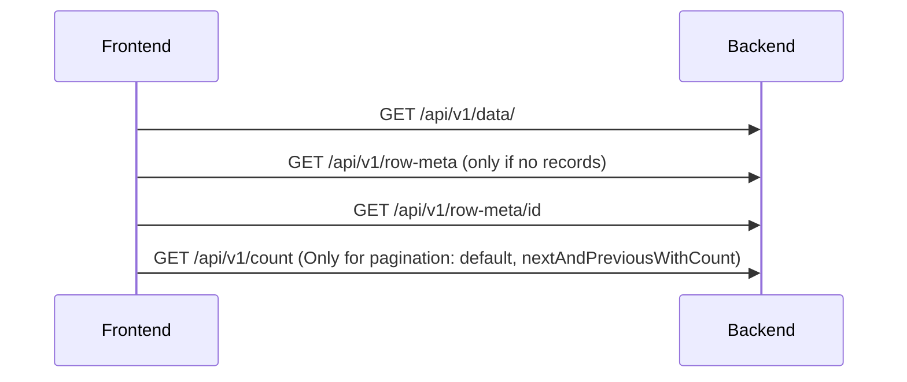

#### API -> DAO

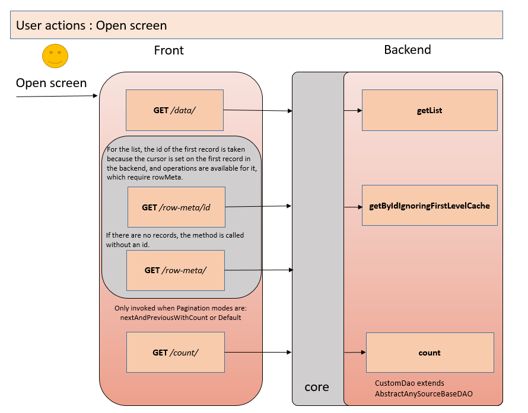

### <a id="crudoperations">CRUD-операции</a>

#### Создание { #create }
**Действия пользователя:** Create

**Процесс:**
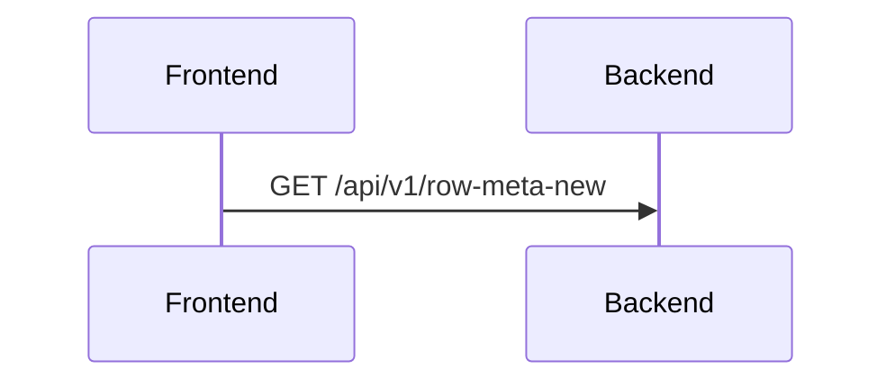

**Используемые методы:**

- `getId()` (с использованием FirstLevelCache)
- `setId()` (с использованием FirstLevelCache)

**Рекомендация:** используйте стандартный механизм CXBOX для хранения записей и вызова внешних систем.

##### API -> DAO
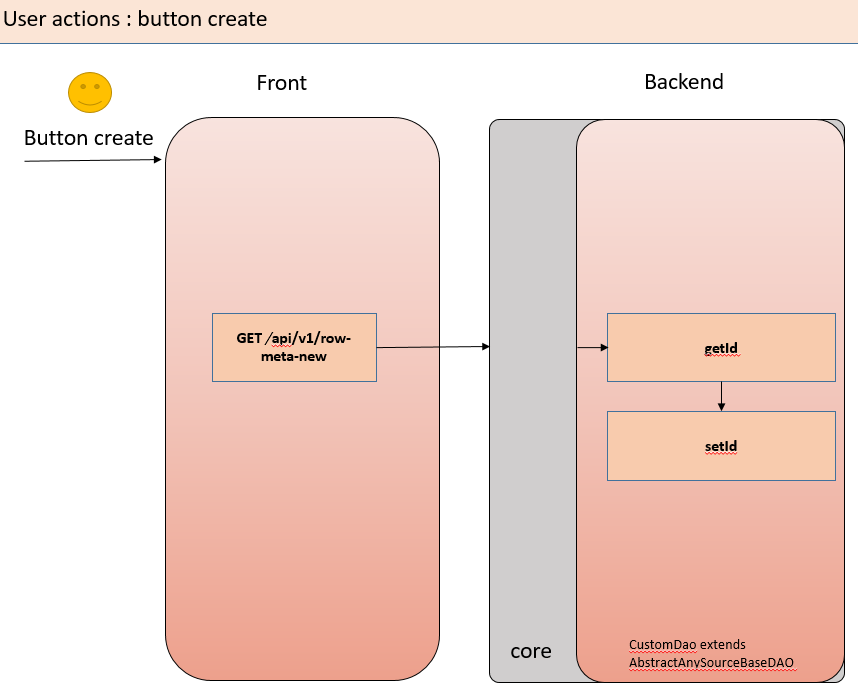

#### Сохранение (Save) { #save }
**Действия пользователя:** Save

**Процесс:**
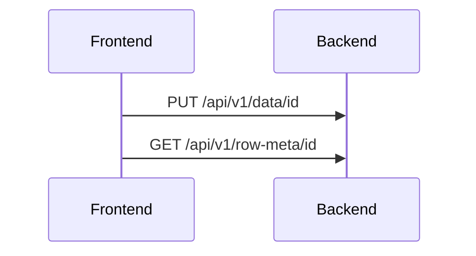

**Используемые методы:**

Frontend->>Backend: PUT /api/v1/data/id

- `getId()` (с использованием FirstLevelCache)
- `setId()` (с использованием FirstLevelCache)
- `getId()` (с использованием FirstLevelCache)
- `create()` 
- `update()` 

Frontend->>Backend: GET /api/v1/row-meta/id

- `getByIdIgnoringFirstLevelCache()`

##### API -> DAO

=== "сохранение после создания"
    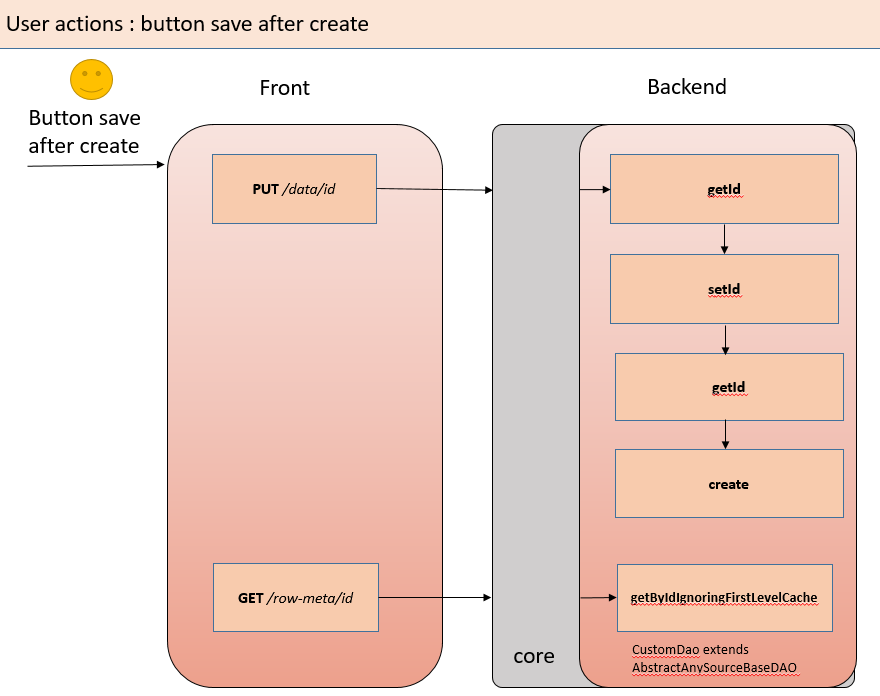
=== "сохранение"
    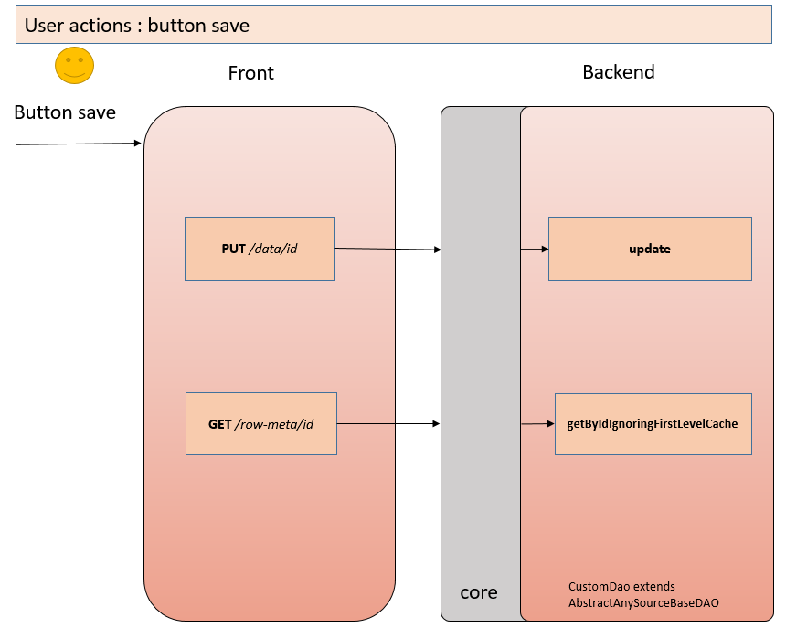

#### Удаление { #delete }

**Действия пользователя:** Delete

**Процесс:**
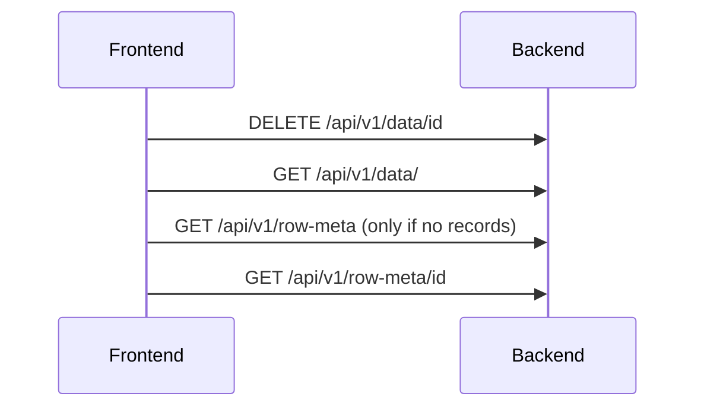

**Используемые методы:**

Frontend->>Backend: DELETE /api/v1/data/id

- `delete()`
- `getList()`
- `getByIdIgnoringFirstLevelCache()`

##### API -> DAO
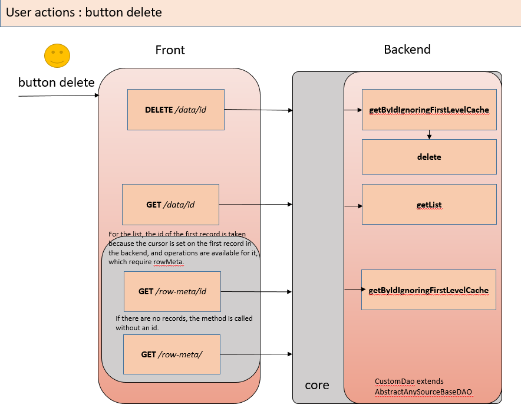

<!-- 
### <a id="click">Клик ...</a>
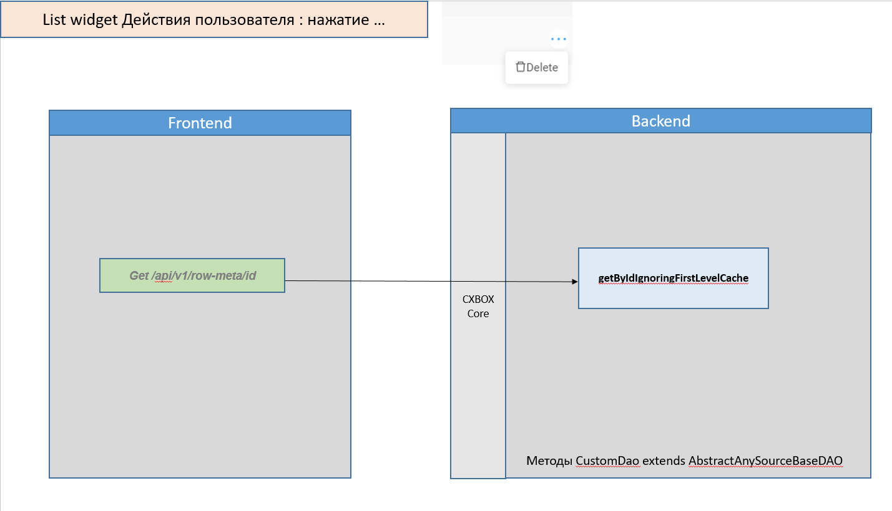

**Действия пользователя:** нажатие "…"

**Процесс:**
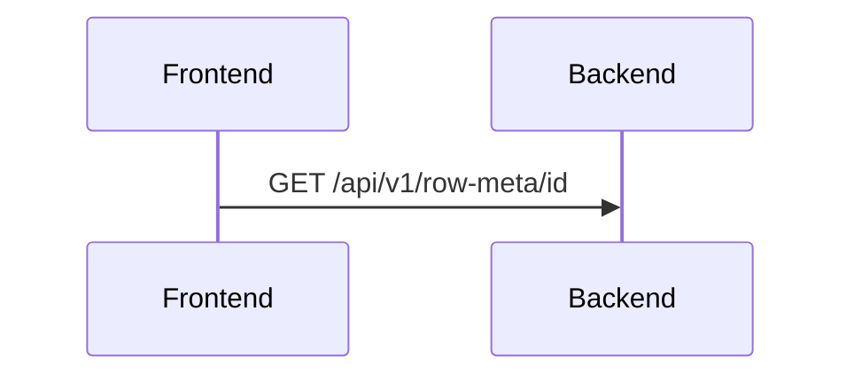

#### API -> DAO

### <a id="forceactive">Force Activate</a>

**Процесс:**
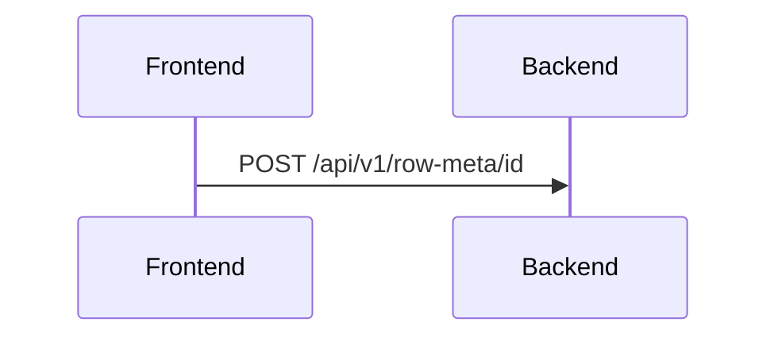

### <a id="openformpopup">Открытие FormPopup</a>

**Процесс:**

### <a id="openPopup">Открытие Popup, Assoc</a>
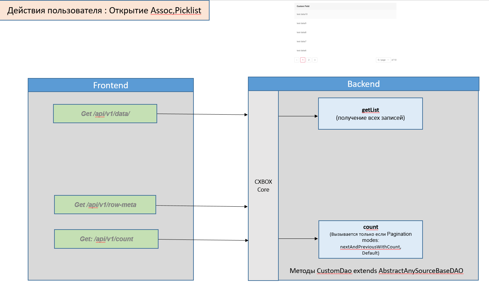

**Процесс:**

 

 

| Эндпоинт           | Открытие экрана  | create | save | delete           | click .. | open Assoc,  popup |
|--------------------|------------------|--------|------|------------------|----------|----------------------|
| GET `/count`       | ✅                |       |      |                  |          |✅                  |
| GET `/row-meta`    | ✅ без записей |       |      | ✅ без записей |   ✅    |✅                  |
| GET `/row-meta-new`|                  | ✅     |      |                  |          |                      |
| GET `/row-meta/id` | ✅                |       | ✅   | ✅               |          |                      |
| GET `/data/`       | ✅                |       |      | ✅               |          |✅                     |
| PUT `/data/id`     |                  |        | ✅   |                  |          |                      |
| DELETE `/data/id`  |                  |        |      | ✅               |          |                      |

Все

| Операция              | GET  `/row-meta` | GET  `/row-meta-new` | GET  `/row-meta/id` | POST  `/row-meta/id` | GET  `/data/` | PUT  `/data/id` | DELETE  `/data/id` | GET  `/count` |
|-----------------------|-------------------|--------------------------|-------------------|--------------------|--------------|---------------|------------------|--------------|
| Открытие экрана       | ✅ без записей  | ❌                 |✅                |                    | ✅           |               |                  | ✅           |
| Создание              | ❌                 | ✅                 |                   |                    |              |               |                  |              |
| Сохранение            | ❌                 | ❌                 | ✅                |                    |              | ✅            |                  |              |
| Удаление              | ✅ без записей  | ❌                 | ✅                |                    | ✅           |               | ✅               |              |
| Клик ..               | ❌                 | ❌                 | ✅                 |                    |              |               |                  |              |
| Открытие Assoc, Popup | ✅  без записей | ❌                 | ✅                 |                    | ✅           |               |                  | ✅           |
| Открытие Form Popup   | ❌                 | ❌                 |                   | ✅                  |              |               |                  |              |
| Force Active          | ❌                 | ❌                 |                   | ✅                 |              |               |                  |              |

-->