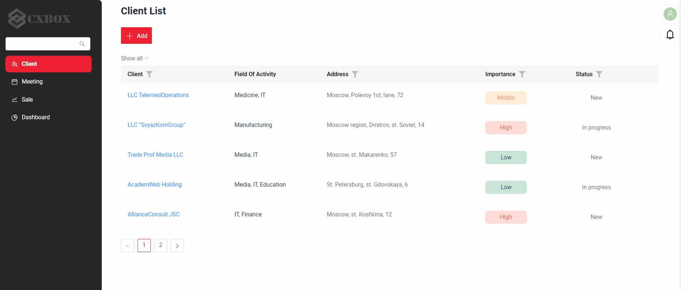

# Push-уведомления { #push-notificaions }
cxbox/core 3.0.5

cxbox-ui/core 1.37.1

[:material-play-circle: Живой пример]({{ external_links.demo }}/ui/#/screen/meeting){:target="_blank"} 

## Как это выглядит? { #how-does-it-look }
 

## Как добавить? { #how-to-add }
??? Example "Пример"
    - Шаг 1. Добавьте новую зависимость в pom.xml.
    ```
    <dependency>
    <groupId>org.springframework.boot</groupId>
    <artifactId>spring-boot-starter-websocket</artifactId>
    </dependency>
    ```

    -  Шаг 2. Добавьте новые параметры окружения в application.yml
    ```
    websocket:
        endpointToConnect: /websocketnotification
        topic: /user/queue/websocket.reply
    ```

    === "Шаг 3. SimpleBroker"
        Брокер по умолчанию — реализация SimpleBroker из Spring.

        подробнее см. [протоколы STOMP](https://www.toptal.com/java/stomp-spring-boot-websocket)

    === "Шаг 3. ActiveMQ"
        - подробнее см. [ActiveMQ](https://roytuts.com/messaging-with-stomp-over-websockets-using-spring-and-activemq/)
    
        +  Шаг 3.1. Добавьте новую зависимость в pom.xml.

        ```
            <dependency>
              <groupId>org.springframework.boot</groupId>
              <artifactId>spring-boot-starter-activemq</artifactId>
            </dependency>
            <dependency>
              <groupId>org.springframework.boot</groupId>
              <artifactId>spring-boot-starter-reactor-netty</artifactId>
            </dependency>
        ```
        +  Шаг 3.2. Установите переменной окружения ACTIVEMQ_BROKER_TYPE значение 'activemq'

        ```
        ACTIVEMQ_BROKER_TYPE:activemq
        ```

        +  Шаг 3.3 Прочие настройки:

        ```
        ACTIVEMQ_ADMIN_LOGIN: The default admin login is 'admin'
        ACTIVEMQ_ADMIN_PASSWORD: The default administrator password is 'admin'
        ACTIVEMQ_HOST: The default connection host is 'activemq'
        ACTIVEMQ_PORT: The default connection port is '61616'
        STOMP_PORT: The default STOMP connection port is '61613'
        ```

    - Шаг 4. Добавьте WebSocketConfig.java

        ```java
        import org.springframework.beans.factory.annotation.Value;
        import org.springframework.context.annotation.Configuration;
        import org.springframework.messaging.simp.config.MessageBrokerRegistry;
        import org.springframework.web.socket.config.annotation.EnableWebSocketMessageBroker;
        import org.springframework.web.socket.config.annotation.StompEndpointRegistry;
        import org.springframework.web.socket.config.annotation.WebSocketMessageBrokerConfigurer;
        
        @Configuration
        @EnableWebSocketMessageBroker
        public class WebSocketConfig implements WebSocketMessageBrokerConfigurer {
        
            @Value("${spring.websocket.topic}")
            private String topic;
        
            @Value("${spring.websocket.endpointToConnect}")
            private String endpointToConnect;
        
            @Value("${cxbox.api.path}")
            private String api;
        
            @Override
            public void configureMessageBroker(MessageBrokerRegistry config) {
                config.enableSimpleBroker(topic);
            }
        
            @Override
            public void registerStompEndpoints(StompEndpointRegistry registry) {
                registry.addEndpoint(api + endpointToConnect);
            }
        
        }
        ```
     