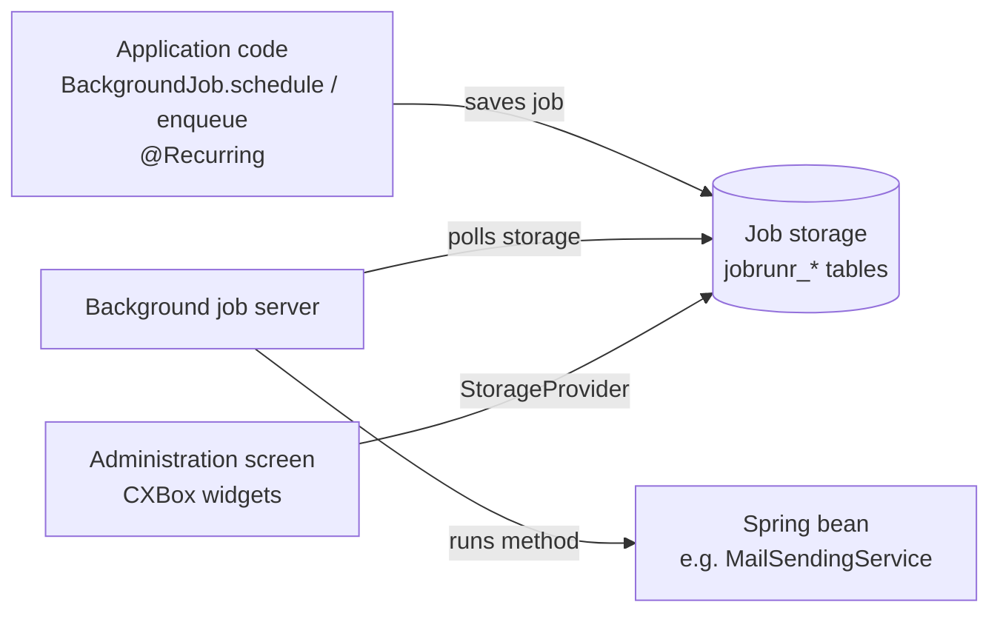
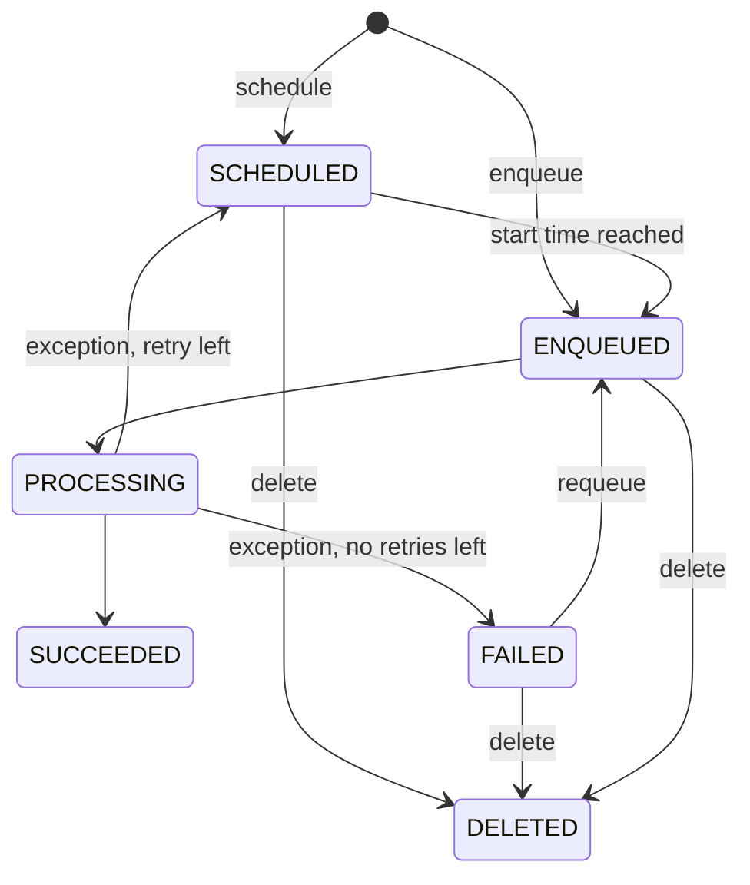

# Scheduler

A job scheduler is a tool that creates and runs tasks automatically. Applications usually use a scheduler to automate maintenance tasks:
sending emails and notifications later, cleaning up old data, recalculating statistics, synchronizing with external systems, and so on.

CXBox has no scheduler of its own. In the demo application, scheduling is done with the [JobRunr](https://www.jobrunr.io){:target="_blank"} library.
Its jobs are shown to the administrator on a regular CXBox screen called **Administration → Job Administration**.

[:material-play-circle: Live Sample]({{ external_links.demo }}/ui/#/screen/admin/view/scheduledJobs){:target="_blank"}

## How does it work?



1. The application code creates a job. A job is a call to a method of a Spring bean, given as a lambda, for example `x -> x.stats("save pressed job")`.
2. JobRunr serializes the job (class, method, arguments) to JSON and saves it in the job storage.
   With a relational database, JobRunr uses the application `DataSource` and creates its own `jobrunr_*` tables at startup.
   You don't need any Liquibase changes for this.
3. The background job server (enabled with `org.jobrunr.background-job-server.enabled: true`) polls the storage.
   When a job is due, the server gets the bean from the Spring context and calls the method in a separate thread.
4. When the job finishes, its state changes. If the method throws an exception, JobRunr retries the job
   (`retries` in the `@Job` annotation, 10 by default). When it runs out of retries, the job is moved to `FAILED`.

Because jobs live in the database, they survive an application restart. If several application instances share one database,
each job still runs only once.

### Job states

| State        | Meaning                                                                |
|--------------|------------------------------------------------------------------------|
| `SCHEDULED`  | The job waits for its start time (`BackgroundJob.schedule(...)`)       |
| `ENQUEUED`   | The job is queued and waits for a free worker of the job server        |
| `PROCESSING` | The job is running                                                     |
| `SUCCEEDED`  | The job finished without errors                                        |
| `FAILED`     | The job failed after all retries                                       |
| `DELETED`    | The job was deleted (for example, by the administrator)                |



## How to add?

??? Example
    Step 1. Add the JobRunr starter to `pom.xml`.
    Choose the starter that matches your Spring Boot version: `jobrunr-spring-boot-4-starter` (Spring Boot 4, used in the demo)
    or `jobrunr-spring-boot-3-starter` (Spring Boot 3).

    ```xml
    <properties>
        <jobrunr-spring-boot-4-starter.version>8.6.1</jobrunr-spring-boot-4-starter.version>
    </properties>

    <dependency>
        <groupId>org.jobrunr</groupId>
        <artifactId>jobrunr-spring-boot-4-starter</artifactId>
        <version>${jobrunr-spring-boot-4-starter.version}</version>
    </dependency>
    ```

    Step 2. Enable the background job server in `application.yml`.
    The JobRunr dashboard is turned off: the administrator works with jobs on a CXBox screen instead (see [How to add the administration screen?](#how-to-add-the-administration-screen)).

    ```yaml
    org:
      jobrunr:
        background-job-server:
          enabled: true
        dashboard:
          enabled: false
    ```

    Step 3. Create the method that the scheduler will run. It must be a public method of a Spring bean.
    The `@Job` annotation is optional. It sets the job name shown to the administrator (`%0` is replaced by the first argument)
    and the number of retries.

    ```java
    @Slf4j
    @Service
    @RequiredArgsConstructor
    public class MailSendingService {

        @Job(name = "The sample job with variable %0", retries = 2)
        public void stats(String variable) {
            log.info(variable);
        }

    }
    ```

    !!! info
        The job arguments are serialized to JSON and saved in the database. Pass simple values (ids, strings, dates), not entities or DTOs.
        Read the data again inside the job method.

## How to create a job?

### Run later (one-time job)

`BackgroundJob.schedule` creates a job in the `SCHEDULED` state. The job runs once at the given time.

The demo example below adds the **Send Email Next Day** action on the Meeting screen. The action schedules a job for the next day.

```java
.action(act -> act
        .action("sendEmailNextDay", "Send Email Next Day")
        .invoker((bc, data) -> {
            BackgroundJob.<MailSendingService>schedule(
                    LocalDateTime.now().plusDays(1),
                    x -> x.stats("save pressed job")
            );
            return new ActionResultDTO<MeetingDTO>()
                    .setAction(PostAction.showMessage(MessageType.INFO, "The email will be dispatched tomorrow."));
        })
)
```

[:material-play-circle: Live Sample]({{ external_links.demo }}/ui/#/screen/meeting){:target="_blank"}

### Run now in the background (fire-and-forget)

`BackgroundJob.enqueue` creates a job in the `ENQUEUED` state. The job server runs it as soon as a worker is free.
Use it for long operations that the user shouldn't wait for. Unlike Spring `@Async`, the job is saved in the database and retried on errors.

```java
BackgroundJob.<MailSendingService>enqueue(x -> x.stats("enqueued job"));
```

### Run on a schedule (recurring job)

A recurring job is created again and again by a CRON expression, for example every night.
You can declare it with the `@Recurring` annotation on a bean method:

```java
@Recurring(id = "cleanup-old-notifications", cron = "0 3 * * *")
@Job(name = "Cleanup of old notifications")
public void cleanupOldNotifications() {
    // ...
}
```

Or you can create it from code, for example when the period is set in the application settings:

```java
BackgroundJob.<MailSendingService>scheduleRecurrently(
        "daily-stats",
        "0 9 * * *",
        x -> x.stats("daily stats")
);
```

The recurring job `id` must be unique. If you call `scheduleRecurrently` again with the same `id`, the existing job is updated instead of creating a new one.
Each run of a recurring job is a separate job, and its `recurringjobid` field holds the recurring job `id`.

!!! tip
    Instead of the static `BackgroundJob` class, you can inject the `JobScheduler` bean. It has the same methods (`schedule`, `enqueue`, `scheduleRecurrently`)
    and is easier to mock in tests.

## How to add the administration screen?

The demo application has the **Administration** screen with the **Job Administration** menu. The administrator can:

* see how many jobs there are in each state (the [StatsBlock](../../../widget/type/statblocks/statblocks.md) widget). A click on a number opens the list of jobs in that state.
* see the list of jobs for each state: id, state, job details (JSON), creation and update time, recurring job id, version and signature.
* **requeue** a job, for example to run a failed job again;
* **delete** a job, for example to cancel a scheduled job;
* **refresh** the counters.

The screen reads jobs from the JobRunr `StorageProvider`, not from the database tables directly.
So it is built on [AnySource](../microservices/microservices.md) services and doesn't need entities.

??? Example
    Step 1. Add the DTOs.

    `JobStatsDTO` is a counter for one state:

    ```java
    @Getter
    @Setter
    @NoArgsConstructor
    @AllArgsConstructor
    @Accessors(chain = true)
    @SuperBuilder(toBuilder = true)
    public class JobStatsDTO extends DataResponseDTO {

        private String title;

        private Long value;

        private String color;

        private String description;

        private String icon;

    }
    ```

    `JobAdminDTO` is one job:

    ```java
    @Getter
    @Setter
    @NoArgsConstructor
    @AllArgsConstructor
    @Accessors(chain = true)
    @SuperBuilder(toBuilder = true)
    public class JobAdminDTO extends DataResponseDTO {
        private Long version;
        private String jobasjson;
        private String jobsignature;
        private String state;
        private LocalDateTime createdat;
        private LocalDateTime updatedat;
        private LocalDateTime scheduledat;
        private String recurringjobid;
    }
    ```

    Step 2. Add the business components. `jobsStats` is the parent BC with counters.
    There is one child BC for each state, and they all use the same service.

    ```java
    jobsStats(JobStatsService.class),
        scheduledJobs(jobsStats, JobAdminService.class),
        enqueuedJobs(jobsStats, JobAdminService.class),
        processingJobs(jobsStats, JobAdminService.class),
        succeededJobs(jobsStats, JobAdminService.class),
        failedJobs(jobsStats, JobAdminService.class),
        deletedJobs(jobsStats, JobAdminService.class),
    ```

    Step 3. Add the enum that links a JobRunr state with its BC, view, icon and color.

    ```java
    @Getter
    @AllArgsConstructor
    public enum JobStatsStateEnum {

        SCHEDULED("Scheduled", StateName.SCHEDULED, "", "#779FE9", "clock-circle", "scheduledJobs", CxboxRestController.scheduledJobs),
        ENQUEUED("Enqueued", StateName.ENQUEUED, "", "#779FE9", "history", "enqueuedJobs", CxboxRestController.enqueuedJobs),
        PROCESSING("Processing", StateName.PROCESSING, "", "#779FE9", "code", "processingJobs", CxboxRestController.processingJobs),
        SUCCEEDED("Succeeded", StateName.SUCCEEDED, "", "#779FE9", "check-circle", "succeededJobs", CxboxRestController.succeededJobs),
        FAILED("Failed", StateName.FAILED, "", "#779FE9", "exclamation-circle", "failedJobs", CxboxRestController.failedJobs),
        DELETED("Deleted", StateName.DELETED, "", "#779FE9", "delete", "deletedJobs", CxboxRestController.deletedJobs);

        @JsonValue
        private final String value;

        private final StateName stateName;

        private final String description;

        private final String color;

        private String icon;

        private String adminView;

        private CxboxRestController bc;

        public static String mapToId(JobStatsStateEnum statsState) {
            return statsState.name();
        }

        public static JobStatsStateEnum getById(String id) {
            return Arrays.stream(JobStatsStateEnum.values()).filter(v -> v.name().equals(id)).findFirst().orElse(null);
        }

        public static JobStatsStateEnum getByBc(BusinessComponent bc) {
            return Arrays.stream(JobStatsStateEnum.values()).filter(v -> v.getBc().isBc(bc)).findFirst().orElse(null);
        }

    }
    ```

    Step 4. Add the counters: DAO, Meta and Service.
    The DAO counts the jobs with `storageProvider.countJobs(stateName)`.
    The Meta sets a drill-down on the counter that opens the view of that state.

    === "JobStatsDao"
        ```java
        @Service
        @RequiredArgsConstructor
        public class JobStatsDao extends AbstractAnySourceBaseDAO<JobStatsDTO> implements
                AnySourceBaseDAO<JobStatsDTO> {

            private final StorageProvider storageProvider;

            @Override
            public String getId(final JobStatsDTO entity) {
                return entity.getId();
            }

            @Override
            public void setId(final String id, final JobStatsDTO entity) {
                entity.setId(id);
            }

            @Override
            public JobStatsDTO getByIdIgnoringFirstLevelCache(final BusinessComponent bc) {
                return getStates().stream().filter(s -> Objects.equals(s.getId(), bc.getId())).findFirst().orElse(null);
            }

            @Override
            public Page<JobStatsDTO> getList(final BusinessComponent bc, final QueryParameters queryParameters) {
                return new PageImpl<>(getStates());
            }

            private List<JobStatsDTO> getStates() {
                return Arrays.stream(JobStatsStateEnum.values()).map(s -> JobStatsDTO.builder()
                                .id(JobStatsStateEnum.mapToId(s))
                                .title(s.getValue())
                                .value(storageProvider.countJobs(s.getStateName()))
                                .color(s.getColor())
                                .description(s.getValue())
                                .icon(s.getIcon())
                                .build())
                        .collect(Collectors.toList());
            }

            @Override
            public void delete(final BusinessComponent bc) {
                throw new IllegalStateException();
            }

            @Override
            public JobStatsDTO update(BusinessComponent bc, JobStatsDTO entity) {
                throw new IllegalStateException();
            }

            @Override
            public JobStatsDTO create(final BusinessComponent bc, final JobStatsDTO entity) {
                throw new IllegalStateException();
            }

        }
        ```
    === "JobStatsMeta"
        ```java
        @Service
        @RequiredArgsConstructor
        public class JobStatsMeta extends AnySourceFieldMetaBuilder<JobStatsDTO> {

            @Override
            public void buildRowDependentMeta(RowDependentFieldsMeta<JobStatsDTO> fields, BcDescription bc,
                    String id, String parentId) {
                JobStatsStateEnum state = JobStatsStateEnum.getById(id);
                fields.setDrilldown(
                        JobStatsDTO_.value,
                        DrillDownType.INNER,
                        "/screen/admin/view/" + state.getAdminView()
                );
            }

            @Override
            public void buildIndependentMeta(FieldsMeta<JobStatsDTO> fields, BcDescription bcDescription,
                    String parentId) {
            }

        }
        ```
    === "JobStatsService"
        ```java
        @RequiredArgsConstructor
        @Service
        public class JobStatsService extends AnySourceVersionAwareResponseService<JobStatsDTO, JobStatsDTO> {

            @Getter(onMethod_ = @Override)
            private final Class<JobStatsMeta> meta = JobStatsMeta.class;

            @Getter(onMethod_ = @Override)
            private final Class<JobStatsDao> dao = JobStatsDao.class;

            @Override
            protected CreateResult<JobStatsDTO> doCreateEntity(JobStatsDTO entity, BusinessComponent bc) {
                throw new IllegalStateException();
            }

            @Override
            protected ActionResultDTO<JobStatsDTO> doUpdateEntity(JobStatsDTO entity, JobStatsDTO data, BusinessComponent bc) {
                throw new IllegalStateException();
            }

            @Override
            public Actions<JobStatsDTO> getActions() {
                return Actions.<JobStatsDTO>builder()
                        .action(act -> act
                                .action("refresh", "Refresh")
                                .invoker((bc, dto) -> new ActionResultDTO<JobStatsDTO>()
                                        .setAction(PostAction.refreshBc(CxboxRestController.jobsStats)))
                        )
                        .build();
            }

        }
        ```

    Step 5. Add the job list: DAO, Meta and Service.
    The DAO finds the state by the BC and reads jobs with `storageProvider.getJobs(...)`.
    The **requeue** and **delete** actions change the job state and save it back to the storage.

    === "JobAdminDao"
        ```java
        @Service
        @RequiredArgsConstructor
        public class JobAdminDao extends AbstractAnySourceBaseDAO<JobAdminDTO> implements
                AnySourceBaseDAO<JobAdminDTO> {

            private final JsonMapper jsonMapper;

            private final StorageProvider storageProvider;

            @Override
            public String getId(final JobAdminDTO entity) {
                return entity.getId();
            }

            @Override
            public void setId(final String id, final JobAdminDTO entity) {
                entity.setId(id);
            }

            @Override
            public JobAdminDTO getByIdIgnoringFirstLevelCache(final BusinessComponent bc) {
                return map(storageProvider.getJobById(UUID.fromString(bc.getId())));
            }

            @Override
            public Page<JobAdminDTO> getList(final BusinessComponent bc, final QueryParameters queryParameters) {
                JobStatsStateEnum state = JobStatsStateEnum.getByBc(bc);
                if (state == null) {
                    return new PageImpl<>(new ArrayList<>());
                }
                return new PageImpl<>(getJobs(state.getStateName(), 10));
            }

            public void deleteJobById(UUID id) {
                final Job job = storageProvider.getJobById(id);
                job.delete("Job deleted via Dashboard");
                storageProvider.save(job);
            }

            public void requeueJobById(UUID id) {
                final Job job = storageProvider.getJobById(id);
                job.enqueue();
                storageProvider.save(job);
            }

            private List<JobAdminDTO> getJobs(StateName stateName, int limit) {
                return storageProvider.getJobs(
                                stateName,
                                new OffsetBasedPageRequest(null, OffsetBasedPageRequest.DEFAULT_OFFSET, limit)
                        ).getItems()
                        .stream()
                        .map(this::map)
                        .collect(Collectors.toList());
            }

            private JobAdminDTO map(Job job) {
                ZoneId zone = ZoneId.systemDefault();
                return JobAdminDTO.builder()
                        .id(job.getId().toString())
                        .version((long) job.getVersion())
                        .jobasjson(jsonMapper.serialize(job.getJobDetails()))
                        .jobsignature(job.getJobSignature())
                        .state(job.getState().toString())
                        .createdat(LocalDateTime.ofInstant(job.getCreatedAt(), zone))
                        .updatedat(LocalDateTime.ofInstant(job.getUpdatedAt(), zone))
                        .recurringjobid(job.getRecurringJobId().orElse(null))
                        .build();
            }

            @Override
            public void delete(final BusinessComponent bc) {
                throw new IllegalStateException();
            }

            @Override
            public JobAdminDTO update(BusinessComponent bc, JobAdminDTO entity) {
                throw new IllegalStateException();
            }

            @Override
            public JobAdminDTO create(final BusinessComponent bc, final JobAdminDTO entity) {
                throw new IllegalStateException();
            }

        }
        ```
    === "JobAdminMeta"
        ```java
        @Service
        @RequiredArgsConstructor
        public class JobAdminMeta extends AnySourceFieldMetaBuilder<JobAdminDTO> {

            @Override
            public void buildRowDependentMeta(RowDependentFieldsMeta<JobAdminDTO> fields, BcDescription bc,
                    String id, String parentId) {
            }

            @Override
            public void buildIndependentMeta(FieldsMeta<JobAdminDTO> fields, BcDescription bcDescription,
                    String parentId) {
                fields.enableSort(
                        JobAdminDTO_.id,
                        JobAdminDTO_.state,
                        JobAdminDTO_.jobasjson,
                        JobAdminDTO_.createdat,
                        JobAdminDTO_.updatedat,
                        JobAdminDTO_.scheduledat,
                        JobAdminDTO_.recurringjobid,
                        JobAdminDTO_.version,
                        JobAdminDTO_.jobsignature
                );
            }

        }
        ```
    === "JobAdminService"
        ```java
        @RequiredArgsConstructor
        @Service
        public class JobAdminService extends AnySourceVersionAwareResponseService<JobAdminDTO, JobAdminDTO> {

            private final JobAdminDao jobAdminDao;

            @Getter(onMethod_ = @Override)
            private final Class<JobAdminMeta> meta = JobAdminMeta.class;

            @Getter(onMethod_ = @Override)
            private final Class<JobAdminDao> dao = JobAdminDao.class;

            @Override
            protected CreateResult<JobAdminDTO> doCreateEntity(JobAdminDTO entity, BusinessComponent bc) {
                throw new IllegalStateException();
            }

            @Override
            protected ActionResultDTO<JobAdminDTO> doUpdateEntity(JobAdminDTO entity, JobAdminDTO data, BusinessComponent bc) {
                throw new IllegalStateException();
            }

            @Override
            public Actions<JobAdminDTO> getActions() {
                return Actions.<JobAdminDTO>builder()
                        .action(act -> act
                                .action("requeue", "requeue")
                                .invoker((bc, dto) -> {
                                    jobAdminDao.requeueJobById(UUID.fromString(bc.getId()));
                                    return new ActionResultDTO<JobAdminDTO>().setAction(PostAction.refreshBc(CxboxRestController.jobsStats));
                                })
                        )
                        .action(act -> act
                                .action("delete", "delete")
                                .invoker((bc, dto) -> {
                                    jobAdminDao.deleteJobById(UUID.fromString(bc.getId()));
                                    return new ActionResultDTO<JobAdminDTO>().setAction(PostAction.refreshBc(CxboxRestController.jobsStats));
                                })
                        )
                        .build();
            }

        }
        ```

    Step 6. Add the widgets.

    === "jobStats.widget.json"
        ```json
        {
          "name": "jobStats",
          "title": "",
          "type": "StatsBlock",
          "bc": "jobsStats",
          "fields": [
            {"title": "title", "key": "title", "type": "input"},
            {"title": "value", "key": "value", "type": "number", "bgColorKey": "color", "drillDown": true},
            {"title": "icon", "key": "icon", "type": "input"},
            {"title": "description", "key": "description", "type": "hint"}
          ],
          "options": {
            "stats": {
              "valueFieldKey": "value",
              "titleFieldKey": "title",
              "iconFieldKey": "icon",
              "descriptionFieldKey": "description"
            }
          }
        }
        ```
    === "jobStatsActions.widget.json"
        ```json
        {
          "name": "jobStatsActions",
          "title": "",
          "type": "Form",
          "bc": "jobsStats",
          "fields": [],
          "options": {
            "actionGroups": {
              "include": ["refresh"]
            }
          }
        }
        ```
    === "failedJobsList.widget.json"
        One List widget per state, with its own `bc` (`scheduledJobs`, `enqueuedJobs`, `processingJobs`, `succeededJobs`, `failedJobs`, `deletedJobs`).
        ```json
        {
          "name": "failedJobsList",
          "title": "",
          "type": "List",
          "bc": "failedJobs",
          "fields": [
            {"title": "id", "key": "id", "type": "input"},
            {"title": "state", "key": "state", "type": "input"},
            {"title": "jobasjson", "key": "jobasjson", "type": "text"},
            {"title": "createdat", "key": "createdat", "type": "dateTime"},
            {"title": "updatedat", "key": "updatedat", "type": "dateTime"},
            {"title": "scheduledat", "key": "scheduledat", "type": "dateTime"},
            {"title": "recurringjobid", "key": "recurringjobid", "type": "input"},
            {"title": "version", "key": "version", "type": "number"},
            {"title": "jobsignature", "key": "jobsignature", "type": "input"}
          ],
          "options": {
            "actionGroups": {
              "include": ["requeue", "delete"]
            }
          }
        }
        ```

    Step 7. Add a view for each state and add the views to the screen menu.

    === "failedJobs.view.json"
        ```json
        {
          "name": "failedJobs",
          "title": "Failed",
          "template": "DashboardView",
          "url": "/screen/admin/view/failedJobs",
          "widgets": [
            {"widgetName": "secondLevelMenu", "position": 0, "gridWidth": 24},
            {"widgetName": "jobListHeader", "position": 10, "gridWidth": 24},
            {"widgetName": "jobStatsActions", "position": 20, "gridWidth": 24},
            {"widgetName": "jobStats", "position": 30, "gridWidth": 24},
            {"widgetName": "thirdLevelMenu", "position": 31, "gridWidth": 24},
            {"widgetName": "failedJobsList", "position": 32, "gridWidth": 24}
          ],
          "rolesAllowed": ["CXBOX_USER", "BUSINESS_ADMIN"]
        }
        ```
    === "admin.screen.json"
        ```json
        {
          "title": "Administration",
          "primaryViewName": "scheduledJobs",
          "primaryViews": ["scheduledJobs"],
          "navigation": {
            "type": "standard",
            "menu": [
              {
                "title": "Job Administration",
                "child": [
                  {"viewName": "scheduledJobs"},
                  {"viewName": "enqueuedJobs"},
                  {"viewName": "processingJobs"},
                  {"viewName": "succeededJobs"},
                  {"viewName": "failedJobs"},
                  {"viewName": "deletedJobs"}
                ]
              }
            ]
          }
        }
        ```

    !!! warning
        The administration screen lets users delete and restart jobs. Give access to it only to administrator roles (`rolesAllowed`).
