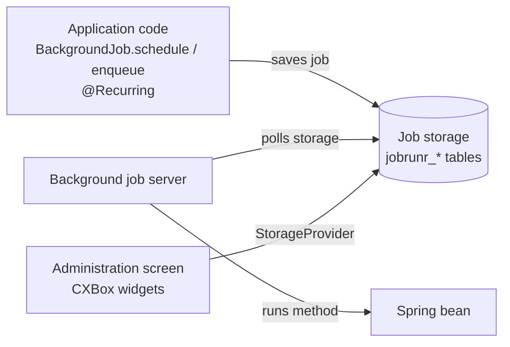
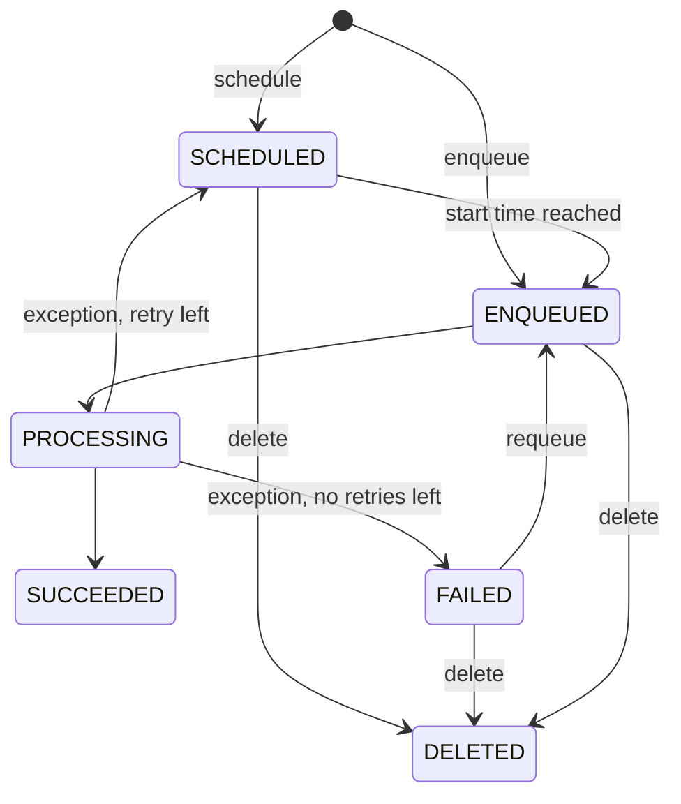

# Scheduler

A job scheduler is a tool that creates and runs tasks automatically. Applications usually use a scheduler to automate maintenance tasks:
sending emails and notifications later, cleaning up old data, recalculating statistics, synchronizing with external systems, and so on.

CXBox has no scheduler of its own. The samples and the demo application use the [JobRunr](https://www.jobrunr.io){:target="_blank"} library.
Its jobs are shown to the administrator on a regular CXBox screen.

[:material-play-circle: Live Sample]({{ external_links.code_samples }}/ui/#/screen/myexample5262){:target="_blank"} ·
[:fontawesome-brands-github: GitHub]({{ external_links.github_ui }}/{{ external_links.github_branch }}/src/main/java/org/demo/documentation/feature/scheduler){:target="_blank"}

## How does it work?



1. The application code creates a job. A job is a call to a method of a Spring bean, given as a lambda, for example `x -> x.execute(id)`.
2. JobRunr serializes the job (class, method, arguments) to JSON and saves it in the job storage.
   With a relational database, JobRunr uses the application `DataSource` and creates its own `jobrunr_*` tables at startup.
   You don't need any Liquibase changes for this.
3. The background job server (enabled with `org.jobrunr.background-job-server.enabled: true`) polls the storage.
   When a job is due, the server gets the bean from the Spring context and calls the method in a separate thread.
4. When the job finishes, its state changes. If the method throws an exception, JobRunr retries the job
   (`retries` in the `@Job` annotation, 10 by default). When it runs out of retries, the job is moved to `FAILED`.

Because jobs live in the database, they survive an application restart. If several application instances share one database,
each job still runs only once.

### Job states

| State        | Meaning                                                          |
|--------------|------------------------------------------------------------------|
| `SCHEDULED`  | The job waits for its start time (`BackgroundJob.schedule(...)`) |
| `ENQUEUED`   | The job is queued and waits for a free worker of the job server  |
| `PROCESSING` | The job is running                                               |
| `SUCCEEDED`  | The job finished without errors                                  |
| `FAILED`     | The job failed after all retries                                 |
| `DELETED`    | The job was deleted (for example, by the administrator)          |



## How to add?

??? Example
    **Step 1.** Add the JobRunr starter to `pom.xml`.
    Choose the starter that matches your Spring Boot version: `jobrunr-spring-boot-4-starter` (Spring Boot 4)
    or `jobrunr-spring-boot-3-starter` (Spring Boot 3).

    ```xml
    <dependency>
        <groupId>org.jobrunr</groupId>
        <artifactId>jobrunr-spring-boot-4-starter</artifactId>
        <version>${jobrunr-spring-boot-4-starter.version}</version>
    </dependency>
    ```

    **Step 2.** Enable the background job server in `application.yml`.
    The JobRunr dashboard is turned off: the administrator works with jobs on a CXBox screen instead (see [Job administration](#job-administration)).

    ```yaml
    org:
      jobrunr:
        background-job-server:
          enabled: true
        dashboard:
          enabled: false
    ```

    **Step 3.** Create a Spring bean with the method that the scheduler will run.
    The `@Job` annotation is optional. It sets the job name shown to the administrator (`%0` is replaced by the first argument)
    and the number of retries.

    ```java
    --8<--
    {{ external_links.github_raw_doc }}/feature/scheduler/task/MyExample5262JobHandler.java:job
    --8<--
    ```

    [:fontawesome-brands-github: GitHub]({{ external_links.github_ui }}/{{ external_links.github_branch }}/src/main/java/org/demo/documentation/feature/scheduler/task/MyExample5262JobHandler.java){:target="_blank"}

    !!! info
        The job runs in a background thread, outside the user's request. If the job saves entities, log in as a system user first
        (`authzService.loginAs(...)`), the same way as in `*TestDataLoadService`.

        The job arguments are serialized to JSON and saved in the database. Pass simple values (ids, strings, dates), not entities or DTOs.
        Read the data again inside the job method.

## How to create a job?

In the sample, the **Jobs from actions** view shows a list of records with two actions.
Each action creates a job that sets the record status to `Done` and fills **Executed Date**.

[:material-play-circle: Live Sample]({{ external_links.code_samples }}/ui/#/screen/myexample5262/view/myexample5262list){:target="_blank"} ·
[:fontawesome-brands-github: GitHub]({{ external_links.github_ui }}/{{ external_links.github_branch }}/src/main/java/org/demo/documentation/feature/scheduler/task){:target="_blank"}

### Run now in the background (fire-and-forget)

`BackgroundJob.enqueue` creates a job in the `ENQUEUED` state. The job server runs it as soon as a worker is free.
Use it for long operations that the user shouldn't wait for. Unlike Spring `@Async`, the job is saved in the database and retried on errors.

```java
--8<--
{{ external_links.github_raw_doc }}/feature/scheduler/task/MyExample5262Service.java:enqueue
--8<--
```

### Run later (one-time job)

`BackgroundJob.schedule` creates a job in the `SCHEDULED` state. The job runs once at the given time.

```java
--8<--
{{ external_links.github_raw_doc }}/feature/scheduler/task/MyExample5262Service.java:schedule
--8<--
```

### Run on a schedule (recurring job)

A recurring job is created again and again by a CRON expression, for example every night.
Declare it with the `@Recurring` annotation on a bean method. In the sample, the job runs every 5 minutes:

```java
--8<--
{{ external_links.github_raw_doc }}/feature/scheduler/task/MyExample5262JobHandler.java:recurring
--8<--
```

You can also create a recurring job from code, for example when the period is set in the application settings:
`BackgroundJob.scheduleRecurrently("<id>", "<cron>", x -> x.method())`.

The recurring job `id` must be unique. If you call `scheduleRecurrently` again with the same `id`, the existing job is updated instead of creating a new one.
Each run of a recurring job is a separate job, and its **Recurring Job Id** holds the recurring job `id`.

!!! tip
    Instead of the static `BackgroundJob` class, you can inject the `JobScheduler` bean. It has the same methods (`schedule`, `enqueue`, `scheduleRecurrently`)
    and is easier to mock in tests.

## Job administration

The **Job administration** view shows the scheduler jobs to the administrator. The administrator can:

* see how many jobs there are in each state (the [StatsBlock](../../../widget/type/statblocks/statblocks.md) widget). A click on a number shows the jobs in that state;
* see the jobs: name, state, creation and update time, recurring job id, signature;
* **Requeue** a job, for example to run a failed job again;
* **Delete** a job, for example to cancel a scheduled job;
* **Refresh** the counters.

[:material-play-circle: Live Sample]({{ external_links.code_samples }}/ui/#/screen/myexample5262/view/myexample5262jobs){:target="_blank"} ·
[:fontawesome-brands-github: GitHub]({{ external_links.github_ui }}/{{ external_links.github_branch }}/src/main/java/org/demo/documentation/feature/scheduler/admin){:target="_blank"}

The view reads jobs from the JobRunr `StorageProvider` bean, not from the database tables directly.
So it is built on AnySource services and doesn't need entities.

??? Example
    **Step 1.** Add two business components: `myexample5262jobstats` with one record per state,
    and its child `myexample5262job` with the jobs. The parent record id is the state, so the child shows the jobs of the selected state.

    ```java
    --8<--
    {{ external_links.github_raw_doc }}/feature/scheduler/CxboxMyExample5262Controller.java:bc
    --8<--
    ```

    **Step 2.** Count the jobs of each state with `StorageProvider.countJobs`.

    ```java
    --8<--
    {{ external_links.github_raw_doc }}/feature/scheduler/admin/stats/MyExample5262JobStatsDao.java:getStats
    --8<--
    ```

    **Step 3.** Add a drill-down on the counter. It opens the same view with the selected state, so the job list is filtered by it.

    ```java
    --8<--
    {{ external_links.github_raw_doc }}/feature/scheduler/admin/stats/MyExample5262JobStatsMeta.java:buildRowDependentMeta
    --8<--
    ```

    **Step 4.** Read the jobs of the parent state with `StorageProvider.getJobs`.

    ```java
    --8<--
    {{ external_links.github_raw_doc }}/feature/scheduler/admin/job/MyExample5262JobDao.java:getList
    --8<--
    ```

    **Step 5.** Add the **Requeue** and **Delete** actions. They change the job state and save the job back to the storage.

    ```java
    --8<--
    {{ external_links.github_raw_doc }}/feature/scheduler/admin/job/MyExample5262JobDao.java:actions
    --8<--
    ```

    ```java
    --8<--
    {{ external_links.github_raw_doc }}/feature/scheduler/admin/job/MyExample5262JobService.java:getActions
    --8<--
    ```

    **Step 6.** Add the widgets to the view: `StatsBlock` with the counters (`myexample5262jobstats`),
    `Form` with the **Refresh** action and `List` with the jobs (`myexample5262job`).

    [:fontawesome-brands-github: GitHub]({{ external_links.github_ui }}/{{ external_links.github_branch }}/src/main/java/org/demo/documentation/feature/scheduler/admin){:target="_blank"}

    !!! warning
        The administration view lets users delete and restart jobs. Give access to it only to administrator roles (`rolesAllowed`).
