# Локализация (i18n) { #localization-i18n }

В этом документе описано, как работает локализация в системе и как добавлять переводы для элементов интерфейса, справочников и перечислений.

Система поддерживает локализацию для:

* [Статического текста](#static)
* [Локализации данных](#datalocalization)
## Основы { #basic }
[:material-play-circle: Живой пример]({{ external_links.code_samples }}/ui/#/screen/client){:target="_blank"} ·
[:fontawesome-brands-github: GitHub]({{ external_links.github_ui }}/{{ external_links.github_branch }}/src/main/java/org/demo/documentation/feature/locale){:target="_blank"}

Чтобы сменить язык интерфейса, нужно:

* французский — войти как пользователь demo_fr/demo
* английский — войти как пользователь demo/demo

!!! info
    Чтобы перевод всех элементов применился на выбранный язык, нужно выйти и снова войти в систему или обновить страницу. Простое переключение ролей не меняет язык интерфейса полностью.

Как это выглядит?

=== "французский"
    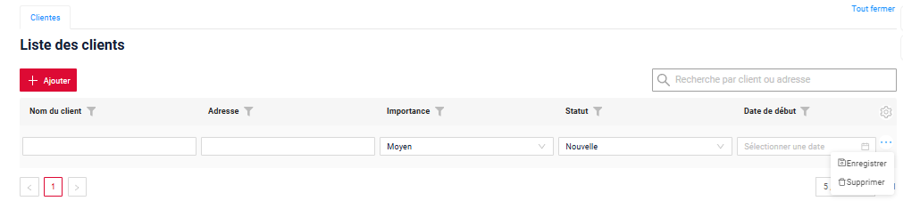
=== "английский"
    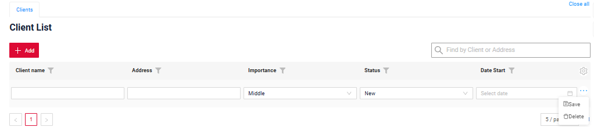 

## <a id="setting">Предварительная настройка для работы с локализацией</a>
??? Example "Пример"

    Необходимо настроить корректную передачу языка.
    Язык определяется:
    === "по пользователю"
        Шаг 1. Добавьте собственный DynamicLocaleResolver в ApplicationConfig.java
        ```java
            @Bean
            public LocaleResolver localeResolver() {
                return new DynamicLocaleResolver();
            }
        ```
        Шаг 2. Добавьте enum SupportedLanguages
        ```java
        @RequiredArgsConstructor
        @Getter
        public enum SupportedLanguages {
        
            ENGLISH(Locale.ENGLISH),
            FRENCH(Locale.FRENCH);
        
            private final Locale locale;
        
            public static @NonNull Locale getDefaultLocale() {
                return SupportedLanguages.ENGLISH.getLocale();
            }
        
        }
        ```
        Шаг 3. Настройка DynamicLocaleResolver

        Ниже приведён пример настройки разбора токена и получения локали каждого пользователя из Keycloak.
        
        Настройка Keycloak

        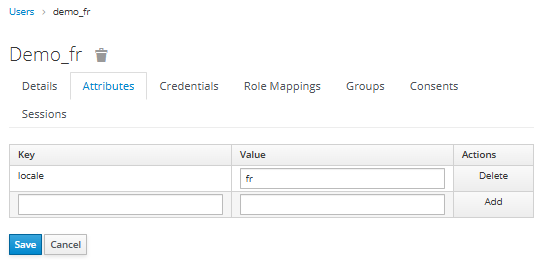

        ```java
        public class DynamicLocaleResolver extends AcceptHeaderLocaleResolver {
        
            @NotNull
            @Override
            public Locale resolveLocale(@NotNull HttpServletRequest request) {
                Authentication authentication = SecurityContextHolder.getContext().getAuthentication();
                if (authentication == null || !(authentication.getPrincipal() instanceof Jwt jwt)) {
                    return SupportedLanguages.getDefaultLocale();
                }
                return resolveFromJwt(jwt);
            }
        
            private Locale resolveFromJwt(Jwt jwt) {
                String localeClaim = jwt.getClaimAsString("locale");
        
                if (localeClaim == null || localeClaim.isBlank()) {
                    return SupportedLanguages.getDefaultLocale();
                }
        
                return SupportedLanguages.FRENCH.getLocale().getLanguage().equals(localeClaim.toLowerCase()) ?
                        SupportedLanguages.FRENCH.getLocale() :
                        SupportedLanguages.getDefaultLocale();
	        }
        }
        ```

    === "по серверу"

        LocaleContextHolder.getLocale().getLanguage()
        
        или, при использовании системной локали:
        
        Locale.getDefault()
        
        Если по какой-то причине корректно настроить язык стандартным способом невозможно, можно использовать обходное решение — задать локаль по умолчанию при запуске приложения:
            
        ```java
            @SpringBootApplication
            @ConfigurationPropertiesScan("org.demo.conf")
            public class Application {
            
                public static void main(String[] args) {
                    Locale.setDefault(new Locale("ru"));
                    SpringApplication.run(Application.class, args);
                }
            }            
        ```
 
        ⚠️ Locale.setDefault(...) меняет локаль для всего процесса JVM, поэтому этот подход рекомендуется только как временное решение или для систем с одной локалью.
    

    **Для работы с локализацией выполните предварительную настройку и на фронтенде, и на бэкенде,
    что необходимо для корректной обработки добавленного языка.**
 
    **Фронтенд**:
    
    подробнее см. [Глобальный статический текст (фронтенд)](#global)
 
    **Шаг 1**
      
    Добавьте файл перевода `ui/src/i18n/assets/fr.json` с переводами.
    В `ui/src/i18n/assets` уже есть файл `en.json` с переводами, используемыми в UI.
    Для нового языка достаточно перевести значения на новый язык.

    Используйте следующий формат имени (UTF-8): (fr.json)

      ```text
      fr.json
      en.json
      <lang>.json
      ```
    
    Пример:

    ```json
    "translation": { 
        "Clear": "Effacer",
        "Copy details to clipboard": "Copier les détails dans le presse-papiers",
        "Details": "Détails",
        "Error": "Erreur",
        "Errors": "Erreurs"
    }
    ```
    **Шаг 2**
    Зарегистрируйте новый язык, чтобы фронтенд мог его обрабатывать.
    1.0 ui/src/i18n/assets/local/index.ts
    ```
    import { Resource } from 'i18next'
    import en from './en.json'
    import fr from './fr.json'
    import ru from './ru.json'
    
    export default {
        en,
        ru,
        fr
    } as Resource
    
    ```
    1.1  ui/src/i18n/assets/moment/index.ts
    ```
    import 'moment/locale/ru'
    import 'moment/locale/fr'
    ```

    1.2 Языки, поддерживаемые Ant:    ui/src/i18n/assets/antd/index.

    ```
    import { Locale } from 'antd/es/locale-provider'
    import { SupportedLanguage } from '../../constants'
    import enUs from 'antd/es/locale-provider/en_US'
    import ruRu from 'antd/es/locale-provider/ru_RU'
    import frFr from 'antd/es/locale-provider/fr_FR'
    
    export default { en: enUs, ru: ruRu, fr: frFr } as { [key in SupportedLanguage]: Locale }
    ```

    !!! info
        Начиная с [релиза 2.0.18](https://doc.cxbox.org/ru/new/version218/): фронтенд автоматически определяет язык пользователя: параметр `language` в /login
        
        До [релиза 2.0.18](https://doc.cxbox.org/ru/new/version218/): для получения языка пользователя требовалась дополнительная доработка фронтенда. Без неё фронтенд использовал предопределённую константу.
    
    **Бэкенд**:
    
    подробнее см. [Статический текст: Widget / View / Screen](#widget)

    **Шаг 1**
    Создайте файлы перевода для [статического текста: Widget / View / Screen](#widget) в:  src/main/resources/ui/

    Используйте следующий формат имени (UTF-8): (messages_<lang>.properties)

      ```text
      messages.properties (default)
      messages_fr.properties
      ```
    
    **Шаг 2**  Добавьте поддерживаемые языки.
    Добавьте в `application.yml` :
    
      ```yaml
      cxbox:
        localization:
          supported-languages: [ en, fr ]
      ```


## <a id="static">Статический текст</a>

Статическая локализация используется для подписей интерфейса, заголовков, кнопок, сообщений и другого текста UI, который не поступает из бизнес-данных.

### <a id="global"> Статический текст: глобальный (фронтенд)</a>

Сюда относятся общие подписи UI, используемые во всём интерфейсе (стандартные кнопки Cxbox, операции и ошибки валидации, обрабатываемые на стороне UI).

Хранится на фронтенде: файл перевода ui/src/i18n/assets/<language>.json с переводами.

#### Примеры { #examples }

Как это выглядит?
=== "настройки фильтра действий"
    === "французский"
        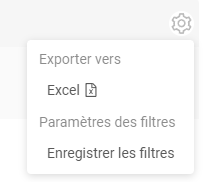
    === "английский"
        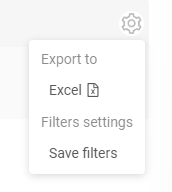
=== "сообщение об обязательности"
    === "французский"
        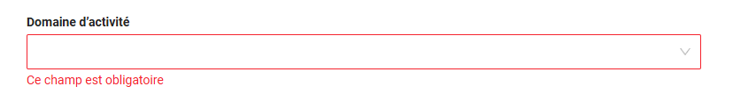
    === "английский"
        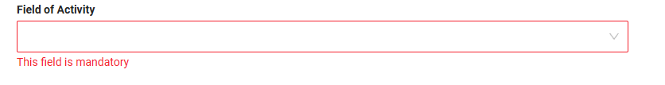

Как добавить?

??? Example "Пример"
    Добавьте файл перевода ui/src/i18n/assets/fr.json с переводами.

    ```json
    "translation": { 
        "Clear": "Effacer",
        "Copy details to clipboard": "Copier les détails dans le presse-papiers",
        "Details": "Détails",
        "Error": "Erreur",
        "Errors": "Erreurs"
    }
    ```


### <a id="widget">Статический текст: Widget / View / Screen </a>

Сюда относится текст, заданный непосредственно в конфигурационных файлах:

* *.widget.json
* *.view.json
* *.screen.json

Такой текст может включать: заголовки, подписи, любой пользовательский текст, указанный непосредственно в JSON

Локализация применяется за счёт использования ключей перевода вместо жёстко заданного текста.

Используйте   {{ui.client.name}}  

#### Примеры локализации { #examples-localization }

##### Подписи полей { #field-labels }

Подписи полей определяют, как поля отображаются на экранах.

Как это выглядит?
=== "французский"
    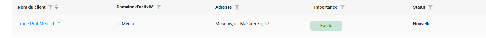
=== "английский"
    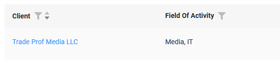

Как добавить?
??? Example "Пример"
    
    **Шаг 1**
    Используйте ключ перевода в JSON виджета: `ui.client.name`

    ```json
    --8<--
    {{ external_links.github_raw_doc }}/feature/locale/clientList.widget.json
    --8<--
    ```  
 
    **Шаг 2**
      Добавьте перевод в `src/main/resources/ui/messages_fr.properties`:
    
      ```properties
      ui.client.name=Nom du client
      ```

    Используйте рекомендуемые префиксы ключей:
    
    * `ui.*` — тексты UI


##### Заголовки представлений (View) { #view-titles }

Заголовки представлений определяют название view в UI.

Как это выглядит?
=== "французский"
    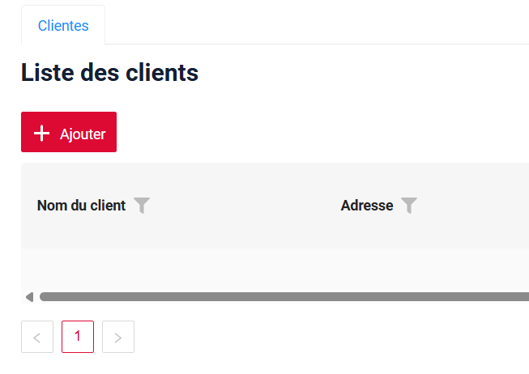
=== "английский"
    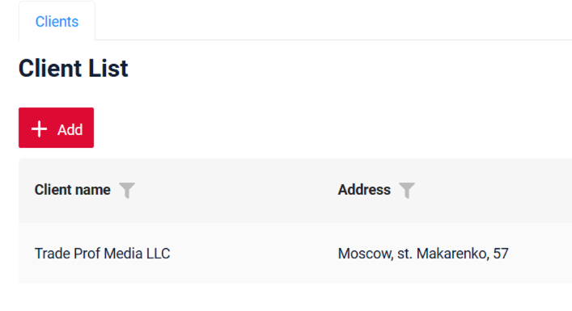

Как добавить?

??? Example "Пример"

    **Шаг 1**
    Задайте заголовок в JSON экрана:  `ui.view.clients`

    ```json
    --8<--
    {{ external_links.github_raw_doc }}/feature/locale/client.screen.json
    --8<--
    ``` 

    **Шаг 2**
      Добавьте перевод в `src/main/resources/ui/messages_fr.properties`:
    
      ```properties
      ui.view.clients=Clientes
      ```
    
    Используйте рекомендуемые префиксы ключей:
    
    * `ui.*` — тексты UI


##### Заголовки экранов (Screen) { #screen-titles }

Заголовки экранов определяют название экрана в UI.

Как это выглядит?
=== "французский"
    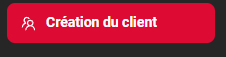 
=== "английский"
    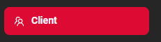
 
Как добавить?

??? Example "Пример"
    
    **Шаг 1**
    Задайте заголовок в JSON экрана:  `ui.screen.screenname`

    ```json
    --8<--
    {{ external_links.github_raw_doc }}/feature/locale/client.screen.json
    --8<--
    ``` 

    **Шаг 2**
      Добавьте перевод в `src/main/resources/ui/messages_fr.properties`:
    
      ```properties
        ui.screen.screenname=Fonctionnalités locales
      ```
    
    Используйте рекомендуемые префиксы ключей:
    
    * `ui.*` — тексты UI


##### Placeholder для FullTextSearch { #fulltextsearch-placeholder }

Как это выглядит?
=== "французский"
    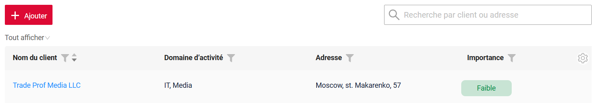
=== "английский"
    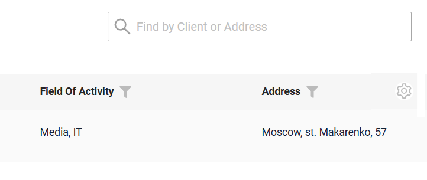

Как добавить?
??? Example "Пример"

    **Шаг 1**
    Используйте ключ перевода в JSON виджета: `ui.client.find.placeholder`

    ```json
    --8<--
    {{ external_links.github_raw_doc }}/feature/locale/clientList.widget.json
    --8<--
    ```  

    **Шаг 2**
      Добавьте перевод в `src/main/resources/ui/messages_fr.properties`:
    
      ```properties
      ui.client.find.placeholder=Recherche par client ou adresse
      ```

    Используйте рекомендуемые префиксы ключей:
    
    * `ui.*` — тексты UI

### <a id="action">Статический текст: заданный в Java</a>
 Сюда относится текст UI, создаваемый на бэкенде, например:

* Подписи кнопок
* Сообщения во всплывающих окнах
* Сообщения валидации
* и т. д.

!!! warning "Внимание"
    Важно отличать **статику** от **данных**, которые также передаются из Java.
    Под *данными* понимаются значения, которые могут меняться (пользователем, через админку и т. д.) и/или для которых доступны дополнительные функции — поиск, сортировка, полнотекстовый поиск и т. д.
    Поэтому для статического текста, заданного в Java, достаточно перевести значение непосредственно перед отправкой на фронтенд — в любом месте Java-кода с помощью соответствующего выражения.
    **Данные** же должны поддерживать редактирование, поиск и сортировку. Поэтому добавляется задача **обратного перевода** — преобразования локализованного значения, полученного из UI, обратно во внутреннее представление. Это более сложная задача, она рассматривается в разделе [Локализация данных](#datalocalization).


Перевод можно выполнить в любом месте Java-кода, где значение готовится для UI.
Используйте метод LocalizationFormatter.uiMessage("action.add")

#### Примеры локализации { #examples-localization_1 }

##### Действия { #actions }
Как это выглядит?

=== "французский"
    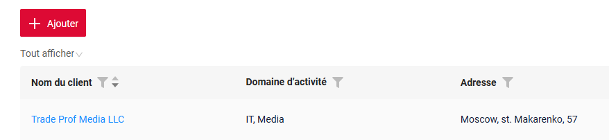
=== "английский"
    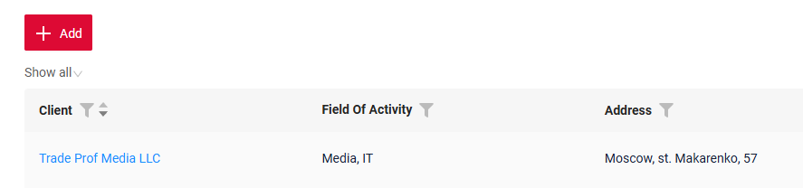 
 
Как добавить?

??? Example "Пример"
    **Шаг 1**
    Добавьте перевод LocalizationFormatter.uiMessage() для кнопки

    ```java
    --8<--
    {{ external_links.github_raw_doc }}/feature/locale/Myexample6103Service.java:getActions
    --8<--
    ```  

    **Шаг 2**
      Добавьте перевод в `src/main/resources/ui/messages_fr.properties`:
    
      ```properties
      action.add=Ajouter 
      ```
    
    Используйте рекомендуемые префиксы ключей:
    
    * `action.*` — кнопки и действия

##### Сообщения бизнес-исключений { #business-exception-messages }

Как это выглядит?

=== "французский"
    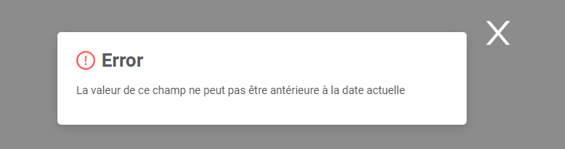
=== "английский"
    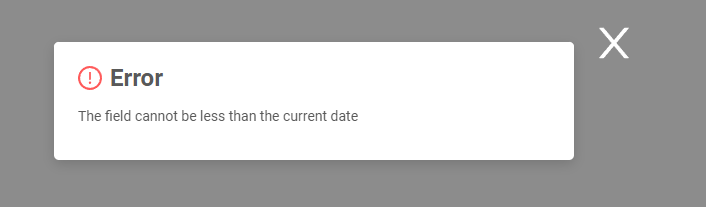

Как добавить?

??? Example "Пример"
    **Шаг 1**
    Добавьте перевод LocalizationFormatter.uiMessage() в сообщение исключения

    ```java
    --8<--
    {{ external_links.github_raw_doc }}/feature/locale/Myexample6103Service.java:doUpdateEntity
    --8<--
    ```  

    **Шаг 2**
      Добавьте перевод в `src/main/resources/ui/messages_fr.properties`:
    
    ```properties
    business.exception.less.current.date=La valeur de ce champ ne peut pas être antérieure à la date actuelle
    ``` 

## <a id="datalocalization">Локализация данных</a>

* [Enum](#enum)
* [Dictionary](#dictionary)

!!! warning "Внимание"
    Под «данными» понимается информация, которая может изменяться (пользователями, через админку и т. д.) и/или поддерживает дополнительные функции — поиск, сортировку, полнотекстовый поиск и т. д. Функция LocalizationFormatter.uiMessage() выполняет перевод только в одну сторону, а для данных нужны редактирование, поиск, полнотекстовый поиск и сортировка. Поскольку эта функция не поддерживает обратный перевод, мы не рекомендуем использовать LocalizationFormatter.uiMessage() для данных

#### <a id="enum">Enum</a>
Как это выглядит?

=== "французский"
    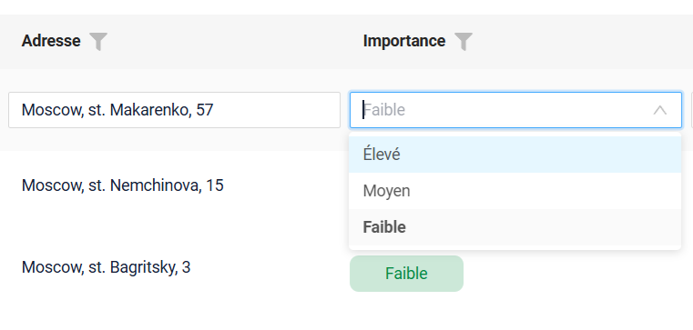
=== "английский"
    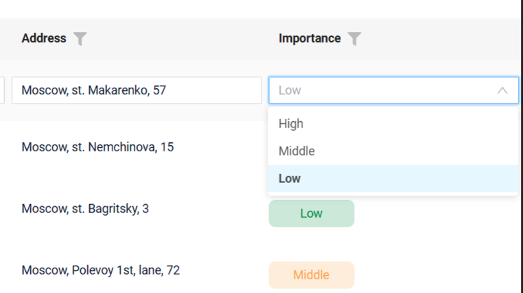

Как добавить?

??? Example "Пример"
    === "первоначальная настройка"
    **Шаг 1**  Добавьте PlatformLocaleEnum.java в /conf/cxbox/extension/locale

    ```java
    --8<--
    {{ external_links.github_raw }}/conf/cxbox/extension/locale/PlatformLocaleEnum.java
    --8<--
    ```  
    **Шаг 2**  Добавьте SupportedLanguages.java

    ```java
    --8<--
    {{ external_links.github_raw }}/conf/cxbox/extension/locale/SupportedLanguages.java
    --8<--
    ```  
    **Шаг 3**  Добавьте LocaleEnum.java
    Каждая константа enum должна задавать значение для каждой поддерживаемой локали.
    Локализация настраивается через map #translations().

    ```java
    --8<--
    {{ external_links.github_raw }}/conf/cxbox/extension/locale/LocaleEnum.java
    --8<--
    ```  
    **Шаг 4**  Реализуйте LocaleEnum.java

    ```java
    --8<--
    {{ external_links.github_raw_doc }}/feature/locale/enums/StatusEnum.java
    --8<--
    ```  

#### <a id="dictionary">Справочник (Dictionary)</a>

Как это выглядит?

=== "французский"
    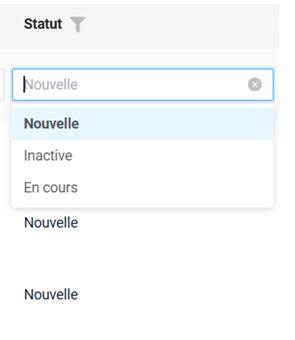
=== "английский"
    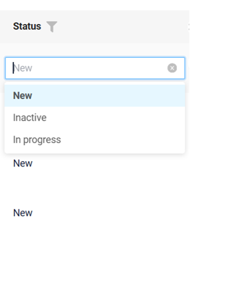

Как добавить?

??? Example "Пример"
    Необходимо заполнить таблицу `dictionary_item_tr` переведёнными значениями для каждого справочника, указав значение нового языка в колонке `language`.
    
    **Шаг 1** Добавьте новую колонку `VALUE_FR`
    ```
        <column name="VALUE_FR" remarks="French language" type="VARCHAR2(255)"/>
    ```
    **Шаг 2** Добавьте новую колонку `VALUE_FR` в DICTIONARY.csv

    ```csv
    TYPE;KEY;VALUE;VALUE_FR;DISPLAY_ORDER;DESCRIPTION;ACTIVE;ID
    BRIEFINGS;PROJECT;Project;Projet;1;;;
    BRIEFINGS;SECURITY;Security;Sécurité;2;;;
    BRIEFINGS;MARKET;Market;Marché;3;;;
    ```

    **Шаг 3** Добавьте value_fr в insert для dictionary_item_tr

    ```
    <sql>
      insert into dictionary_item_tr (id, language, value)
      select id, 'en', value from dictionary_item
      union all
      select id, 'fr', value_fr from dictionary_item;
    </sql>
    ```