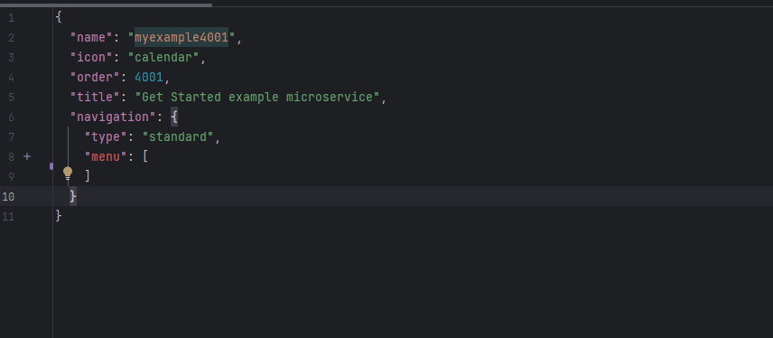
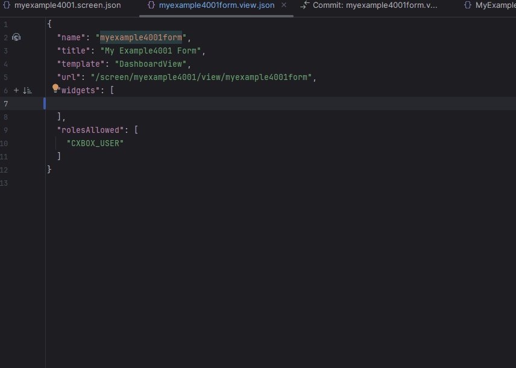

# Добавление нового поля на новый экран { #add-new-field-to-new-screen }
(подробнее см. [Микросервисы](https://doc.cxbox.org/ru/features/element/microservices/microservices/))

Задача для разработчика:

* Нужно создать поле на новом экране.
* Экран должен выглядеть так:


[:material-play-circle: Живой пример]({{ external_links.code_samples }}/ui/#/screen/myexample4001){:target="_blank"} ·
[:fontawesome-brands-github: GitHub]({{ external_links.github_ui }}/{{ external_links.github_branch }}/src/main/java/org/demo/documentation/getstarted/microservice/example){:target="_blank"}
=== "С плагином (рекомендуется)"

    **Шаг 1** [Скачайте плагин для IntelliJ](https://doc.cxbox.org/ru/plugin/plugininstalling)

    **Шаг 2** Добавьте **screen**

    Создайте файл **screen.json**

    ```json 
    {
      "name": "myexample4001",
      "icon": "calendar",
      "order": 4001,
      "title": "Get Started example microservice",
      "navigation": {
        "menu": [
        ]
      }
    }
    ```
    
    **Шаг 3** Создайте и добавьте **view** в соответствующий **screen.json**

     

    **Шаг 4** Создайте и добавьте **widget** в соответствующий **view.json**

    

    **Шаг 5** Создайте **DAO**, **DTO**, **Service**. Добавьте в соответствующий **Controller**
    
    
    **Шаг 6** Добавьте поле в соответствующий **widget.json**
    см. [Добавление поля](/ru/gettingstarted/microservice/addfield)

=== "Пример написания кода"

    ## **Шаг 1** Создайте **DAO**, **DTO**, **Service**, **Controller** { #step1-create-dao-dto-service-controller }
    см. [Подготовка окружения](/ru/gettingstarted/microservice/addenvironment)
    
    ## **Шаг 2** Добавьте **screen** { #step2-add-screen }
    см. [Добавление экрана](/ru/gettingstarted/microservice/addscreen)
    
    ## **Шаг 3** Добавьте **view** в соответствующий **screen.json** { #step3-add-view-to-corresponding-screenjson }
    см. [Добавление представления](/ru/gettingstarted/microservice/addview)
    
    ## **Шаг 4** Добавьте **widget** в соответствующий **view.json** { #step4-add-widget-to-corresponding-viewjson }
    см. [Добавление виджета](/ru/gettingstarted/microservice/addwidget)
    
    ## **Шаг 5** Добавьте поле в соответствующий **widget.json** { #step5-add-field-to-corresponding-widgetjson }
    см. [Добавление поля](/ru/gettingstarted/microservice/addfield)
