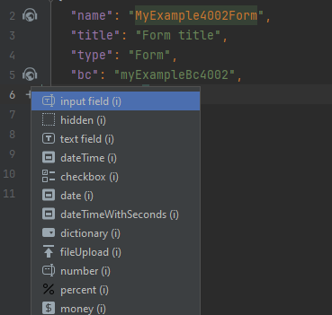
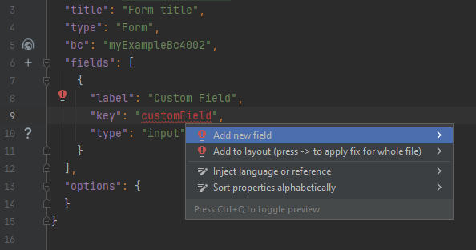
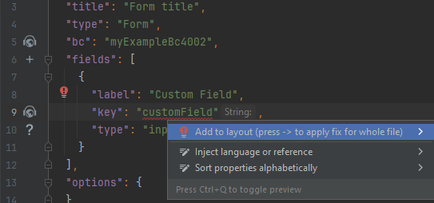
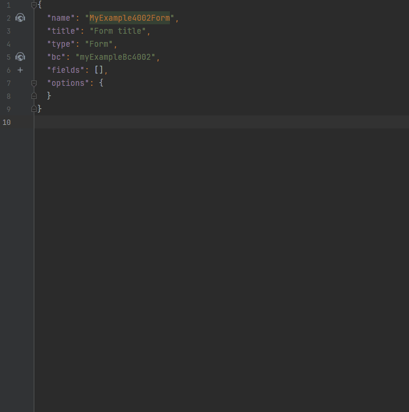

# Добавление нового поля на существующий экран { #add-new-field-to-an-existing-screen }

Добавьте поле в соответствующий **widget.json**

## Шаг 1 Добавьте поле в виджет { #step1-add-field-to-widget }

        

## Шаг 2 Добавьте поле в entity, DTO { #step2-add-field-to-entity-dto }

      

## Шаг 3 Добавьте поле в layout { #step3-add-field-to-layout }

   

## Пример { #example }
     