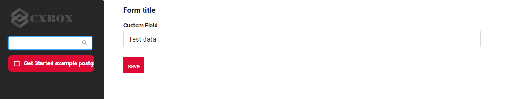

# Добавление нового поля на экран { #add-new-field-to-screen }
Задача — добавить новое поле в интерфейс.

Экран должен выглядеть так:

[:material-play-circle: Живой пример]({{ external_links.code_samples }}/ui/#/screen/myexample4002){:target="_blank"} ·
[:fontawesome-brands-github: GitHub]({{ external_links.github_ui }}/{{ external_links.github_branch }}/src/main/java/org/demo/documentation/getstarted/postgres/example){:target="_blank"}

## **Шаг 1** Создайте **DAO**, **DTO**, **Service**, **Controller** { #step1-create-dao-dto-service-controller }
см. [Подготовка окружения](/ru/gettingstarted/postgres/addenvironment)

## **Шаг 2** Добавьте **screen** { #step2-add-screen }
см. [Добавление экрана](/ru/gettingstarted/postgres/addscreen)

## **Шаг 3** Добавьте **view** в соответствующий **screen.json** { #step3-add-view-to-corresponding-screenjson }
см. [Добавление представления](/ru/gettingstarted/postgres/addview)

## **Шаг 4** Добавьте **widget** и **field** в соответствующий **view.json** { #step4-add-widget-and-field-to-corresponding-viewjson }
см. [Добавление виджета и поля](/ru/gettingstarted/postgres/addwidget)

#### Пример { #example }

