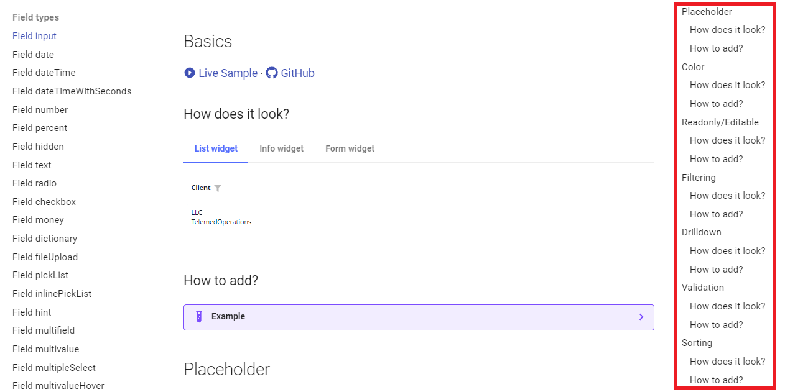
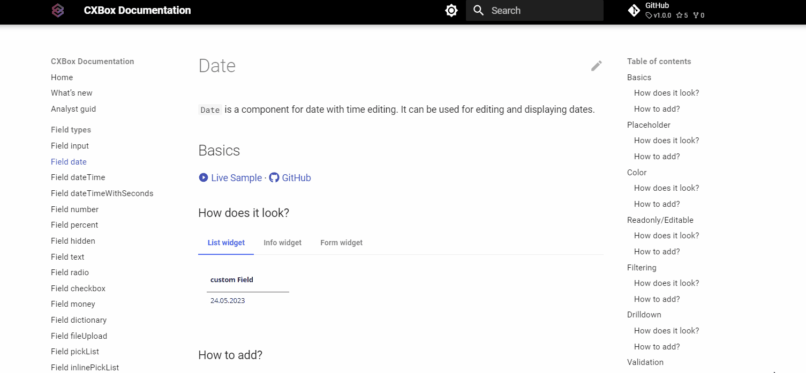
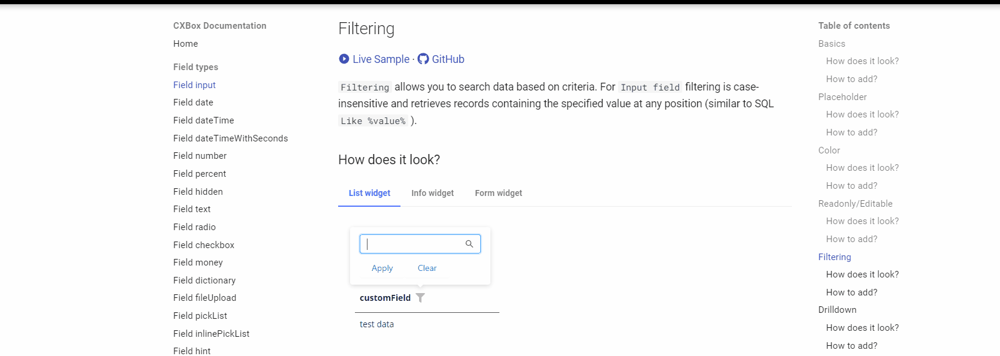

# Руководство для аналитиков { #guide-for-analysts }
## Как пользоваться { #how-to-use }
### Добавление типа поля { #add-field-type }
Я хочу добавить поле в интерфейс и изучить его свойства и возможности.

Как это сделать?
#### 1) Выберите тип поля { #1-choose-field-type }

Слева находится меню, в котором можно выбрать нужный тип поля,
и вы легко можете поделиться ссылкой на этот тип поля с разработчиком

#### 2) Выберите функцию { #2-choose-function }

При нажатии на тип поля отобразится меню,
открывающее доступ ко всем возможным сценариям работы с этим полем.

Например, если вы хотите узнать, как работает фильтрация для определённого типа поля,
достаточно выбрать ссылку "Filtering - How does it look?", чтобы изучить эту функциональность.

#### 3) Изучите описание особенностей работы { #3-look-at-the-description-about-explanation-of-operational-intricacies }

В этом разделе приведено описание возможностей функции и её визуального отображения на экране.

#### 4) Посмотрите живой пример { #4-look-at-the-live-example }

Если описания недостаточно, по ссылке можно перейти в раздел живых примеров.
Там можно поработать с примером напрямую и лучше понять, как работает это поле.