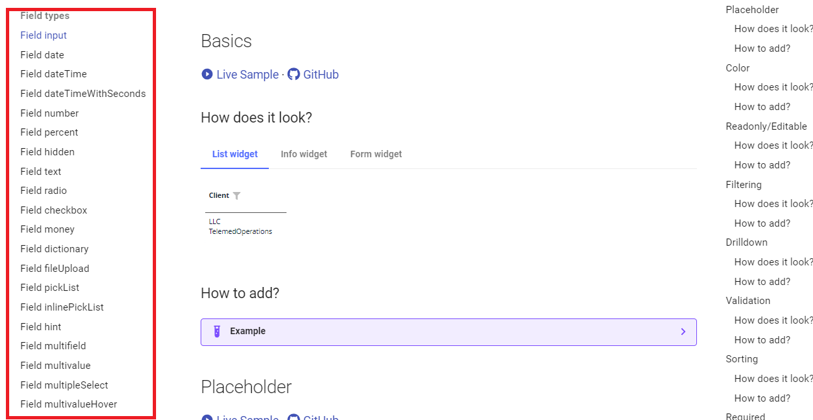
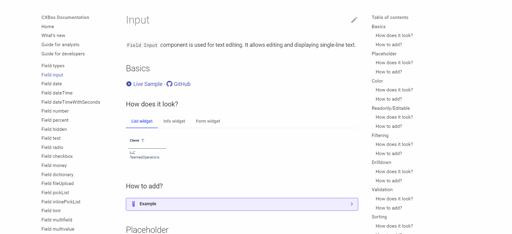
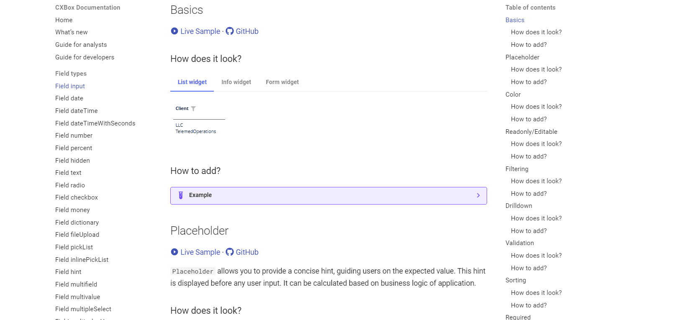
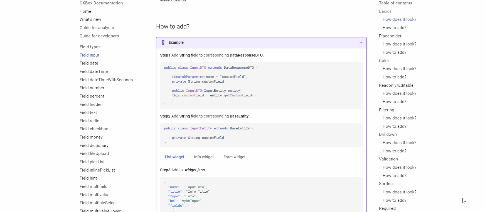

# Руководство для разработчиков { #guide-for-developers }
## Как пользоваться { #how-to-use }
### Добавление поля с нужной функцией { #add-a-field-add-the-desired-function }
Задача — добавить поле определённого типа с нужной функцией

Как это сделать?
#### 1) Выберите тип поля { #1-choose-field-type }

Слева находится меню, в котором можно выбрать нужный тип поля,

#### 2) Выберите функцию Basics { #2-choose-basics-function }

При нажатии на тип поля отобразится меню,
открывающее доступ ко всем возможным сценариям работы с этим полем.

Выберите ссылку "Basics - How to add?".
В этом разделе показано, какие базовые действия нужно выполнить, чтобы добавить поле нужного типа

#### 3) Добавьте нужную функцию { #3-add-the-desired-function }

Например, если вы хотите узнать, как работает фильтрация для определённого типа поля,
достаточно выбрать ссылку "Filtering - How does it look?", чтобы изучить эту функциональность.

В этом разделе приведено описание возможностей функции.

#### 4) Посмотрите пример кода { #4-look-at-the-code-sample }

Если описания недостаточно, по ссылке можно перейти в раздел примеров кода.
Там можно поработать с примером напрямую и лучше понять, как добавить это поле.