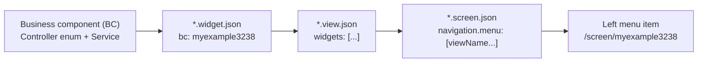
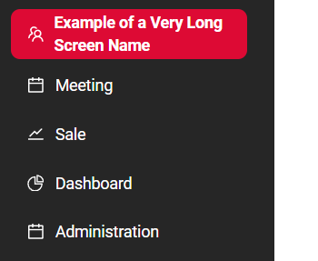
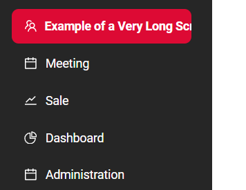
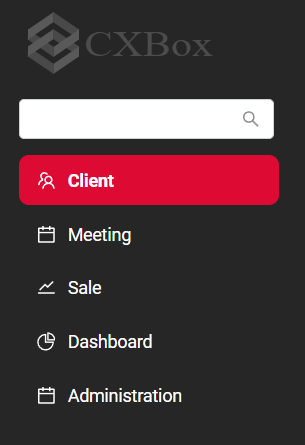
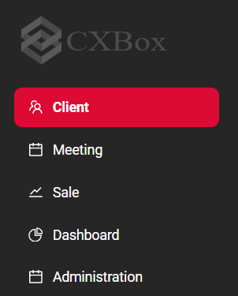

# Screen

**`Screen`** is the top-level element of the user interface navigation. Each screen is a separate item in the left navigation menu.
When a user selects a screen, the application opens one of its [views](/navigation/view/view/).

A screen is used to:

* group views that work with one business entity or one business process (for example, *Clients*: list of clients, client card, client contacts);
* add an item to the left navigation menu (title, icon, order);
* define the navigation (tabs) between views inside the screen;
* define which view opens first when the user selects the screen.

Screen is described in the **`*.screen.json`** file.

## How is a screen assembled?

The screen is assembled from the bottom up:

* **Widget** (`*.widget.json`) displays the data of a business component (BC). See [Widget](/widget/type/widget/).
* **View** (`*.view.json`) places widgets on the page. See [View](/navigation/view/view/).
* **Screen** (`*.screen.json`) combines views and builds the navigation (tabs) between them.



When the application starts, CXBox reads all `*.screen.json` files (by default, the path is `/**/*.screen.json`, property `cxbox.meta.screen-path`) and for each screen:

1. Collects the list of views from `navigation.menu` (including all nested `child` levels).
2. Takes the widgets of these views and collects the list of business components (BC) used by the widgets (including BCs from the widget `hierarchy` option).
   The parent-child relationship between BCs is taken from the controller enum (`EnumBcIdentifier`), for example `myexample3239(myexample3238, MyExample3239Service.class)`.
3. Builds the tabs tree from `navigation.menu`.

When the user logs in, the backend returns only those screens and views that are available for the user roles (see [rolesAllowed](/environment/userrole/userrole/)):

* views not available for the user's role are removed from the screen;
* a screen without available views is not displayed in the left menu;
* screens in the left menu are sorted by `order`, then by `name`.

!!! info
    Only views listed in `navigation.menu` belong to the screen. A view that exists in `*.view.json` but is not added to any screen cannot be opened.

### URL

The screen URL is `/screen/<screen name>`. The view URL inside the screen is `/screen/<screen name>/view/<view name>`.
Therefore, the `url` in `*.view.json` must contain the name of the screen the view is added to:

```json
{
  "name": "myexample3238list",
  "url": "/screen/myexample3238/view/myexample3238list"
}
```

The same URL is used for navigation from the code, for example, for a [drilldown](/features/element/drilldown/drilldown/):

```java
fields.setDrilldown(
    MyExample3238DTO_.fullName,
    DrillDownType.INNER,
    "/screen/myexample3238/view/myexample3238form/" + CxboxMyExample3238Controller.myexample3238 + "/" + id
);
```

## JSON structure

```json
{
  "name": "myexample5000",
  "icon": "calendar",
  "order": 5000,
  "title": "Screen basic",
  "navigation": {
    "type": "standard",
    "menu": [
      {
        "title": "List",
        "child": [
          {
            "viewName": "MyExample5000list"
          }
        ]
      }
    ]
  }
}
```

Root properties:

| Property          | Type   | Required | Description                                                                                                                                         |
|-------------------|--------|----------|-----------------------------------------------------------------------------------------------------------------------------------------------------|
| `name`            | string | yes      | Unique screen name. Used in the URL: `/screen/<name>`.                                                                                              |
| `title`           | string | yes      | Screen title displayed in the left menu.                                                                                                            |
| `icon`            | string | no       | Icon of the screen in the left menu (e.g., `calendar`).                                                                                             |
| `order`           | number | no       | Position of the screen in the left menu (ascending). Default `0`.                                                                                   |
| `navigation`      | object | yes      | Navigation (tabs) between views of the screen.                                                                                                      |
| `primaryViewName` | string | no       | View that opens when the screen is selected. See [primaryViewName](/navigation/tabs/standard/basic/tab/#primaryviewname).                          |
| `primaryViews`    | array  | no       | List of views to open when the screen is selected, depending on the user's roles. See [primaryViews](/navigation/tabs/standard/basic/tab/#primaryviews). |

Navigation properties:

| Property | Type   | Description                                                                 |
|----------|--------|-----------------------------------------------------------------------------|
| `type`   | string | Navigation type. `standard` - tabs. See [Tabs](/navigation/tabs/standard/basic/tab/). |
| `menu`   | array  | Menu items: views and groups of views (tabs of the second level).           |

Menu item properties:

| Property      | Type    | Description                                                                                                                                                          |
|---------------|---------|----------------------------------------------------------------------------------------------------------------------------------------------------------------------|
| `viewName`    | string  | Name of the view. Item with `viewName` is a [Single view](/navigation/tabs/standard/basicdevelop/tabfordevelop/#how-add-a-view-to-the-screen).                        |
| `title`       | string  | Title of the tab for a group of views.                                                                                                                               |
| `child`       | array   | Nested menu items. Item with `child` is an [Aggregate view](/navigation/tabs/standard/basicdevelop/tabfordevelop/#how-add-a-view-to-the-screen) (next tab level).     |
| `hidden`      | boolean | `true` - the tab is not displayed, but the view can be opened by URL (e.g., drilldown). Default `false`. See [Hidden](/navigation/tabs/standard/basic/tab/#hidden). |
| `defaultView` | string  | View that opens when a group of views is selected. See [defaultView](/navigation/tabs/standard/basic/tab/#defaultview).                                             |

!!! info
    The rules for building the tabs tree (unique view names, no empty `child` arrays, at least one view per level) are described in [Rules for rendering tabs](/navigation/tabs/standard/basicdevelop/tabfordevelop/#rules_rendering).

## Basic
[:material-play-circle: Live Sample]({{ external_links.code_samples }}/ui/#/screen/myexample5000){:target="_blank"} ·
[:fontawesome-brands-github: GitHub]({{ external_links.github_ui }}/{{ external_links.github_branch }}/src/main/java/org/demo/documentation/screen/basic){:target="_blank"}

### How to add?
??? Example
    **Step 1** Create a business component: controller enum, DTO, entity, repository, service, meta.

    **Step 2** Create a widget for the business component.
    ```json
    --8<--
    {{ external_links.github_raw_doc }}/screen/basic/myexample5000list.widget.json
    --8<--
    ```

    **Step 3** Create a view and add the widget to it. The `url` of the view contains the screen name.
    ```json
    --8<--
    {{ external_links.github_raw_doc }}/screen/basic/MyExample5000list.view.json
    --8<--
    ```

    **Step 4** Create a **.screen.json** and add the view to `navigation.menu`.
    ```json
    --8<--
    {{ external_links.github_raw_doc }}/screen/basic/myexample5000.screen.json
    --8<--
    ```

    !!! tip
        Add screens and views with the [plugin](/gettingstarted/postgres/addscreen/).

## Screen without icon
[:material-play-circle: Live Sample]({{ external_links.code_samples }}/ui/#/screen/myexample5001){:target="_blank"} ·
[:fontawesome-brands-github: GitHub]({{ external_links.github_ui }}/{{ external_links.github_branch }}/src/main/java/org/demo/documentation/screen/withouticon){:target="_blank"}

The `icon` property is optional.

??? Example
    ```json
    --8<--
    {{ external_links.github_raw_doc }}/screen/withouticon/myexample5001.screen.json
    --8<--
    ```

## Typical use case
[:material-play-circle: Live Sample]({{ external_links.code_samples }}/ui/#/screen/myexample3238){:target="_blank"} ·
[:fontawesome-brands-github: GitHub]({{ external_links.github_ui }}/{{ external_links.github_branch }}/src/main/java/org/demo/documentation/navigation/tab/typestandard/defaultview/typicalexample){:target="_blank"}

Screen *Clients*:

* `myexample3238list` - list of clients. Opens when the screen is selected (the first view in `menu`).
* `myexample3238form` - client card with the list of contacts. Opens by drilldown from the list.
* `myexample3239form` - client card with the contact form.

The client card views are combined into the group *Form Client* (`child`). They are `hidden`, so the second-level tabs are not displayed,
and `defaultView` defines the view that opens when the group tab is selected.

BCs of the screen: `myexample3238` (clients) and its child `myexample3239` (contacts):

```java
myexample3238(MyExample3238Service.class),
myexample3239(myexample3238, MyExample3239Service.class);
```

??? Example
    **Step 1** Create views. The client card views contain the system widgets [SecondLevelMenu](/navigation/tabs/standard/basic/tab/#SecondLevel) and [ThirdLevelMenu](/navigation/tabs/standard/basic/tab/#thirdlevelmenu).
    === "myexample3238list"
        ```json
        --8<--
        {{ external_links.github_raw_doc }}/navigation/tab/typestandard/defaultview/typicalexample/myexample3238list.view.json
        --8<--
        ```
    === "myexample3238form"
        ```json
        --8<--
        {{ external_links.github_raw_doc }}/navigation/tab/typestandard/defaultview/typicalexample/myexample3238form.view.json
        --8<--
        ```
    === "myexample3239form"
        ```json
        --8<--
        {{ external_links.github_raw_doc }}/navigation/tab/typestandard/defaultview/typicalexample/myexample3239form.view.json
        --8<--
        ```

    **Step 2** Add the views to the **.screen.json**.
    ```json
    --8<--
    {{ external_links.github_raw_doc }}/navigation/tab/typestandard/defaultview/typicalexample/myexample3238.screen.json
    --8<--
    ```

    **Step 3** Add a drilldown from the list to the client card.
    ```java
    --8<--
    {{ external_links.github_raw_doc }}/navigation/tab/typestandard/defaultview/typicalexample/MyExample3238Meta.java
    --8<--
    ```

More examples of navigation inside a screen: [Tabs](/navigation/tabs/standard/basic/tab/).

## Additional properties

### Screen Name Wrapping in Left Menu

When using the application, screen names in the left navigation panel can sometimes be long.
You can control how these names are displayed.

Screen names:

* remain on a single line. No line breaks are applied (Default behavior)
* can wrap to multiple lines if they do not fit within the left panel

#### How does it look?
=== "multiple lines"
    
=== "single line"
    

#### How to add?
??? Example
    
    | Value       | Behavior Description                                                                                                         |
    | ----------- | ---------------------------------------------------------------------------------------------------------------------------- |
    | **not set** | Screen names remain on a single line. No line breaks are applied.                                                            |
    | **none**    | Same as the default behavior: screen names stay on a single line.                                                            |
    | **auto**    | Screen names can wrap to multiple lines if they do not fit within the left panel width. There is no line length restriction. |

    **Step 1** Add the `sideBarWordBreak` parameter to `application.yml`

    ```yml
    cxbox:
        ui: 
            side-bar-word-break: auto
    ```

    **Step 2** Add the `sideBarWordBreak` parameter to `LoginServiceImpl`  

    ```java
	public Collection<SimpleDictionary> getFeatureSettings() {
		return Stream.of(
    						feature(
								UIProperties.SIDE_BAR_WORD_BREAK,
								uiProperties.getSideBarWordBreak()
						),
    ```


### Screen Search in Left Menu

The application allows controlling whether the screen search in the left navigation panel is displayed for a user. 

The screen search is :

* always visible when the left menu is expanded (Default behavior)
* not rendered in the expanded left menu for the user

#### How does it look?
=== "always visible"
    
=== "not rendered"
    
#### How to add?
??? Example
    
    | Value       | Behavior Description                                                                  |
    | ----------- | ------------------------------------------------------------------------------------- |
    | **not set** | Default behavior: the screen search is always visible when the left menu is expanded. |
    | **true**    | Same as default: the screen search is always visible.                                 |
    | **false**   | The screen search is not rendered in the expanded left menu for the user.             |

    **Step 1** Add the `sideBarSearchEnabled` parameter to `application.yml`

    ```yml
    cxbox:
        ui: 
            side-bar-search-enabled: true
    ```

    **Step 2** Add the `sideBarSearchEnabled` parameter to `LoginServiceImpl`  

    ```java
	public Collection<SimpleDictionary> getFeatureSettings() {
		return Stream.of(
 						feature(
								UIProperties.SIDE_BAR_SEARCH_ENABLE,
								uiProperties.getSideBarSearchEnabled()
						),
    ```
