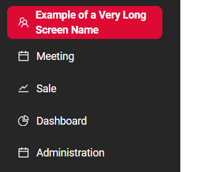
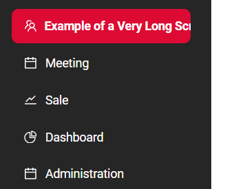
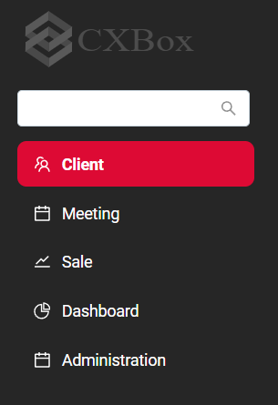
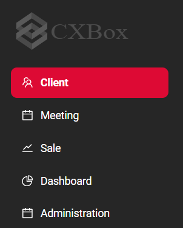

# Экран (Screen) { #screen }
!!! warning line end "В разработке"

## Дополнительные свойства { #additional-properties }

### Перенос названий экранов в левом меню { #screen-name-wrapping-in-left-menu }

Названия экранов в левой панели навигации иногда бывают длинными.
Можно управлять тем, как они отображаются.

Названия экранов:

* остаются в одну строку. Переносы строк не применяются (поведение по умолчанию)
* могут переноситься на несколько строк, если не помещаются в левую панель

#### Как это выглядит? { #how-does-it-look }
=== "несколько строк"
    
=== "одна строка"
    

#### Как добавить? { #how-to-add }
??? Example "Пример"
    
    | Значение    | Описание поведения                                                                                                           |
    | ----------- | ---------------------------------------------------------------------------------------------------------------------------- |
    | **не задано** | Названия экранов остаются в одну строку. Переносы строк не применяются.                                                    |
    | **none**    | Аналогично поведению по умолчанию: названия экранов остаются в одну строку.                                                  |
    | **auto**    | Названия экранов могут переноситься на несколько строк, если не помещаются по ширине левой панели. Ограничения длины строки нет. |

    **Шаг 1** Добавьте параметр `sideBarWordBreak` в `application.yml`

    ```yml
    cxbox:
        ui: 
            side-bar-word-break: auto
    ```

    **Шаг 2** Добавьте параметр `sideBarWordBreak` в `LoginServiceImpl`

    ```java
	public Collection<SimpleDictionary> getFeatureSettings() {
		return Stream.of(
    						feature(
								UIProperties.SIDE_BAR_WORD_BREAK,
								uiProperties.getSideBarWordBreak()
						),
    ```


### Поиск экранов в левом меню { #screen-search-in-left-menu }

Приложение позволяет управлять тем, отображается ли пользователю поиск экранов в левой панели навигации.

Поиск экранов:

* всегда виден, когда левое меню развёрнуто (поведение по умолчанию)
* не отображается пользователю в развёрнутом левом меню

#### Как это выглядит? { #how-does-it-look_1 }
=== "всегда виден"
    
=== "не отображается"
    
#### Как добавить? { #how-to-add_1 }
??? Example "Пример"
    
    | Значение    | Описание поведения                                                                    |
    | ----------- | ------------------------------------------------------------------------------------- |
    | **не задано** | Поведение по умолчанию: поиск экранов всегда виден, когда левое меню развёрнуто.    |
    | **true**    | Аналогично поведению по умолчанию: поиск экранов всегда виден.                        |
    | **false**   | Поиск экранов не отображается пользователю в развёрнутом левом меню.                  |

    **Шаг 1** Добавьте параметр `sideBarSearchEnabled` в `application.yml`

    ```yml
    cxbox:
        ui: 
            side-bar-search-enabled: true
    ```

    **Шаг 2** Добавьте параметр `sideBarSearchEnabled` в `LoginServiceImpl`

    ```java
	public Collection<SimpleDictionary> getFeatureSettings() {
		return Stream.of(
 						feature(
								UIProperties.SIDE_BAR_SEARCH_ENABLE,
								uiProperties.getSideBarSearchEnabled()
						),
    ```
 
<!-- 
1. Определите корневой объект:
    - Создайте JSON-объект со следующими свойствами: name, icon, order, title и navigation.

2. Задайте базовые свойства:
    - name: уникальный идентификатор файла.
    - icon: строка, задающая тип иконки для этой конфигурации (например, "calendar").
    - order: числовое значение, задающее порядок или приоритет.
    - title: описательный заголовок конфигурации.


## Структура JSON { #json-structure }
Этот JSON описывает структуру меню навигации

```json
{
  "name": "myexample",
  "icon": "calendar",
  "order": 12,
  "title": "My example screen",
  "navigation": {
    "type": "standard",
    "menu": [
      
    ]
  }
}
```

Корневые свойства:

| Свойство     | Тип    | Описание                                          |
| ------------ | ------ | ------------------------------------------------- |
| `name`       | string | Уникальный идентификатор модуля.                  |
| `icon`       | string | Имя иконки модуля (например, "calendar").         |
| `order`      | number | Порядок отображения модуля в UI.                  |
| `title`      | string | Заголовок, отображаемый в UI.                     |
| `navigation` | object | Настройки навигации модуля.                       |

Свойства навигации:

| Свойство | Тип    | Описание                              |
| -------- | ------ |---------------------------------------|
| `type`   | string | Стиль навигации (например, `standard` ). |
| `menu`   | array  | Массив разделов меню верхнего уровня. |


## Перенос слов в боковой панели (`sideBarWordBreak`) { #sidebar-word-wrapping-sidebarwordbreak }

В объект `featureSettings`, возвращаемый бэкендом при входе пользователя, добавлен новый флаг `sideBarWordBreak`.

Эта настройка определяет, будут ли длинные названия экранов в левом меню навигации переноситься на несколько строк.
 
Доступные значения:

* `none` (по умолчанию): перенос слов не применяется.
* `auto`: включает автоматический перенос слов для названий экранов в боковой панели.

Если название экрана слишком длинное и не помещается по ширине боковой панели, при значении `auto` оно перенесётся на следующую строку.

### Поведение { #behavior }

| Значение `sideBarWordBreak` | Поведение боковой панели                              |
| ------------------------ | -------------------------------------------------------- |
| *Не задано*              | Поведение по умолчанию: названия экранов не переносятся. |
| `none`                   | Аналогично поведению по умолчанию: названия не переносятся. |
| `auto`                   | Длинные названия экранов автоматически переносятся на следующую строку. |

### Пример { #example }

Если название экрана слишком длинное для текущей ширины боковой панели и `sideBarWordBreak` равен `auto`, оно будет выглядеть так:

```
Very Long Screen
Name Example
```
 -->