# Тип standard { #type-standard }
`Tab` — компонент, позволяющий пользователю переключаться между разными компонентами с помощью вкладок.
Вкладки организованы в виде панели вкладок. Если вкладок больше, чем помещается на панели, появляются кнопки навигации для прокрутки вкладок.

* В названиях вкладок можно использовать только **константные** значения.
* Сейчас поддерживается **трёхуровневая иерархия вкладок**.

 

##  <a id="OneLevel">View без вкладок</a>
[:material-play-circle: Живой пример]({{ external_links.code_samples }}/ui/#/screen/myexample32356){:target="_blank"} ·
[:fontawesome-brands-github: GitHub]({{ external_links.github_ui }}/{{ external_links.github_branch }}/src/main/java/org/demo/documentation/navigation/tab/typestandard/basic/onelevel){:target="_blank"}

### Как это выглядит? { #how-does-it-look }
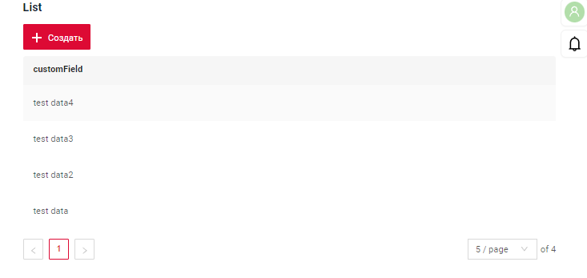

###  Как добавить? { #how-to-add }
??? Example "Пример"
    **Шаг 1** Добавьте бизнес-виджет в **.view.json**, используя свойство [позиции виджета](/ru/navigation/view/view/).
    ```json
    --8<--
    {{ external_links.github_raw_doc }}/navigation/tab/typestandard/basic/onelevel/myexample32356single.view.json
    --8<--
    ```
    **Шаг 2** Добавьте view в **.screen.json** с типом [Single](/ru/navigation/tabs/standard/basicdevelop/tabfordevelop/#how-add-a-view-to-the-screen)
    ```json
    --8<--
    {{ external_links.github_raw_doc }}/navigation/tab/typestandard/basic/onelevel/myexample32356.screen.json
    --8<--
    ```

    


##  <a id="SecondLevel">SecondLevel</a>

### Как это выглядит? { #how-does-it-look_1 }
=== "Сверху"
    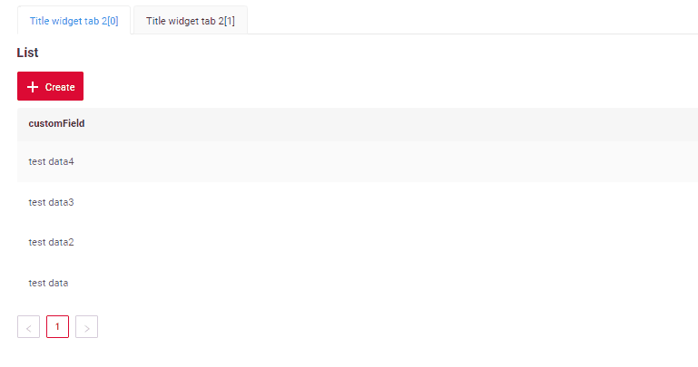

=== "Снизу"
    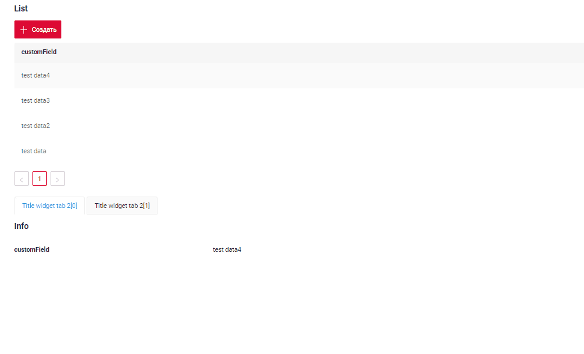

###  Как добавить? { #how-to-add_1 }
??? Example "Пример"
    === "Сверху"
        [:material-play-circle: Живой пример]({{ external_links.code_samples }}/ui/#/screen/myexample32358){:target="_blank"} ·
        [:fontawesome-brands-github: GitHub]({{ external_links.github_ui }}/{{ external_links.github_branch }}/src/main/java/org/demo/documentation/navigation/tab/typestandard/basic/secondlevel/top){:target="_blank"}

        **Шаг 1** Добавьте виджет **SecondLevelMenu** `первым` в **.view.json**, используя свойство [позиции виджета](/ru/navigation/view/view/).
    
        ```json
        --8<--
        {{ external_links.github_raw_doc }}/navigation/tab/typestandard/basic/secondlevel/top/myexample3235second.view.json
        --8<--
        ```
     
        **Шаг 2** Добавьте view в **.screen.json** с типом [Single](/ru/navigation/tabs/standard/basicdevelop/tabfordevelop/#how-add-a-view-to-the-screen)
        ```json
        --8<--
        {{ external_links.github_raw_doc }}/navigation/tab/typestandard/basic/secondlevel/top/myexample32358.screen.json
        --8<--
        ```

        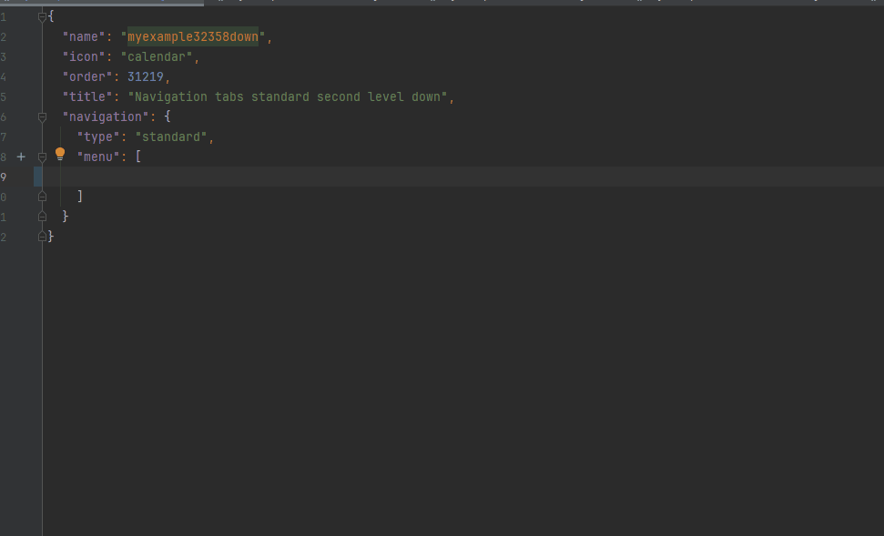
    === "Снизу"
        [:material-play-circle: Живой пример]({{ external_links.code_samples }}/ui/#/screen/myexample32358down){:target="_blank"} ·
        [:fontawesome-brands-github: GitHub]({{ external_links.github_ui }}/{{ external_links.github_branch }}/src/main/java/org/demo/documentation/navigation/tab/typestandard/basic/secondlevel/down){:target="_blank"}

        **Шаг 1** Добавьте виджет **SecondLevelMenu** `после виджета` в **.view.json**, используя свойство [позиции виджета](/ru/navigation/view/view/)
        ```json
        --8<--
        {{ external_links.github_raw_doc }}/navigation/tab/typestandard/basic/secondlevel/down/myexample3235seconddown.view.json
        --8<--
        ```
    
        **Шаг 2** Добавьте view в **.screen.json** с типом [Single](/ru/navigation/tabs/standard/basicdevelop/tabfordevelop/#how-add-a-view-to-the-screen)
        ```json
        --8<--
        {{ external_links.github_raw_doc }}/navigation/tab/typestandard/basic/secondlevel/down/myexample32358down.screen.json
        --8<--
        ```
        

##  <a id="ThirdLevelMenu">ThirdLevelMenu</a>
[:material-play-circle: Живой пример]({{ external_links.code_samples }}/ui/#/screen/myexample3235){:target="_blank"} ·
[:fontawesome-brands-github: GitHub]({{ external_links.github_ui }}/{{ external_links.github_branch }}/src/main/java/org/demo/documentation/navigation/tab/typestandard/basic/thirdlevel){:target="_blank"}
### Как это выглядит? { #how-does-it-look_2 }
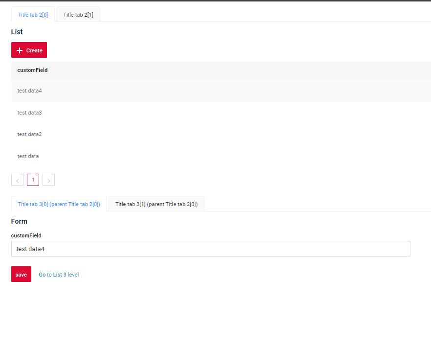

###  Как добавить? { #how-to-add_2 }
??? Example "Пример"
    **Шаг 1** Добавьте виджет **ThirdLevelMenu** после виджета **SecondLevelMenu** в **.view.json**, используя свойство [позиции виджета](/ru/navigation/view/view/)
        подробнее см. [Уровни вкладок](/ru/navigation/tabs/standard/basicdevelop/tabfordevelop/#tab-levels)
    ```json
    --8<--
    {{ external_links.github_raw_doc }}/navigation/tab/typestandard/basic/thirdlevel/myexample3235thirdleveltab1.view.json
    --8<--
    ```

    **Шаг 2** Добавьте view в **.screen.json** с типом [Aggregate](/ru/navigation/tabs/standard/basicdevelop/tabfordevelop/#how-add-a-view-to-the-screen)
     подробнее см. [Как задать название вкладки](/ru/navigation/tabs/standard/basicdevelop/tabfordevelop/#how-add-name-for-tab)
    ```json
    --8<--
    {{ external_links.github_raw_doc }}/navigation/tab/typestandard/basic/thirdlevel/myexample3235.screen.json
    --8<--
    ```
    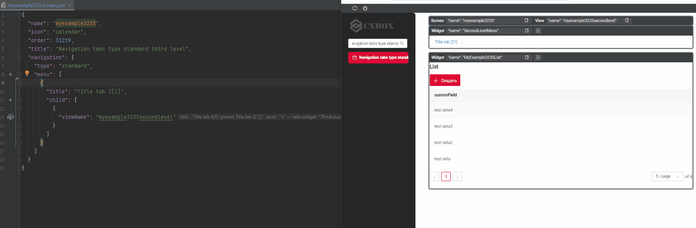

##  <a id="FourthLevelMenu">FourthLevelMenu</a>
 
[:material-play-circle: Живой пример]({{ external_links.code_samples }}/ui/#/screen/myexample32353){:target="_blank"} ·
[:fontawesome-brands-github: GitHub]({{ external_links.github_ui }}/{{ external_links.github_branch }}/src/main/java/org/demo/documentation/navigation/tab/typestandard/basic/fourthlevel){:target="_blank"}
### Как это выглядит? { #how-does-it-look_3 }
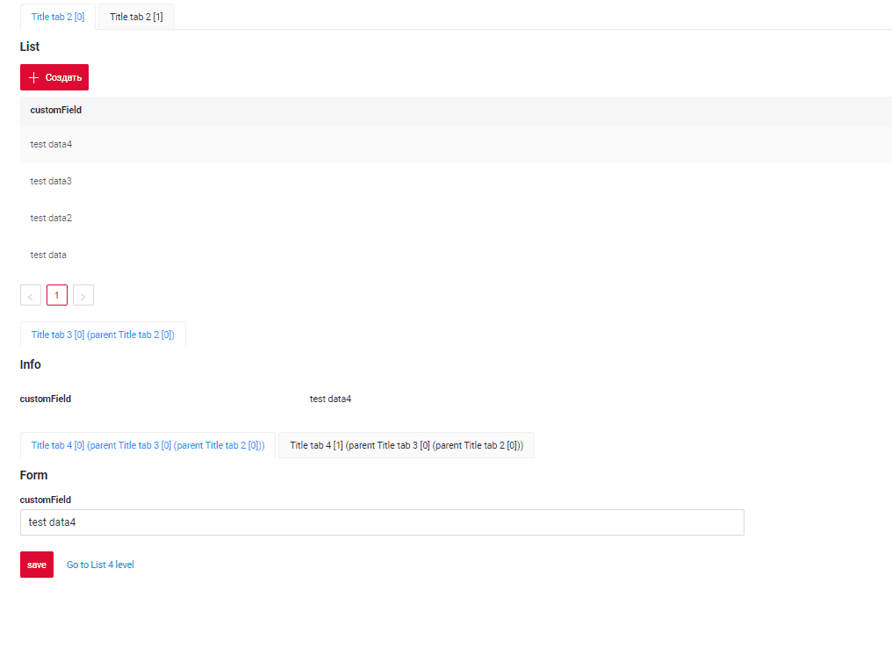 

### Как добавить? { #how-to-add_3 }
??? Example "Пример"
    **Шаг 1** Добавьте виджет **FourthLevelMenu** после виджета **ThirdLevelMenu** в **.view.json**, используя свойство [позиции виджета](/ru/navigation/view/view/)
    подробнее см. [Уровни вкладок](/ru/navigation/tabs/standard/basicdevelop/tabfordevelop/#tab-levels)
    ```json
    --8<--
    {{ external_links.github_raw_doc }}/navigation/tab/typestandard/basic/fourthlevel/myexample3235fourthleveltab1.view.json
    --8<--
    ```

    **Шаг 2** Добавьте view в **.screen.json** с типом [Aggregate](/ru/navigation/tabs/standard/basicdevelop/tabfordevelop/#how-add-a-view-to-the-screen)
    ```json
    --8<--
    {{ external_links.github_raw_doc }}/navigation/tab/typestandard/basic/fourthlevel/myexample32353.screen.json
    --8<--
    ```

    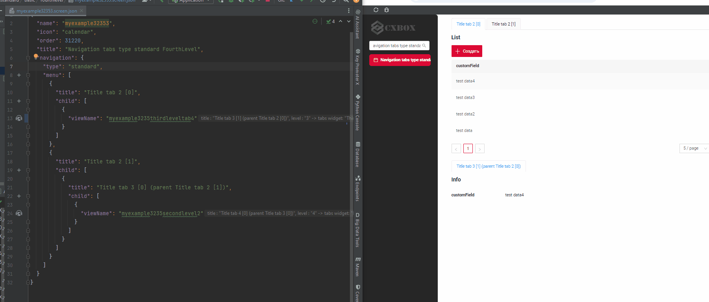

## Дополнительные свойства { #additional-properties }
### <a id="hidden">Скрытый (Hidden)</a>
[:material-play-circle: Живой пример]({{ external_links.code_samples }}/ui/#/screen/myexample32359){:target="_blank"} ·
[:fontawesome-brands-github: GitHub]({{ external_links.github_ui }}/{{ external_links.github_branch }}/src/main/java/org/demo/documentation/navigation/tab/typestandard/hidden){:target="_blank"}

Если view помечен как скрытый, он не отображается в общей иерархии и доступен только по определённой ссылке (например, через drilldown или нажатие кнопки). При выходе из скрытого view он исчезает.

#### Как это выглядит? { #how-does-it-look_4 }
 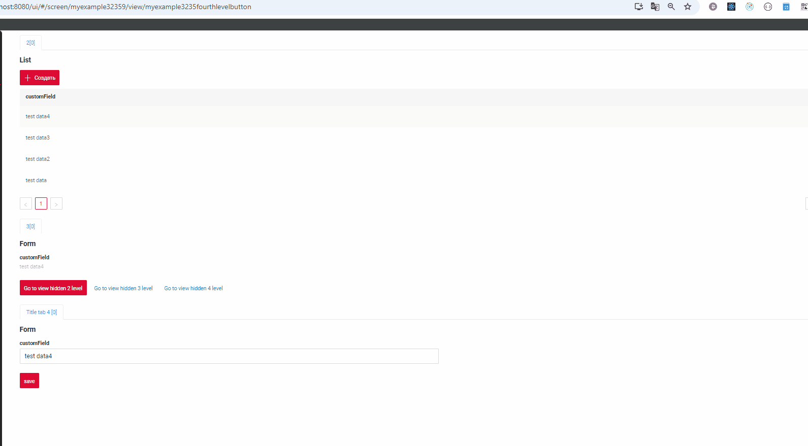

#### Как добавить? { #how-to-add_4 }
??? Example "Пример"
    **Шаг 1** Добавьте **hidden** = **true** для view
 
    ```json
    --8<--
    {{ external_links.github_raw_doc }}/navigation/tab/typestandard/hidden/myexample32359.screen.json
    --8<--
    ```
### defaultView 
(начиная с [релиза 2.0.5](https://doc.cxbox.org/ru/new/version205/"))

[:material-play-circle: Живой пример]({{ external_links.code_samples }}/ui/#/screen/myexample3235defaultview){:target="_blank"} ·
[:fontawesome-brands-github: GitHub]({{ external_links.github_ui }}/{{ external_links.github_branch }}/src/main/java/org/demo/documentation/navigation/tab/typestandard/defaultview){:target="_blank"}

"defaultView" для [Aggregate view](/ru/navigation/tabs/standard/basicdevelop/tabfordevelop/#how-add-a-view-to-the-screen)

Функция "defaultView" позволяет задать view, который открывается по умолчанию при переходе через drilldown на экране или при выборе пункта в левом меню. При необходимости можно настроить открытие скрытого view.

#### Как это выглядит? { #how-does-it-look_5 }
=== "базовый"
    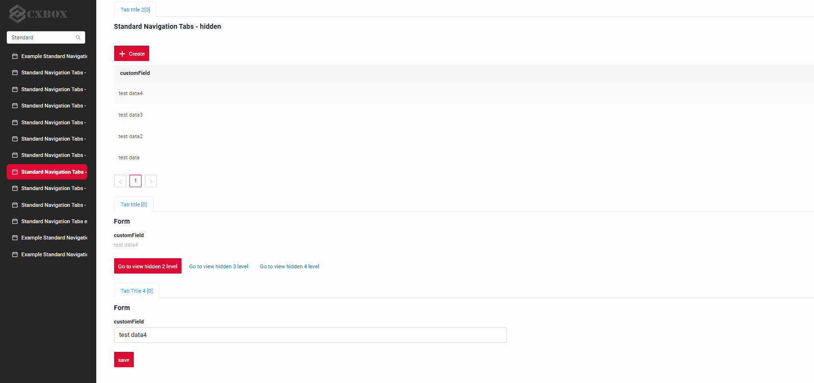
=== "со скрытым"
    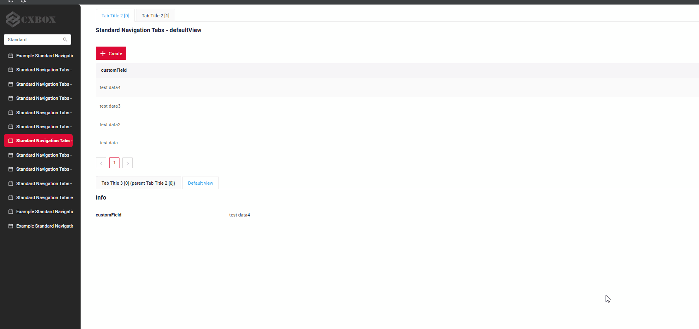

#### Как добавить? { #how-to-add_5 }
??? Example "Пример"
    **Шаг 1** Добавьте **defaultView** для [Aggregate view](/ru/navigation/tabs/standard/basicdevelop/tabfordevelop/#how-add-a-view-to-the-screen)

    ```json
    --8<--
    {{ external_links.github_raw_doc }}/navigation/tab/typestandard/defaultview/myexample3235defaultview.screen.json
    --8<--
    ```

    [:material-play-circle: Живой пример]({{ external_links.code_samples }}/ui/#/screen/myexample3235defaultview){:target="_blank"} ·
    [:fontawesome-brands-github: GitHub]({{ external_links.github_ui }}/{{ external_links.github_branch }}/src/main/java/org/demo/documentation/navigation/tab/typestandard/defaultview){:target="_blank"}

#### Типичный сценарий использования { #typical-use-case }
[:material-play-circle: Живой пример]({{ external_links.code_samples }}/ui/#/screen/myexample3238){:target="_blank"} ·
[:fontawesome-brands-github: GitHub]({{ external_links.github_ui }}/{{ external_links.github_branch }}/src/main/java/org/demo/documentation/navigation/tab/typestandard/defaultview/typicalexample){:target="_blank"}

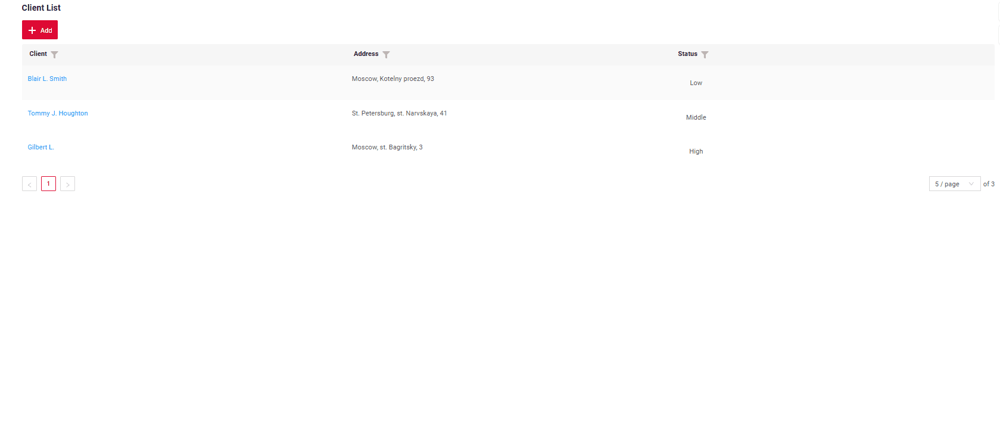

1) Перейдите на вкладку Client List внутри основной сущности Task.

2) Нажмите кнопку Create, чтобы открыть новую вкладку для ввода контактных данных.

3) Заполнив данные, нажмите кнопку Save, чтобы вернуться на Client Form.

### primaryViewName

[:material-play-circle: Живой пример]({{ external_links.code_samples }}/ui/#/screen/myexample3235primaryview){:target="_blank"} ·
[:fontawesome-brands-github: GitHub]({{ external_links.github_ui }}/{{ external_links.github_branch }}/src/main/java/org/demo/documentation/navigation/tab/typestandard/primaryviewname){:target="_blank"}

"primaryViewName" для экрана.

Функция "primaryViewName" позволяет задать view, который открывается по умолчанию при переходе через drilldown на экране или при выборе пункта в левом меню. При необходимости можно настроить открытие скрытого view.

#### Как это выглядит? { #how-does-it-look_6 }
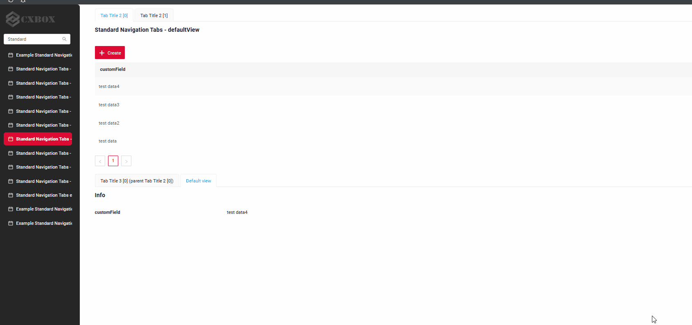 

#### Как добавить? { #how-to-add_6 }
??? Example "Пример"
    **Шаг 1** Добавьте **primaryViewName** для экрана

    ```json
    --8<--
    {{ external_links.github_raw_doc }}/navigation/tab/typestandard/primaryviewname/myexample3235primaryview.screen.json
    --8<--
    ```

### primaryViews

[:material-play-circle: Живой пример]({{ external_links.code_samples }}/ui/#/screen/myexample3235primaryviews){:target="_blank"} ·
[:fontawesome-brands-github: GitHub]({{ external_links.github_ui }}/{{ external_links.github_branch }}/src/main/java/org/demo/documentation/navigation/tab/typestandard/primaryviews){:target="_blank"}

"primaryViews" для экрана.

Функция "primaryViews" позволяет задать views, которые открываются по умолчанию при переходе через drilldown на экране или при выборе пункта в левом меню. При необходимости можно настроить открытие скрытого view.

Функция "primaryViews" позволяет задать последовательность views. Если роль пользователя не даёт доступа к первому view, система автоматически отображает следующий доступный view из списка. Если ни один из views недоступен, по умолчанию используется первый view, указанный на экране.

#### Как это выглядит? { #how-does-it-look_7 }


#### Как добавить? { #how-to-add_7 }
??? Example "Пример"
    **Шаг 1** Добавьте **primaryViews** для экрана

    ```json
    --8<--
    {{ external_links.github_raw_doc }}/navigation/tab/typestandard/primaryviews/myexample3235primaryviews.screen.json
    --8<--
    ```
