# Тип standard { #type-standard }
## <a id="rules_rendering">Правила отображения вкладок</a>
Эти правила нужны, чтобы при выборе вкладки всегда было что отобразить.

Они обеспечивают целостную и работоспособную навигацию по вкладкам, чтобы у пользователя всегда было осмысленное представление и он мог эффективно перемещаться.

* **Уникальное имя view**: у каждой вкладки должно быть уникальное имя. Это помогает отслеживать и восстанавливать подсветку вкладок при переходах между уровнями.
  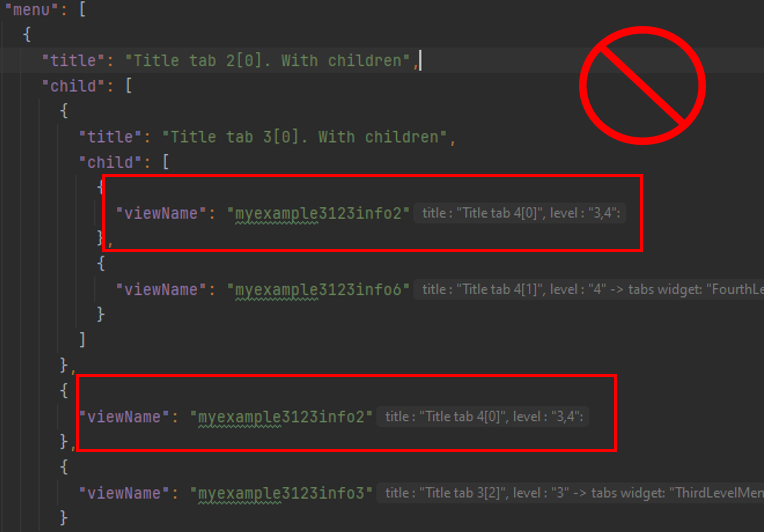{height=800px width=1000px}
 
* **Нет пустых массивов**: уровень не может содержать пустой массив. Это гарантирует, что при переходе по вкладкам всегда есть view для отображения.
  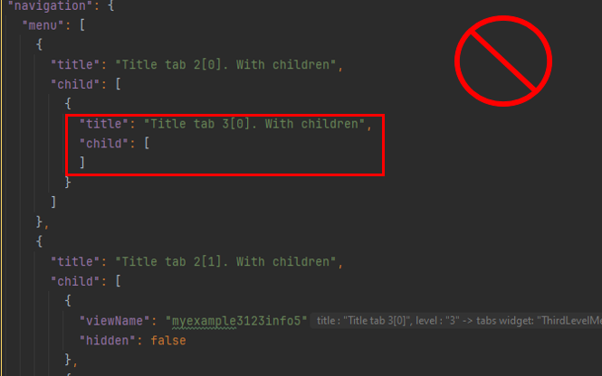{height=800px width=1000px}

* **Минимум один view на уровне**: каждый уровень иерархии вкладок должен содержать хотя бы один view.
  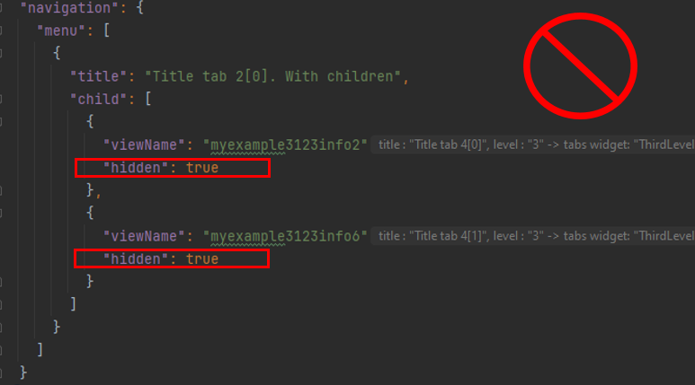{height=800px width=1000px}

 
## <a id="option_add_view">Как добавить view на экран?</a>
Есть два варианта добавления view:

* Single View
* Aggregate View

!!! advice "Совет по добавлению views"
    Добавляйте views только с помощью плагина
 
* **Single View**.
    Этот тип позволяет добавить один view на текущем уровне

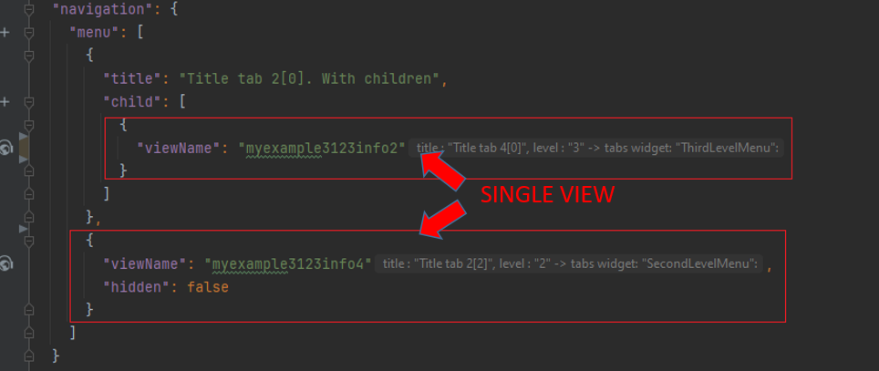

* **Aggregate View**.
   Используется, когда нужны многоуровневые вкладки (>2).
   Каждый уровень aggregate view соответствует вкладке в иерархии. При переходе вглубь по вкладкам вы перемещаетесь по этим уровням aggregate view.
   Уровень не может содержать пустой массив. ([см. правила вкладок](#rules_rendering))

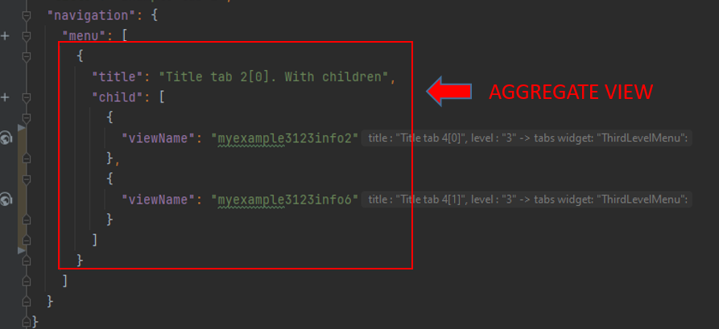

## <a id="ADD_NAME_VIEW">Как задать название вкладки?</a>
В названиях вкладок можно использовать только **константные** значения.

**Single View**:
Название вкладки берётся непосредственно из названия view.
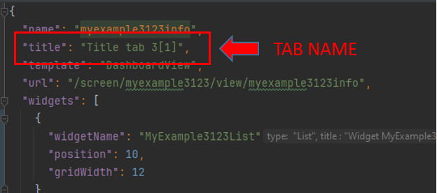
 
**Aggregate View**:
Название вкладки берётся из поля title.
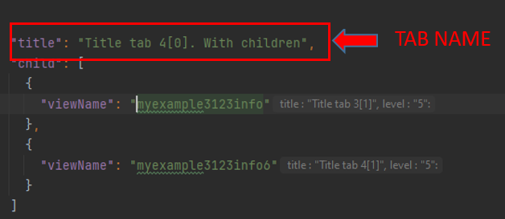

## <a id="tab_levels">Что означает уровень вкладки?</a>
Сейчас поддерживается **трёхуровневая иерархия вкладок**.
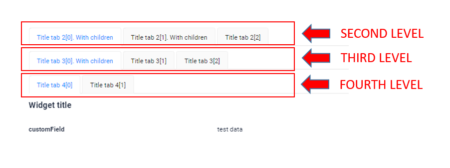

Виджеты распределяются по уровням с помощью соответствующего системного виджета для каждого уровня вкладок.

* [SecondLevelMenu](/navigation/tabs/standard/basic/tab/#SecondLevel)
* [ThirdLevelMenu](/navigation/tabs/standard/basic/tab/#ThirdLevelMenu)
* [FourthLevelMenu](/navigation/tabs/standard/basic/tab/#FourthLevelMenu)

**Пример реализации**

Чтобы организовать в системе трёхуровневую иерархию вкладок, выполните следующие шаги:

1) Определите системные виджеты: каждому уровню вкладок соответствует свой системный виджет. Убедитесь, что системные виджеты для каждого уровня определены в вашей системе.

2) Добавьте виджеты в файл view. Разместите виджеты в иерархии:

   * Уровень 2: виджеты, размещённые сразу под системным виджетом SecondLevelMenu.
     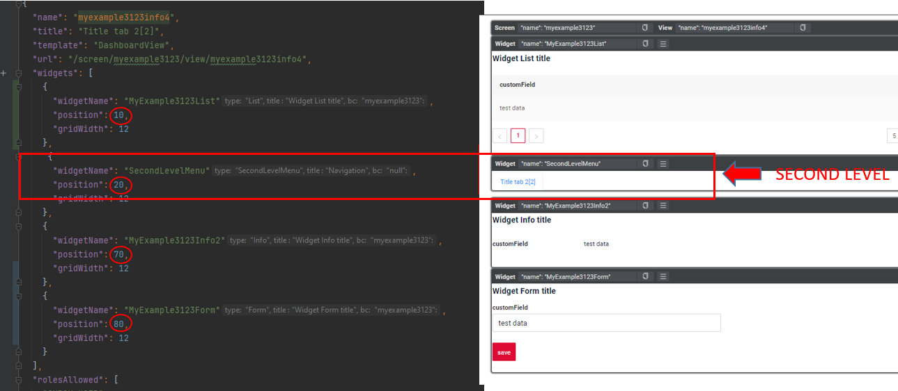  
   * Уровень 3: виджеты, размещённые под системным виджетом ThirdLevelMenu.
     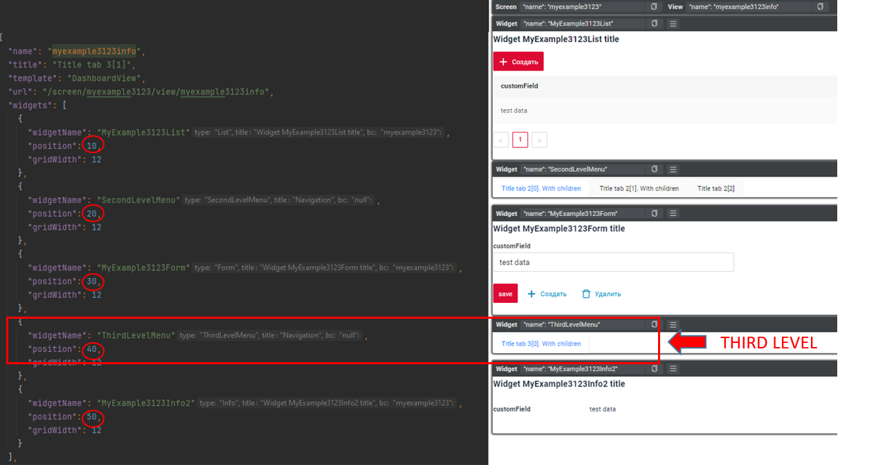  
   * Уровень 4: виджеты, размещённые под системным виджетом FourthLevelMenu.
     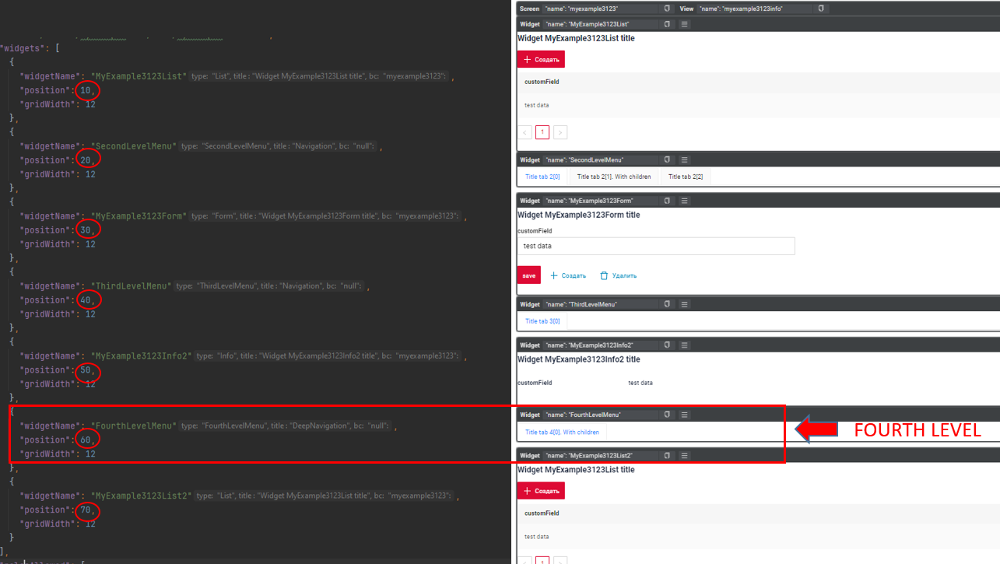

## <a id="add_tab">Как создать вкладку?</a>

**<a id="add_tab_level_1">Уровень 1</a>**

* Добавьте view в **.screen.json** с типом [Single](/ru/navigation/tabs/standard/basicdevelop/tabfordevelop/#how-add-a-view-to-the-screen)
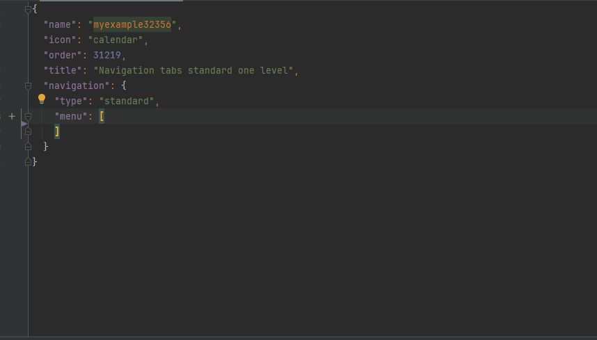

**<a id="add_tab_level_2">Уровень 2</a>**

Первый view уровня 2:

* Добавьте виджет [SecondLevelMenu](/ru/navigation/tabs/standard/basicdevelop/tabfordevelop/#tab-levels) в выбранный view
* Добавьте выбранный view в **.screen.json** с типом [Single](/ru/navigation/tabs/standard/basicdevelop/tabfordevelop/#how-add-a-view-to-the-screen)
* Название вкладки уровня 2 = *Title* view. Подробнее см. [Как задать название вкладки](/ru/navigation/tabs/standard/basicdevelop/tabfordevelop/#how-add-name-for-tab)

Следующий view уровня 2:

* Добавьте виджет [SecondLevelMenu](/ru/navigation/tabs/standard/basicdevelop/tabfordevelop/#tab-levels) в выбранный view
* Добавьте выбранный view в **.screen.json** с типом [Single](/ru/navigation/tabs/standard/basicdevelop/tabfordevelop/#how-add-a-view-to-the-screen)
* Название вкладки уровня 2 = *Title* view. Подробнее см. [Как задать название вкладки](/ru/navigation/tabs/standard/basicdevelop/tabfordevelop/#how-add-name-for-tab)

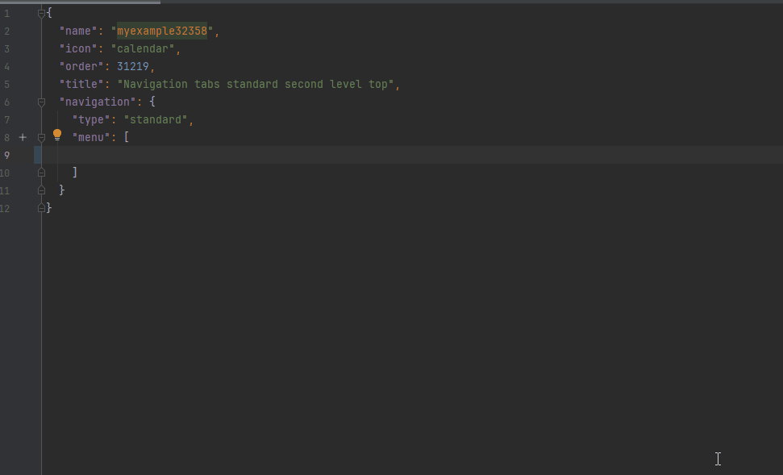

**<a id="add_tab_level_3">Уровень 3</a>**

Первый view уровня 3:

* Добавьте виджет [ThirdLevelMenu](/ru/navigation/tabs/standard/basicdevelop/tabfordevelop/#tab-levels) в выбранный view
* Добавьте выбранный view в **.screen.json** с типом [Aggregate view](/ru/navigation/tabs/standard/basicdevelop/tabfordevelop/#how-add-a-view-to-the-screen)
* Название вкладки уровня 2, на которой будут расположены вкладки уровня 3 = поле title. Подробнее см. [Как задать название вкладки](/ru/navigation/tabs/standard/basicdevelop/tabfordevelop/#how-add-name-for-tab)
* Название вкладки уровня 3 = *Title* view. Подробнее см. [Как задать название вкладки](/ru/navigation/tabs/standard/basicdevelop/tabfordevelop/#how-add-name-for-tab)


Следующий view уровня 3:

* Добавьте виджет [ThirdLevelMenu](/ru/navigation/tabs/standard/basicdevelop/tabfordevelop/#tab-levels) в выбранный view
* На уровне 3 выберите тег `child` и добавьте выбранный view в **.screen.json** с типом [Single](/ru/navigation/tabs/standard/basicdevelop/tabfordevelop/#how-add-a-view-to-the-screen)
* Название вкладки уровня 3 = *Title* view. Подробнее см. [Как задать название вкладки](/ru/navigation/tabs/standard/basicdevelop/tabfordevelop/#how-add-name-for-tab)

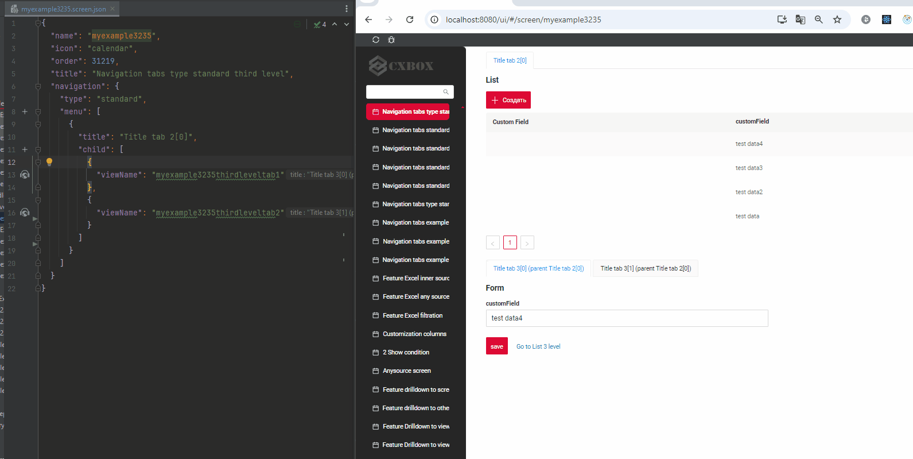

**<a id="add_tab_level_4">Уровень 4</a>**

Первый view уровня 4:

* Добавьте виджет [FourthLevelMenu](/ru/navigation/tabs/standard/basicdevelop/tabfordevelop/#tab-levels) в выбранный view.
* Добавьте [вкладку уровня 3](#add_tab_level_3).
* На уровне 3 выберите тег `child` и добавьте выбранный view в **.screen.json** с типом [Aggregate view](/ru/navigation/tabs/standard/basicdevelop/tabfordevelop/#how-add-a-view-to-the-screen)
* Название вкладки уровня 3, на которой будут расположены вкладки уровня 4 = поле title. Подробнее см. [Как задать название вкладки](/ru/navigation/tabs/standard/basicdevelop/tabfordevelop/#how-add-name-for-tab)
* Название вкладки уровня 4 = *Title* view. Подробнее см. [Как задать название вкладки](/ru/navigation/tabs/standard/basicdevelop/tabfordevelop/#how-add-name-for-tab)

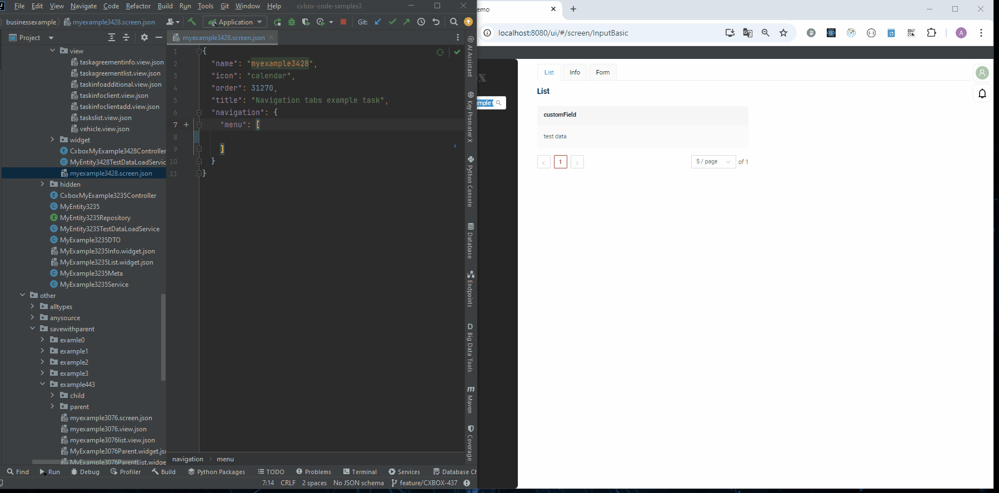

Следующий view уровня 4:

* Добавьте виджет [FourthLevelMenu](/ru/navigation/tabs/standard/basicdevelop/tabfordevelop/#tab-levels) в выбранный view.
* На уровне 4 выберите тег `child` и добавьте выбранный view в **.screen.json** с типом [Single](/ru/navigation/tabs/standard/basicdevelop/tabfordevelop/#how-add-a-view-to-the-screen)
* Название вкладки уровня 4 = *Title* view. Подробнее см. [Как задать название вкладки](/ru/navigation/tabs/standard/basicdevelop/tabfordevelop/#how-add-name-for-tab)

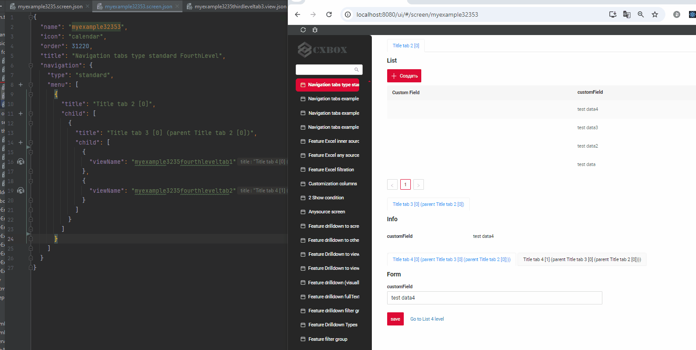

## Как разобраться в уровнях вкладок на готовом экране? { #how-to-understand-tab-levels-on-the-finished-screen }

Чтобы убедиться в правильной сборке экрана на каждом уровне, используйте функцию сворачивания в IDEA:

1) Сверните JSON до первого уровня (menu). Каждый элемент — это вкладка, а количество элементов равно количеству горизонтальных вкладок второго уровня. Используйте [свойство позиции виджета](/ru/widget/type/widget/).
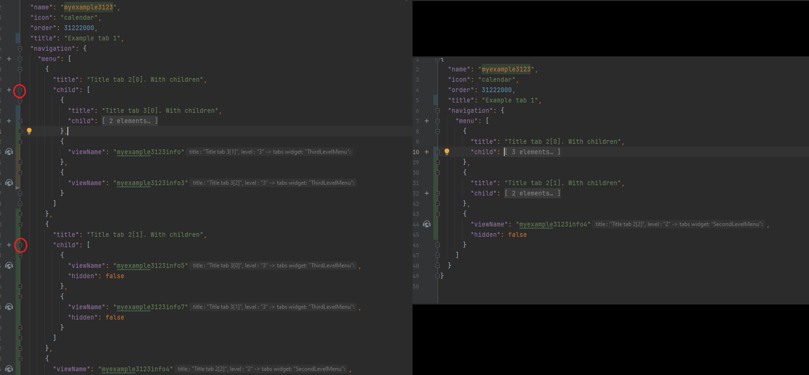
  
*Пример* :

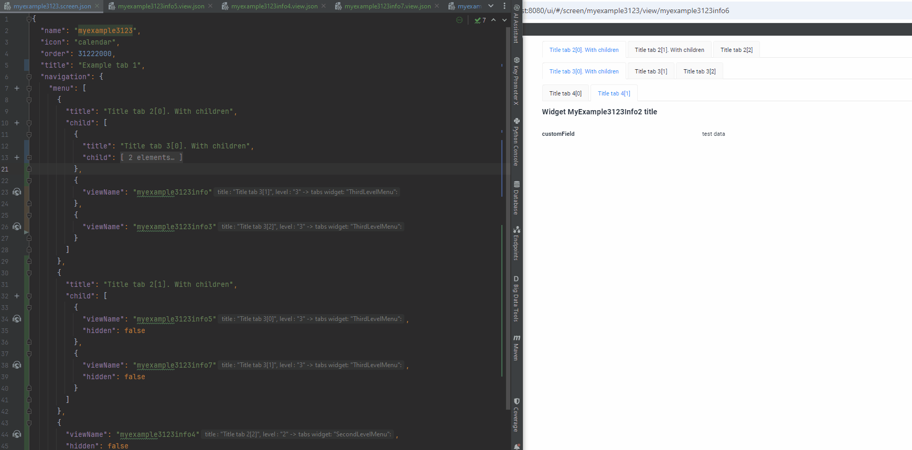

2) Разверните первый элемент второго уровня. Каждый элемент — это вкладка, а количество элементов равно количеству горизонтальных вкладок третьего уровня. Используйте [свойство позиции виджета](/ru/widget/type/widget/).

*Пример* :

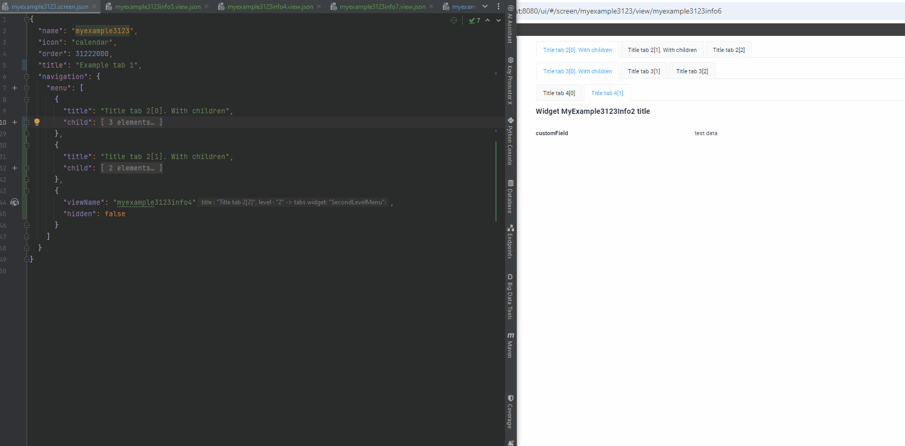

3) Разверните первый элемент четвёртого уровня. Каждый элемент — это вкладка, а количество элементов равно количеству горизонтальных вкладок четвёртого уровня. Используйте [свойство позиции виджета](/ru/widget/type/widget/).

*Пример* :

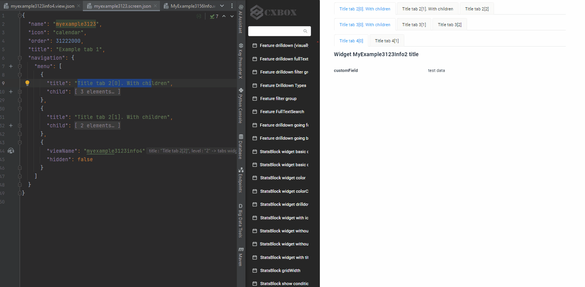

## Типичный сценарий использования { #typical-use-case }
[:material-play-circle: Живой пример]({{ external_links.code_samples }}/ui/#/screen/myexample3428){:target="_blank"} ·
[:fontawesome-brands-github: GitHub]({{ external_links.github_ui }}/{{ external_links.github_branch }}/src/main/java/org/demo/documentation/navigation/tab/typestandard/businessexample){:target="_blank"}

Иерархия бизнес-экрана:

* Общий список задач: отображение всех задач в общем списке.
* Детали задачи: отображение подробностей выбранной задачи (добавление данных, дополнительная информация).
* Список клиентов: отображение всех клиентов, связанных с выбранной задачей.
* Информация о клиенте: отображение подробностей для выбранной задачи.
* Список договоров: отображение информации о договорах, связанных с выбранной задачей.

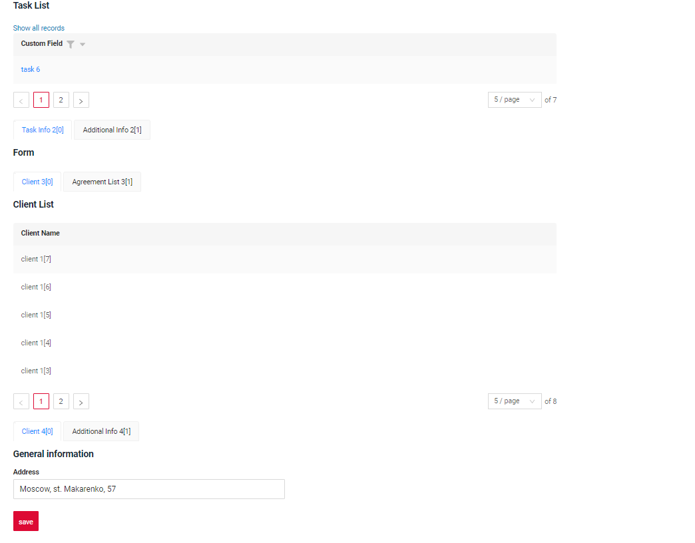

### 1. Определите иерархию { #1-define-the-hierarchy }
Определим иерархию для нашего экрана:

**Уровень 1**:

* Общий список задач

**Уровень 2 Информация о задаче**:

* Вкладка Task Info
* Вкладка Additional Info

**Уровень 3 Связанные объекты**:

* Вкладка Client
* Вкладка Agreement

**Уровень 4 Информация о клиенте**:

* Вкладка Client Info
* Вкладка Additional Info

### 2. Формирование view { #2-view-formation }
Для примера выберем view с наибольшим количеством вкладок (4); остальные views создаются аналогично.

**View** :

`Уровень 1`: List Tasks

`Уровень 2`: Task Info

`Уровень 3`: Client

`Уровень 4`: Client Info

**Уровень 1. List Tasks**:

Виджет TaskList первого уровня — добавляется первым
??? Example "Пример"
    ```json
    "widgets": [
        {
            "widgetName": "TaskList",
            "position": 10,
            "gridWidth": 12
        } 
    ]
    ```
**Уровень 2. Task Info**:

Для виджета TaskInfoForm на втором уровне сначала добавьте системный виджет SecondLevelMenu, а затем TaskInfoForm.
??? Example "Пример"
    ```json
    "widgets": [
        {
            "widgetName": "TaskList",
            "position": 10,
            "gridWidth": 12
        } 
        {
          "widgetName": "SecondLevelMenu",
          "position": 20,
          "gridWidth": 12
        }
        {
            "widgetName": "TaskInfoForm",
            "position": 30,
            "gridWidth": 24
        }
    ]
    ```
**Уровень 3. Client**:

Для виджета ClientsList на третьем уровне сначала добавьте системный виджет ThirdLevelMenu, а затем ClientsList.
 
??? Example "Пример"
    ```json
    "widgets": [
        {
          "widgetName": "TaskList",
          "position": 10,
          "gridWidth": 12
        },
        {
            "widgetName": "SecondLevelMenu",
            "position": 20,
            "gridWidth": 12
        },
        {
            "widgetName": "TaskInfoForm",
            "position": 30,
            "gridWidth": 24
        },
        {
            "widgetName": "ThirdLevelMenu",
            "position": 40,
            "gridWidth": 12
        },
        {
            "widgetName": "ClientsList",
            "position": 50,
            "gridWidth": 12
        } 
    ]
    ```
**Уровень 4. Client Info**:

Для виджета ClientInformationForm сначала добавьте системный виджет FourthLevelMenu, а затем ClientInformationForm.

??? Example "Пример"
    ```json
    "widgets": [
        {
            "widgetName": "TaskList",
            "position": 10,
            "gridWidth": 12
        },
        {
            "widgetName": "SecondLevelMenu",
            "position": 20,
            "gridWidth": 12
        },
        {
            "widgetName": "TaskInfoForm",
            "position": 30,
            "gridWidth": 24
        },
        {
            "widgetName": "ThirdLevelMenu",
            "position": 40,
            "gridWidth": 12
        },
        {
            "widgetName": "ClientsList",
            "position": 50,
            "gridWidth": 12
        },
        {
            "widgetName": "FourthLevelMenu",
            "position": 60,
            "gridWidth": 12
        },
        {
            "widgetName": "ClientInformationForm",
            "position": 70,
            "gridWidth": 12
        }
    ]
    ```
!!! advice "Совет"
    Рекомендуется назначать виджетам номера позиций с шагом 10. Тогда при необходимости добавить новые виджеты между существующими это можно сделать легко, без перенумерации.

### 3. Формирование экрана { #3-screen-formation }

**Уровень 1. List Tasks**: общий список задач

**Уровень 2. Информация о задаче**: вкладка Task Info, вкладка Additional Info

**Уровень 3. Связанные объекты**: вкладка Client, вкладка Agreement

**Уровень 4. Информация о клиенте**: вкладка Client Info, вкладка Client Additional Info

3.1 Добавьте уровень 4

**Уровень 4. Информация о клиенте**: вкладка Client Info, вкладка Client Additional Info
Сначала добавим [view уровня 4](#add_tab_level_4)

 
 
3.2 Добавьте уровень 3

**Уровень 3. Связанные объекты**: вкладка Client, вкладка Agreement

Сверните JSON до третьего уровня (menu). Добавим view уровня 3.

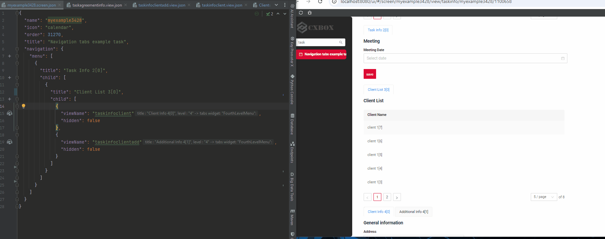

3.3 Добавьте уровень 2

**Уровень 2. Информация о задаче**: вкладка Task Info, вкладка Additional Info

Сверните JSON до второго уровня (menu). Добавим view уровня 2.

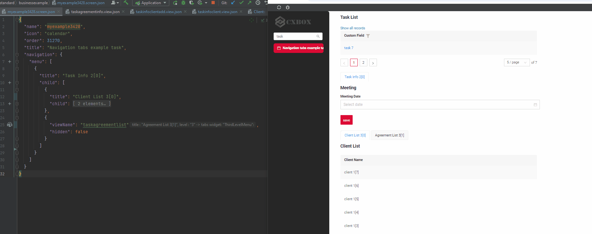