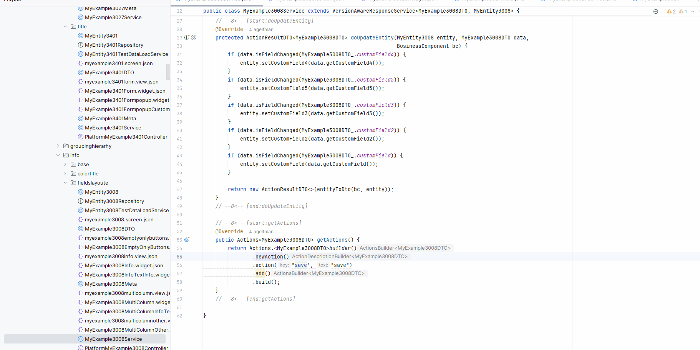

# 1.7.1
## Исправлена фильтрация полей типа Hint { #fix-for-filtering-fields-of-type-hint }
В DTO для полей `Hint` добавлена аннотация `SearchParameter`, благодаря чему фильтрация работает корректно.

## Добавлен quick-fix для API action builder { #added-quick-fix-for-action-builder-api }
Перевести действия на новый API можно выборочно или сразу для всего проекта.

Выборочно:

Для всего проекта:

##  Добавлена инспекция ссылок на виджеты { #added-inspection-for-widget-references }
1. Ссылки и инспекции для `option.create.widget` и `option.edit.widget`
   1.1 В `.widget.json` добавлены ссылки из `option.create.widget` и `option.edit.widget` на поле `name`, что даёт автодополнение, переход к использованиям и определению, а также рефакторинг переименования.
   1.2 Добавлены инспекции ошибок и предупреждений для недопустимых типов виджетов и отсутствующих ссылок.
   
2. Ссылки и инспекции для `confirmWithCustomWidget`
   2.1 Реализованы ссылки из аргументов метода `confirmWithCustomWidget` на виджеты в `.widget.json` с теми же возможностями автодополнения, навигации и рефакторинга.
   2.2 Добавлены инспекции ошибок и предупреждений для недопустимых типов виджетов и отсутствующих ссылок.
   
3. В ядро добавлена аннотация `@WidgetName`, которая проверяет тип виджета через параметр `typePostfix`, чтобы гарантировать использование правильного типа.
4. Расширено покрытие инспекций и автодополнения для методов, аргументы которых помечены `@WidgetName`.
   

 

 