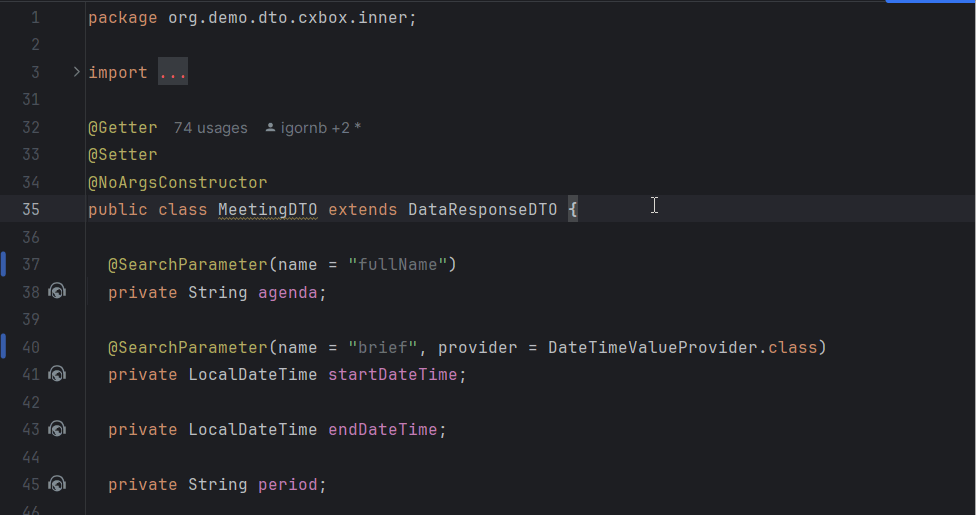
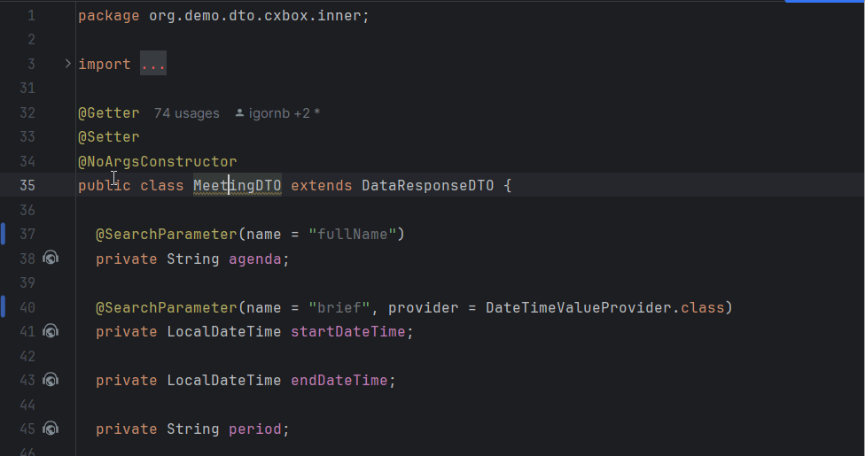
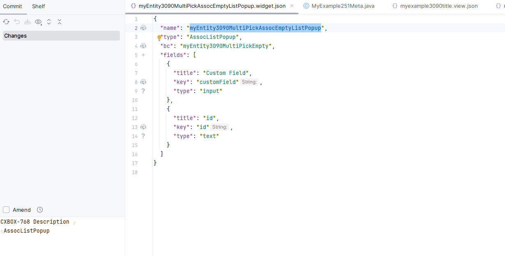

# 1.7.8

## Добавлено: @SearchParameter — улучшена обработка неразрешённых сущностей { #added-searchparameter-improved-handling-for-unresolved-entities }

Улучшено поведение плагина, когда Entity, указанную в аннотации, не удаётся разрешить.

Теперь, если Entity не удаётся разрешить, плагин:

###  Инспекция { #inspection }
Подсвечивает имя класса жёлтым (Warning) с сообщением "Entity not found."

### Предложение quick-fix { #quick-fix-suggestion }
Предлагает quick-fix для явного указания пути к Entity в комментарии.
Пример комментария: //@entity:<полный путь к entity>.

## Инспекция ссылок на поля с постфиксом -FieldKey (раздел options). { #inspection-for-field-references-with-fieldkey-postfix-options-section }

Плагин теперь поддерживает автодополнение, ссылки и инспекции для ссылок на поля в разделе options файла widget.json. Чтобы включить эту функциональность, называйте поля в options с постфиксом -FieldKey (или просто fieldKey). Плагин свяжет эти поля с массивом fields в начале файла widget.json и обеспечит корректность ссылок.

"Автодополнение"
   

"Ссылка"
   

"Инспекция"
   

## Добавлено: добавление поля **MultipleSelect** для Enum, хранимого в Entity как Set<> { #added-adding-multipleselect-field-for-enum-stored-in-entity-as-set }
Добавление поля **MultipleSelect** теперь использует новый метод для `buildRowDependentMeta`.

