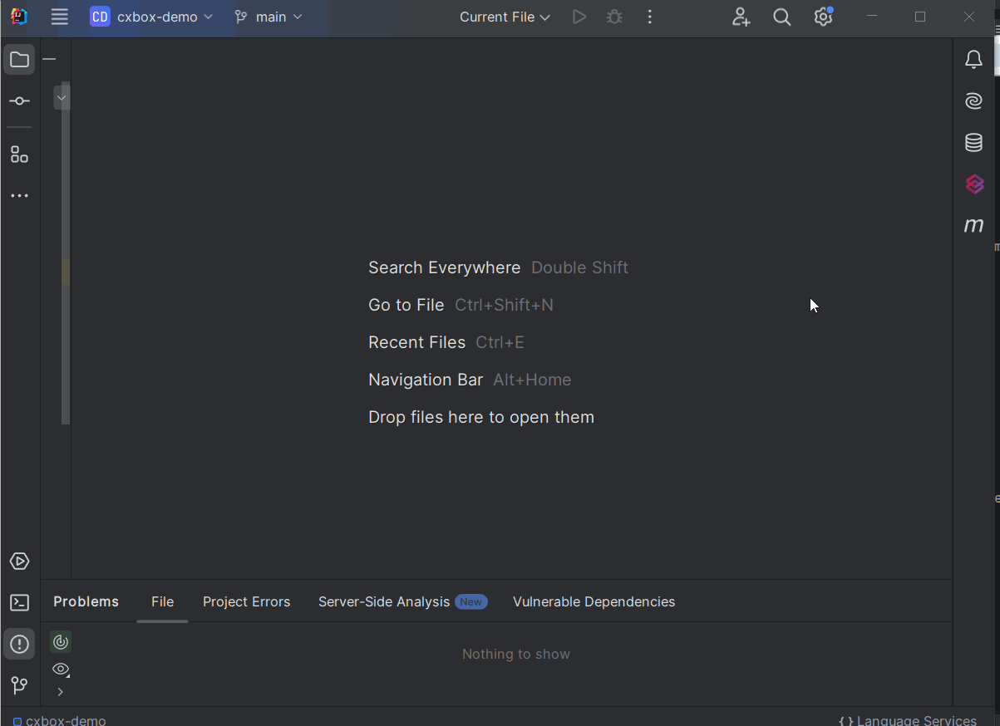
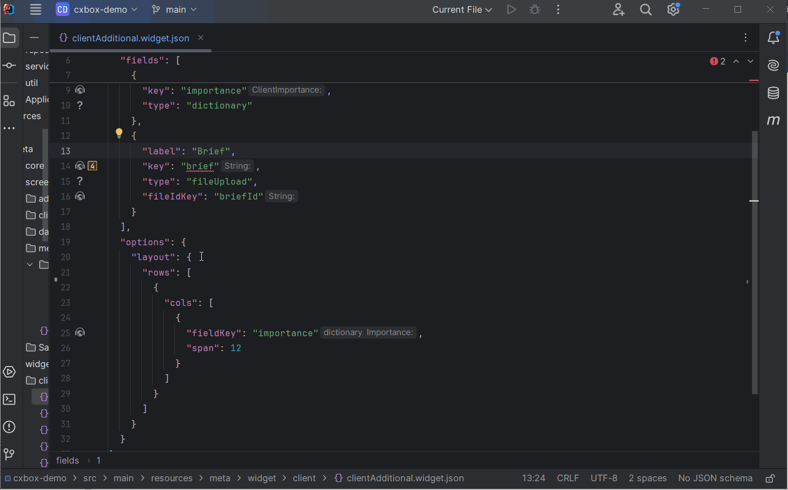
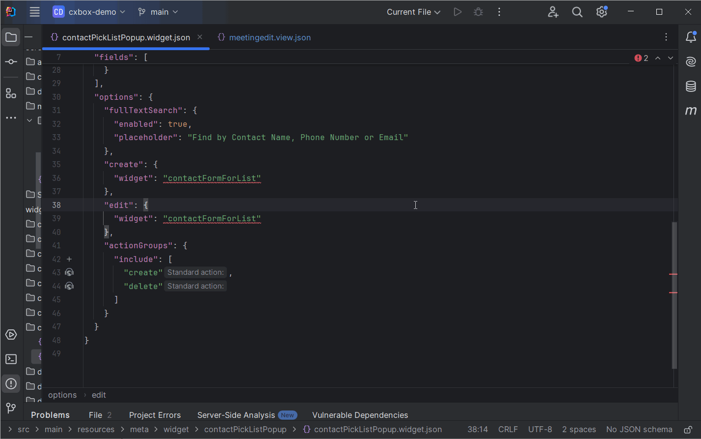
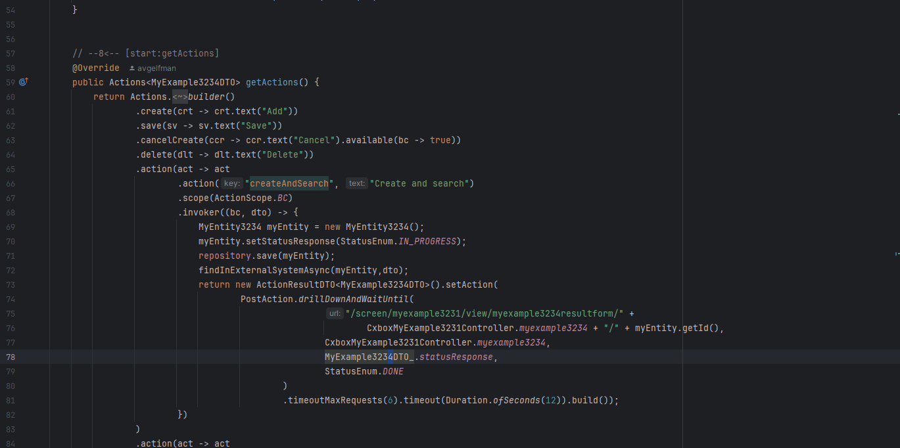
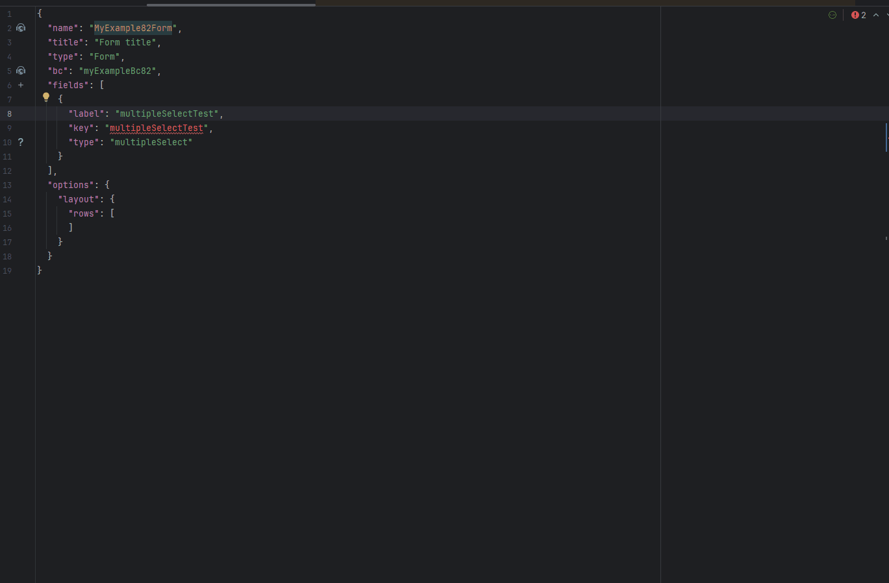
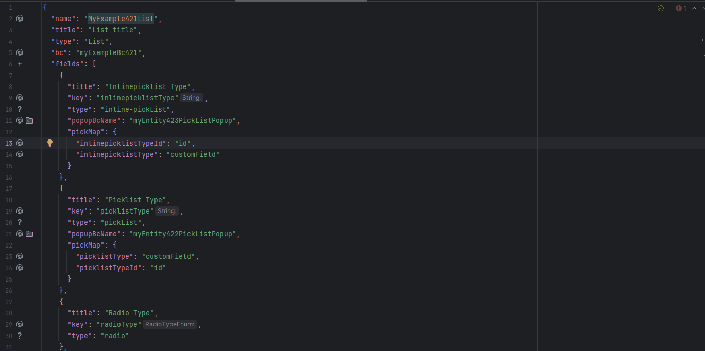

# 1.7.9

## Добавлено: кнопка Run Inspections { #added-run-inspections-button }

На боковую панель IntelliJ IDEA добавлена кнопка Run Inspections, позволяющая запустить инспекции по всему проекту в один клик. Функция автоматизирует ручные шаги запуска инспекций, избавляя от необходимости настраивать профили и параметры.

## Добавлено: виджет AdditionalInfo — проверка fieldKey в *.widget.json { #added-additionalinfo-widget-fieldkey-validation-in-widgetjson }

Добавлены инспекции для виджета [AdditionalInfo](https://doc.cxbox.org/ru/widget/type/additionalinfo/additionalinfo/) по той же логике, что и для виджета [Info](https://doc.cxbox.org/ru/widget/type/info/info/). Теперь, если `fieldKey` в `layout` отсутствует или не ссылается на поле из `fields`, выдаётся предупреждение инспекции.

## Добавлено: инспекция options -> create/edit -> widget в *.widget.json { #added-inspection-for-options-createedit-widget-in-widgetjson }

Добавлена инспекция, проверяющая, что виджеты, указанные в параметрах `create` и `edit`, присутствуют на том же view, что и основной виджет. Отсутствующие виджеты автоматически добавляются на view.

## Добавлено: postAction drillDownAndWaitUntil — проверка successCondition_bcName { #added-postaction-drilldownandwaituntil-validation-for-successconditionbcname }

Добавлена проверка того, что поле, указанное в параметре successCondition_bcName, присутствует в указанном bc в postAction drillDownAndWaitUntil.

## Добавлено: поле multipleSelect — обновлён метод автогенерации поля в *.widget.json { #added-multipleselect-field-updated-method-for-field-auto-generation-in-widgetjson }

Теперь при добавлении поля multipleSelect через кнопку + плагин автоматически генерирует необходимый код. Если версия ядра проекта это поддерживает, сгенерированный код использует `setConcreteValues()` вместо `setDictionaryTypeWithCustomValues()`, помеченного как **@deprecated** начиная с 4.0.0-M12.

## Исправлено: поле inlinePicklist — проверка родительского bc в *.widget.json { #fixed-inlinepicklist-field-parent-bc-check-in-widgetjson }

Исправлена инспекция `popupBcName` в *.widget.json: теперь она корректно проверяет, что указанный бизнес-компонент (bc) является дочерним для bc родительского виджета.

## Добавлено: @SearchParam — улучшенный алгоритм инспекции { #added-searchparam-enhanced-inspection-algorithm }

Улучшена проверка пути к фильтруемому полю, что обеспечивает лучшую совместимость с микросервисами (Anysource-сервисами).
Кроме того, исправлена проблема в процессе инспекции для случаев, когда у исходного аннотированного поля не был явно указан путь.
 