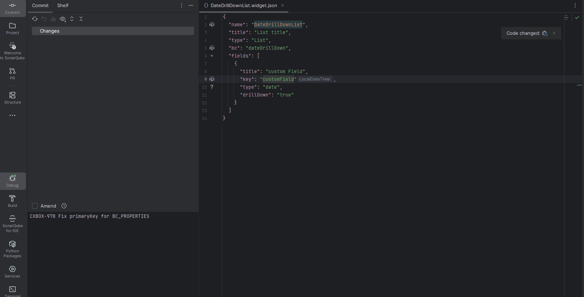
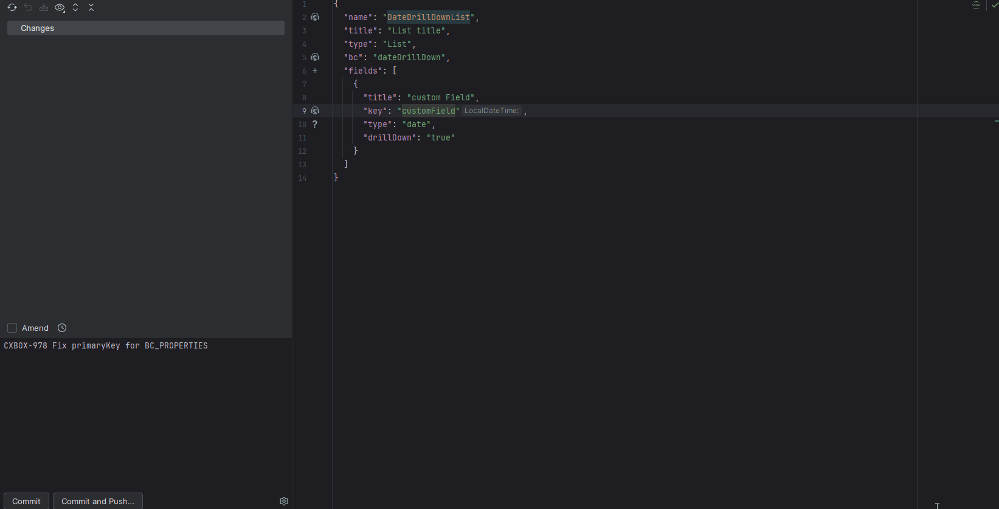
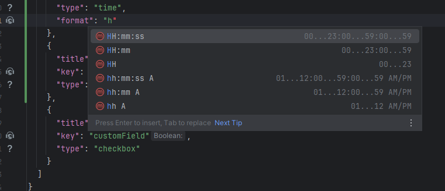
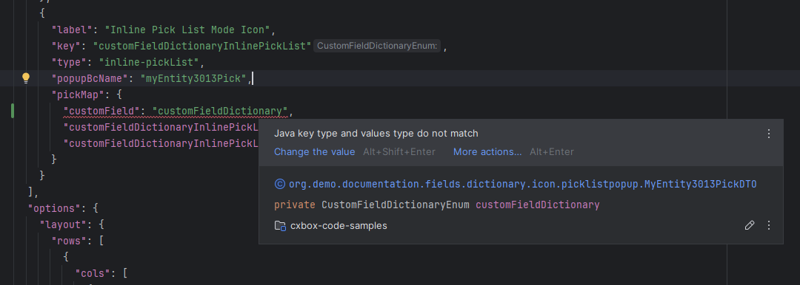
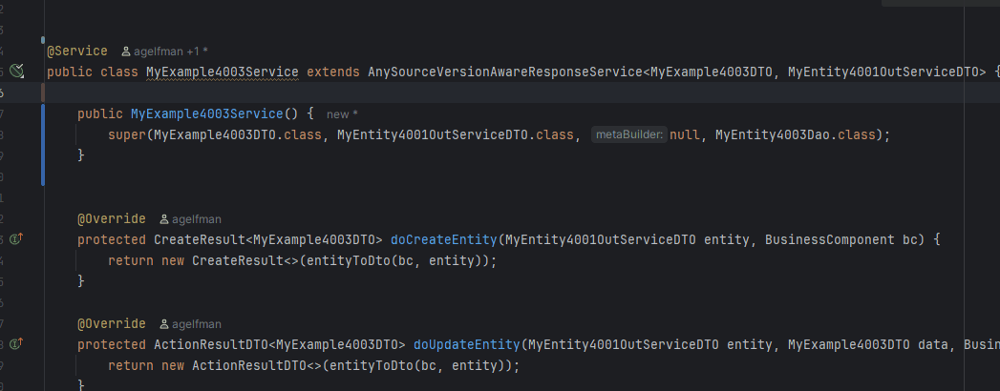
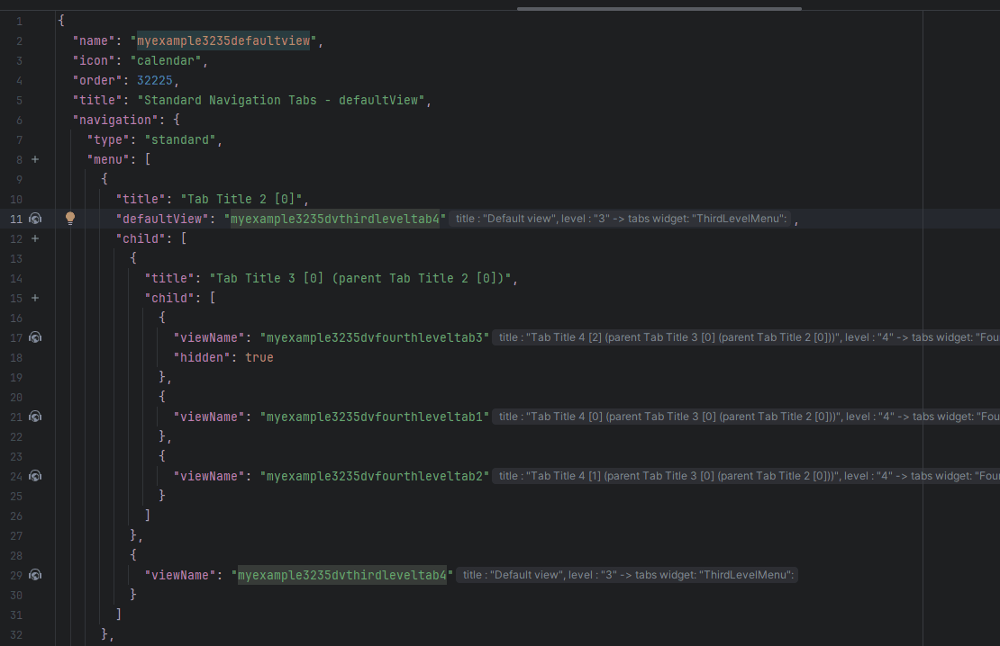
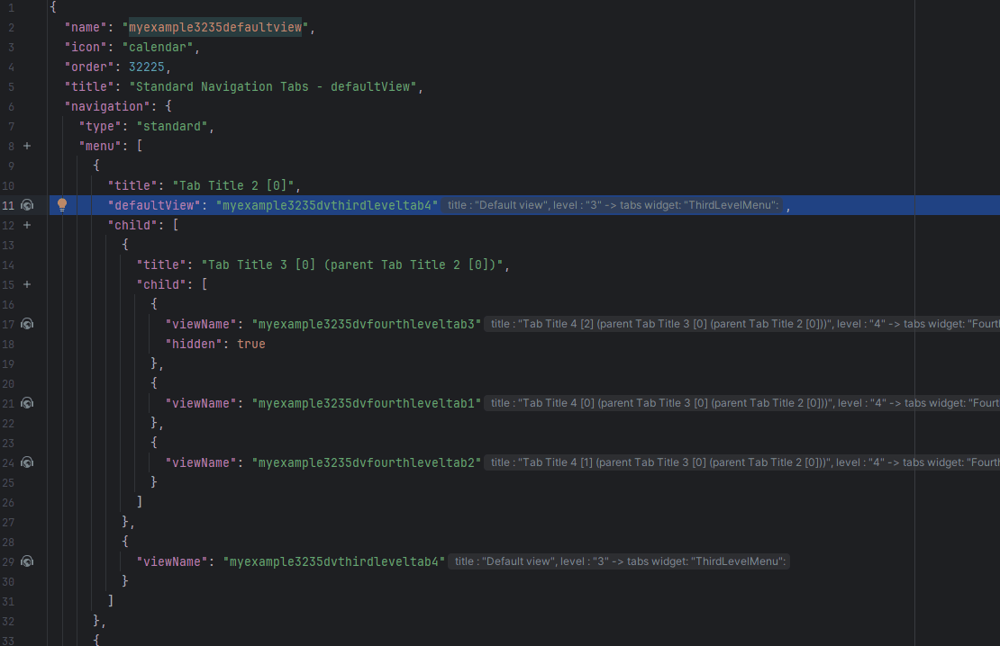
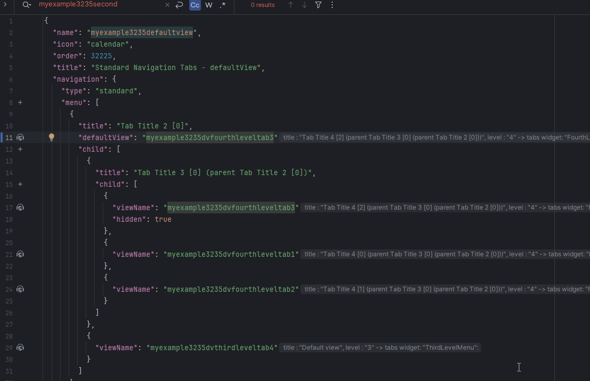
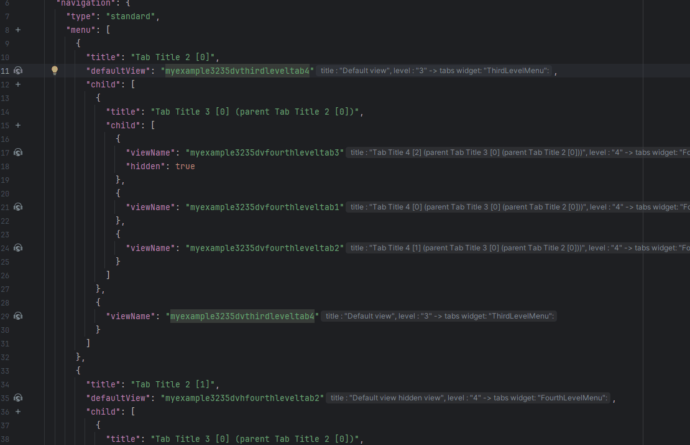
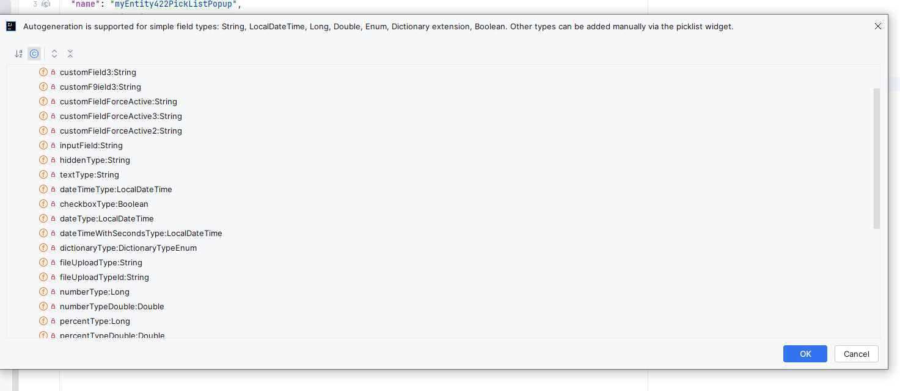

# 1.8.0

## Добавлено: поддержка IntelliJ 2025.1+ { #added-intellij-20251-support }

Установка плагина *Platform Tools*

Теперь у плагина **отдельные сборки** для разных версий IDE JetBrains. Убедитесь, что настроен правильный репозиторий обновлений.

1) Откройте менеджер плагинов

* В IDE JetBrains выберите `Help → Find Action`
* Введите `Plugins` и откройте соответствующий пункт

2) Добавьте репозиторий плагинов

* В окне Plugins нажмите ⚙️ (иконка шестерёнки) → `Manage Plugin Repositories...`
* Нажмите ➕
* Введите следующий URL:
  ```
  https://document.cxbox.org/plugin/updatePlugins.xml
  ```

* Нажмите **OK**

3) Установите плагин

* Перейдите на вкладку `Marketplace`
* Найдите **Platform Tools**
* Нажмите **Install**
* После установки нажмите **OK**

4) Перезапустите IDE

## Добавлено: поддержка генерации кода для полей типа <code>Time</code> в <code>.widget.json</code>.<br> { #added-code-generation-support-added-for-fields-with-type-time-in-widgetjson }

Работает с [core 4.0.0-M17](https://github.com/CX-Box/cxbox/tree/cxbox-4.0.0-M17) и более новыми версиями.

### Генерация кода { #code-generation }

Добавлена поддержка генерации кода для полей типа `time`. Теперь можно:

* Сгенерировать поле `time` с форматом по умолчанию `hh:mm:ss`;
* Указать собственный формат времени, выбрав нужный шаблон из списка поддерживаемых форматов.

=== "time"
    
=== "time с форматом"
    

### Автодополнение { #autocomplete }

Для полей `time` теперь доступно автодополнение. При вводе формата отображается список **официально поддерживаемых шаблонов**,
что упрощает и ускоряет настройку нужного формата времени.



## Добавлено: проверка типов для полей с <code>pickMap</code> { #added-type-checking-for-fields-containing-pickmap }
Для полей с <code>pickMap</code> добавлена проверка типов, обеспечивающая согласованность Java-типов параметров <code>pickMap</code> (кроме поля <code>id</code>).

**Проверка реализована для следующих типов полей:**

* `inline-pickList`
* `pickList`
* `suggestionPickList`



## Добавлено: инспекции и quick-fix для нового API { #added-inspection-and-quick-fix-support-for-the-new-api }
В рамках релиза [core 4.0.0-M15](https://github.com/CX-Box/cxbox/tree/cxbox-4.0.0-M15) используются @RequiredArgsConstructor и @Getter из Lombok (meta, dao)
для AnySourceVersionAwareResponseService и @Getter (meta) для VersionAwareResponseService вместо явного написания конструктора.
В плагин добавлен quick-fix, обеспечивающий совместимость с новым API и упрощающий переход на обновлённую реализацию сервисов.



## Добавлено: <code>@SearchParameter</code>: если параметр не задан явно { #added-searchparameter-if-no-explicit-parameter-is-defined }
Теперь, если для @SearchParameter не указан параметр, используется поле сущности с соответствующим именем.


## Добавлено: автодополнение, навигация по Ctrl-клику и инспекция для defaultView { #added-autocomplete-ctrl-click-navigation-and-inspection-for-defaultview }
Добавлена поддержка автодополнения, навигации по Ctrl-клику и инспекции для свойства <code>defaultView</code> в <code>.screen.json</code>

### Автодополнение: { #autocomplete_1 }


### Навигация по Ctrl-клику { #ctrl-click-navigation }


### Инспекция { #inspection }


### Рефакторинг { #refactoring }


## Исправлено: генерация кода для полей типа <code>Picklist</code> и <code>inline-pickList</code> { #fixed-code-generation-for-fields-with-type-picklist-and-inline-picklist }
Для полей типа <code>Picklist</code> и <code>inline-pickList</code> в <code>.widget.json</code> исправлена генерация кода:

* **Добавлена фильтрация полей** во всплывающем окне выбора полей при создании picklist.
  Теперь отображаются только поля следующих типов:

   * `String`
   * `LocalDateTime`
   * `Long`
   * `Double`
   * `Enum`
   * `Dictionary extension`
   * `Boolean`

* **Автогенерация конфигурации picklist** теперь поддерживается **только** для перечисленных выше простых типов полей.
  Поля других типов можно добавить вручную через виджет picklist.

> **Сообщение об автогенерации:**
> *Автогенерация поддерживается для простых типов полей: String, LocalDateTime, Long, Double, Enum, Dictionary extension, Boolean. Другие типы можно добавить вручную через виджет picklist.*


 