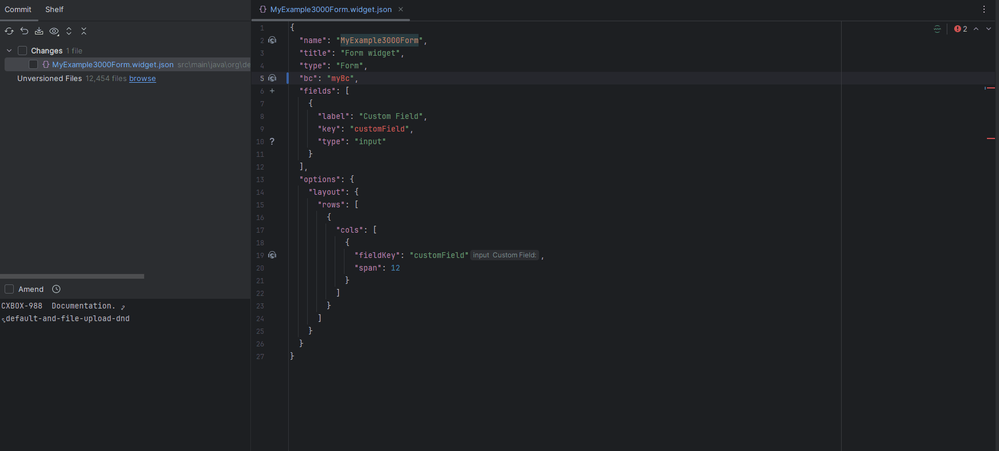
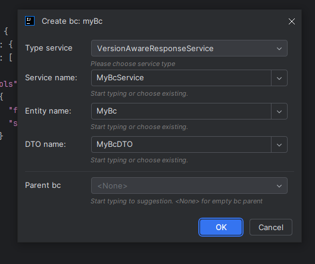
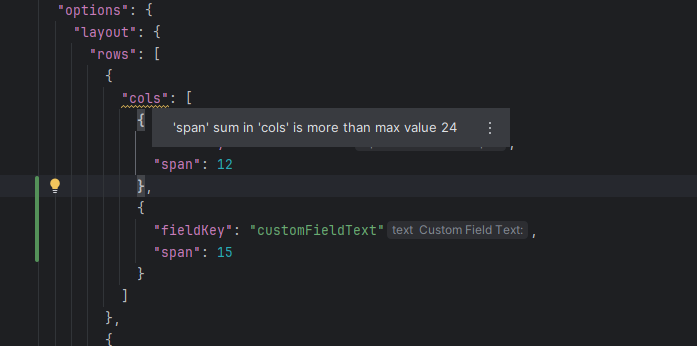
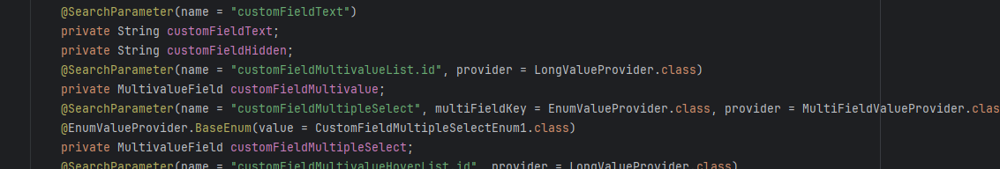
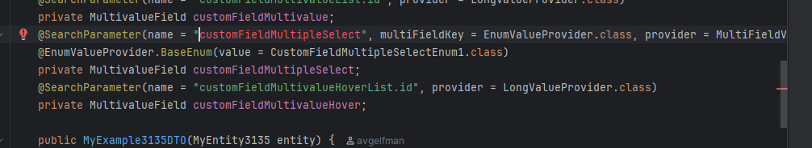

# 2.0.0

## Добавлено: поддержка IntelliJ 2025.2+ (с версии 1.9.0) { #added-intellij-20252-support-added-with-190 }
Добавлена поддержка IntelliJ 2025.2+.
 
## Добавлено: генерация bc из виджета (с версии 2.0.0) { #added-added-generation-bc-from-widget-with-200 }
Добавлена генерация bc из виджета.

Можно создать новые Service, Entity или DTO на основе имени вашего БК либо использовать существующие Services, Entities или DTOs

Выберите параметры:

Пример:

## Добавлено: проверка суммы значений span в options.layout.rows.cols (с версии 2.0.0) { #added-added-to-check-the-sum-of-span-values-in-optionslayoutrowscols-with-200 }
Для виджетов Form и Info добавлена проверка того, что сумма значений span в options.layout.rows.cols не превышает предел сетки (24)

## Исправлено: некорректное срабатывание инспекции для ss (с версии 1.9.0) { #fixed-incorrect-triggering-of-inspection-for-ss-with-190 }
Исправлена инспекция `SearchParameterAnnotationCorrectEndingInspection`, которая работала некорректно для поля `multipleSelect`.

=== "после"
    
=== "до"
    
 