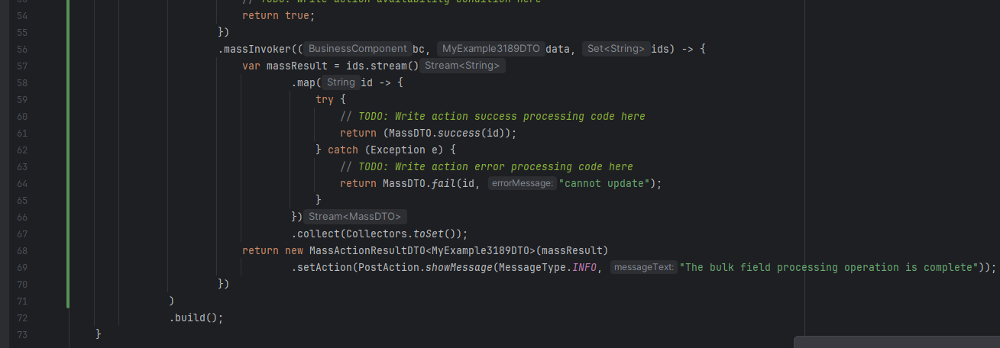
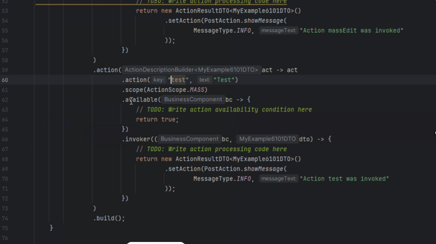
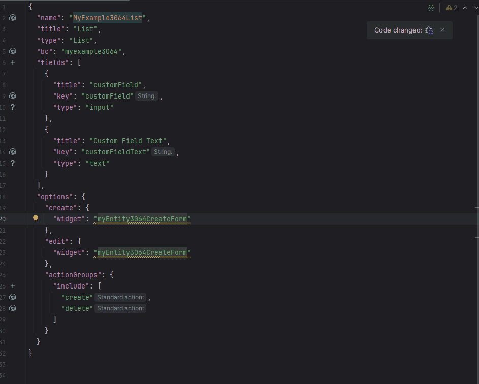

# 2.0.2
 
## Добавлено. Поддержка новой версии IDEA (2.25.3) { #added-support-for-the-new-version-of-idea-2253-added }
<!-- CXBOX-1194  -->
Добавлена поддержка IntelliJ 2025.3+.
 
## Исправлено. Исправлен invoker для massInvoker (массовые операции) { #fixed-fixed-invoker-for-massinvokerbulk-operations }
<!-- CXBOX-1173  -->
Исправлен invoker для massInvoker.
=== "после"
    
=== "до"
    

## Добавлено. Инспекция предупреждает об использовании виджета с тем же BC { #added-inspection-warns-about-same-bc-widget-usage }
<!-- CXBOX-1077   -->
Добавлена инспекция (предупреждение), указывающая на случаи, когда в тегах `options.create`, `options.edt` или `options.read` используются виджеты с тем же бизнес-компонентом, что и у виджета, к которому применяются эти теги.

## Исправлено. PickMapHasValueOnWidgetInspection удалена { #fixed-fixed-pickmaphasvalueonwidgetinspection-deleted }
<!-- CXBOX-1011   -->
PickMapHasValueOnWidgetInspection удалена.

## Исправлено. Исправлена генерация MultivalueField для VersionAwareResponseService { #fixed-fixed-for-versionawareresponseservice-multivaluefield-generation }
<!-- CXBOX-1182   -->
Создание поля Multivalue снова работает для внутренних сущностей.
