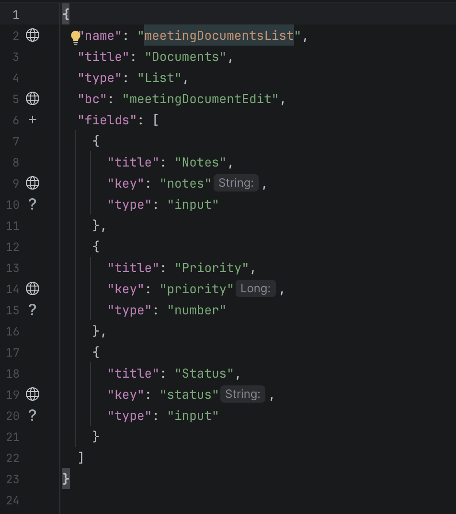
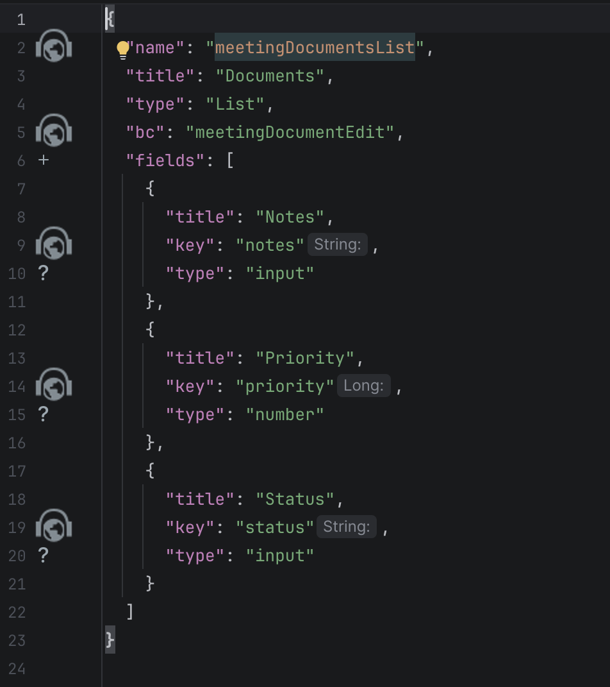

# 2.0.4

## Добавлено. Поддержка новой версии IDEA (2026.2) { #added-support-for-the-new-version-of-idea-20262-added }
<!-- CXBOX-1376  -->
Добавлена поддержка IntelliJ 2026.2+.

## Исправлено: изменена иконка навигации на полях редактора { #fixed-changed-navigation-gutter-icon }
<!-- CXBOX-1376  -->
Иконка навигации на полях редактора (gutter) заменена на компактную иконку `AllIcons.Nodes.PpWeb` во всех местах использования:

* `.screen.json`: `defaultView`, `primaryViewName`, `primaryViews`, `name` view в `navigation`;
* `.view.json`: `name` view, имена виджетов в `widgets`;
* `.widget.json`: `name` виджета, `bc`, `key` поля, `popupBcName` и `assocValueKey` полей `multivalue` / `pickList`, ключи `pickMap`, `format` времени, действия и группы `actionGroups`, `fieldKey` в `options.layout`;
* Java: поля DTO-классов (наследников `DataResponseDTO`), навигация к их использованиям в виджетах.

=== "после"
    
=== "до"
    
