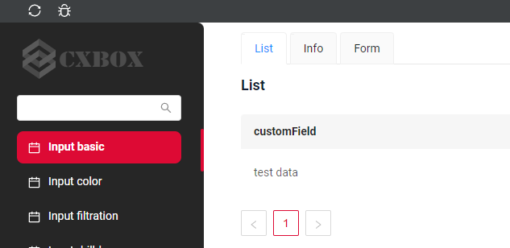
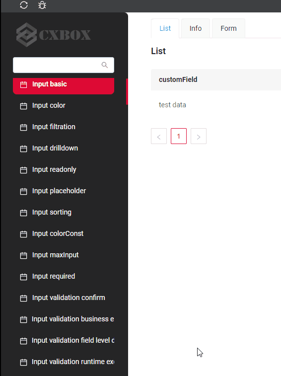
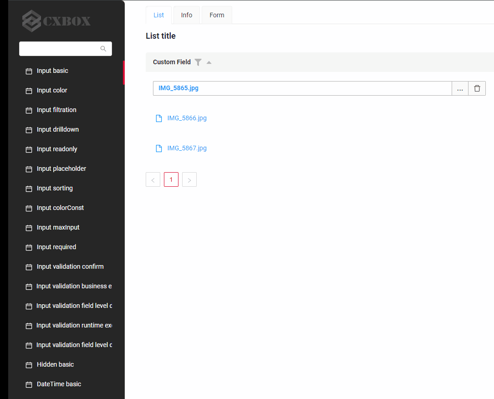
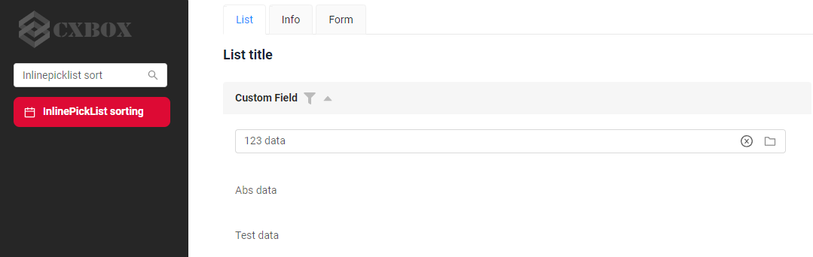
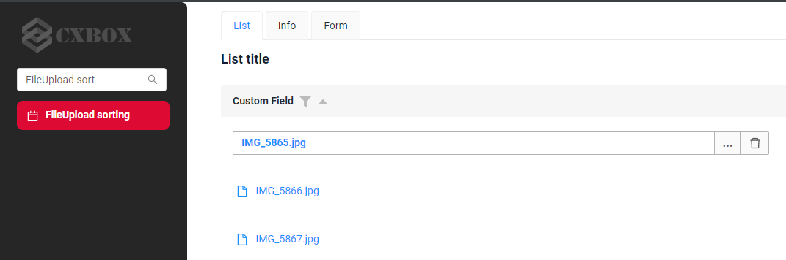
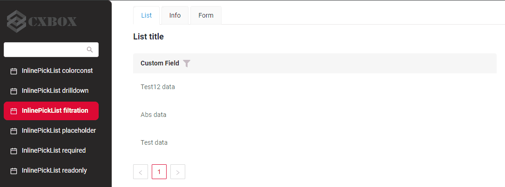
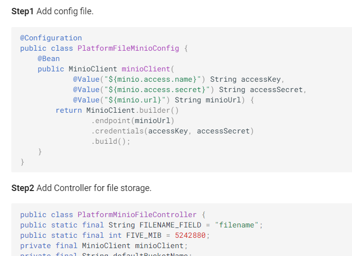

# v1.0.0

## **Ключевые обновления 21 сентября 2023** { #key-updates-september-21-2023 }
### CXBOX ([Демо](https://github.com/CX-Box/cxbox-demo), [Примеры кода](https://github.com/CX-Box/cxbox-code-samples)) { #cxbox-demo-code-samples }

#### Красно-чёрная тема { #red-black-theme }
{width="800"}

В релизе обновлена тема оформления.
Выбранная тема — классическое сочетание красного и чёрного, символизирующее аристократический вкус и достоинство)

Чтобы посмотреть новую тему, перейдите по
[ссылке]({{ external_links.demo }}/ui/)

#### Добавлен поиск экранов по названию в меню { #added-search-for-screens-by-name-in-menu }
{width="300" }

В обновление входит новая удобная функция поиска экранов по названию в меню.
Она позволяет пользователям быстро и эффективно находить нужные экраны.
Фильтрация нечувствительна к регистру и находит записи, содержащие указанное значение в любой позиции (аналогично SQL Like %value% )
[ссылка](https://code-samples.cxbox.org/ui/#/screen/InputBasic).

####  Добавлена прокрутка экранов в меню { #added-scroll-for-screens-in-menu }
{width="500" }

В меню добавлена прокрутка.
Эта функция позволяет просматривать полный список экранов или пунктов в ограниченном пространстве.
Если список не помещается в доступное пространство, его можно прокручивать вверх или вниз.
[ссылка](https://code-samples.cxbox.org/ui/#/screen/InputBasic)

#### Добавлена сортировка для полей FileUpload, InlinePicklist { #added-sort-for-fields-fileuploadinlinepicklist }
{ width="800" }
{ width="800" }

Добавлена сортировка для полей FileUpload, InlinePicklist. Используется лексикографическая сортировка.
Этот способ сортировки основан на порядке символов в поле: буквы и цифры упорядочиваются в соответствии с их положением в алфавите или числовой последовательности.
Посмотреть можно здесь:
[InlinePicklist](https://code-samples.cxbox.org/ui/#/screen/InputBasic),
[FileUpload](https://code-samples.cxbox.org/ui/#/screen/InputBasic).

#### Исправлена фильтрация { #fix-filtration }
{width="600" }

Исправлены проблемы фильтрации для разных типов полей:
    [InlinePickList](https://code-samples.cxbox.org/ui/#/screen/myexample142/view/myexample142list),
    [PickList](https://code-samples.cxbox.org/ui/#/screen/myexample111/view/myexample111list),
    [MultipleSelect](https://code-samples.cxbox.org/ui/#/screen/myexample256/view/myexample256list),
    [Radio](https://code-samples.cxbox.org/ui/#/screen/myexample25/view/myexample25list),
    [Money](https://code-samples.cxbox.org/ui/#/screen/myexample63/view/myexample63list),
    [Number](https://code-samples.cxbox.org/ui/#/screen/NumberFiltration/view/NumberFiltrationlist),
    [DateTime](https://code-samples.cxbox.org/ui/#/screen/DateTimeFiltration/view/DateTimeFiltrationlist),
    [DateTimeWithSeconds](https://code-samples.cxbox.org/ui/#/screen/DateTimeWithSecondsFiltration/view/DateTimeWithSecondsFiltrationlist),
    [FileUpload](https://code-samples.cxbox.org/ui/#/screen/myexample99/view/myexample99list),
    [Checkbox](https://code-samples.cxbox.org/ui/#/screen/myexample53/view/myexample53list)

#### Добавлена работа с файловым хранилищем Minio { #added-worked-with-file-store-minio }

Документация дополнена подробным примером работы с файловым хранилищем Minio.
Это дополнение даёт практическое представление об использовании Minio для хранения файлов вместе с cxbox.
[FileStorage.Minio](https://doc.cxbox.org/features/element/fileStorage/fileStorage/)

#### Прочие изменения { #other-changes }
см. [журнал изменений cxbox-demo](https://github.com/CX-Box/cxbox-demo/releases/tag/v1.0.0)

см. [журнал изменений cxbox-code-samples](https://github.com/CX-Box/cxbox-code-samples/releases/tag/v1.0.0)