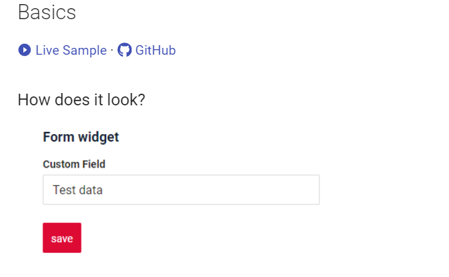
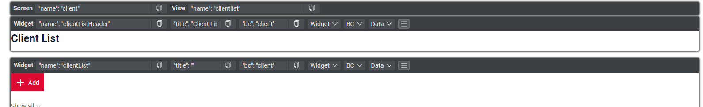

# v1.0.1
cxbox/core 3.0.5
cxbox-ui/core 1.37.1

## **Ключевые обновления 7 декабря 2023** { #key-updates-december-7-2023 }

### CXBOX [документация](https://doc.cxbox.org/ru/) { #cxbox-documetation }

#### Добавлено описание виджета формы { #added-creation-form-widget }
{width="500"}

Добавлен новый раздел документации с описанием основной функциональности виджета формы.
Раздел содержит подробное описание основ, основных визуальных частей и условия отображения.
Также добавлены ссылки на живые примеры для практического знакомства и на примеры кода.

#### Прочие изменения { #other-changes }
см. [журнал изменений cxbox-doc](https://github.com/CX-Box/cxbox-doc/releases/tag/v1.0.1)

### CXBOX ([Демо](https://github.com/CX-Box/cxbox-demo)) { #cxbox-demo }

#### Новый дизайн режима разработки { #development-mode-redesign }
{width="800"}

Панель отладки стала удобнее. Новый дизайн позволяет видеть всю основную информацию о виджете в одной строке. Если нужна более подробная информация, достаточно нажать на стрелку, чтобы раскрыть дополнительные сведения. Это делает работу с панелью отладки проще и удобнее.
Добавлен новый раздел документации с описанием основной функциональности всех типов полей.
Каждый раздел содержит подробное описание основных операций, placeholder,
способов сортировки, вариантов цветового выделения, фильтрации, drilldown, валидации, обязательного заполнения и фильтрации для конкретного типа поля.
Также добавлены ссылки на живые примеры для практического знакомства и на примеры кода.

#### Поддержка Oracle { #oracle-support }
Добавлена возможность развернуть приложение на базе данных Oracle с помощью настроек.

подробнее см. [Поддержка Oracle](/ru/features/element/database/oracle/oraclebd)

#### Добавлены метрики производительности { #added-performance-metrics }
В приложение добавлены инструменты мониторинга — метрики производительности.
Метрики производительности используются для оценки и мониторинга поведения, операций и эффективности.

подробнее см. [Метрики производительности](/ru/features/element/monitoringtools/metrics/performancemetrics)

#### Интеграция с email { #integration-with-email }
В приложение добавлена отправка на email.

подробнее см. [Отправка на email](/ru/features/element/notifications/email/email)

#### Добавлена опциональная поддержка базовой авторизации { #basic-auth-optional-support-added }
Добавлена возможность хранить логин и пароль в базе данных.

подробнее см. [Базовая авторизация](/ru/features/element/authorization/basic/basicauthorization)
#### Push-уведомления { #push-notifications }
Добавлены push-уведомления

подробнее см. [WebSocket и Long Polling](/ru/features/element/notifications/push/websocket)

#### Прочие изменения { #other-changes_1 }
см. [журнал изменений cxbox-demo](https://github.com/CX-Box/cxbox-demo/releases/tag/v.1.0.1)

см. [журнал изменений cxbox-code-samples](https://github.com/CX-Box/cxbox-code-samples/releases/tag/v1.0.1)