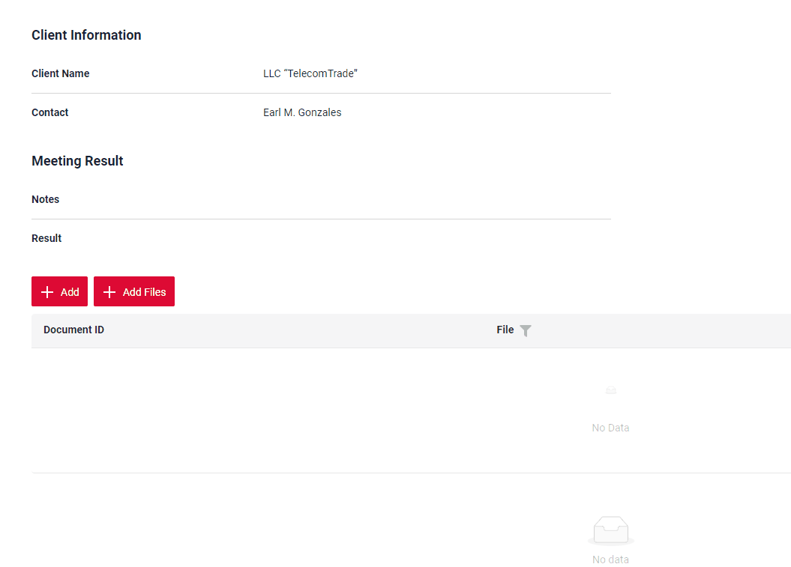
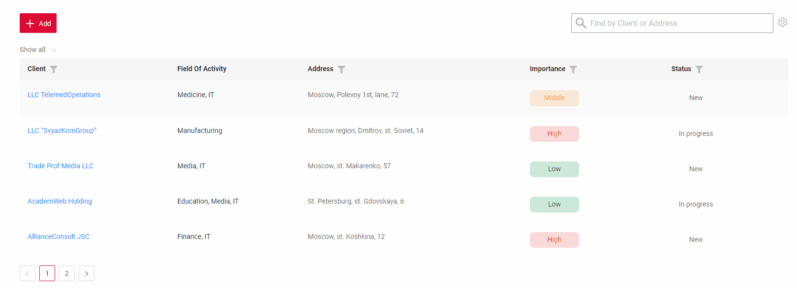
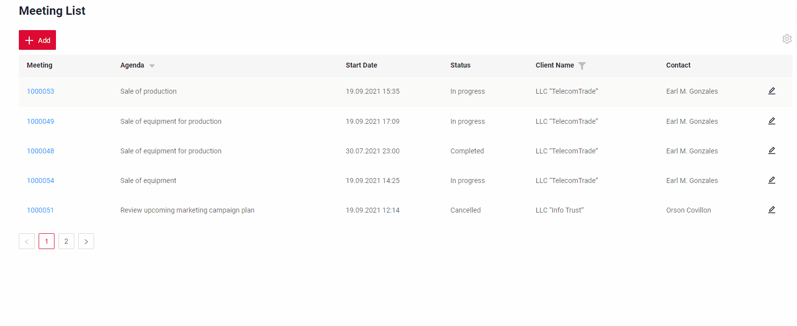
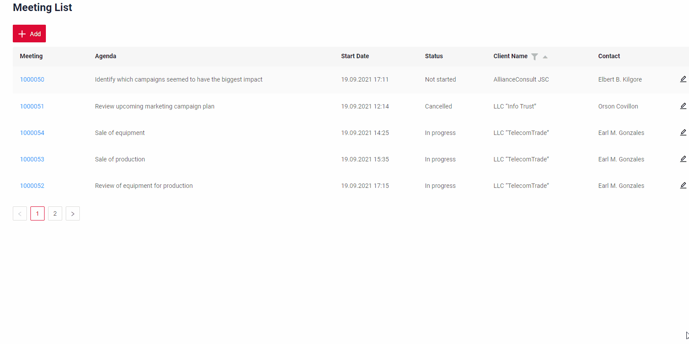
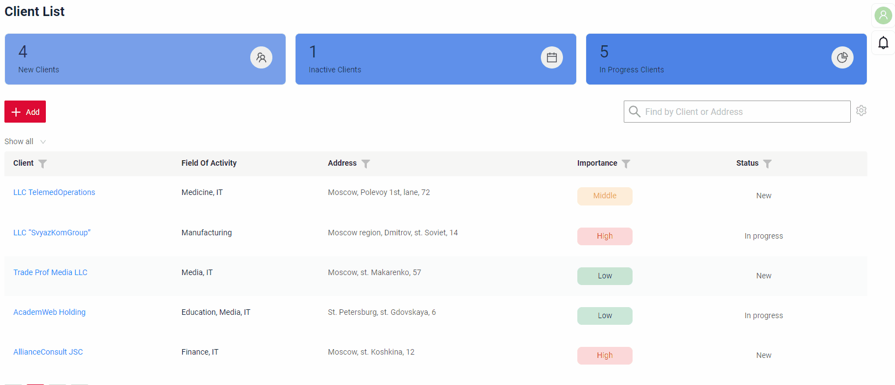
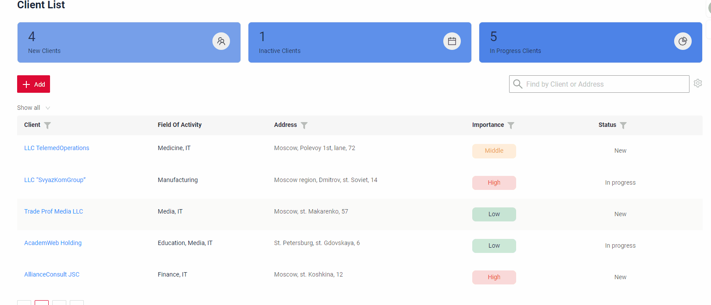
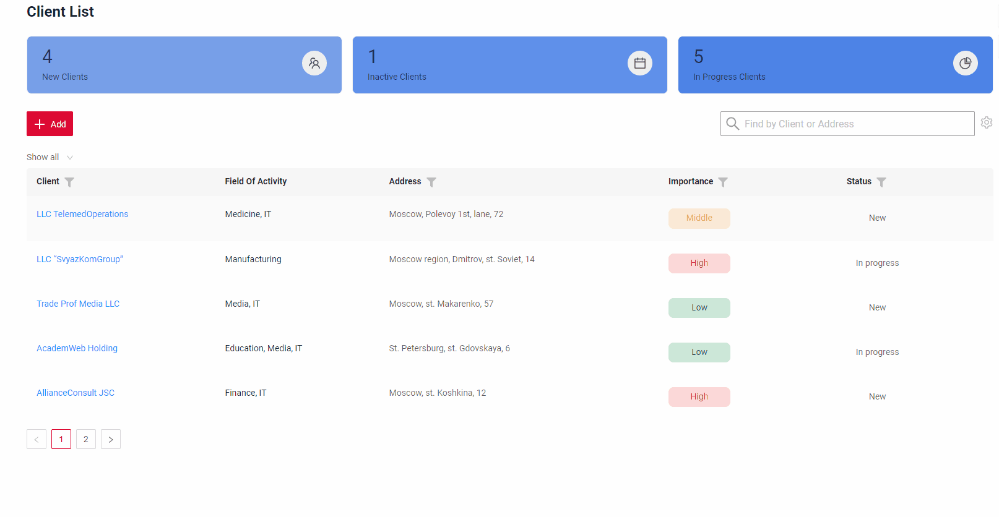
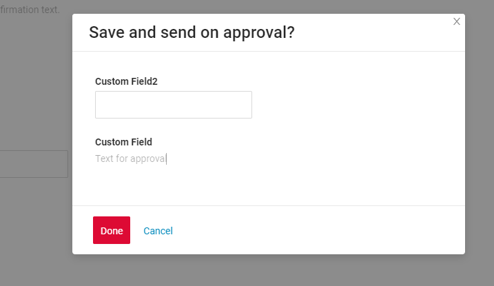
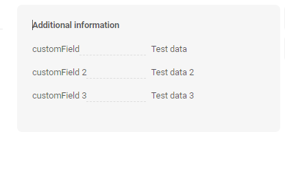

# v2.0.0

cxbox/core 4.0.0-M2

cxbox-ui/core 2.0.0-alpha.6

## **Ключевые обновления 11 марта 2024** { #key-updates-march-11-2024 }

### CXBOX ([Демо](https://github.com/CX-Box/cxbox-demo)) { #cxbox-demo }

#### Новая версия фронтенда cxbox { #new-version-front-cxbox }
В релизе используется новая версия фронтенда cxbox UI.

подробнее см. [Новый UI](#CXBOXUI)

#### Новая версия ядра cxbox { #new-version-core-cxbox }
В релизе используется новая версия ядра cxbox.

подробнее см. [Новое ядро](#CXBOXCORE)

####  Поддержка микросервисной архитектуры { #support-for-microservice-architecture }
Добавлена возможность работать не только с данными из базы данных, но и с данными из любого источника. Например, значительно улучшена поддержка микросервисной архитектуры.

подробнее см. [Улучшенная работа с микросервисами](#Microservices)

#### Добавлена множественная загрузка файлов { #added-multi-upload-for-files }

Множественная загрузка файлов. Чтобы загрузить несколько файлов, выберите их во всплывающем окне, дождитесь загрузки и нажмите кнопку "Save".
Файлы будут загружены в хранилище и появятся на странице после завершения загрузки. Эта возможность упрощает загрузку нескольких документов сразу и экономит время пользователя.
Она также гарантирует, что все нужные файлы загружаются в виджет за один раз, без необходимости загружать каждый файл отдельно.

Живой пример [Добавление файлов](  {{ external_links.demo }}/ui/#/screen/meeting/view/meetingview/meeting/1000053)

#### Добавлен полнотекстовый поиск { #added-full-text-search }

Для виджетов List добавлена возможность полнотекстового поиска. Когда пользователь вводит текст в поле полнотекстового поиска, виджет фильтрует строки, соответствующие запросу (критерии поиска настраиваются и обычно проверяют, есть ли соответствующее значение хотя бы в одной колонке). Это помогает пользователям быстро находить нужную информацию в виджете List.

Живой пример [Полнотекстовый поиск]({{ external_links.demo }}/ui/#/screen/meeting)

#### Дополнительные колонки { #additional-columns }

Если нужно изменить состав или порядок отображаемых колонок, это можно сделать в меню настроек, выбрав, какие колонки «отображать», а какие нет.
Эти изменения сохраняются только для вашей учётной записи, поэтому вы можете просматривать колонки так, как вам удобно.

Живой пример [Настройка отображаемых колонок]({{ external_links.demo }}/ui/#/screen/client)

#### Новая фильтрация pickList { #new-picklist-filtration }

Новая фильтрация позволяет искать записи picklist по ID или по тексту, что делает поиск нужной информации более гибким и эффективным. Режимы фильтрации взаимоисключающие: одновременно можно использовать только один режим.
Это улучшение делает работу удобнее и ускоряет выбор записей из picklist.

Живой пример [Новый фильтр pickList]({{ external_links.demo }}/ui/#/screen/meeting)

#### Настройка групп фильтров { #filter-group-setting }

Пользовательские фильтры можно сохранить для пользователя и выбирать из выпадающего списка. Это позволяет быстро применять сохранённые персональные фильтры, не вводя их каждый раз заново. Изменения сохраняются только для учётной записи пользователя.

Живой пример [Настройка групп фильтров]({{ external_links.demo }}/ui/#/screen/client).

#### Добавлен новый тип виджета — StatsBlock { #added-new-widget-type-statsblock }

Виджет позволяет отображать статистику в виде панели. Только для просмотра данных.

Живой пример [StatsBlock]({{ external_links.demo }}/ui/#/screen/client).

#### Добавлен новый тип виджета — suggestionPickList { #added-new-widget-type-suggestionpicklist }

Новый тип виджета позволяет искать данные во внешних системах по определённым полям. В текущем релизе приведён пример получения данных из внешнего REST API (dadata).

Живой пример [suggestionPickList]({{ external_links.demo }}/ui/#/screen/client)

#### Добавлен новый тип виджета — FormPopup { #added-new-widget-type-formpopup }

Добавлен новый тип виджета — всплывающее окно с дополнительными полями.

Живой пример [FormPopup](https://doc.cxbox.org/ru/widget/type/formpopup/formpopup/)

#### Добавлен новый тип виджета — AdditionalInfo { #added-new-widget-type-additionalinfo }

Добавлен новый тип виджета только для просмотра данных. Виджет всегда располагается справа и имеет серый фон.

Живой пример [AdditionalInfo](https://doc.cxbox.org/ru/widget/type/additionalinfo/additionalinfo/)

#### Прочие изменения { #other-changes }
см. [журнал изменений cxbox-demo](https://github.com/CX-Box/cxbox-demo/releases/tag/v2.0.0)

### <a id="CXBOXUI">CXBOX</a> ([Core Ui](https://github.com/CX-Box/cxbox-ui))

#### Node JS версии < 18 { #node-js-version-18 }
Удалена поддержка Node JS версии < 18

#### Удалены все прямые зависимости { #all-direct-dependencies-have-been-removed }
Изменения позволили использовать в проекте зависимости, удовлетворяющие требованиям диапазона версий.

#### UIKit отделён от ui core { #uikit-has-been-separated-from-ui-core }
UIKit отделён от ui core, поэтому вместо стандартного UIKit cxbox на основе ant-design теперь можно реализовать в проекте собственный UIKit на предпочитаемой библиотеке (material и т. д.).

#### Заменены собственные утилиты TypeScript { #replaced-custom-typescript-utilities }
Собственные утилиты TypeScript заменены хорошо документированными стандартными функциями библиотек Redux-toolkit и Redux-observable.

#### Изменение поведения стандартных действий { #change-standard-actions-behavior }
Добавлена возможность менять поведение стандартных действий на уровне проекта.

#### Изменение логики маршрутизации на фронтенде { #change-routing-logic-on-the-frontend }
Добавлена возможность выбрать библиотеку для маршрутизации на фронтенде.

#### Автотесты для асинхронных процессов с Marble-тестированием { #autotests-for-asynchronous-marble-testing-processes }
Теперь можно реализовать автотесты для асинхронных процессов с Marble-тестированием

### <a id="CXBOXCORE">CXBOX</a>  ([Core](https://github.com/CX-Box/cxbox))
#### Обновление до Spring Boot 3 (java 17+) { #updated-to-springbot-3java-17 }
Обновлено до Spring Boot 3 (java 17+)

#### <a id="Any source API">API Any Source и улучшенная работа с микросервисами</a>
Новый API "Any Source" позволяет отображать/редактировать/обновлять данные из микросервисов или любых других источников.
Особенность API — полное единообразие со старым «внутренним» API для работы в стандартном режиме (например, API на основе VersionAwareResponseService).
Многоэтапное создание сущностей с force active полями поддерживается в новом API "Any Source" из коробки.

#### Исправлены предупреждения безопасности зависимостей { #fixed-dependency-security-alert }
Исправлены все найденные GitHub на текущий момент ([предупреждения безопасности зависимостей](https://github.com/CX-Box/cxbox/security/dependabot)).

#### Из ядра удалены таблицы { #removed-from-the-core-of-the-table }
Из ядра удалены таблицы:

    * User
    * User_Role
    * USER_DIVISIONS
    * REVINFO
    * DIVISION
    * DEPT

#### Удалены стартеры { #removed-the-starters }
Удалены стартеры:

    * cxbox notifications starter (пример перенесён в demo и реализован на веб-сокетах для возможности глубокой кастомизации в проектах)
    * cxbox quartz starter (удалён)
    * cxbox workflow starter (удалён)
    * Changelistener (рекомендуется использовать стандартный Listener Hibernate)

#### FieldExtractors сделаны Spring-сервисами { #made-fieldextractors-spring-service }
Разработчику больше не нужно регистрировать их в META-INF.services — теперь достаточно аннотации @Service

#### Прочие изменения { #other-changes_1 }
см. [журнал изменений cxbox](https://github.com/CX-Box/cxbox/releases/tag/cxbox-4.0.0-M2)
