# v2.0.1

* [cxbox/demo 2.0.1 git](https://github.com/CX-Box/cxbox-demo/tree/v.2.0.1), [примечания к релизу](https://github.com/CX-Box/cxbox-demo/releases/tag/v.2.0.1)

* [cxbox/core 4.0.0-M3 git](https://github.com/CX-Box/cxbox/tree/cxbox-4.0.0-M3), [примечания к релизу](https://github.com/CX-Box/cxbox/releases/tag/cxbox-4.0.0-M3), [maven](https://central.sonatype.com/artifact/org.cxbox/cxbox-starter-parent)

* [cxbox-ui/core 2.0.0 git](https://github.com/CX-Box/cxbox-ui/tree/2.0.0), [примечания к релизу](https://github.com/CX-Box/cxbox-ui/releases/tag/2.0.0), [npm](https://www.npmjs.com/package/@cxbox-ui/core)

* [cxbox/code-samples 2.0.1 git](https://github.com/CX-Box/cxbox-code-samples/tree/v2.0.1), [примечания к релизу](https://github.com/CX-Box/cxbox-code-samples/releases/tag/v2.0.1)

## **Ключевые обновления июля 2024** { #key-updates-july-2024 }
### CXBOX [документация](https://doc.cxbox.org/ru/) { #cxbox-documetation }
#### Добавлено руководство по началу работы для разработчика { #added-getting-started-for-developer }
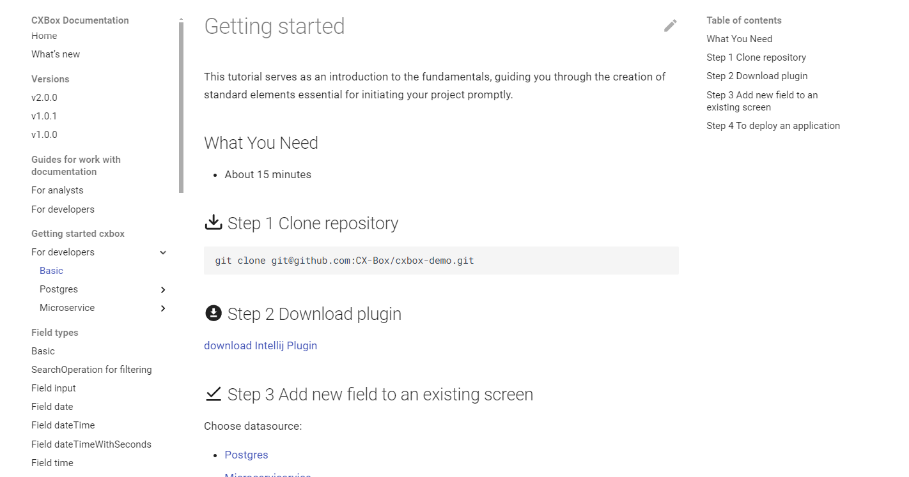

Это руководство знакомит с основами и помогает создать стандартные элементы, необходимые для быстрого старта проекта.

подробнее см. [Начало работы](https://doc.cxbox.org/ru/gettingstarted/getstartedfordevelopers/)
#### Добавлены примеры создания для микросервисов { #added-creation-examples-for-microservice }
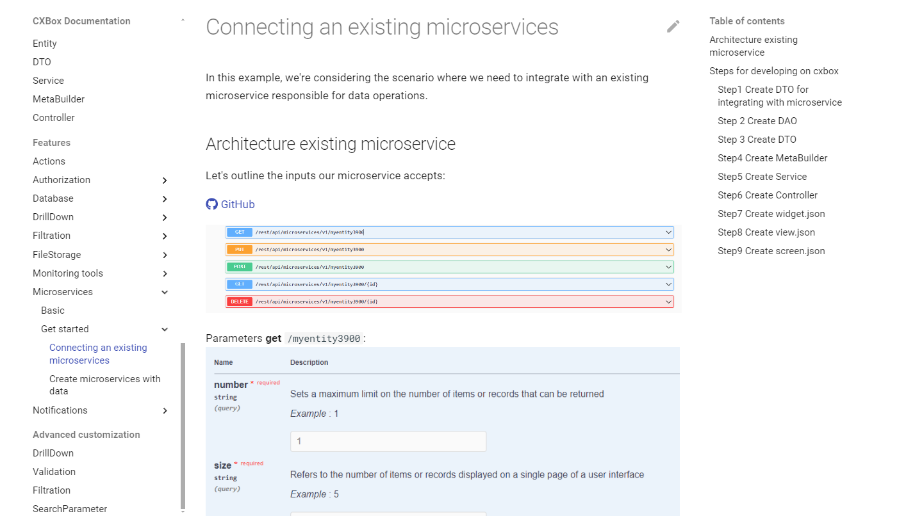

Добавлен обзор стандартных подходов к работе с микросервисами.
Кроме того, описан сценарий, когда нужно интегрироваться с существующим микросервисом, отвечающим за операции с данными.

подробнее см. [Микросервисы](https://doc.cxbox.org/ru/features/element/microservices/microservices/)
#### Добавлены примеры создания виджетов { #added-creation-examples-for-widgets }
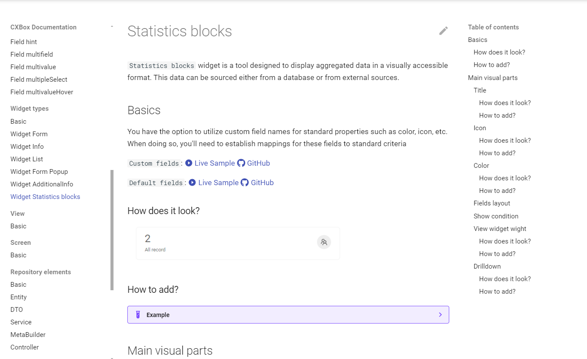

Добавлено описание работы со следующими типами виджетов:

[Info](https://doc.cxbox.org/widget/type/info/info.md/):
Виджет Info — компонент только для просмотра данных.

[Form](https://doc.cxbox.org/widget/type/form/form/):
Виджет Form — компонент для просмотра и редактирования данных. Обычно отображает несколько полей. Также может отображать доступные действия

[List](https://doc.cxbox.org/widget/type/list/list/):
Виджет List выводит общую информацию по множеству записей и представляет её в удобном для пользователя виде.

[AdditionalInfo](https://doc.cxbox.org/widget/type/additionalinfo/additionalinfo/):
Виджет AdditionalInfo — компонент только для просмотра данных. Виджет всегда располагается справа.

[Блоки статистики](https://doc.cxbox.org/ru/widget/type/statblocks/statblocks/):
Виджет блоков статистики предназначен для отображения агрегированных данных в наглядном виде. Данные могут поступать как из базы данных, так и из внешних источников.
#### Добавлены примеры для полнотекстового поиска и групп фильтров { #added-creation-examples-for-fulltextsearchfilter-group }
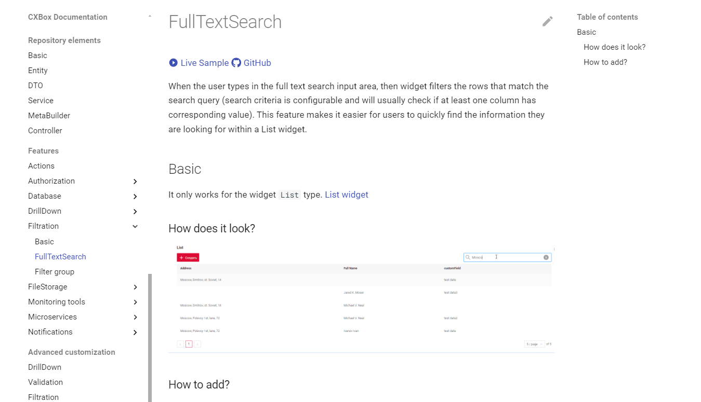

Добавлено описание следующих способов фильтрации:

[Полнотекстовый поиск](https://doc.cxbox.org/ru/widget/type/property/filtration/filtration/#by-fulltextsearch) :
Когда пользователь вводит текст в поле полнотекстового поиска, виджет фильтрует строки, соответствующие запросу (критерии поиска настраиваются и обычно проверяют, есть ли соответствующее значение хотя бы в одной колонке). Это помогает пользователям быстро находить нужную информацию в виджете List.

[Группа фильтров](https://doc.cxbox.org/ru/features/element/filtration/filtergroup/filtergroup/):
Заполненный пользователем фильтр можно сохранить для каждого отдельного пользователя.

#### Добавлены примеры для drilldown { #added-creation-examples-for-drilldown }
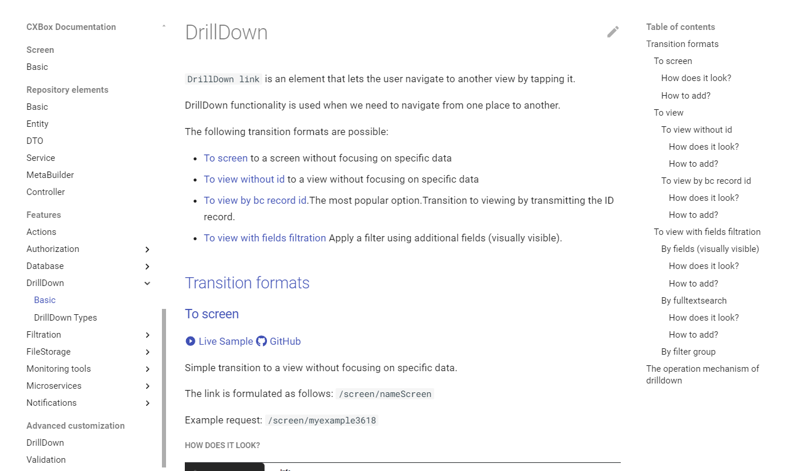
Добавлено описание работы с drilldown, их особенностей и различных вариантов использования.

[Drilldown](https://doc.cxbox.org/features/element/drilldown/drilldown/) :
DrillDown link — элемент, который позволяет пользователю перейти в другое представление, нажав на него.
#### Добавлены примеры для multivalue_primary { #added-creation-examples-for-multivalueprimary }
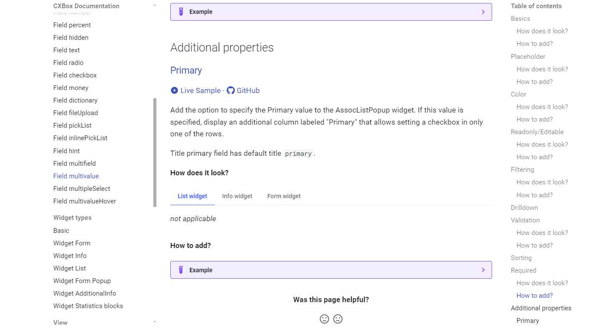
Добавлен пример, демонстрирующий возможность добавить атрибут primary к полю типа "multivalue".

[Multivalue_primary](https://doc.cxbox.org/widget/fields/field/multivalue/multivalue//):
Добавлена возможность указать значение Primary для виджета AssocListPopup. Если оно указано, отображается дополнительная колонка "Primary", в которой флажок можно установить только в одной из строк.

#### Прочие изменения { #other-changes }
см. [журнал изменений cxbox-doc](https://github.com/CX-Box/cxbox-doc/releases/tag/v2.0.1)

### CXBOX ([Демо](https://github.com/CX-Box/cxbox-demo), [Примеры кода](https://github.com/CX-Box/cxbox-code-samples)) { #cxbox-demo-code-samples }
#### Предпросмотр файлов { #file-preview }

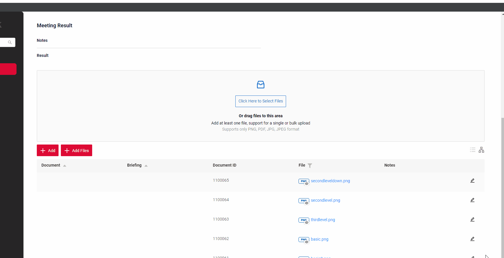

Добавлена кнопка с иконкой глаза. При нажатии система открывает всплывающее окно с полноэкранным предпросмотром файла.
В предпросмотр добавлены три типа кнопок:

Fullscreen: при нажатии система открывает всплывающее окно с полноэкранным предпросмотром файла.
Navigate: система показывает предпросмотр файлов во всплывающем окне из списка виджета в том порядке, который был на момент открытия окна, с учётом применённых фильтров и сортировки.
Download: система скачивает файл и сохраняет его в стандартную папку загрузок пользователя.

подробнее см. [Предпросмотр файлов]({{ external_links.demo }}/ui/#/screen/meeting/view/meetingview/meeting/1000053)
#### Множественная загрузка файлов без всплывающего окна. { #multi-upload-of-files-without-popup }

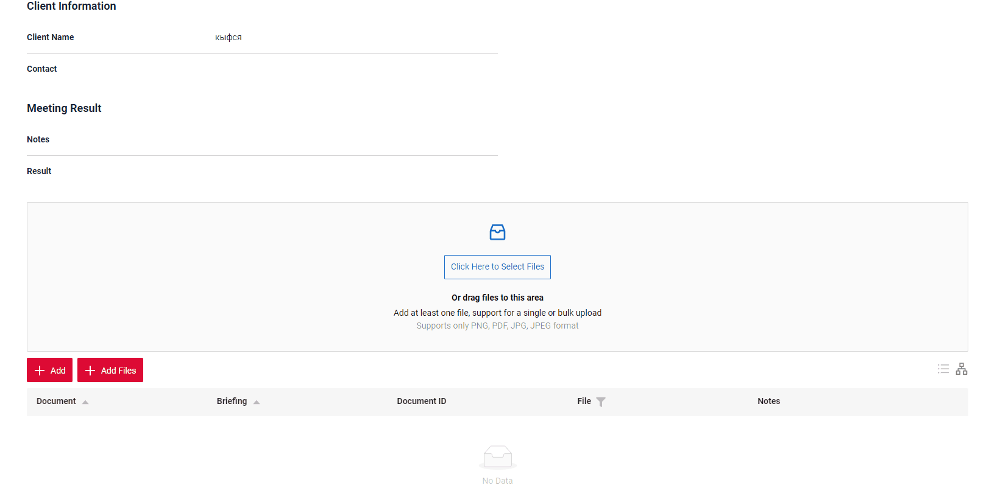

В новом обновлении загружать файлы можно прямо через виджет.
После загрузки файлы сохраняются и отображаются на странице по завершении процесса.
Добавлен индикатор прогресса загрузки файлов.
Это улучшение упрощает одновременную загрузку нескольких документов.

Живой пример [Добавление файлов]({{ external_links.demo }}/ui/#/screen/meeting/view/meetingview/meeting/1000053)
#### Добавлено отображение количества применённых фильтров { #added-display-of-the-number-of-applied-filters }
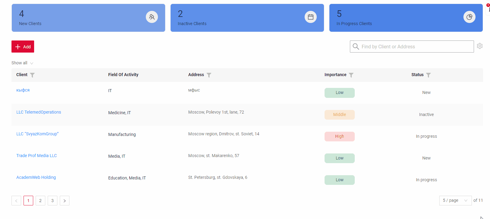

Если таблица отфильтрована, появляется кнопка "Clear all filters".
Количество применённых фильтров отображается как "Clear n filters" (где n — количество отфильтрованных колонок).

Живой пример [Добавление файлов]({{ external_links.demo }}/ui/#/screen/meeting)

#### Добавлен новый тип виджета — GroupingHierarchy { #added-new-widget-type-groupinghierarchy }
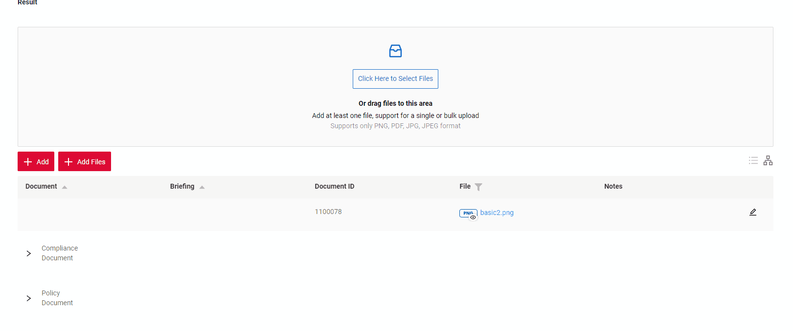

"Grouping Hierarchy" — исключительно режим отображения.
По сути, это виджет списка, дополненный функцией группировки.
Живой пример [GroupingHierarchy]({{ external_links.demo }}/ui/#/screen/meeting/view/meetingview/meeting/1000053)
 
#### Добавлен view с полномочиями (responsibility) { #added-view-with-responsibility }

Добавлен экран с полномочиями. Позволяет добавлять или убирать доступ к view.

[Живой пример]({{ external_links.demo }}/ui/#/screen/admin/view/responsibilitiesAdmin)

#### Добавлена фильтрация по диапазону для Date/DateTime/DateTimeWithSeconds { #added-filtration-by-range-for-datedatetimedatetimewithseconds }
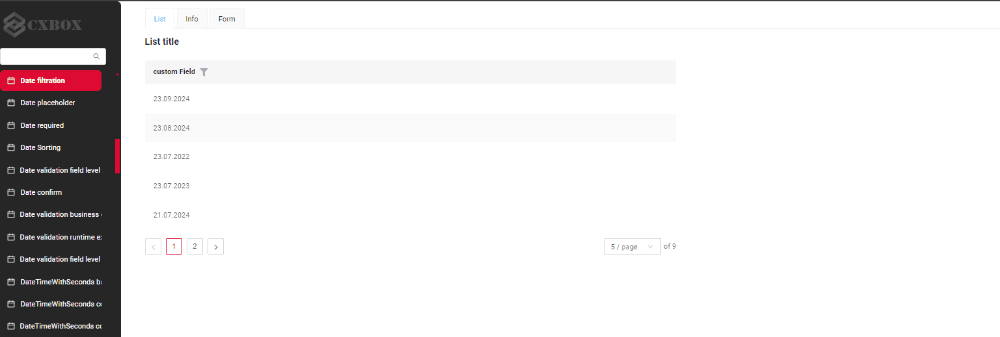

Теперь поля Date/DateTime/DateTimeWithSeconds можно фильтровать по диапазону. Возможность доступна для всех проектов.
#### Добавлена поддержка BgColor/BgColorKey поля в шаблоне Title { #added-support-bgcolorbgcolorkey-of-field-in-title-template }
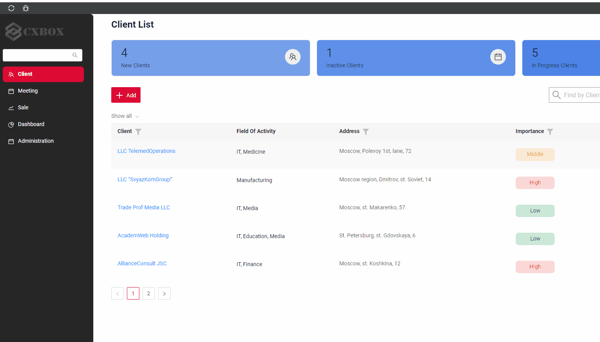

Добавлена возможность выделять цветом части заголовка виджета.
#### Прочие изменения { #other-changes_1 }
см. [журнал изменений cxbox-demo](https://github.com/CX-Box/cxbox-demo/releases/tag/v.2.0.1)

см. [журнал изменений cxbox-code-samples](https://github.com/CX-Box/cxbox-code-samples/releases/tag/v2.0.1)

### <a id="CXBOXUI">CXBOX</a> ([Core Ui](https://github.com/CX-Box/cxbox-ui))

#### Добавлена фильтрация по диапазону { #added-filtration-by-range }
Добавлена фильтрация по диапазону для Date/DateTime/DateTimeWithSeconds
#### Добавлена поддержка цвета в шаблоне Title { #added-support-color-in-title-template }
Добавлена поддержка BgColor/BgColorKey поля в шаблоне Title
#### Выбор нескольких файлов { #select-multiple-files }
Добавлена поддержка нескольких файлов
#### Предпросмотр файлов { #file-preview_1 }
Добавлена поддержка дополнительных параметров в meta для предпросмотра файлов

### <a id="CXBOXCORE">CXBOX 4.0.0-M3</a>  ([Core](https://github.com/CX-Box/cxbox))
####  Обновление до Spring Boot 3.2.4 { #updated-to-springbot-324 }
Обновлено до Spring Boot 3.2.4
#### Предпросмотр файлов { #file-preview_2 }
Добавлена поддержка дополнительных параметров в meta для предпросмотра файлов
#### Добавлена фильтрация по диапазону { #added-filtration-by-range_1 }
Добавлена поддержка фильтрации по диапазону для Date/DateTime/DateTimeWithSeconds
#### Добавлена сортировка в справочнике LOV { #added-sorting-in-the-lov-dictionary }
Добавлена сортировка в справочнике LOV
#### Настраиваемое значение лимита Bc по умолчанию { #default-bc-limit-value-is-configurable }
Теперь в application.yml (cxbox.meta.bcDefaultPageLimit) можно задать количество строк по умолчанию, отображаемых в любом виджете (раньше было 5).
При этом значение для конкретного bc по-прежнему можно переопределить в BC_Properties.csv через PAGE_LIMIT
#### Прочие изменения { #other-changes_2 }
см. [журнал изменений cxbox](https://github.com/CX-Box/cxbox/releases/tag/cxbox-4.0.0-M3)
