# 2.0.10

* [cxbox/demo 2.0.10 git](https://github.com/CX-Box/cxbox-demo/tree/v.2.0.10), [примечания к релизу](https://github.com/CX-Box/cxbox-demo/releases/tag/v.2.0.10)

* [cxbox/core 4.0.0-M13 git](https://github.com/CX-Box/cxbox/tree/cxbox-4.0.0-M13), [примечания к релизу](https://github.com/CX-Box/cxbox/releases/tag/cxbox-4.0.0-M13), [maven](https://central.sonatype.com/artifact/org.cxbox/cxbox-starter-parent/4.0.0-M13)

* [cxbox-ui/core 2.4.3 git](https://github.com/CX-Box/cxbox-ui/tree/2.4.3), [примечания к релизу](https://github.com/CX-Box/cxbox-ui/releases/tag/2.4.3), [npm](https://www.npmjs.com/package/@cxbox-ui/core/v/2.4.3)

* [cxbox/code-samples 2.0.10 git](https://github.com/CX-Box/cxbox-code-samples/tree/v.2.0.10), [примечания к релизу](https://github.com/CX-Box/cxbox-code-samples/releases/tag/v.2.0.10)

## **Ключевые обновления декабря 2024, января 2025** { #key-updates-december-2024-january-2025 }

### CXBOX ([Демо](https://demo.cxbox.org)) { #cxbox-demo }

#### Добавлено: [виджет List](/ru/list/) — выравнивание числовых типов полей { #added-list-widget-alignment-of-numeric-field-types }

Для числовых типов полей ([number](/ru/widget_field_number), [money](/ru/widget_field_money), [percent](/ru/widget_field_percent)) в [виджете List](/ru/list/) настроено выравнивание по правому краю. И заголовки, и содержимое теперь единообразно выровнены вправо.

=== "number"  
    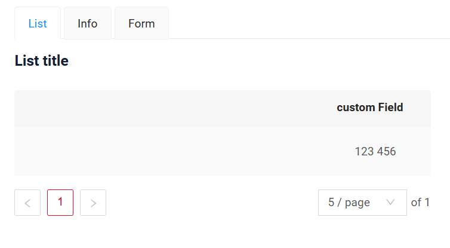  
=== "money"  
    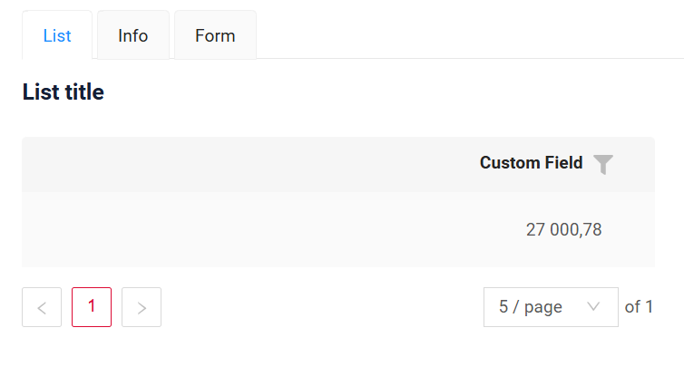  
=== "percent"
    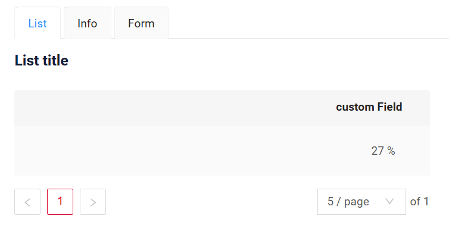  

#### Добавлено: виджеты [Form](/ru/form/), [Info](/ru/info/) — улучшенное выравнивание полей { #added-form-info-widgets-improved-field-alignment }

Улучшена логика компоновки полей в виджетах [Form](/ru/form/) и многоколоночном [Info](/ru/info/) (с [titleMode: top](https://doc.cxbox.org/ru/new/version207/?h=titlemode#added-info-widget-field-title-mode)). Строки остаются единообразно выровненными независимо от того, есть ли у полей подписи.

=== "Все с подписями"
    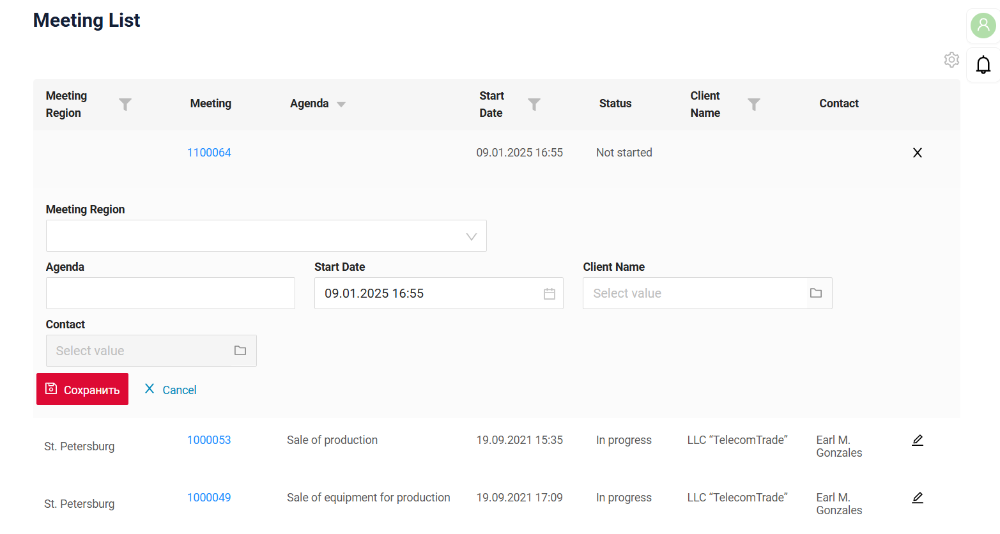  
=== "Некоторые с подписями"
    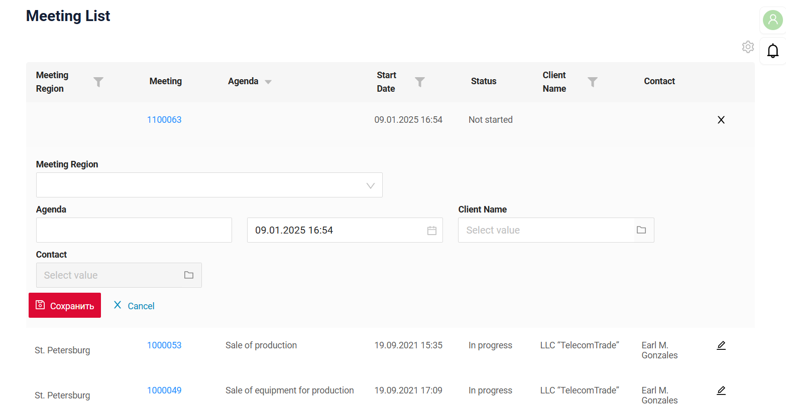  
=== "Все без подписей"
    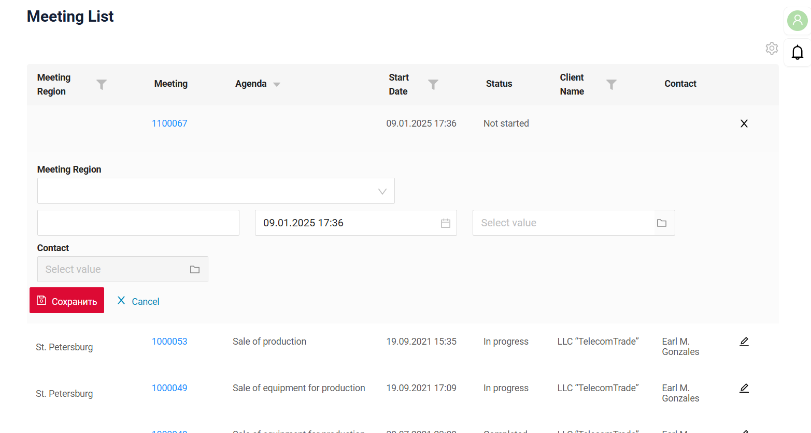  

#### Добавлено: поле [fileUpload](/ru/widget_field_fileUpload) — обработка расширений файлов без учёта регистра для предпросмотра { #added-fileupload-field-case-insensitive-file-extension-handling-for-file-preview }

Реализована проверка расширений файлов без учёта регистра, чтобы тип файла в предпросмотре определялся правильно. Независимо от того, **.png** это или **.PNG**, иконка предпросмотра теперь корректно отображает тип файла.

=== "После"
    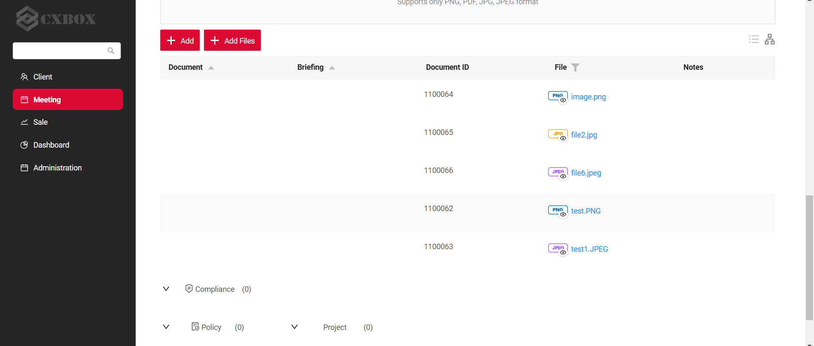
=== "До"
    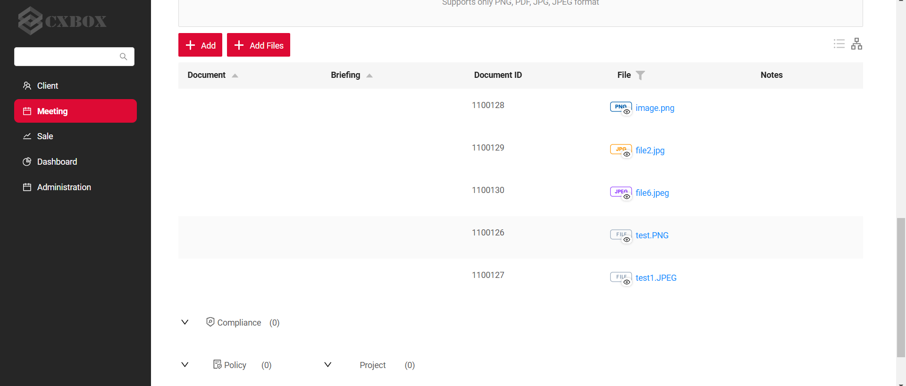  

#### Добавлено: [виджет List](/ru/list/) — одинаковый размер воронки для всех полей { #added-list-widget-constant-funnel-size-for-all-fields }

Теперь размер воронки фильтра одинаков независимо от типа фильтруемого поля.

=== "После"
    
=== "До"
    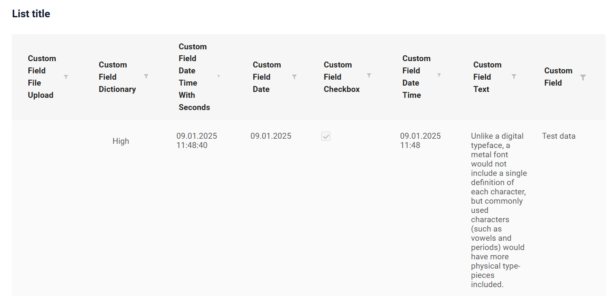  

#### Прочие изменения { #other-changes }
см. [журнал изменений cxbox-demo](https://github.com/CX-Box/cxbox-demo/releases/tag/v.2.0.10)

### CXBOX ([Core Ui](https://github.com/CX-Box/cxbox-ui/releases/tag/2.4.3))

Выпущена новая версия CORE UI (2.4.3).

#### Прочие изменения { #other-changes_1 }
см. [журнал изменений cxbox-ui](https://github.com/CX-Box/cxbox-ui/releases/tag/2.4.3)

<!--### CXBOX [plugin](https://plugins.jetbrains.com/plugin/19523-platform-tools)

Плагин обновлён до версии 1.7.8

#### Добавлено: инспекция ссылок на поля с постфиксом `-FieldKey` (раздел `options`) { #added-inspection-for-field-references-with-fieldkey-postfix-options-section }

Плагин теперь поддерживает автодополнение, ссылки и инспекции для ссылок на поля в разделе `options` файла `widget.json`. Чтобы включить эту функциональность, называйте поля в options с постфиксом `-FieldKey` (или просто `fieldKey`). Плагин свяжет эти поля с массивом fields в начале файла widget.json и обеспечит корректность ссылок.

=== "Автодополнение"
    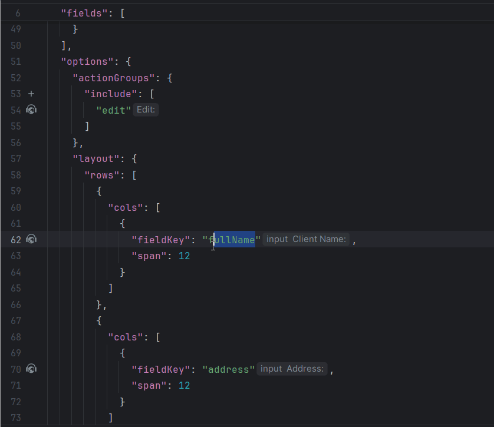
=== "Ссылка"
    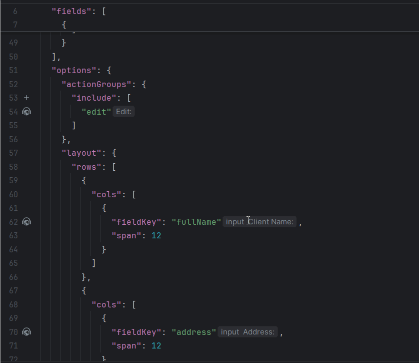
=== "Инспекция"
    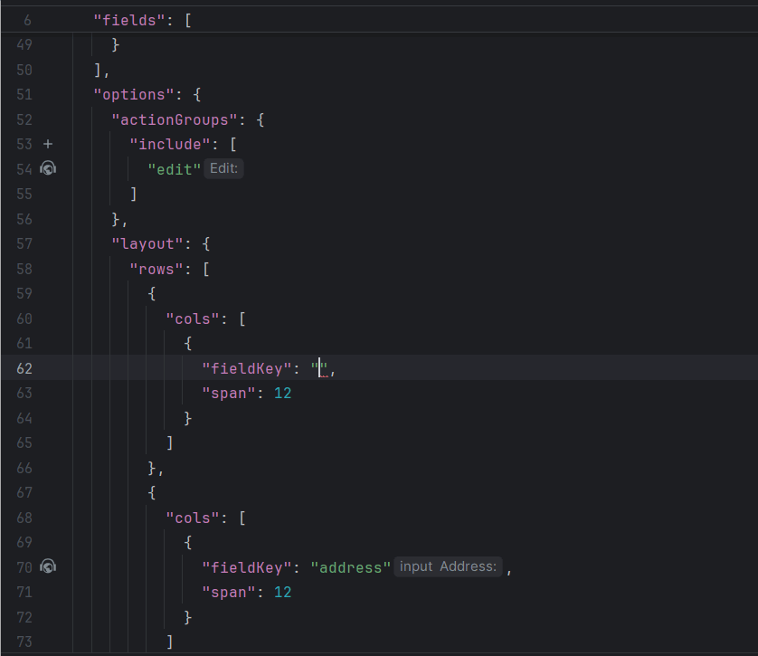  
-->

### CXBOX [документация](https://doc.cxbox.org/ru/) { #cxbox-documentation }

#### Добавлено: [AdditionalList](https://doc.cxbox.org/ru/widget/type/additionallist/additionallist.md/) { #added-additionallist }
Добавлено подробное описание виджета AdditionalList.
