# 2.0.11

* [cxbox/demo 2.0.11 git](https://github.com/CX-Box/cxbox-demo/tree/v.2.0.11), [примечания к релизу](https://github.com/CX-Box/cxbox-demo/releases/tag/v.2.0.11)

* [cxbox/core 4.0.0-M15 git](https://github.com/CX-Box/cxbox/tree/cxbox-4.0.0-M15), [примечания к релизу](https://github.com/CX-Box/cxbox/releases/tag/cxbox-4.0.0-M15), [maven](https://central.sonatype.com/artifact/org.cxbox/cxbox-starter-parent/4.0.0-M15)

* [cxbox-ui/core 2.5.1 git](https://github.com/CX-Box/cxbox-ui/tree/2.5.1), [примечания к релизу](https://github.com/CX-Box/cxbox-ui/releases/tag/2.5.1), [npm](https://www.npmjs.com/package/@cxbox-ui/core/v/2.5.1)

* [cxbox/code-samples 2.0.11 git](https://github.com/CX-Box/cxbox-code-samples/tree/v.2.0.11), [примечания к релизу](https://github.com/CX-Box/cxbox-code-samples/releases/tag/v.2.0.11)


## **Ключевые обновления января, февраля 2025** { #key-updates-january-february-2025 }

### CXBOX ([Демо](https://demo.cxbox.org)) { #cxbox-demo }

#### Добавлено: виджет [GroupingHierarchy](https://doc.cxbox.org/ru/widget/type/groupinghierarchy/groupinghierarchy/) — поддержка агрегирующих строк { #added-groupinghierarchy-widget-support-for-aggregate-rows }

Добавлены агрегирующие строки для отображения агрегатов на уровнях иерархии. Настраивается в `widget.json -> options -> groupMode: compact/ aggregate`.
 
=== "aggregate"  
    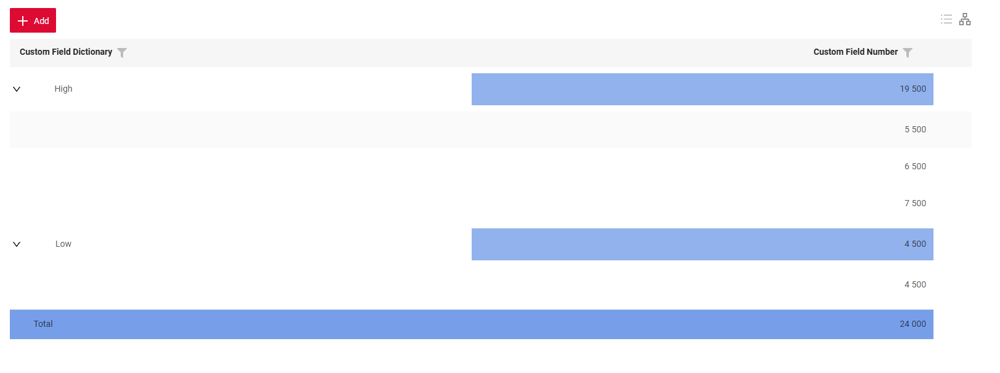{width="700"}  
    При `groupMode: aggregate` виджет отображает **агрегирующие строки** на уровне поля группировки.
    В этом режиме можно:
    1) Задать колонки, в которых отображаются агрегированные значения
    2) Указать, на каких уровнях иерархии должны отображаться агрегаты
    3) Выбрать функцию агрегации для вычислений. Сейчас поддерживаются стандартные функции: sum, min, max, avg.
    4) Настроить, какие колонки используются для вычисления агрегатов, включая значения из других колонок.
    !!! info  
        Скоро мы добавим подробное описание режима Aggregate в обновлённую статью о `GroupingHierarchy` (раздел [Aggregate](https://doc.cxbox.org/ru/widget/type/groupinghierarchy/groupinghierarchy/#aggregate))
=== "compact (по умолчанию)"
    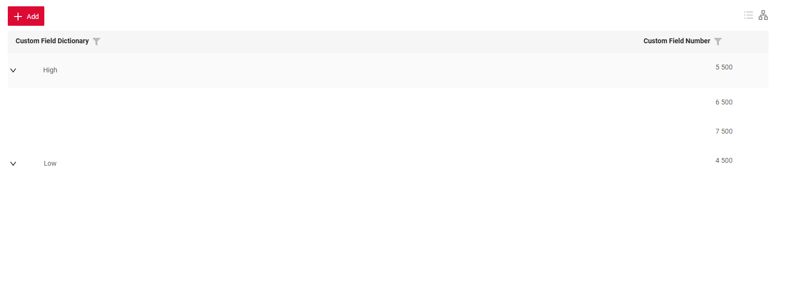{width="700"}  
    При `groupMode: compact` виджет отображается в компактном виде: поля группировки и их содержимое выводятся **в одной строке**.

#### Добавлено: [PostAction waitUntil и drillDownAndWaitUntil](https://doc.cxbox.org/ru/features/element/actions/postaction/drilldownandwaituntil/ddandwaituntil/) { #added-waituntil-and-drilldownandwaituntil-postaction }

**waitUntil**

Этот механизм позволяет программе ждать, пока не выполнится определённое условие. Например: «Ждать, пока статус задачи не станет 'Done'».

Это полезно при длительных операциях (например, при ожидании ответа от сторонней системы), когда нужно показать пользователю, что происходит, и сообщить, когда всё завершится.

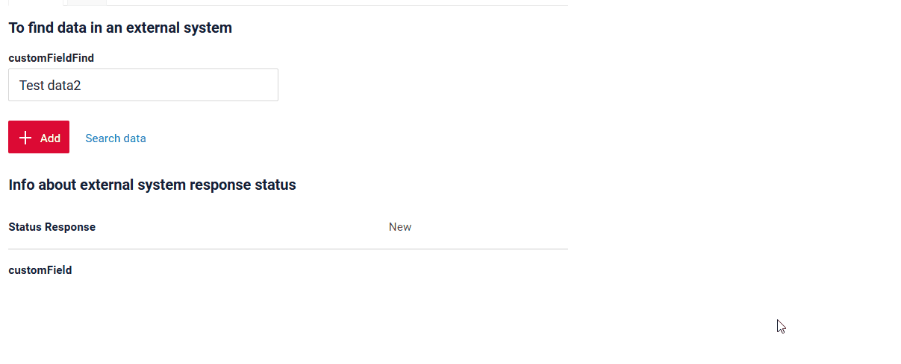

**drillDownAndWaitUntil**

Это механизм, который позволяет программе перейти на другой экран, а затем ждать, пока не выполнится определённое условие.
Например: «Перейти на этот экран, дождаться, пока статус не станет 'Done', и показывать пользователю, что происходит».

Это полезно в сценариях, когда нужно перейти на другой экран (например, чтобы посмотреть подробности или результаты).

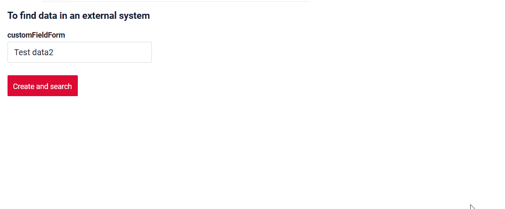

#### Добавлено: виджет Pie1D — новый тип виджета! { #added-pie1d-widget-new-widget-type }

Добавлен новый тип виджета `Pie1D` для отображения данных в виде круговой диаграммы.

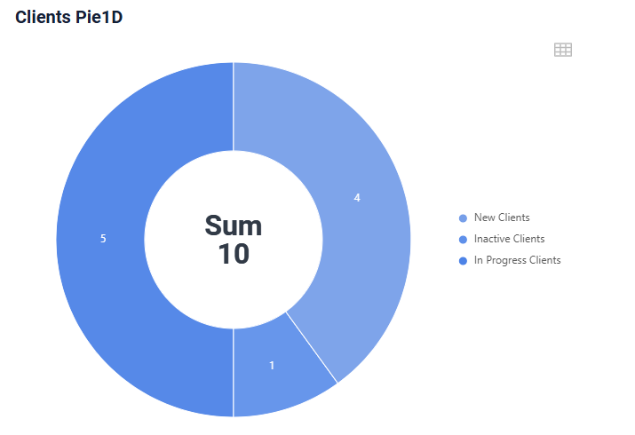

Основные возможности:

* Настройка внутреннего радиуса
* Отображение всплывающих подсказок
* Отображение легенды
* Отображение текста/агрегата в центре

Функциональность включает:

=== "Drilldown"  
    Нажмите на сегмент, чтобы перейти к отфильтрованным данным в таблице.
    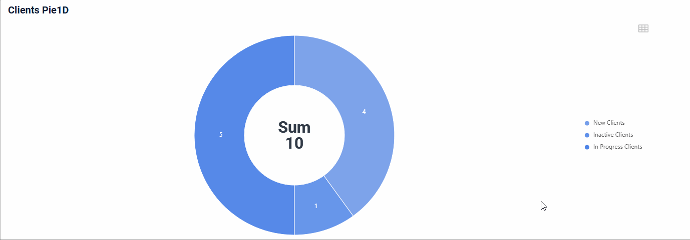
=== "Переключение режима"
    Переключитесь из режима диаграммы в табличный режим, чтобы посмотреть данные в виде таблицы.
    
=== "Взаимодействие с сегментами"
    Нажимайте на значения легенды, чтобы добавлять или убирать сегменты диаграммы. Агрегированное значение в центре диаграммы пересчитывается при взаимодействии с легендой.
      

#### Добавлено: виджет Column2D — новый тип виджета! { #added-column2d-widget-new-widget-type }

Добавлен новый тип виджета `Column2D` для отображения данных по осям X и Y.

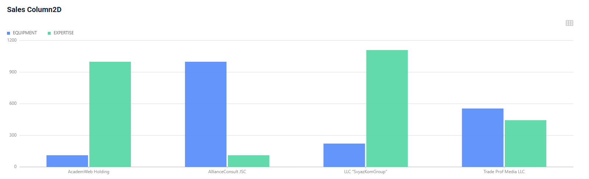

Основные возможности:

* Настройка масштаба/шага осей
* Отображение сгруппированных столбцов
* Отображение всплывающих подсказок

Функциональность включает:

=== "Drilldown"  
    Нажмите на значения оси X, чтобы перейти к отфильтрованным данным в таблице.
    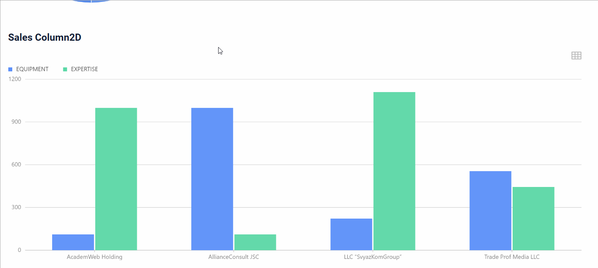
=== "Переключение режима"
    Переключитесь из режима столбцов в табличный режим, чтобы посмотреть данные в виде таблицы.
    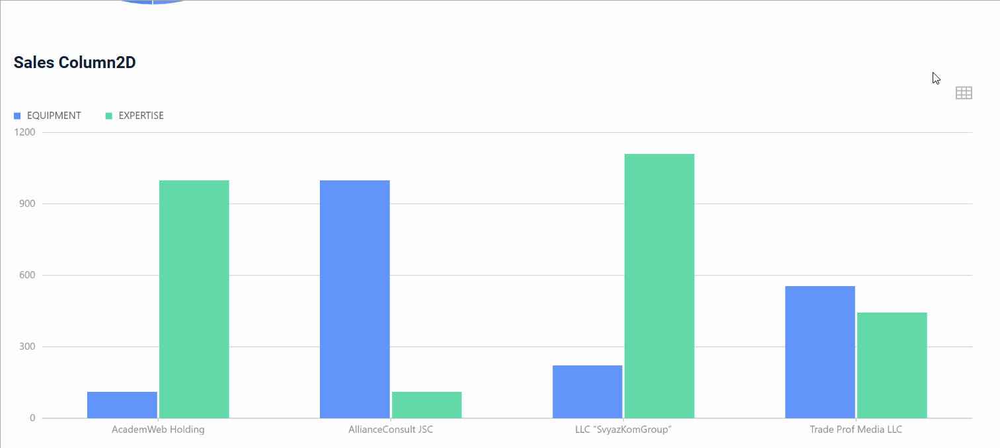
=== "Взаимодействие с сегментами"
    Нажимайте на значения легенды, чтобы добавлять или убирать столбцы с графика.
    

#### Добавлено: виджет [AssocListPopup](https://doc.cxbox.org/ru/widget/type/assoclistpopup/assoclistpopup/) — поддержка создания строки { #added-assoclistpopup-widget-support-for-creating-a-row }

Теперь новую строку можно создать прямо в `AssocListPopup`. При нажатии кнопки Add внутри всплывающего окна появляется новая строка, в которую можно ввести данные и сразу выбрать её в качестве значения поля.
=== "После"
    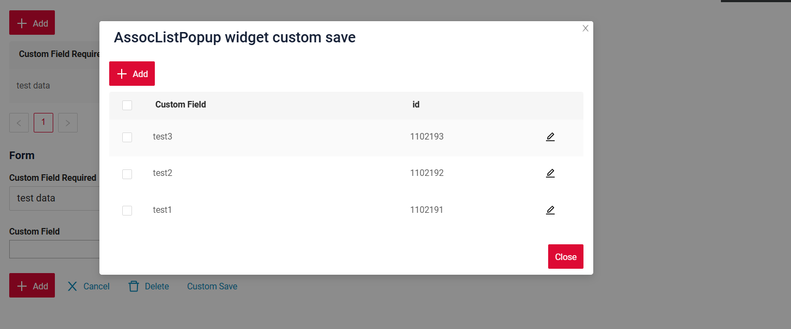
=== "До"
    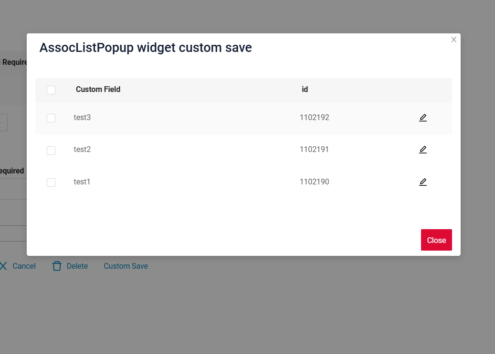  

#### Добавлено: виджет [Info](/ru/info/) — единообразное выделение полей { #added-info-widget-consistent-field-highlighting }

Улучшена логика выделения полей в виджете [Info](/ru/info/). Скрытые поля не выделяются вообще.
Для видимых полей добавляется линия сверху и снизу, за исключением:

* Первой строки (нет линии сверху)
* Последней строки (нет линии снизу)

=== "После"
    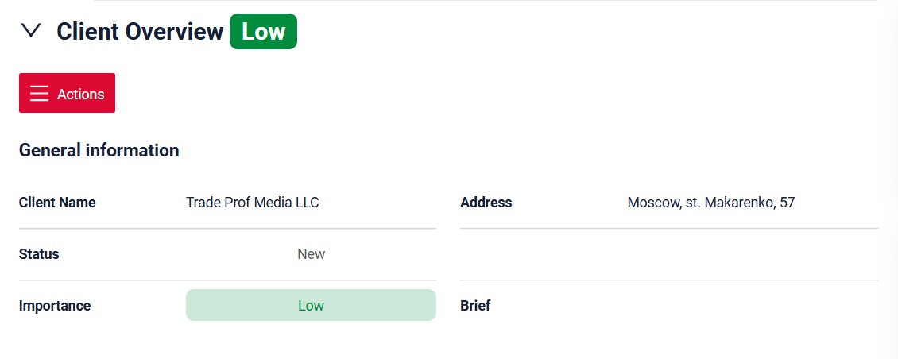
=== "До"
      

#### Добавлено: поле [inlinePickList](https://doc.cxbox.org/ru/widget/fields/field/inlinePickList/inlinePickList/) — ограничения в виджете [FormPopup](/ru/form/) { #added-inlinepicklist-field-restrictions-in-formpopup-widget }

Для поля [inlinePickList](https://doc.cxbox.org/ru/widget/fields/field/inlinePickList/inlinePickList/) в [FormPopup](/ru/form/) добавлено ограничение, запрещающее открытие всплывающего окна внутри всплывающего окна, так как это не поддерживается. Иконка папки убрана, поэтому всплывающее окно больше нельзя вызвать. Все доступные значения отображаются в выпадающем списке.

!!! info  
    В FormPopup рекомендуется использовать InlinePickList (и избегать pickList), так как inlinePickList показывает значения в выпадающем списке, а всплывающее окно pickList из-за ограничения работать не будет.

=== "После"
    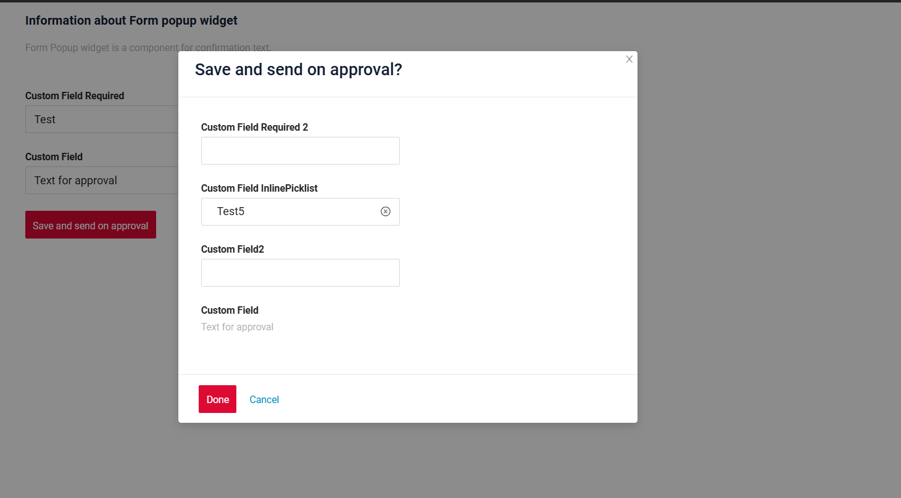  
=== "До"
    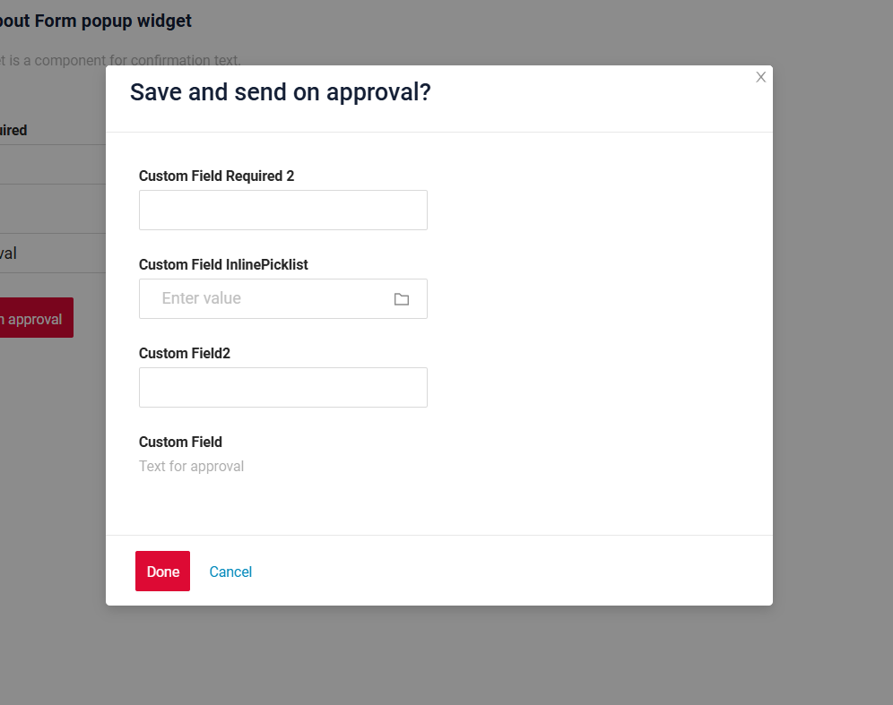  

#### Добавлено: виджет [FormPopup](/ru/form/) — улучшенная обработка обязательных полей { #added-formpopup-widget-improved-required-fields-handling }

Обновлена логика проверки обязательных полей в FormPopup: обязательные поля в FormPopup и на основной форме теперь проверяются отдельно.

#### Добавлено: SIEM { #added-siem }
* Добавлено логирование входа в систему.
```
INFO o.d.c.c.extension.siem.SecurityLogger: SIEM event. Operation: login, endpoint (resource): /login, user: DEMO (CXBOX_USER,BUSINESS_ADMIN), session: F2DBA42C1BAED2599339101D5FA3280F, ipAddress: 0:0:0:0:0:0:0:1, data: 1100057 
```

* Для событий `invoke` логируется имя действия.
``` 
INFO o.d.c.c.extension.siem.SecurityLogger : SIEM event. Operation: INVOKE.sendEmailNextDay, endpoint (resource): meeting (1100062), user: DEMO (CXBOX_USER,BUSINESS_ADMIN), session: F2DBA42C1BAED2599339101D5FA3280F, ipAddress: 0:0:0:0:0:0:0:1, data: null
```

* В SIEM логируются изменения доступа `Responsibility View` и `Responsibility Action` (с уровнем WARN).
```
WARN o.d.c.c.extension.siem.SecurityLogger    : SIEM event. Operation: UPDATE, endpoint (resource): responsibilities (1100342), user: DEMO (CXBOX_USER,BUSINESS_ADMIN), session: F2DBA42C1BAED2599339101D5FA3280F, ipAddress: 0:0:0:0:0:0:0:1, data: {"id":"1100342","vstamp":1,"internalRoleCD":"BUSINESS_ADMIN","view":"meetingview","viewWidgets":[{"id":"meetingViewButtons","value":"'/api/v1/../meeting' by widget 'meetingViewButtons'","options":{}},{"id":"meetingEditViewHeader","value":"'/api/v1/../meetingEdit' by widget 'meetingEditViewHeader'","options":{}},{"id":"meetingDocumentsFormForList","value":"'/api/v1/../meetingDocumentEdit' by widget 'meetingDocumentsFormForList'","options":{}},{"id":"meetingView","value":"'/api/v1/../meeting' by widget 'meetingView'","options":{}},{"id":"meetingDocumentsList","value":"'/api/v1/../meetingDocumentEdit' by widget 'meetingDocumentsList'","options":{}},{"id":"meetingViewClientInfo","value":"'/api/v1/../meeting' by widget 'meetingViewClientInfo'","options":{}},{"id":"SecondLevelMenu","value":"'/api/v1/../null' by widget 'SecondLevelMenu'","options":{}},{"id":"meetingViewResult","value":"'/api/v1/../meeting' by widget 'meetingViewResult'","options":{}}]}
```

В коде проекта в SiemCrudmaEventListener можно **настроить параметры**:

* Настроить логирование только ID:
 ``` public static final boolean SIEM_CONFIG_LOG_DATA_ID_ONLY = false;```

* Configure which CRUD-MA actions to log:
``` 
public static final Map<CrudmaActionType, Boolean> SIEM_CONFIG_LOG_CRUDMA_ACTION_TYPES = Map.of(
  CrudmaActionType.INVOKE, true,
  CrudmaActionType.FIND, true,
  CrudmaActionType.GET, true,
  CrudmaActionType.UPDATE, true,
  CrudmaActionType.PREVIEW, false,
  CrudmaActionType.DELETE, true,
  CrudmaActionType.COUNT, false,
  CrudmaActionType.ASSOCIATE, true,
  CrudmaActionType.META, false,
  CrudmaActionType.CREATE, true
  );
```

* Configure which BC + CRUD-MA pairs to log with a WARN level (by default, it is set for administration screens: responsibility and action responsibility):
```
public static final Map<EnumBcIdentifier, List<CrudmaActionType>> SIEM_CONFIG_LOG_LEVEL_WARN = Map.of(
    CxboxRestController.responsibilities,
    Arrays.stream(CrudmaActionType.values()).filter(e -> !e.isReadOnly()).toList(),
    CxboxRestController.responsibilitiesAction,
    Arrays.stream(CrudmaActionType.values()).filter(e -> !e.isReadOnly()).toList()
);
```
#### Fixed: [dictionary](/ru/widget/fields/field/dictionary/dictionary/) field - filtering logic   

We have improved the filtering logic for Dictionary fields. Now, when all selected values are unchecked and Apply is clicked, the filter is properly cleared, and all data is displayed without requiring an additional Clear Filter action.  

#### Fixed: consistent handling of field keys  

We have updated the logic for processing field keys. Previously, `widget.json -> fields -> key: number` would lead to errors in data handling on the frontend, because the "key" value was misinterpreted as a custom type. Now, the new logic prevents errors and guarantees proper interpretation of fields.  

#### Other Changes
see [cxbox-demo changelog](https://github.com/CX-Box/cxbox-demo/releases/tag/v.2.0.11)

### CXBOX ([Core Ui](https://github.com/CX-Box/cxbox-ui/releases/tag/2.5.1))

We have released two CORE UI versions - 2.5.0 and 2.5.1! 

#### Other Changes
see [cxbox-ui 2.5.0 changelog](https://github.com/CX-Box/cxbox-ui/releases/tag/2.5.0) and [cxbox-ui 2.5.1 changelog](https://github.com/CX-Box/cxbox-ui/releases/tag/2.5.1)

### CXBOX 4.0.0-M15 ([Core](https://github.com/CX-Box/cxbox/tree/cxbox-4.0.0-M15))  

#### Added: @RequiredArgsConstructor  
Use Lombok’s @RequiredArgsConstructor and @Getter (meta,dao) for AnySourceVersionAwareResponseService and  @Getter (meta) VersionAwareResponseService instead of explicitly writing a constructor.
This makes the code cleaner and reduces boilerplate.

=== "After"

    ```java
    @SuppressWarnings({"java:S1170"})
    @Service
    @RequiredArgsConstructor
    public class ResponsibilitiesActionAdminService extends
    VersionAwareResponseService<ResponsibilitiesActionAdminDTO, ResponsibilitiesAction> {
 
        private final MetaAdminServiceExt metaAdminServiceExt;
    
        private final JpaDao jpaDao;
    
        private final CxboxFileService cxboxFileService;
    
        @Getter(onMethod_ = @Override)
        private final Class<ResponsibilitiesActionAdminMeta> meta = ResponsibilitiesActionAdminMeta.class;

    ```
=== "Before"

    ```java
    @Service
    public class ResponsibilitiesActionAdminService extends
    VersionAwareResponseService<ResponsibilitiesActionAdminDTO, ResponsibilitiesAction> {
    
        private final MetaAdminServiceExt metaAdminServiceExt;
    
        private final JpaDao jpaDao;
    
        private final CxboxFileService cxboxFileService;
    
        public ResponsibilitiesActionAdminService(MetaAdminServiceExt metaAdminServiceExt, JpaDao jpaDao,
                CxboxFileService cxboxFileService) {
            super(
                    ResponsibilitiesActionAdminDTO.class,
                    ResponsibilitiesAction.class,
                    null,
                    ResponsibilitiesActionAdminMeta.class
            );
            this.metaAdminServiceExt = metaAdminServiceExt;
            this.jpaDao = jpaDao;
            this.cxboxFileService = cxboxFileService;
        }

    ```
#### Other Changes
We have released two CORE versions! See [cxbox 4.0.0-M14 changelog](https://github.com/CX-Box/cxbox/releases/tag/cxbox-4.0.0-M14) and [cxbox 4.0.0-M15 changelog](https://github.com/CX-Box/cxbox/releases/tag/cxbox-4.0.0-M15).  

### CXBOX [documentation](https://doc.cxbox.org/)

#### Added: [waitUntil and drillDownAndWaitUntil](https://doc.cxbox.org/features/element/actions/postaction/drilldownandwaituntil/ddandwaituntil/)  

We have added a full description of waitUntil and drillDownAndWaitUntil postActions  

#### Added: [pickListPopup](https://doc.cxbox.org/widget/type/picklistpopup/picklistpopup/) widget - standard actions and additional properties description  

We have provided a full description of [pickListPopup](https://doc.cxbox.org/widget/type/picklistpopup/picklistpopup/) widget's [standard actions](https://doc.cxbox.org/widget/type/picklistpopup/picklistpopup/#standard-actions) and [additional properties](https://doc.cxbox.org/widget/type/picklistpopup/picklistpopup/#additional-properties). 

#### Added: [assocListPopup](https://doc.cxbox.org/widget/type/assoclistpopup/assoclistpopup/) widget - standard actions and additional properties description

We have provided a full description of [assocListPopup](https://doc.cxbox.org/widget/type/assoclistpopup/assoclistpopup/) widget's [standard actions](https://doc.cxbox.org/widget/type/assoclistpopup/assoclistpopup/#actions) and [additional properties](https://doc.cxbox.org/widget/type/assoclistpopup/assoclistpopup/#additional-properties). 

#### Added: [filtration](https://doc.cxbox.org/widget/type/property/filtration/filtration/) - [by personal filter group](https://doc.cxbox.org/widget/type/property/filtration/filtration/#by-personal-filter-group)  

We have added a description of filtration [by personal filter group](https://doc.cxbox.org/widget/type/property/filtration/filtration/#by-personal-filter-group). 

#### Added: [sorting](https://doc.cxbox.org/widget/type/property/sorting/sorting/) - field level  

We have updated the [sorting](https://doc.cxbox.org/widget/type/property/sorting/sorting/) article with the information on fields' sorting.  

#### Added: [multipleSelect](https://doc.cxbox.org/widget/fields/field/multipleSelect/multipleSelect/) field - method update  

We have updated the article on [multipleSelect](https://doc.cxbox.org/widget/fields/field/multipleSelect/multipleSelect/) field and provided the information on `setConcreteValues` method.  

