# 2.0.12

* [cxbox/demo 2.0.12 git](https://github.com/CX-Box/cxbox-demo/tree/v.2.0.12), [примечания к релизу](https://github.com/CX-Box/cxbox-demo/releases/tag/v.2.0.12)

* [cxbox/core 4.0.0-M16 git](https://github.com/CX-Box/cxbox/tree/cxbox-4.0.0-M16), [примечания к релизу](https://github.com/CX-Box/cxbox/releases/tag/cxbox-4.0.0-M16), [maven](https://central.sonatype.com/artifact/org.cxbox/cxbox-starter-parent/4.0.0-M16)

* [cxbox-ui/core 2.5.2 git](https://github.com/CX-Box/cxbox-ui/tree/2.5.2), [примечания к релизу](https://github.com/CX-Box/cxbox-ui/releases/tag/2.5.2), [npm](https://www.npmjs.com/package/@cxbox-ui/core/v/2.5.2)

* [cxbox/code-samples 2.0.12 git](https://github.com/CX-Box/cxbox-code-samples/tree/v.2.0.12), [примечания к релизу](https://github.com/CX-Box/cxbox-code-samples/releases/tag/v.2.0.12)  

## **Ключевые обновления февраля, марта 2025** { #key-updates-february-march-2025 }

### CXBOX ([Демо](https://demo.cxbox.org)) { #cxbox-demo }

#### Добавлено: push-уведомления — новые режимы отображения { #added-push-notifications-new-display-modes }

Добавлены три режима отображения [push-уведомлений через WebSocket](https://doc.cxbox.org/ru/features/element/notifications/push/websocket/): `single`, `stack` и `column`.

=== "Single (по умолчанию)"
    Каждое новое уведомление заменяет предыдущее в одной области.
    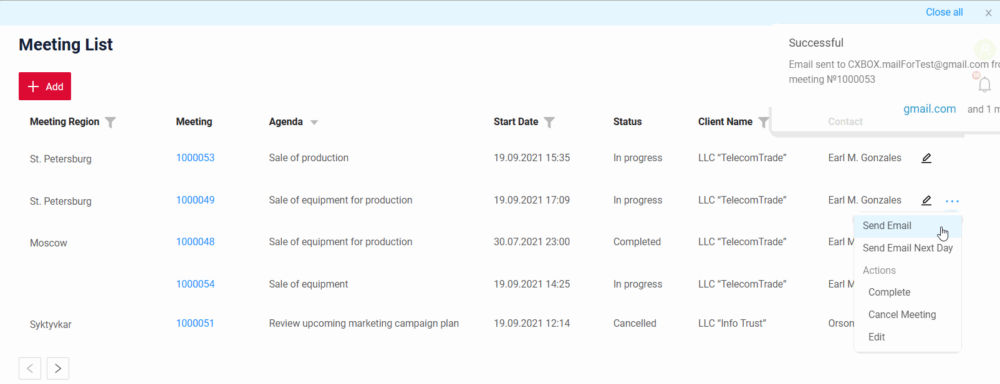
=== "Column"  
    Уведомления отображаются по отдельности, выстраиваясь вертикально в колонку.
    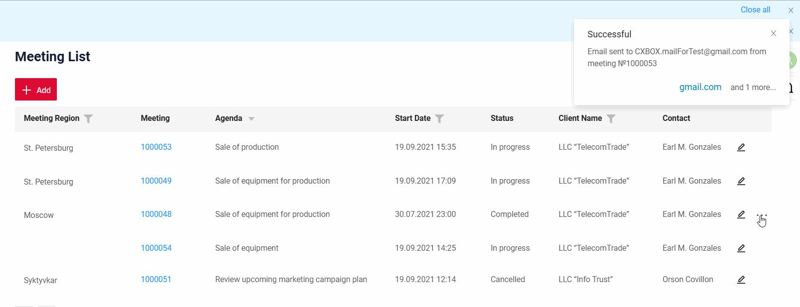  
=== "Stack"  
    Уведомления отображаются по отдельности, накладываясь друг на друга стопкой.
    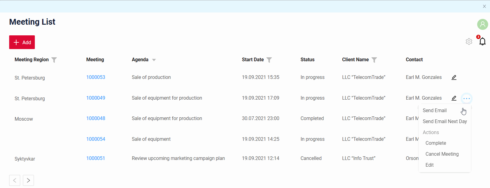  

Для всех трёх режимов можно настроить `timeout`. Для `stack` и `column` также можно задать максимальное количество видимых уведомлений и направление отображения (`upward`/`downward`).

#### Добавлено: виджет Line2D — новый тип виджета! { #added-line2d-widget-new-widget-type }

Добавлен новый тип виджета `Line2D` для отображения данных по осям X и Y в виде линейного графика.

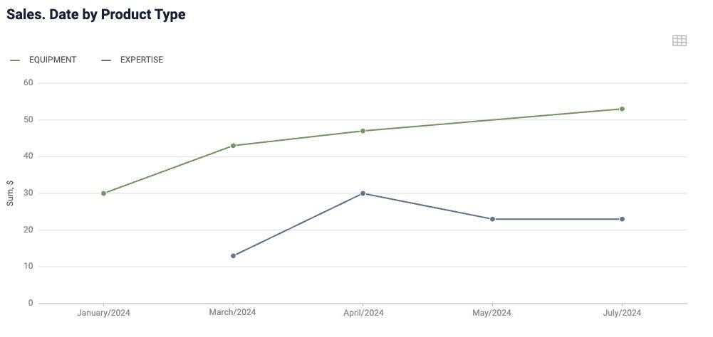{width="700"}

Основные возможности:

* Настройка масштаба/шага осей
* Сгруппированное отображение
* Отображение всплывающих подсказок

Функциональность включает:

* Drilldown — нажмите на значения оси X, чтобы перейти к отфильтрованным данным в таблице.
* Переключение режима — переключитесь из режима графика в табличный режим, чтобы посмотреть данные в виде таблицы.
* Взаимодействие с сегментами — нажимайте на значения легенды, чтобы добавлять или убирать линии с графика.

#### Добавлено: виджет DualAxes2D — новый тип виджета! { #added-dualaxes2d-widget-new-widget-type }

Добавлен новый тип виджета `DualAxes2D` для отображения данных разных типов диаграмм в одной области. Диаграммы используют общую ось X, но могут иметь отдельные оси Y.
**Внимание!** DualAxes2D может отображать только 2D-типы виджетов (например, Line2D, Column2D). Возможности 2D-виджетов (подсказки и масштаб/шаг осей) автоматически применяются к DualAxes2D.

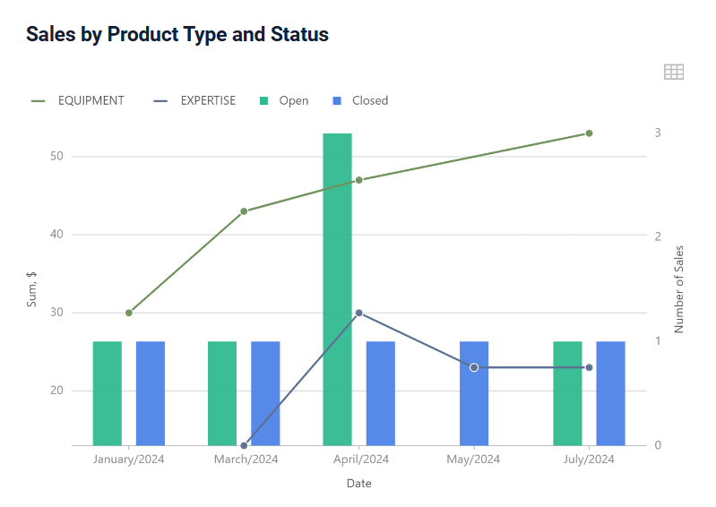{width="700"}

Функциональность включает:

* Drilldown — нажмите на значения оси Y, чтобы перейти к отфильтрованным данным в таблице.
* Переключение режима — переключитесь из режима графика в табличный режим, чтобы посмотреть данные в виде таблицы.
* Взаимодействие с сегментами — нажимайте на значения легенды, чтобы добавлять или убирать линии/столбцы с графика.

#### Добавлено: панель UI — отображение версии приложения и типа окружения { #added-ui-panel-display-of-application-version-and-environment-type }

Для удобства в панели UI добавлена возможность отображать тип окружения и текущую версию приложения. Текст подстраивается под состояние меню (`collapsed`/`expanded`) и показывает всплывающую подсказку с подробностями. Также поддерживается настройка цвета фона этого блока.

=== "После"
    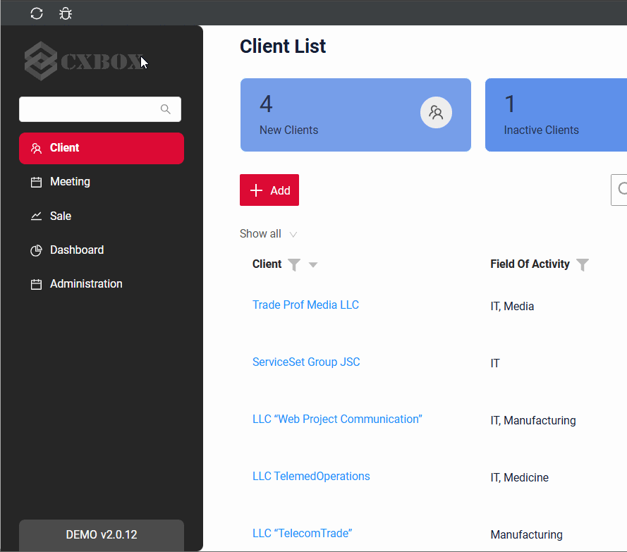
=== "До"
    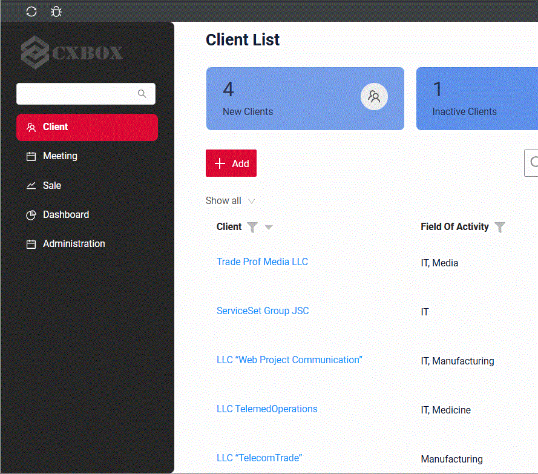

#### Добавлено: push-уведомления — поддержка длинных ссылок { #added-push-notifications-long-links-support }

Улучшено отображение длинных подписей ссылок в [push-уведомлениях](https://doc.cxbox.org/ru/features/element/notifications/push/websocket/). Теперь, если подпись ссылки шире уведомления, текст автоматически переносится на следующую строку, и подпись отображается полностью, без обрезки. Кроме того, текст *"and (N) more..."* (если ссылок несколько) также корректно отображается в области уведомления.

=== "После"
    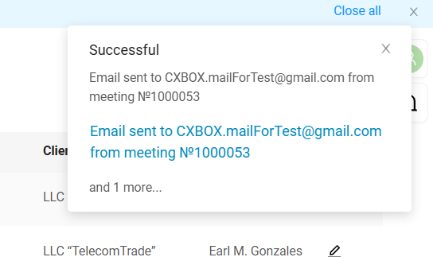{width="700"}
=== "До"
    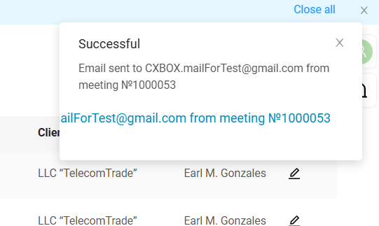{width="700"}  

#### Добавлено: поле suggestionPickList — полоса прокрутки и поддержка пустых значений { #added-suggestionpicklist-field-scrollbar-and-empty-value-support }

Поле suggestionPickList улучшено за счёт поддержки полосы прокрутки — теперь по длинным спискам удобнее перемещаться.

=== "После"
    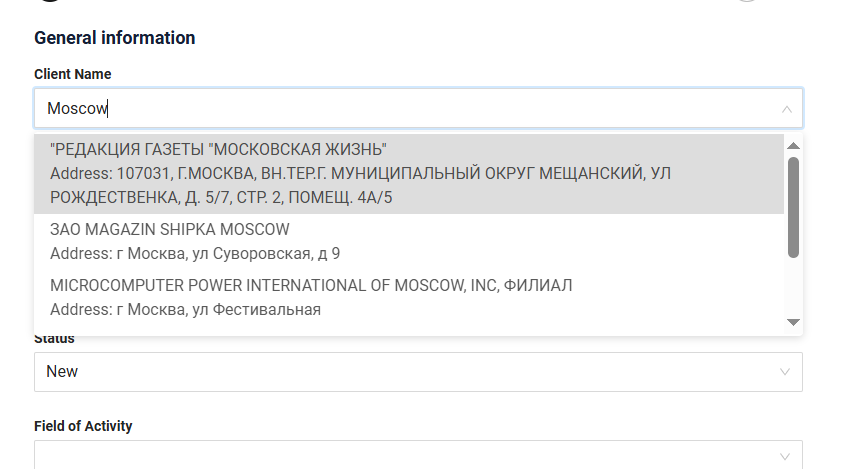{width="700"}
=== "До"
    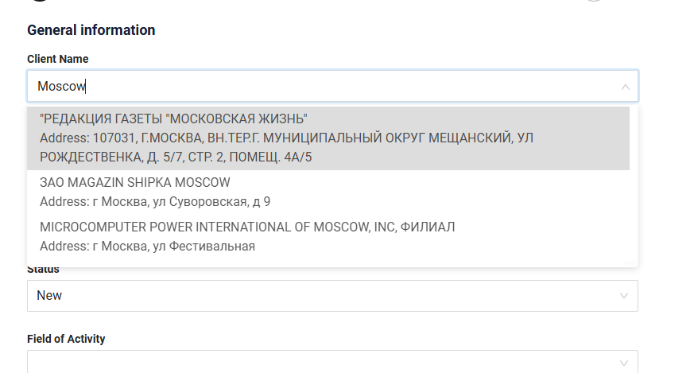{width="700"}  

Кроме того, улучшена логика отображения пустых значений. Если бэкенд возвращает `null`, фронтенд показывает пустое значение вместо `null`.

#### Добавлено: поле suggestionPickList — изменения в способе фильтрации { #added-suggestionpicklist-field-changes-in-filtering-method }

Уточнён способ фильтрации для поля suggestionPickList. Раньше требовалось точное совпадение с введёнными символами (`equals`). Теперь логика фильтрации менее строгая и показывает все результаты, содержащие введённый текст (`contains`).
=== "После"
    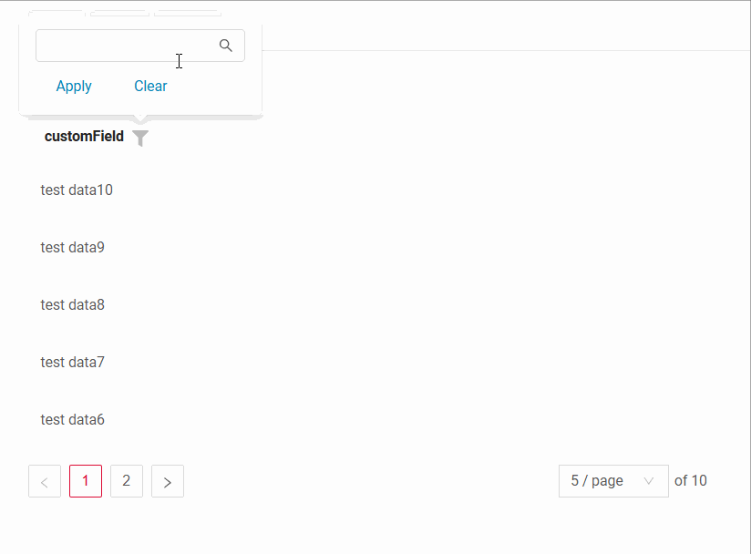  
=== "До"
    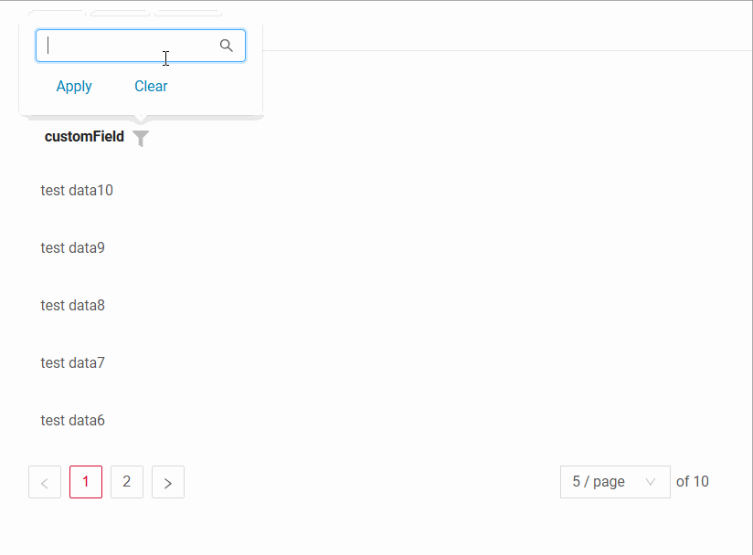  

#### Добавлено: поле dictionary — улучшенная компоновка для mode:icon { #added-dictionary-field-improved-layout-for-modeicon }

Для поля [Dictionary](https://doc.cxbox.org/ru/widget/fields/field/dictionary/dictionary/) с `mode: icon` убрано ограничение минимальной ширины. Это позволяет полю динамически сужаться, сохраняя иконку и значение рядом, что делает компоновку компактнее.
=== "После"
    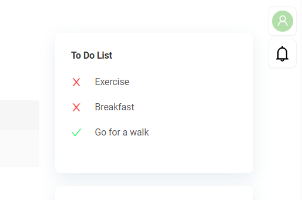{width="700"}   
=== "До"
    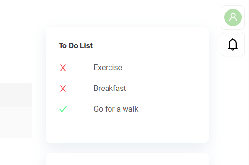{width="700"}  

#### Добавлено: виджет GroupingHierarchy — проверка агрегирующих полей { #added-groupinghierarchy-widget-validation-for-aggregate-fields }

Для агрегирующих полей в виджете [GroupingHierarchy](https://doc.cxbox.org/ru/widget/type/groupinghierarchy/groupinghierarchy/) добавлено правило проверки. Теперь поле **не может** одновременно использоваться и как поле группировки, и как агрегирующее поле. Если одно и то же поле используется и для группировки, и для агрегации, приоритет у группировки, а функция агрегации игнорируется.

#### Исправлено: виджет FormPopup — обновление forceActive { #fixed-formpopup-widget-forceactive-update }

Улучшена работа forceActive для [виджета FormPopup](https://doc.cxbox.org/ru/widget/type/formpopup/formpopup/): теперь выполняется только запрос POST row-meta. Это гарантирует актуальность информации даже во время редактирования сущности и предотвращает потерю данных.

#### Исправлено: AssocListPopup — игнорирование scope для кнопок действий { #fixed-assoclistpopup-ignored-scope-for-action-buttons }

[AssocListPopup](https://doc.cxbox.org/ru/widget/type/assoclistpopup/assoclistpopup/) теперь игнорирует `scope` для кнопок действий, что предотвращает лишнее дублирование. Раньше действия из меню с тремя точками дублировались отдельными кнопками сверху.

#### Добавлено: черновой Builder для drilldown с фильтрацией по полям { #added-draft-builder-for-drilldowns-with-field-filtration }

Добавлен новый Java Builder для формирования [drillDown с фильтрацией по полям](https://doc.cxbox.org/ru/features/element/drilldown/drilldown/#to-view-with-fields-filtration):
=== "После"
    ```java
    drillDownExt.filterBcByFields(
	    CxboxRestController.sale, SaleDTO.class, fb -> fb
	        .input(SaleDTO_.clientName, fields.getCurrentValue(DashboardSalesProductDTO_.clientName).orElse(null))
	        .dictionary(SaleDTO_.product, fields.getCurrentValue(DashboardSalesProductDTO_.productName).orElse(null))
	        .multiValue(SaleDTO_.fieldOfActivity, activity)
	);
    ```
=== "До"
    ```java
   	"?filters={\""
		+ CxboxRestController.sale + "\":\""
		+ URLEncoder.encode(SaleDTO_.clientName + "." + SearchOperation.CONTAINS.getOperationName() 
		+ "=" + fields.getCurrentValue(DashboardSalesProductDTO_.clientName).orElse(null), StandardCharsets.UTF_8)
		+ "&"
		+ URLEncoder.encode(SaleDTO_.product + "." +  SearchOperation.EQUALS_ONE_OF.getOperationName()
		+ "=[\\\"" + fields.getCurrentValue(DashboardSalesProductDTO_.productName).orElse(null) + "\\\"]", StandardCharsets.UTF_8)
		+ "&"
		+ URLEncoder.encode(SaleDTO_.fieldOfActivity + "." + SearchOperation.EQUALS_ONE_OF.getOperationName()
		+ "=[\\\"" + FieldOfActivity.IT.getValue() + "\\\",\\\"" + FieldOfActivity.MEDIA.getValue() + "\\\"]", StandardCharsets.UTF_8)
		+ "\"}";
	//And lots of logic to skip field filter if its value is null...
    ```

!!! info
    Это **черновой** Java API — мы будем его улучшать, и в следующих релизах в нём весьма вероятны критические изменения. Поэтому пока не используйте его в продакшен-коде, но ваша обратная связь очень важна!

#### Прочие изменения { #other-changes }
см. [журнал изменений cxbox-demo](https://github.com/CX-Box/cxbox-demo/releases/tag/v.2.0.12)

### CXBOX ([Core Ui](https://github.com/CX-Box/cxbox-ui/releases/tag/2.5.2))

Выпущена новая версия CORE UI 2.5.2.

#### Прочие изменения { #other-changes_1 }
См. [журнал изменений cxbox-ui 2.5.2](https://github.com/CX-Box/cxbox-ui/releases/tag/2.5.2).

### CXBOX 4.0.0-M16 ([Core](https://github.com/CX-Box/cxbox/tree/cxbox-4.0.0-M16))

Выпущена новая версия CORE 4.0.0-M16.

#### Добавлено: НОВОЕ! Java API для preAction подтверждения { #added-new-java-api-for-confirm-preactions }

Новый Java API для preAction подтверждения в **CORE** обеспечивает стандартизированное и единообразное поведение для preAction `confirm` и `confirmWithWidget`.

1) preAction `confirm`

=== "с title/text"
    `title` или `text` заданы явно
    ```java
    PreAction.confirm(cf -> cf
    .title("Approve?")
    .text("Changes will be saved")
    .yesText("Approve and Save")
    .noText("Cancel"))
    ```
    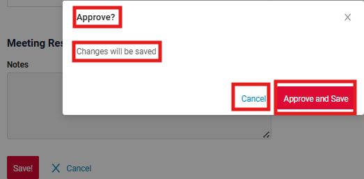

=== "title по умолчанию"
    Если вызвать `.title(null)` или вообще не вызывать `title(..)`, отображается заголовок по умолчанию (точнее, его перевод).
    ```java
    PreAction.confirm(cf -> cf
    .text("Changes will be saved")
    .yesText("Approve and Save")
    .noText("Cancel"))
    ```
    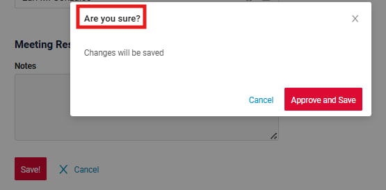  

=== "text по умолчанию"
    Если вызвать `.text(null)` или вообще не вызывать `text(..)`, отображается автоматически сформированный текст.
    ```java
    PreAction.confirm(cf -> cf
    .title("Approve?")
    .yesText("Approve and Save")
    .noText("Cancel"))
    ```
    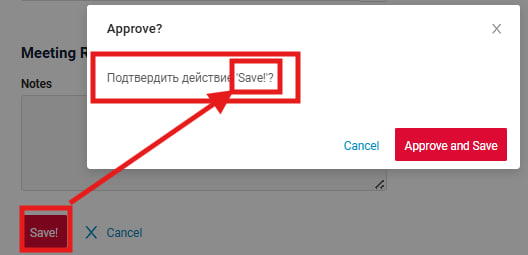


=== "всё по умолчанию"
    Если вызывается `preAction.confirm()`, отображаются все значения по умолчанию.
    ```java
    PreAction.confirm()
    ```    
    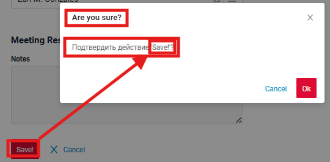

=== "withoutTitle()"  
    Добавлена поддержка пустого заголовка с помощью метода `.withoutTitle()`
    ```java
    PreAction.confirm(cf -> cf
    .withoutTitle()
    .text("Changes will be saved")
    .yesText("Approve and Save")
    .noText("Cancel"))
    ```  
    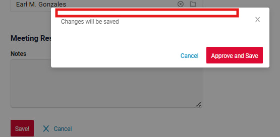

=== "withoutText()"  
    Добавлена поддержка пустого текста с помощью метода `.withoutText()`. Если текст пустой, тело confirmPopup сжимается.
    ```java
    PreAction.confirm(cf -> cf
    .title("Approve?")
    .withoutText()
    .yesText("Approve and Save")
    .noText("Cancel"))
    ```  
    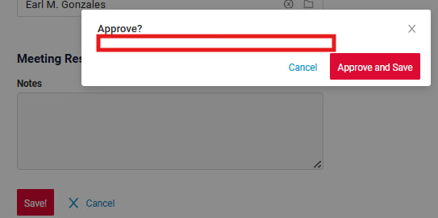
    
2) preAction `confirmWithWidget` (замена старого `confirmWithCustomWidget` из demo)

=== "с title"
    Если `title` содержит значение, оно отображается.
    ```java
    PreAction.confirmWithWidget("meetingResultFormPopup", cf -> cf
    .title("Approve?")
    .yesText("Approve and Save")
    .noText("Cancel")
    )
    ```  
    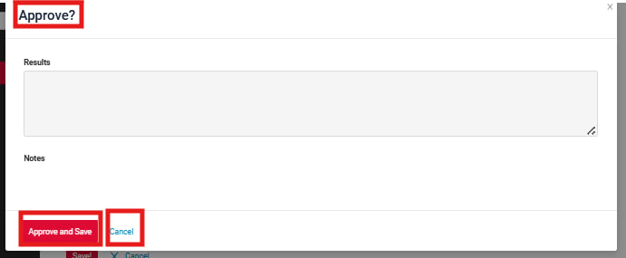

=== "title по умолчанию"
    Если вызвать `.title(null)` или вообще не вызывать `title(..)`, отображается `*FormPopup.widget.json -> title`
    ```java
    PreAction.confirmWithWidget("meetingResultFormPopup", cf -> cf
    .yesText("Approve and Save")
    .noText("Cancel")
    )
    ```
    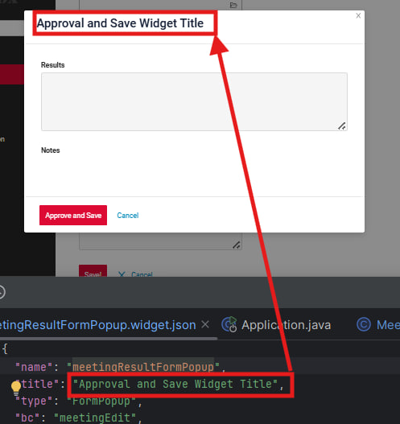

=== "withoutTitle()"  
    Как и для `confirm`, теперь поддерживается пустой заголовок с помощью метода `.withoutTitle()`
    ```java
    PreAction.confirmWithWidget("meetingResultFormPopup", cf -> cf
    .withoutTitle()
    .yesText("Approve and Save")
    .noText("Cancel")
    )
    ```  
    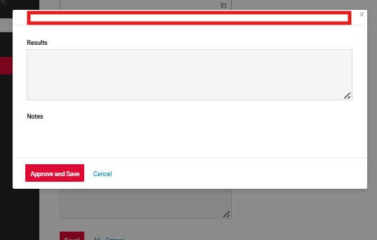  

#### Добавлено: MultivalueField и MultivalueFieldSingleValue реализуют Serializable { #added-multivaluefield-multivaluefieldsinglevalue-implemented-serializable }

`MultivalueField` и `MultivalueFieldSingleValue` теперь реализуют Serializable для совместимости со springSessionJDBC. Это позволяет бэкенду по умолчанию сериализовать bcState с помощью JDK-сериализатора (вместо Jackson) и устраняет проблемы с непоследовательным поведением при сериализации этих объектов.

#### Добавлено: Spring Boot обновлён до 3.3.8 { #added-spring-boot-upgraded-up-to-338 }

В соответствии с требованиями безопасности Spring Boot обновлён с 3.3.4 до 3.3.8. Это обновление также автоматически обновило транзитивные зависимости и устранило большинство проблем безопасности.

#### Прочие изменения { #other-changes_2 }
См. [журнал изменений cxbox 4.0.0-M16](https://github.com/CX-Box/cxbox/releases/tag/cxbox-4.0.0-M16).
