# 2.0.13

* [cxbox/demo 2.0.13 git](https://github.com/CX-Box/cxbox-demo/tree/v.2.0.13), [примечания к релизу](https://github.com/CX-Box/cxbox-demo/releases/tag/v.2.0.13)

* [cxbox/core 4.0.0-M17 git](https://github.com/CX-Box/cxbox/tree/cxbox-4.0.0-M17), [примечания к релизу](https://github.com/CX-Box/cxbox/releases/tag/cxbox-4.0.0-M17), [maven](https://central.sonatype.com/artifact/org.cxbox/cxbox-starter-parent/4.0.0-M17)

* [cxbox-ui/core 2.5.3 git](https://github.com/CX-Box/cxbox-ui/tree/2.5.3), [примечания к релизу](https://github.com/CX-Box/cxbox-ui/releases/tag/2.5.3), [npm](https://www.npmjs.com/package/@cxbox-ui/core/v/2.5.3)

* [cxbox/code-samples 2.0.13 git](https://github.com/CX-Box/cxbox-code-samples/tree/v.2.0.13), [примечания к релизу](https://github.com/CX-Box/cxbox-code-samples/releases/tag/v.2.0.13)  

## **Ключевые обновления апреля, мая 2025** { #key-updates-april-may-2025 }

### CXBOX ([Демо](https://demo.cxbox.org)) { #cxbox-demo }

#### Добавлено: поля number, money, percent — поддержка фильтра по диапазону { #added-number-money-percent-fields-range-filter-support }

Теперь поля [number](https://doc.cxbox.org/ru/widget/fields/field/number/number/), [money](https://doc.cxbox.org/ru/widget/fields/field/money/money/) и [percent](https://doc.cxbox.org/ru/widget/fields/field/percent/percent/) можно фильтровать по диапазону значений.

Фильтр отображает два поля ввода:

* `From` — показывает значения ≥ введённого числа (.greaterOrEqualThan).
* `To` — показывает значения ≤ введённого числа (.lessOrEqualThan).

Можно заполнить одно или оба поля. Отобразятся значения, попадающие в введённый диапазон.

=== "После"
    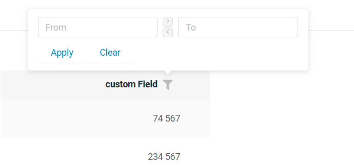{width="700"}
=== "До"
    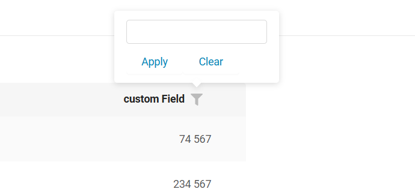{width="700"}

Фильтрация по диапазону для [number](https://doc.cxbox.org/ru/widget/fields/field/number/number/#filtering), [percent](https://doc.cxbox.org/ru/widget/fields/field/percent/percent/#filtering), [money](https://doc.cxbox.org/ru/widget/fields/field/money/money/#filtering) описана в обновлённых статьях.

**Кнопки копирования** позволяют дублировать значения между полями:

* кнопка `>` — копирует `From` в `To`
* кнопка `<` — копирует `To` в `From`

**Примечание**: кнопки активны, только когда соответствующее исходное поле содержит значение.

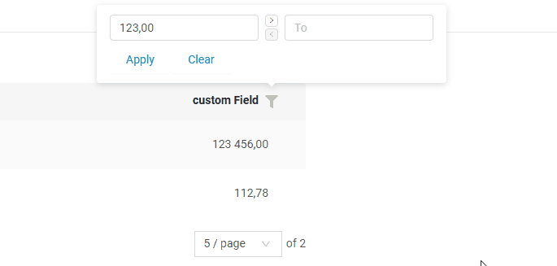  

!!! info 
    Метод `.equals` по-прежнему доступен для фильтрации по точному совпадению, что обеспечивает обратную совместимость.

#### Добавлено: поля dictionary, multipleSelect, radio — отображение фильтра { #added-dictionary-multipleselect-radio-fields-filter-display }
Панель фильтра для полей с фильтрацией в виде флажков ([dictionary](https://doc.cxbox.org/ru/widget/fields/field/dictionary/dictionary/), [multipleSelect](https://doc.cxbox.org/ru/widget/fields/field/multipleSelect/multipleSelect/) и [radio](https://doc.cxbox.org/ru/widget/fields/field/radio/radio/)) стала удобнее.

* **Поле поиска**: добавлено текстовое поле для поиска значений фильтра. Оно появляется **только** когда список значений не помещается в видимую область и отображается полоса прокрутки. **Примечание**: это только инструмент поиска — он не выбирает значения.
* **Счётчик выбранных значений**: на кнопку **"Apply"** добавлен счётчик количества выбранных значений. Он отображается при том же условии, что и поле поиска (когда есть полоса прокрутки). Максимальное отображаемое число ограничено константой фронтенда. Если выбранных значений больше лимита, добавляется знак "+" (например, **9+**).
* **Изменения интерфейса**:
    * Полоса прокрутки теперь выровнена по правому краю
    * Убран отступ между списком и кнопками

=== "После"
    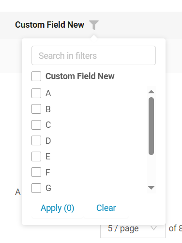{width="400"}
=== "До"
    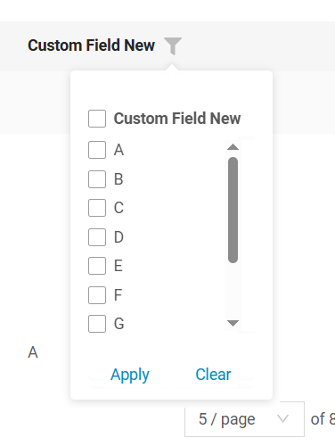{width="400"}  

Отображение фильтра для [dictionary](https://doc.cxbox.org/ru/widget/fields/field/dictionary/dictionary/#filtering), [multipleSelect](https://doc.cxbox.org/ru/widget/fields/field/multipleSelect/multipleSelect/#filtering), [radio](https://doc.cxbox.org/ru/widget/fields/field/radio/radio/#filtering) описано в обновлённых статьях.

#### Добавлено: сортировка — переключение состояний сортировки { #added-sorting-support-for-toggling-sorting-states }

Помимо изменения сортировки (которое уже поддерживалось), пользователи теперь могут сбросить сортировку третьим кликом — поле возвращается в несортированное состояние (только для сортировки, применённой пользователем).

Визуальные изменения делают состояние сортировки понятнее:

* Теперь всегда отображаются обе стрелки (↑↓), показывая, применена ли сортировка.
* Активное направление выделяется (по возрастанию или по убыванию), а другое остаётся бледным.
* Если сортировка не применена, обе стрелки бледные и видны только при наведении.

=== "1-й клик (по возрастанию)"
    
=== "2-й клик (по убыванию)"
    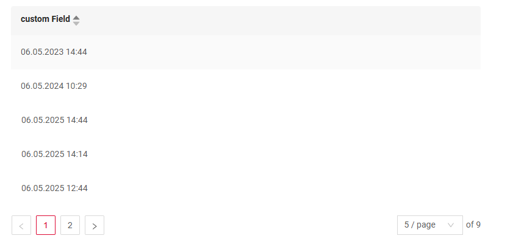
=== "3-й клик (без сортировки)"
    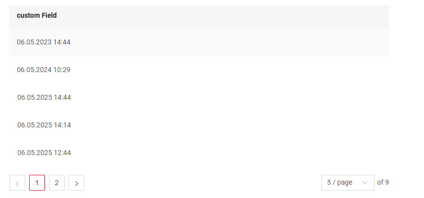  

!!! info
    Пользователь может сбросить **только** сортировку, которую применил сам. Сортировку по умолчанию, заданную системой, сбросить **нельзя**.

#### Добавлено: поле time — улучшения логики и отображения { #added-time-field-logic-and-display-enhancements }
Поле [time](https://doc.cxbox.org/ru/widget/fields/field/time/time/) теперь полностью поддерживается и ведёт себя так же, как поля [date](https://doc.cxbox.org/ru/widget/fields/field/date/date/), [dateTime](https://doc.cxbox.org/ru/widget/fields/field/dateTime/dateTime/) и [dateTimeWithSeconds](https://doc.cxbox.org/ru/widget/fields/field/dateTimeWithSeconds/dateTimeWithSeconds/). Оно поддерживает сортировку, фильтрацию по диапазону и несколько форматов отображения (`HH:mm:ss`, `HH:mm`, `HH`, `hh:mm:ss A`, `hh:mm A`, `hh A`).

=== "List"  
    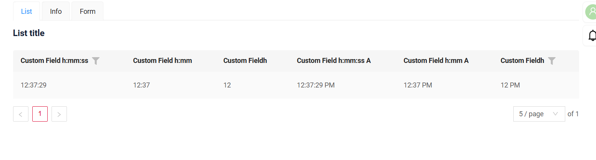
=== "Info"
    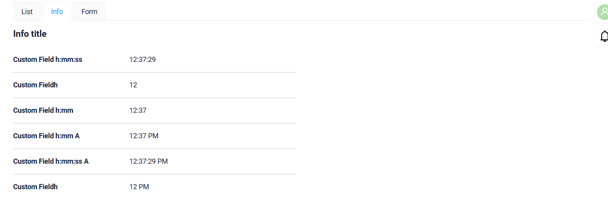
=== "Form"
    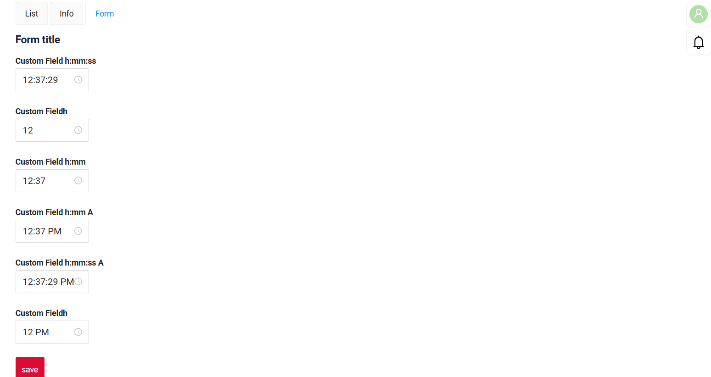

!!! info  
    Обновлённая статья о поле time скоро появится — следите за новостями!

#### Добавлено: панель экранов — перенос строк и строка поиска { #added-screen-panel-line-wrapping-and-search-bar }
В левую панель экранов добавлены две новые возможности:

* **Перенос строк в названиях экранов** — новая настройка определяет, как отображаются длинные названия экранов
=== "none (по умолчанию)"
    Названия остаются в одну строку и могут обрезаться, если название экрана длинное.
    {width="400"}
=== "auto"  
    Названия автоматически переносятся на следующую строку.
    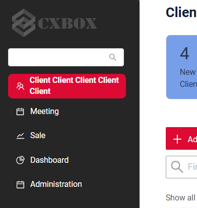{width="400"}

* **Видимость строки поиска** — теперь можно управлять отображением строки поиска при развёрнутом меню навигации:

=== "true (по умолчанию)"
    Строка поиска отображается.
    {width="400"}
=== "false"  
    Строка поиска недоступна.
    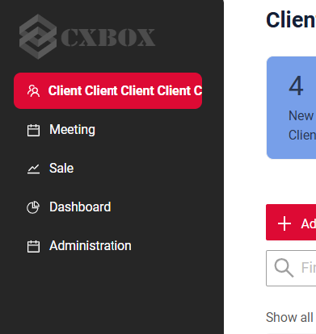{width="400"}

#### Добавлено: виджет Steps — поддержка описаний { #added-steps-widget-description-support }
Виджет Steps теперь поддерживает необязательные описания для каждого шага. Если описание не задано, как и раньше отображается только название шага.

=== "После"
    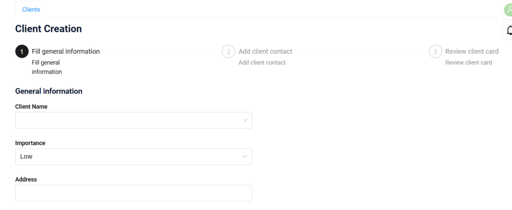
=== "До"
    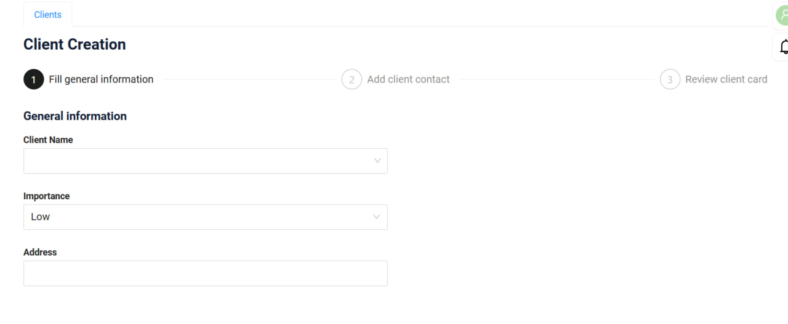

#### Добавлено: виджет List — настраиваемый лимит экспорта в Excel { #added-list-widget-configurable-excel-export-limit }
Теперь на уровне приложения можно задать лимит строк для экспорта в Excel в виджете [List](https://doc.cxbox.org/ru/widget/type/list/list/). Если количество экспортируемых строк превышает лимит, пользователь увидит предупреждение о том, что экспортировано только **N** строк. Для стабильной работы максимальный лимит экспорта — **10 000 строк**, даже если в конфигурации задано большее значение.

#### Исправлено: поле date — отображение применённой фильтрации после drillDown { #fixed-date-field-applied-filtration-display-after-drilldown }
Раньше при открытии окна фильтра для поля [date](https://doc.cxbox.org/ru/widget/fields/field/date/date/) после drillDown применённые значения фильтра не отображались.
Теперь выбранные значения отображаются корректно, что упрощает понимание и изменение применённого фильтра.
=== "После"
    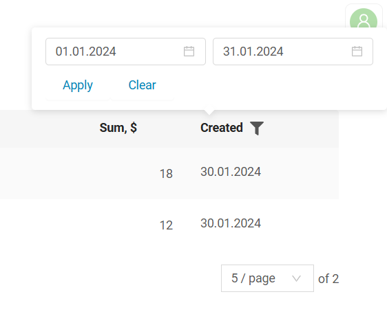
=== "До"
    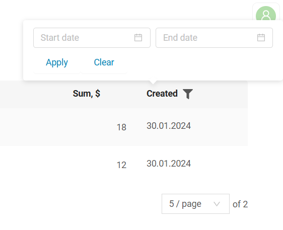

#### Исправлено: showCondition с forceActive у родителя { #fixed-showcondition-with-forceactive-parent }
Улучшена логика showCondition для случаев, когда у родительского виджета включён forceActive. Теперь при изменении значения forceActive-поля метаданные корректно обновляются, и видимость затронутого виджета, а также доступные действия правильно обновляются.

#### Исправлено: drillDown — автопрокрутка вверх { #fixed-drilldown-autoscroll-to-top }
Теперь при переходе через drillDown экран прокручивается вверх.
Раньше позиция прокрутки сохранялась, что могло сбивать пользователей при переключении между экранами.
=== "После"
    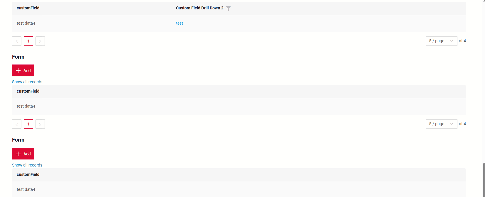{width="900"}
=== "До"
    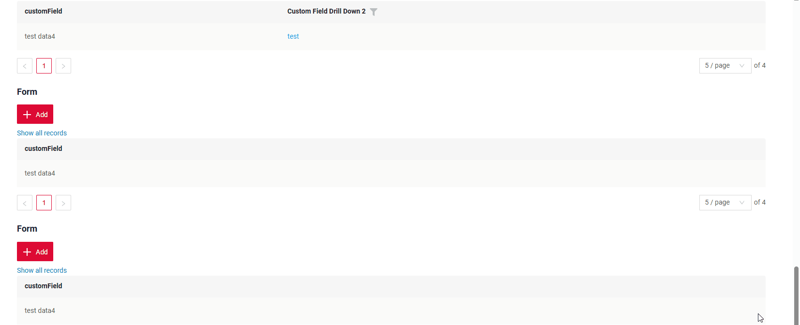{width="900"}

#### Исправлено: поля dictionary, multipleSelect, inlinePickList — единое позиционирование выпадающего списка в виджете List { #fixed-dictionary-multipleselect-inlinepicklist-fields-unified-dropdown-positioning-in-list-widget }
Позиционирование выпадающего списка для полей [dictionary](https://doc.cxbox.org/ru/widget/fields/field/dictionary/dictionary/), [multipleSelect](https://doc.cxbox.org/ru/widget/fields/field/multipleSelect/multipleSelect/) и [inlinePickList](https://doc.cxbox.org/ru/widget/fields/field/inlinePickList/inlinePickList/) унифицировано. Теперь все выпадающие списки в виджете List корректно отображаются за пределами строки и больше не обрезаются.

=== "После"
    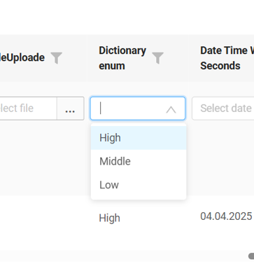
=== "До"
    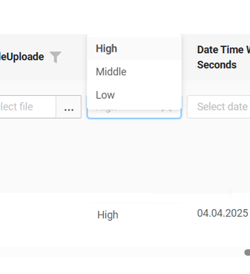

См. [dictionary](https://doc.cxbox.org/ru/widget/fields/field/dictionary/dictionary/#readonlyeditable), [multipleSelect](https://doc.cxbox.org/ru/widget/fields/field/multipleSelect/multipleSelect/#readonlyeditable) и [inlinePickList](https://doc.cxbox.org/ru/widget/fields/field/inlinePickList/inlinePickList/#readonlyeditable) в обновлённых статьях.

#### Исправлено: запрос refresh для несуществующего bc { #fixed-refresh-request-for-a-non-existent-bc }
Фронтенд теперь обрабатывает запросы refresh для бизнес-компонентов, отсутствующих на странице, без ошибок. Вместо этого в консоль выводится предупреждение.

=== "После"
    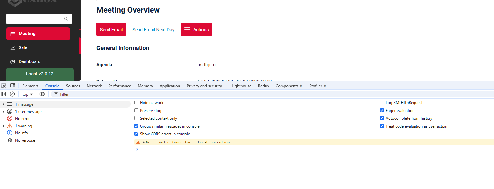
=== "До"
    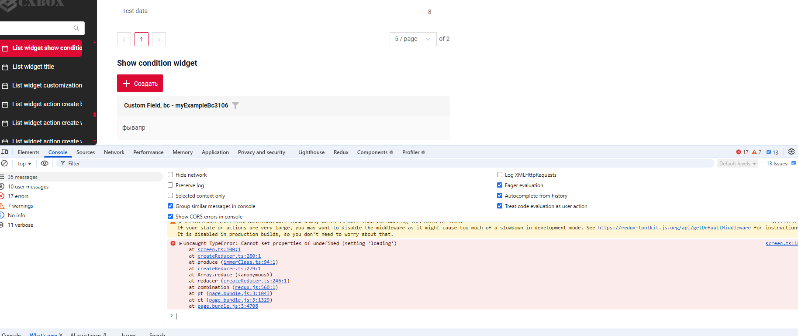  

#### Исправлено: поле dictionary — единый размер поля при валидации (inline-edit) { #fixed-dictionary-field-consistent-field-size-with-validation-inline-edit }

Улучшено отображение dictionary в режиме inline-редактирования при ошибках (например, ошибках проверки обязательности).

Теперь область пустого значения занимает столько же места, сколько заполненные поля, что обеспечивает единообразие интерфейса.
=== "После"
    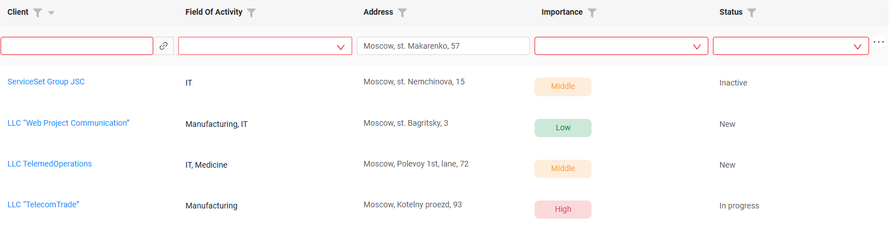
=== "До"
    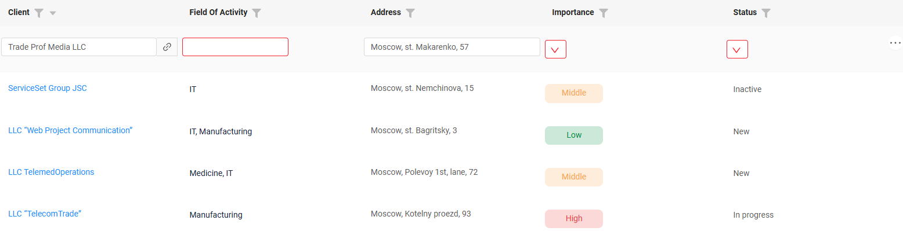

#### Исправлено: действия кнопок — реакция на force-active поля { #fixed-button-actions-respond-to-force-active-fields }

Действия кнопок теперь корректно реагируют на обновление метаданных от force-active полей. Раньше действие могло сработать до повторной проверки доступности кнопки, и его можно было выполнить, даже когда кнопка должна была быть неактивна.

=== "После"
    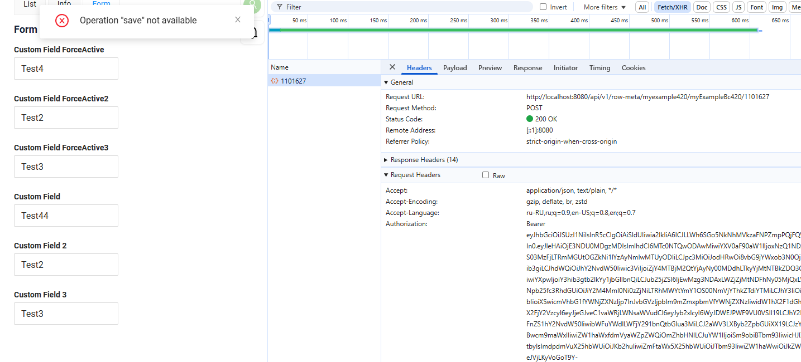
=== "До"
    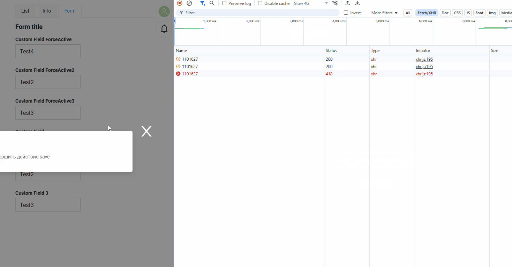

#### Исправлено: dictionary, multipleSelect, multivalue, multivalueHover — единая высота в режиме чтения { #fixed-dictionary-multipleselect-multivalue-multivaluehover-unified-display-height-in-read-mode }

Высота полей этих типов в режиме просмотра изменена с 20px на 16px (как у других полей) для визуального единообразия.

#### Исправлено: поле pickList — обновлённая логика запросов { #fixed-picklist-field-updated-query-logic }

* Фронтенд больше не отправляет запросы данных picklist, если у родительской сущности нет записей.
* Данные дочерней сущности больше не запрашиваются, если у её родительской сущности нет записей.

=== "После"
    Фронтенд больше не отправляет запросы
=== "До"
    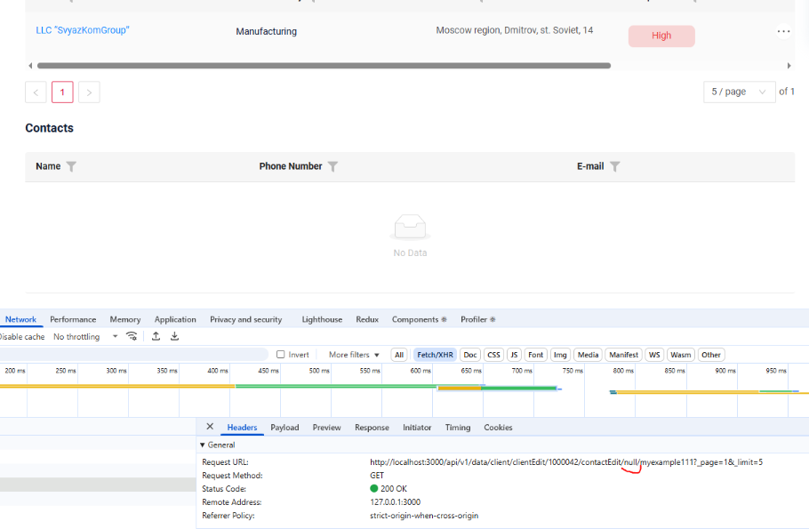

#### Исправлено: переключение ролей — улучшенная обработка ошибок { #fixed-role-switching-improved-error-handling }
Уточнено отображение сообщений об ошибках при переключении ролей пользователя. Раньше ошибка могла появиться, даже если view на самом деле был доступен. Теперь сообщение отображается, только когда запрошенный view действительно недоступен для выбранной роли.

#### Прочие изменения { #other-changes }
см. [журнал изменений cxbox-demo](https://github.com/CX-Box/cxbox-demo/releases/tag/v.2.0.13)

### CXBOX ([Core Ui](https://github.com/CX-Box/cxbox-ui/releases/tag/2.5.3))

Выпущена новая версия CORE UI 2.5.3.

#### Прочие изменения { #other-changes_1 }
См. [журнал изменений cxbox-ui 2.5.3](https://github.com/CX-Box/cxbox-ui/releases/tag/2.5.3).

### CXBOX 4.0.0-M17 ([Core](https://github.com/CX-Box/cxbox/tree/cxbox-4.0.0-M17))

Выпущена новая версия CORE 4.0.0-M17.

#### Прочие изменения { #other-changes_2 }
См. [журнал изменений cxbox 4.0.0-M17](https://github.com/CX-Box/cxbox/releases/tag/cxbox-4.0.0-M17).

### CXBOX [документация](https://doc.cxbox.org/ru/) { #cxbox-documentation }

#### Добавлено: поле [suggestionPickList](https://doc.cxbox.org/ru/widget/fields/field/suggestionpicklist/suggestionPickList/) { #added-suggestionpicklist-field }
Добавлено полное описание поля [suggestionPickList](https://doc.cxbox.org/ru/widget/fields/field/suggestionpicklist/suggestionPickList/)

#### Добавлено: поля [dictionary](https://doc.cxbox.org/ru/widget/fields/field/dictionary/dictionary/#filtering), [multipleSelect](https://doc.cxbox.org/ru/widget/fields/field/multipleSelect/multipleSelect/#filtering), [radio](https://doc.cxbox.org/ru/widget/fields/field/radio/radio/#filtering) — обновлённая статья { #added-dictionary-multipleselect-radio-fields-updated-article }
Добавлено описание [dictionary](https://doc.cxbox.org/ru/widget/fields/field/dictionary/dictionary/#filtering), [multipleSelect](https://doc.cxbox.org/ru/widget/fields/field/multipleSelect/multipleSelect/#filtering), [radio](https://doc.cxbox.org/ru/widget/fields/field/radio/radio/#filtering)

#### Добавлено: поля [number](https://doc.cxbox.org/ru/widget/fields/field/number/number/#filtering), [percent](https://doc.cxbox.org/ru/widget/fields/field/percent/percent/#filtering), [money](https://doc.cxbox.org/ru/widget/fields/field/money/money/#filtering) — фильтрация по диапазону { #added-number-percent-money-fields-filtration-by-range }
Обновлены статьи о фильтрации по диапазону для [number](https://doc.cxbox.org/ru/widget/fields/field/number/number/#filtering), [percent](https://doc.cxbox.org/ru/widget/fields/field/percent/percent/#filtering) и [money](https://doc.cxbox.org/ru/widget/fields/field/money/money/#filtering).

