# 2.0.14

* [cxbox/demo 2.0.14 git](https://github.com/CX-Box/cxbox-demo/tree/v.2.0.14), [примечания к релизу](https://github.com/CX-Box/cxbox-demo/releases/tag/v.2.0.14)

* [cxbox/core 4.0.0-M18 git](https://github.com/CX-Box/cxbox/tree/cxbox-4.0.0-M18), [примечания к релизу](https://github.com/CX-Box/cxbox/releases/tag/cxbox-4.0.0-M18), [maven](https://central.sonatype.com/artifact/org.cxbox/cxbox-starter-parent/4.0.0-M18)

* [cxbox-ui/core 2.6.0 git](https://github.com/CX-Box/cxbox-ui/tree/2.6.0), [примечания к релизу](https://github.com/CX-Box/cxbox-ui/releases/tag/2.6.0), [npm](https://www.npmjs.com/package/@cxbox-ui/core/v/2.6.0)

* [cxbox/code-samples 2.0.14 git](https://github.com/CX-Box/cxbox-code-samples/tree/v.2.0.14), [примечания к релизу](https://github.com/CX-Box/cxbox-code-samples/releases/tag/v.2.0.14)  

## **Ключевые обновления июня, июля 2025** { #key-updates-june-july-2025 }

### CXBOX ([Демо](https://demo.cxbox.org)) { #cxbox-demo }

#### Добавлено: виджет List — массовые операции (НОВОЕ!) { #added-list-widget-mass-operations-new }
Добавлена новая возможность применять действия сразу к нескольким строкам — **массовые операции**.
Это специальный режим отображения [виджета List](https://doc.cxbox.org/ru/widget/type/list/list/), который проводит пользователя через каждый шаг массового действия.

Массовые операции могут включать следующие шаги:
=== "Шаг 1: выбор"
    Рядом с каждой строкой появляются флажки. Можно выбрать несколько строк, которые затем отображаются в виде тегов над таблицей. Также можно выбрать строки из файла и загрузить те, к которым нужно применить массовую операцию.
    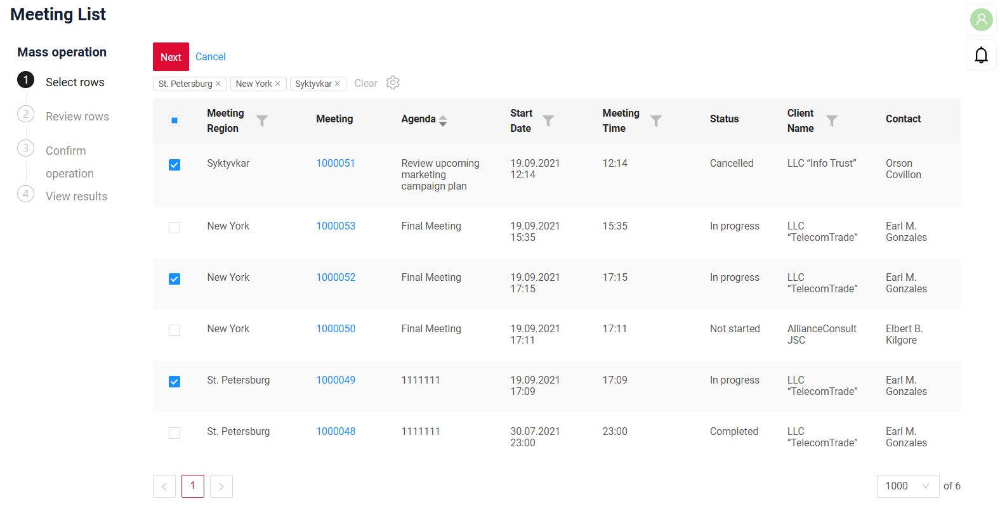
=== "Шаг 2: проверка"
    Выбранные строки отображаются в режиме только для чтения, чтобы можно было перепроверить выбор перед продолжением.
    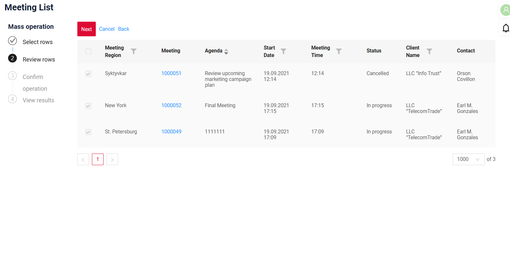
=== "Шаг 3: подтверждение (необязательно)"
    В зависимости от операции этот шаг может отображать форму для ввода дополнительных обязательных данных или просто текст подтверждения.
    !!! info
        Рекомендуем специально создать дополнительное поле массовой операции для отображения на этом шаге. Иначе запрос будет отправлен для первой строки таблицы, и поле будет предзаполнено значениями из первой строки.
    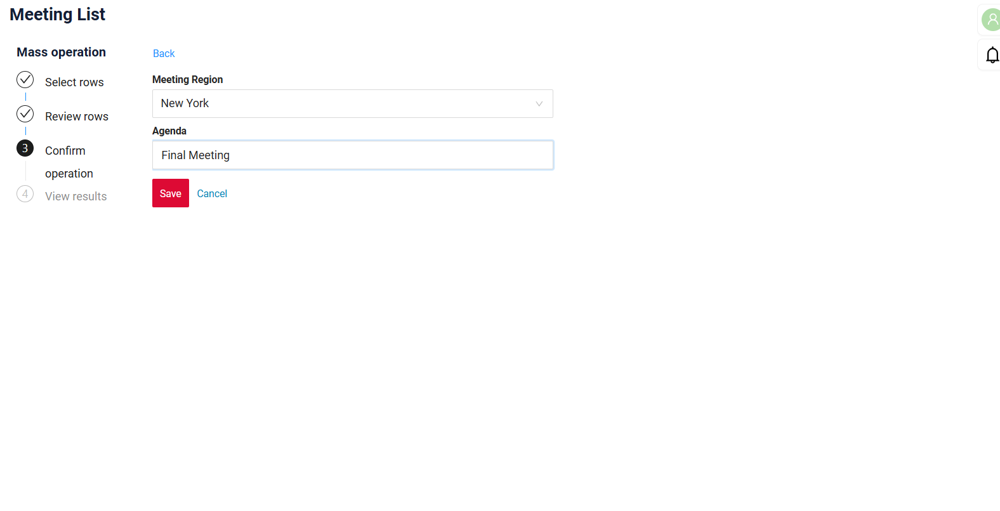
=== "Шаг 4: результаты"
    После завершения действия отображается сводка результатов по каждой строке. Результат также можно скачать в виде файла Excel, чтобы позже работать с этими строками при следующей массовой операции.
    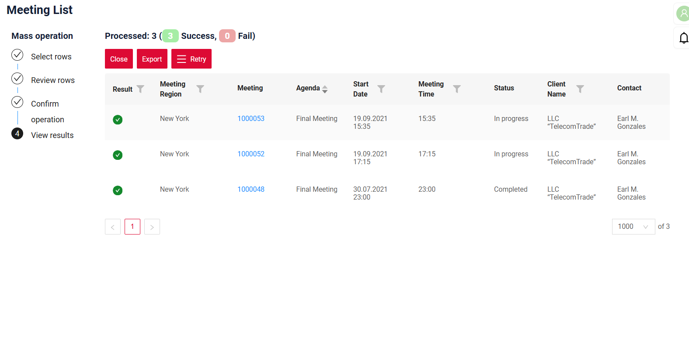

!!! info 
    Подробная статья о массовых операциях скоро появится в официальной документации — следите за новостями!

#### Добавлено: виджет FilePreview — НОВЫЙ тип виджета! { #added-filepreview-widget-new-widget-type }

Добавлен новый тип виджета — FilePreview. Он занимает 50% основной области экрана и располагается рядом с другим содержимым. При прокрутке виджет остаётся закреплённым сверху, поэтому документ всегда виден.

FilePreview поддерживает новый режим предпросмотра `inline`, который отображает документ прямо на странице, без открытия всплывающего окна.

Этот виджет особенно полезен для одновременного просмотра документа и редактирования формы — так проще заполнять формы на основе содержимого загруженного файла.

=== "Стандартное отображение"
    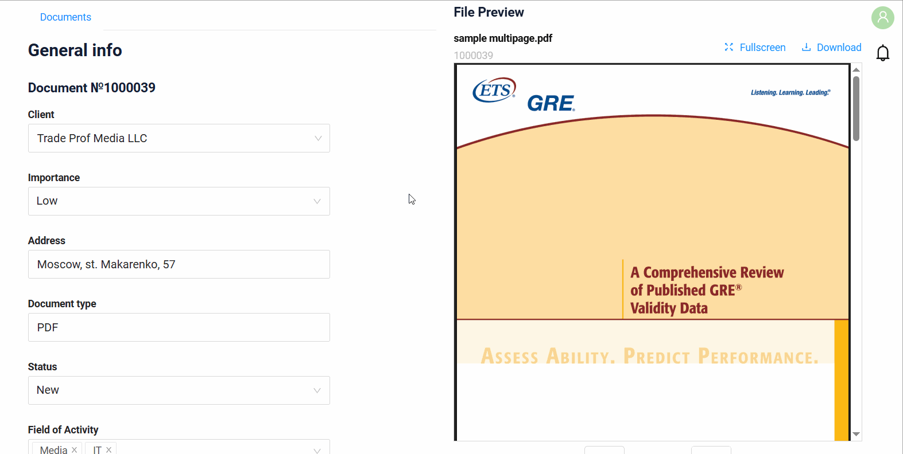
=== "Отображение с дополнительными виджетами"
    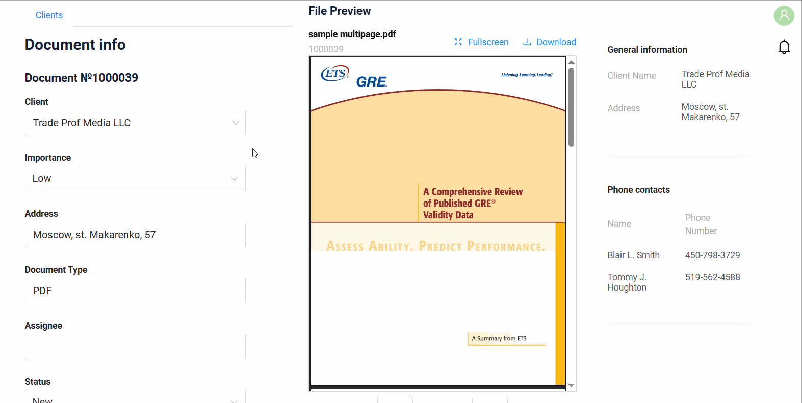  

#### Добавлено: поле text — сокращение значения { #added-text-field-value-truncation }
Добавлена поддержка сокращения длинных значений в [поле text](https://doc.cxbox.org/ru/widget/fields/field/text/text/) с помощью константы фронтенда.
Если значение превышает заданный лимит, оно сокращается с многоточием (...). При наведении на многоточие полное значение показывается во всплывающей подсказке.

=== "После"
    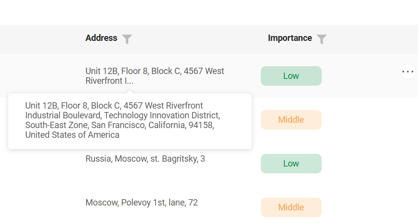
=== "До"
    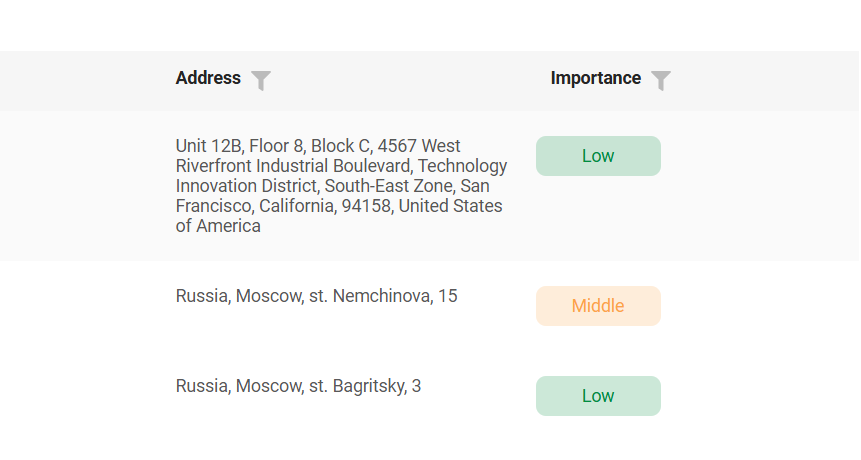  

#### Добавлено: виджет StatsBlock — выделение выбранного блока { #added-statsblock-widget-selected-block-highlighting }

Добавлена поддержка выделения выбранного блока в [StatsBlock](https://doc.cxbox.org/ru/widget/type/statblocks/statblocks/). Так проще понять, какой блок был нажат и какие данные сейчас отображаются.
Это особенно полезно, когда StatsBlock используется вместе с другим виджетом (например, [виджетом List](https://doc.cxbox.org/ru/widget/type/list/list/)).

!!! info
    StatsBlock и виджет List можно разместить на разных views или на одном view. Поведение зависит от их настройки.

StatsBlock + виджет List:
=== "На одном view — выделение поддерживается"
    Если оба виджета размещены на одном view, их можно связать отношением **родитель-потомок** без использования drillDown. В этом случае выделение **доступно**.
    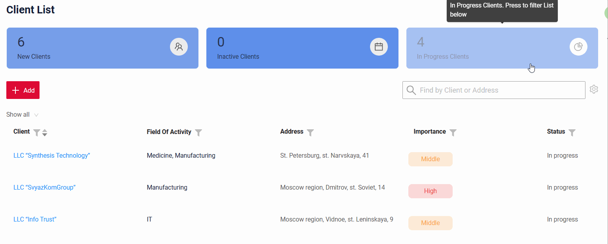
=== "На разных views — без выделения"
    Если виджеты размещены на разных views, выделение **не поддерживается**. Связать их можно **только** с помощью drillDown.
    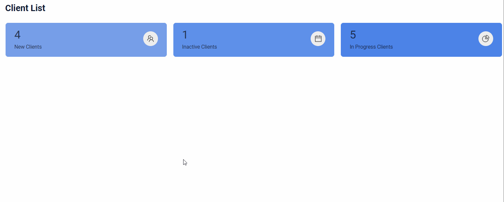  

#### Исправлено: виджет Form — стабильная компоновка при валидации { #fixed-form-widget-stable-layout-on-validation }
Исправлено поведение компоновки в многоколоночном [виджете Form](https://doc.cxbox.org/ru/widget/type/form/form/). Сообщения валидации больше не сдвигают поля. Поля остаются выровненными, а структура формы — стабильной и согласованной при появлении ошибок.

=== "После"
    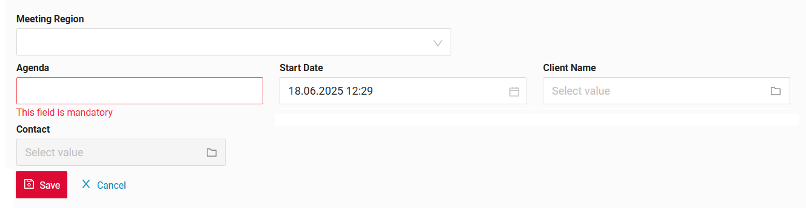
=== "До"
    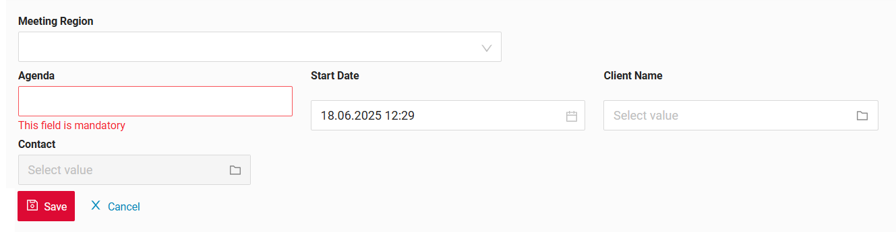  

#### Добавлено: поля date, dateTime, dateTimeWithSeconds — кнопки копирования в фильтре по диапазону { #added-date-datetime-datetimewithseconds-fields-copy-buttons-in-range-filter }

Улучшен фильтр по диапазону для следующих типов полей: [date](https://doc.cxbox.org/ru/widget/fields/field/date/date/), [dateTime](https://doc.cxbox.org/ru/widget/fields/field/dateTime/dateTime/) и [dateTimeWithSeconds](https://doc.cxbox.org/ru/widget/fields/field/dateTimeWithSeconds/dateTimeWithSeconds/).

Фильтр уже поддерживал поля «From» и «To». Теперь добавлены кнопки копирования, упрощающие заполнение обоих полей:

* кнопка `>` — копирует значение «From» в «To»
* кнопка `<` — копирует значение «To» в «From»

Эти кнопки активны, только когда исходное поле содержит значение.

Это обновление делает фильтры по датам такими же удобными, как фильтры для полей number, money и percent, добавленные в предыдущем релизе [2.0.13](https://doc.cxbox.org/ru/new/version2013/#added-number-money-percent-fields-range-filter-support).

=== "После"
    
=== "До"
    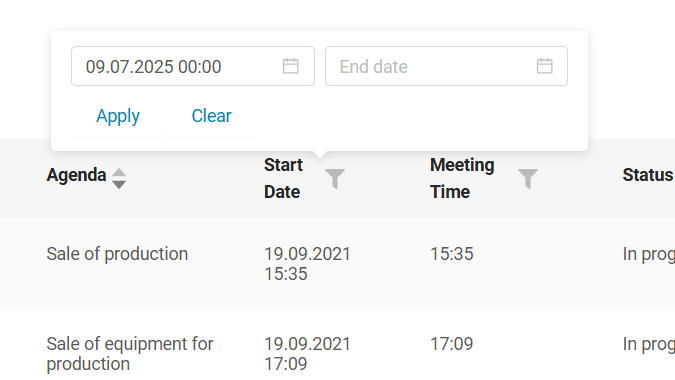  

#### Добавлено: поле fileUpload — поддержка переноса слов { #added-fileupload-field-word-wrapping-support }
Длинные имена файлов в поле [fileUpload](https://doc.cxbox.org/ru/widget/fields/field/fileUpload/fileUpload/) теперь автоматически переносятся и помещаются в доступное пространство.
Текст также обтекает иконку расширения, что делает компоновку компактнее и читабельнее.

=== "После"
    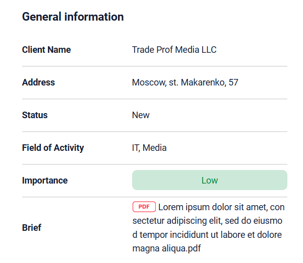
=== "До"
    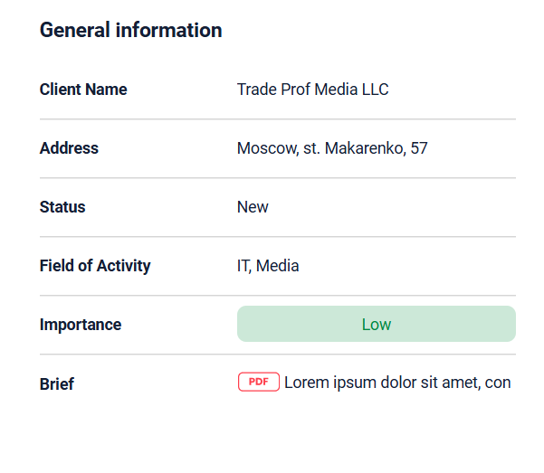  

#### Исправлено: drillDown — обновлённая логика отображения { #fixed-drilldown-updated-display-logic }
Обновлена логика отображения drillDown для корректной обработки случаев, когда в первой строке нет значения в поле drillDown. Ссылки drillDown теперь появляются для всех строк с корректными значениями, независимо от первой строки. Теперь достаточно указать `"drillDown": true` в `*.widget.json`, и ссылки будут корректно отображаться для всех подходящих строк.

=== "После"
    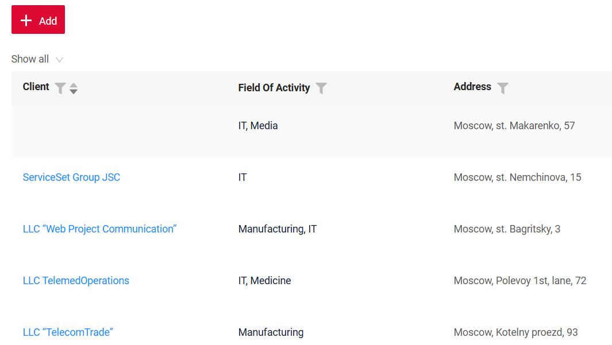
=== "До"
    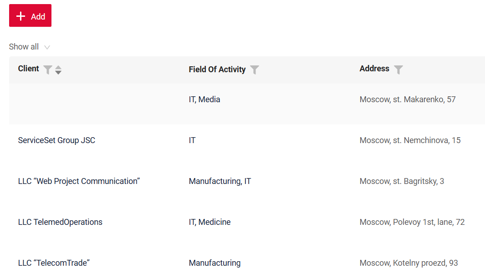  

#### Исправлено: обновление счётчика уведомлений { #fixed-notification-counter-update }
Счётчик непрочитанных уведомлений (иконка колокольчика) теперь автоматически обновляется после удаления непрочитанных сообщений.
Он всегда отражает текущее количество непрочитанных уведомлений — в том числе когда их не осталось.

#### Исправлено: виджет FourthLevelMenu — корректное отображение вкладок { #fixed-fourthlevelmenu-widget-correct-tab-rendering }
FourthLevelMenu теперь показывает только вкладки активной ветви экрана в соответствии со структурой `screen.json`. Вкладки из других ветвей больше не отображаются вне своего контекста.

#### Исправлено: пагинация по умолчанию { #fixed-pagination-default }
**Режим `count` по умолчанию** — `nextAndPreviousSmart`.
Для следующих типов виджетов режим по умолчанию — `nextAndPreviousWithCount`:

* `List`
* `CustomGroupingHierarchy`
* `CustomDashboardList`
* `AssocListPopup`
* `PickListPopup`
* `CustomPie1D`
* `CustomColumn2D`
* `CustomLine2D`
* `CustomDualAxes2D`

Запрос `count` выполняется, **только если на экране есть хотя бы один виджет с режимом `nextAndPreviousWithCount`**.

=== "После: виджет Form"
    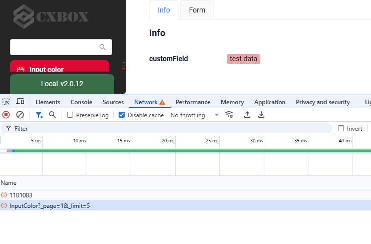
=== "До: виджет Form"
    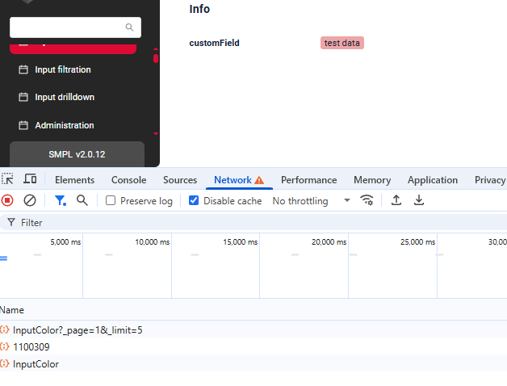

#### Добавлено: отображение панели пагинации { #added-pagination-panel-display }
В конфигурацию `widget.json` в `options -> pagination` добавлен новый параметр, управляющий отображением панели пагинации.

Пример конфигурации:

```json
"options": {
  "pagination": {
    "enabled": false
  }
}
```

* `enabled: false` — панель пагинации и блок выбора лимита **не отображаются** независимо от количества записей.
* `enabled: true` (или если параметр не указан) — применяется стандартная логика отображения с учётом `defaultPageLimit`.
 
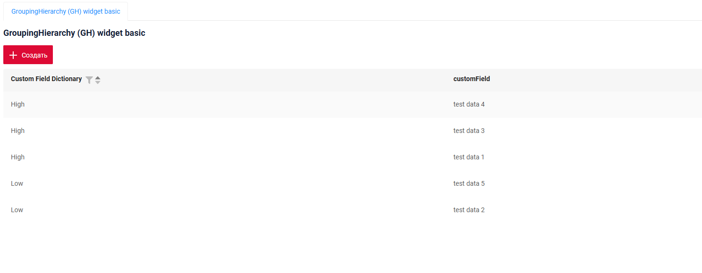

#### Прочие изменения { #other-changes }
см. [журнал изменений cxbox-demo](https://github.com/CX-Box/cxbox-demo/releases/tag/v.2.0.14)


### CXBOX ([Core Ui](https://github.com/CX-Box/cxbox-ui/releases/tag/2.6.0))   

Выпущены две версии CORE UI — 2.5.4 и 2.6.0!

#### Добавлено: тег changedNow_ с полями, изменёнными в текущем взаимодействии пользователя { #added-tag-changednow-the-fields-modified-in-the-current-user-interaction }
Добавлен новый тег `changedNow_`. Он содержит только поля, изменённые в текущем взаимодействии пользователя и ещё не
отправленные на бэкенд.

=== "После: row-meta/ (POST)"
    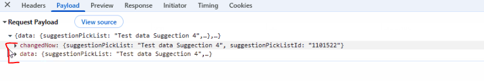
=== "До: row-meta/ (POST)"
    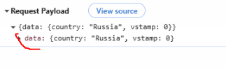


**Когда отправляется `changedNow_`?**

row-meta/ (POST)

* Когда пользователь покидает поле с `forceActive = true`.
* При вызове виджета FormPopup


=== "Поведение после"

    | Сценарий                                                                                                                   | Вызывается Meta Builder | Запускается обновление полей   |
    | -------------------------------------------------------------------------------------------------------------------------- | ------------------- | ------------------------------ |
    | Редактирование поля с `forceActive`                                                                                        | ✅ Да                | ✅ Да                           |
    | `forceActive` → стандартная кнопка Save (для перечисленных ниже полей, где `row-meta` не вызывается, пока пользователь не покинет поле) | ❌ Нет               | ❌ Нет                          |
    | `forceActive` → пользовательская кнопка (для перечисленных ниже полей, где `row-meta` не вызывается, пока пользователь не покинет поле) | ❌ Нет               | ❌ Нет                          |
    | Открытие `FormPopup`                                                                                                       | ✅ Да                | ✅ Да                           |
    | Нажатие только стандартной кнопки Save                                                                                     | ❌ Нет               | ❌ Нет                          |
    | Нажатие только пользовательской кнопки                                                                                     | ❌ Нет               | ❌ Нет                          |
    | Нажатие Delete                                                                                                             | ❌ Нет               | ❌ Нет (запись только удаляется) |

=== "Поведение до"

    | Сценарий                                                                                                                   | Вызывается Meta Builder                             | Запускается обновление полей               |
    | -------------------------------------------------------------------------------------------------------------------------- | --------------------------------------------------- | ------------------------------------------ |
    | Редактирование поля с `forceActive`                                                                                        | ✅ Да                                                | ✅ Да                                       |
    | `forceActive` → стандартная кнопка Save (для перечисленных ниже полей, где `row-meta` не вызывается, пока пользователь не покинет поле) | ✅ Да (через `/row-meta` → затем запрос сохранения)  | Обновление происходит в рамках события `/row-meta` |
    | `forceActive` → пользовательская кнопка (для перечисленных ниже полей, где `row-meta` не вызывается, пока пользователь не покинет поле) | ✅ Да (через `/row-meta` → затем пользовательское действие) | Обновление происходит в рамках события `/row-meta` |
    | Открытие `FormPopup`                                                                                                       | ✅ Да                                                | ✅ Да                                       |
    | Нажатие только стандартной кнопки Save                                                                                     | ❌ Нет                                               | ❌ Нет                                      |
    | Нажатие только пользовательской кнопки                                                                                     | ❌ Нет                                               | ❌ Нет                                      |
    | Нажатие Delete                                                                                                             | ❌ Нет                                               | ❌ Нет (запись только удаляется)            |


**Поведение по типам полей**

Обозначения:

* ✅ — `forceActive` (`row-meta`) вызывается сразу при выборе значения.
* ❌ — `row-meta` не вызывается, пока не нажата кнопка или пользователь не покинет поле.
* `noValid` — поле не поддерживает изменение значения на месте.

| Тип поля              | `forceActive` вызывается сразу?       | Примечания                                          |
| --------------------- | ------------------------------------ | --------------------------------------------------- |
| `input`               | ❌ Нет                                | Вызывается при клике вне поля или по кнопке         |
| `date`                | ✅ Да                                 |                                                     |
| `dateTime`            | ✅ Да                                 |                                                     |
| `dateTimeWithSeconds` | ✅ Да                                 |                                                     |
| `number`              | ❌ Нет                                | Вызывается при клике вне поля или по кнопке         |
| `percent`             | ❌ Нет                                | Вызывается при клике вне поля или по кнопке         |
| `hidden`              | `noValid`                            | Не редактируется                                    |
| `text`                | ❌ Нет                                | Вызывается при клике вне поля или по кнопке         |
| `radio`               | ✅ Да                                 |                                                     |
| `checkbox`            | ✅ Да                                 |                                                     |
| `money`               | ❌ Нет                                |                                                     |
| `dictionary`          | ✅ Да                                 |                                                     |
| `fileUpload`          | ✅ Да                                 |                                                     |
| `pickList`            | ✅ Да                                 |                                                     |
| `inlinePickList`      | ✅ Да                                 | Сохранение вызывается, только если выбран элемент   |
| `hint`                | `noValid`                            | Не редактируется                                    |
| `multifield`          | ✅ Да                                 |                                                     |
| `multivalueHover`     | `noValid`                            | Не редактируется                                    |
| `multivalue`          | ✅ Да                                 |                                                     |
| `multipleSelect`      | ✅ Да                                 |                                                     |
| `suggestionPickList`  | ✅ Да                                 | Сохранение вызывается, только если выбран элемент   |

#### Добавлено: кнопки действий — улучшенная логика повторных действий { #added-action-buttons-improved-logic-for-repeated-actions }

Добавлена новая логика, предотвращающая случайное повторное выполнение одного и того же действия. Если нажать кнопку, пока её действие ещё выполняется, она временно становится неактивной и показывает индикатор загрузки. Остальные действия доступны как обычно.

=== "После"
    Повторные нажатия игнорируются, пока действие выполняется, — действие вызывается только один раз
    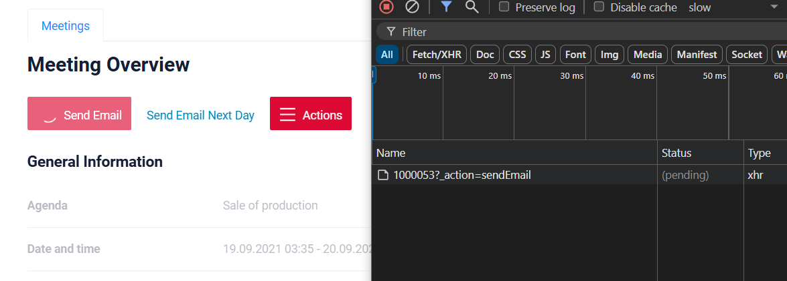
=== "До"
    При двойном клике одно и то же действие (пока оно ещё выполнялось) могло сработать дважды
    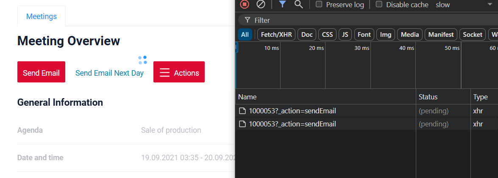  

#### Исправлено: поле Dictionary — поддержка фильтрации со спецсимволами { #fixed-dictionary-field-support-for-filtering-with-special-characters }
Фильтрация по значениям справочника, содержащим спецсимволы (например, "" ), теперь полностью поддерживается. Результаты отображаются корректно во всех случаях.

=== "После"
    Фильтрация по значениям со спецсимволами применяется корректно.
    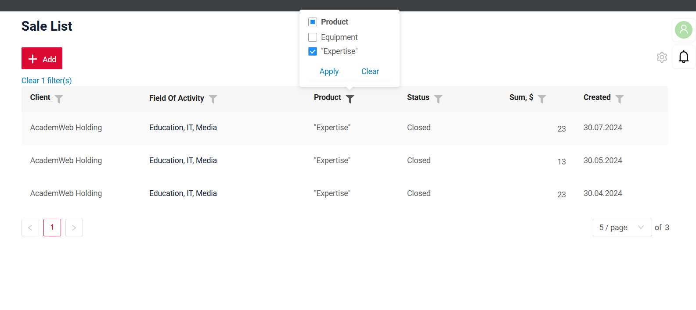
=== "До"
    Фильтрация по значениям со спецсимволами не применялась.
    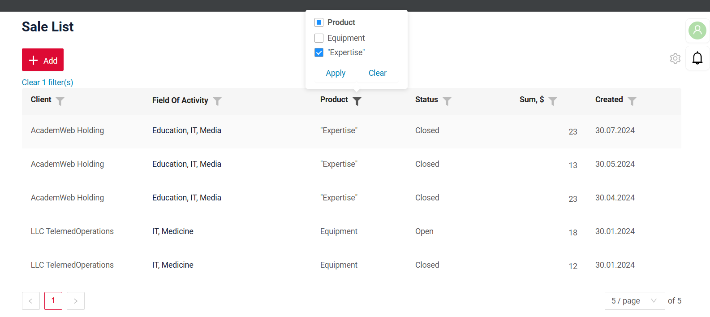  

#### Прочие изменения { #other-changes_1 }
См. [журнал изменений cxbox-ui 2.6.0](https://github.com/CX-Box/cxbox-ui/releases/tag/2.6.0).


### CXBOX 4.0.0-M18 ([Core](https://github.com/CX-Box/cxbox/tree/cxbox-4.0.0-M18))

Выпущена новая версия CORE 4.0.0-M18.

#### Добавлено: тег changedNow_ с полями, изменёнными в текущем взаимодействии пользователя { #added-tag-changednow-the-fields-modified-in-the-current-user-interaction_1 }
**До**

Раньше фронтенд включал в тег `data` все ранее изменённые поля, а не только изменённые в текущем действии пользователя. Из-за этого было сложно определить, какие поля пользователь изменил *только что*.

**После**

Добавлен новый тег `changedNow_`. Он содержит только поля, изменённые в текущем взаимодействии пользователя и ещё не
отправленные на бэкенд.

**Новые методы отслеживания изменений полей на клиенте (changedNow_)**

Рекомендуем использовать этот метод только для обновления значений и размещать его в начале метода `buildRowDependentMeta`.

Для отслеживания изменений полей в UI добавлен следующий метод:

```java
public <V> boolean isFieldChangedNow(RowDependentFieldsMeta<T> fields, DtoField<? super T, V> field)
```

Описание:
Проверяет, было ли конкретное поле изменено в ходе текущего взаимодействия с UI, на основе содержимого тега `changedNow_`.

Пример использования:

`buildRowDependentMeta` 

```java
if (fields.isFieldChangedNow(fields, MyExampleDTO_.country)) {
    if (fields.getCurrentValue(MyExampleDTO_.country).isEmpty()) {
    fields.setCurrentValue(MyExampleDTO_.region, null);
            fields.setCurrentValue(MyExampleDTO_.street, null);
        } else if (Objects.equals(fields.getCurrentValue(MyExampleDTO_.country).orElse(null), CountryEnum.BELARUS)) {
    fields.setCurrentValue(MyExampleDTO_.region, RegionEnum.MINSK);
            fields.setCurrentValue(MyExampleDTO_.street, "Avenue Nezavisimosti");
        } else if (Objects.equals(fields.getCurrentValue(MyExampleDTO_.country).orElse(null), CountryEnum.RUSSIA)) {
    fields.setCurrentValue(MyExampleDTO_.region, RegionEnum.MOSCOWSKAYA);
            fields.setCurrentValue(MyExampleDTO_.street, "Tverskaya street");
        }
}
```

#### Добавлено: builder для drilldown с фильтром по полям { #added-drilldowns-with-field-based-filter-builder }
Реализован новый метод `setDrilldownWithFilter`, обеспечивающий drill-down с возможностью фильтрации по конкретному полю. Его можно использовать со всеми типами полей, добавив напрямую в builder. Это делает формирование drill-down ссылок намного проще и понятнее.

```java
public final void setDrilldownWithFilter(DtoField<? super T, ?> field,
                                         DrillDownTypeSpecifier drillDownType, String drillDown,
                                         Consumer<FC> fc) 
```

Пример использования:

`buildRowDependentMeta`

```java
fields.setDrilldownWithFilter(
        MyExampleWithDrilldownDTO_.customFieldHint, DrillDownType.INNER, "/screen/MyExample/view/MyExamplelist/",fc->
        fc.add(
        CxboxMyExampleController.myexample,
        MyExampleWithDrilldownDTO.class,
            fb -> {
            fb.input(MyExampleWithDrilldownDTO_.region,
                     fields.getCurrentValue(MyExampleWithDrilldownDTO_.region).orElse(null));
            fb.multiValue(MyExampleWithDrilldownDTO_.street,
                          fields.getCurrentValue(MyExample4300WithDrilldownDTO_.street).orElse(null));
            }
        )
);
```

#### Добавлено: поддержка в ядре типов виджетов и полей, официально представленных в предыдущих релизах (перенесено из проекта) { #added-core-support-for-officially-introduced-in-previous-releases-widget-and-field-types-moved-from-project }
Удалите классы из проекта или, если хотите сохранить описание логики новых виджетов на уровне проекта, добавьте новый тип виджета в файлы проекта
[Виджет FilePreview](https://doc.cxbox.org/ru/new/version2014/#added-filepreview-widget-new-widget-type).

* поддержка "multipleSelect" перенесена из проекта в ядро.
* поддержка "suggestionPickList" перенесена из проекта в ядро.
* официально представленные в предыдущих релизах типы виджетов перенесены в ядро.
* InfoFieldExtractor.java и SimpleFormFieldExtractor.java объединены в новый единый SimpleFieldExtractor.java по умолчанию

#### Прочие изменения { #other-changes_2 }
См. [журнал изменений cxbox 4.0.0-M18](https://github.com/CX-Box/cxbox/releases/tag/cxbox-4.0.0-M18).
 
### CXBOX [документация](https://doc.cxbox.org/ru/) { #cxbox-documentation }

#### Добавлено: пагинация — обновлён hideLimitOptions { #added-pagination-hidelimitoptions-updated }
Обновлён раздел [hideLimitOptions](https://doc.cxbox.org/ru/widget/type/property/pagination/pagination/?h=pag#hidelimitoptions) статьи о пагинации.

