# 2.0.15

* [cxbox/demo 2.0.15 git](https://github.com/CX-Box/cxbox-demo/tree/v.2.0.15), [примечания к релизу](https://github.com/CX-Box/cxbox-demo/releases/tag/v.2.0.15)

* [cxbox/core 4.0.0-M19 git](https://github.com/CX-Box/cxbox/tree/cxbox-4.0.0-M19), [примечания к релизу](https://github.com/CX-Box/cxbox/releases/tag/cxbox-4.0.0-M19), [maven](https://central.sonatype.com/artifact/org.cxbox/cxbox-starter-parent/4.0.0-M19)

* [cxbox-ui/core 2.6.1 git](https://github.com/CX-Box/cxbox-ui/tree/2.6.1), [примечания к релизу](https://github.com/CX-Box/cxbox-ui/releases/tag/2.6.1), [npm](https://www.npmjs.com/package/@cxbox-ui/core/v/2.6.1)

* [cxbox/code-samples 2.0.15 git](https://github.com/CX-Box/cxbox-code-samples/tree/v.2.0.15), [примечания к релизу](https://github.com/CX-Box/cxbox-code-samples/releases/tag/v.2.0.15)  

## **Ключевые обновления августа 2025** { #key-updates-august-2025 }

### CXBOX ([Демо](https://demo.cxbox.org)) { #cxbox-demo }

#### Добавлено: баннер уведомлений — адаптивное отображение кнопок { #added-notification-banner-adaptive-button-display }
Баннер уведомлений теперь подстраивается под длинные тексты кнопок: подписи кнопок больше не обрезаются, а всплывающее окно меняет размер соответственно.

=== "После"
    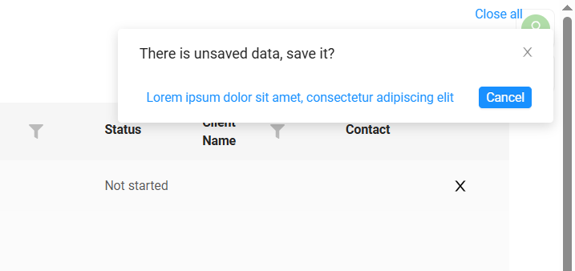
=== "До"
    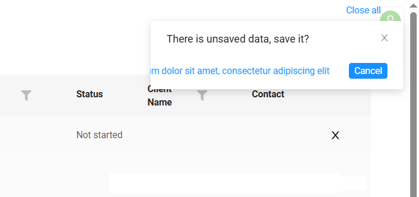

#### Добавлено: тег collapsedCondition { #added-collapsedcondition-tag }
Теперь можно задать состояние свёрнутости по умолчанию при открытии экрана.

В view.json у каждой группы виджетов теперь есть тег collapsedCondition.
=== "collapsedCondition: false (по умолчанию)"
    Группа виджетов отображается развёрнутой.
    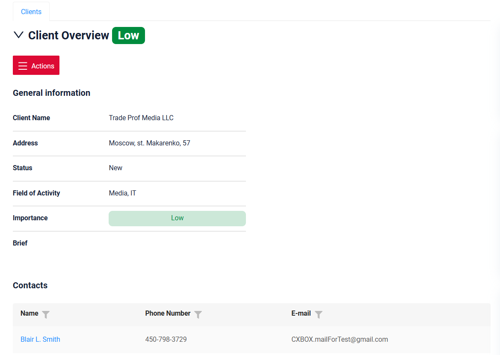
=== "collapsedCondition: true"  
    Группа виджетов отображается свёрнутой сразу после загрузки страницы. Виден только заголовок основного виджета.
    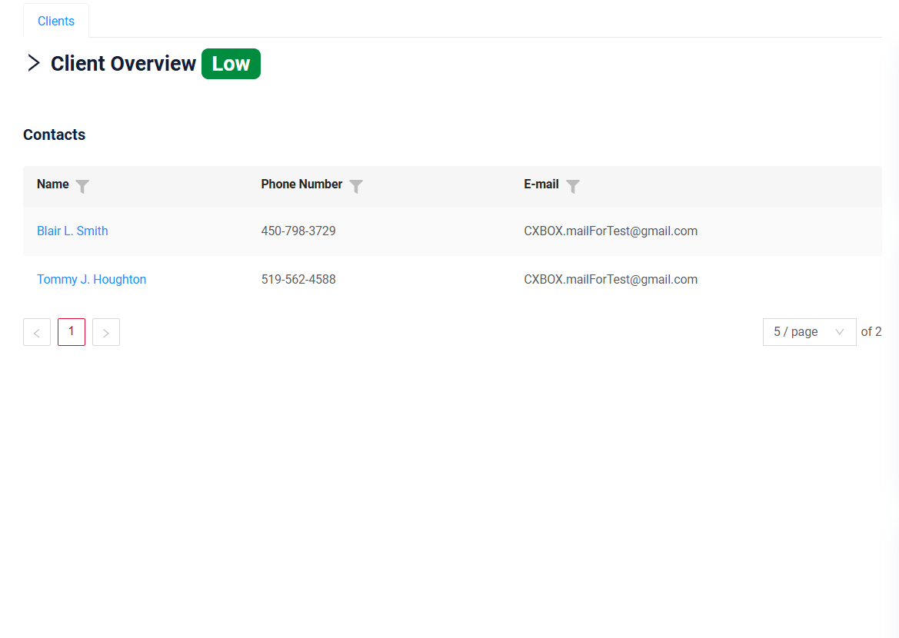  

#### Исправлено: обработка валидации для обязательных недоступных и скрытых полей { #fixed-validation-handling-for-required-disabled-and-hidden-fields }

Улучшена логика валидации недоступных для редактирования и скрытых полей: сообщения корректно отображаются, если обязательные поля пусты. Теперь пользователь видит результат проверки поля.

=== "disabled"
    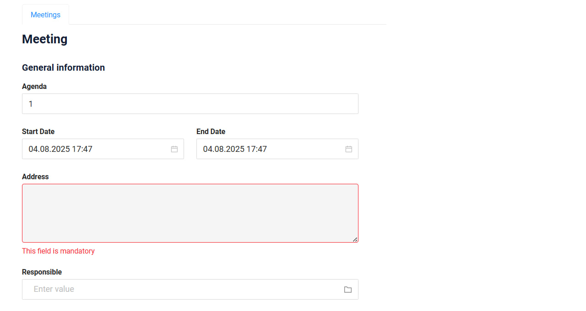
=== "hidden"
    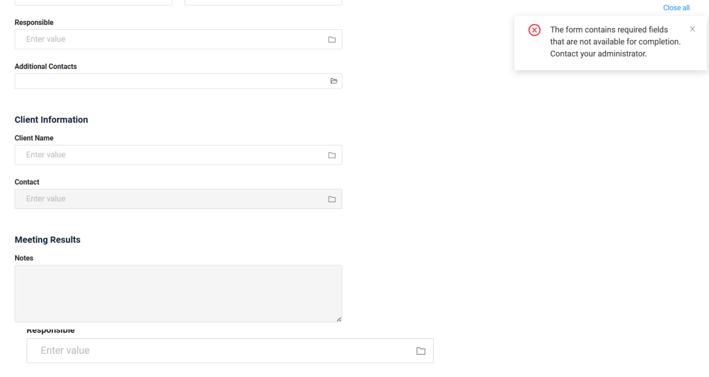

#### Исправлено: отмена после предупреждения валидации { #fixed-cancel-action-after-validation-warning }
Улучшена логика отмены для случаев, когда форма заблокирована валидацией. Теперь, если система предупреждает о незаполненных обязательных полях, пользователь всё равно может отменить и сбросить все изменения.
=== "После"
    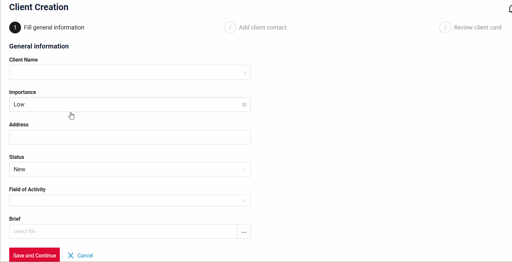
=== "До"
    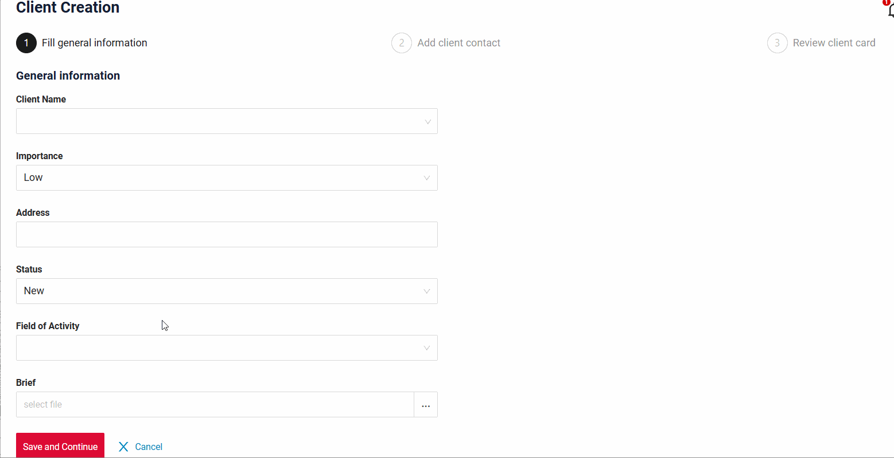 

#### Добавлено: поле multivalue — обновлённое отображение { #added-multivalue-field-updated-display }
Обновлено отображение поля multivalue. Изменения касаются высоты поля, размера чипов, отображения иконки папки и другого — для визуального единообразия с другими типами полей.

#### Исправлено: поле multivalue — корректное отображение значений { #fixed-multivalue-field-correct-display-of-values }
Улучшена логика отображения значений в полях multivalue: теперь каждая строка показывает свои корректные данные независимо от выбранной строки.

#### Прочие изменения { #other-changes }
см. [журнал изменений cxbox-demo](https://github.com/CX-Box/cxbox-demo/releases/tag/v.2.0.15)

### CXBOX ([Core Ui](https://github.com/CX-Box/cxbox-ui/releases/tag/2.6.1))

#### Исправлено: не отображались всплывающие окна с ошибками для fileUpload { #fixed-error-popups-were-not-shown-for-fileupload }
Всплывающие окна с ошибками не отображались, когда для fileUpload возникала ошибка, требующая уведомления пользователя, — сообщение выводилось в консоль.
Теперь отображается всплывающее окно с текстом ошибки.

=== "После"
    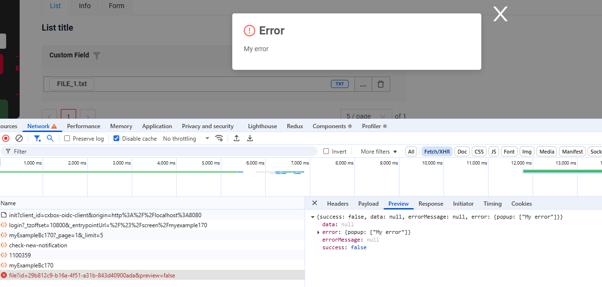
=== "До"
    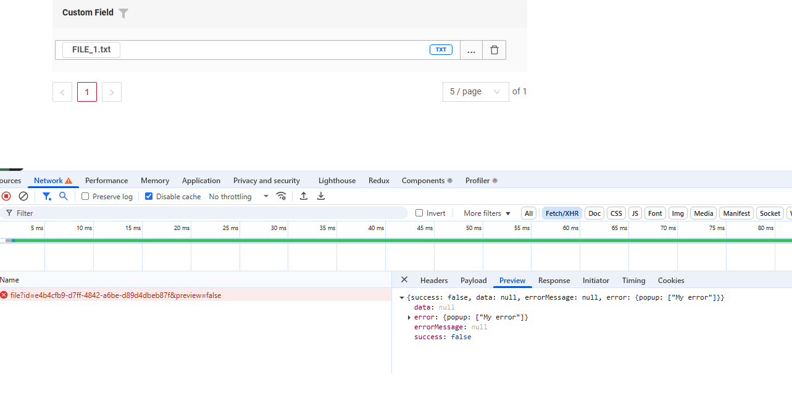

#### Прочие изменения { #other-changes_1 }
См. [журнал изменений cxbox-ui 2.6.1](https://github.com/CX-Box/cxbox-ui/releases/tag/2.6.1).


### CXBOX 4.0.0-M19 ([Core](https://github.com/CX-Box/cxbox/tree/cxbox-4.0.0-M19))

Выпущена новая версия CORE 4.0.0-M19.
#### Исправлено: отсутствие ролей в getSessionUserRoles { #fixed-missing-roles-in-the-getsessionuserroles }
Добавлена обработка ситуации отсутствия ролей в методе getSessionUserRoles.

=== "после"
    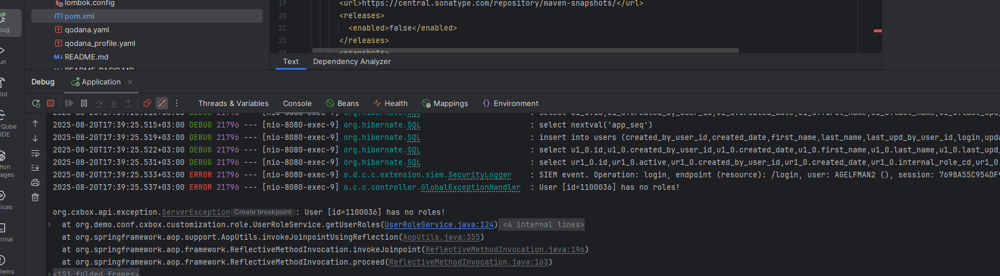
=== "до"
    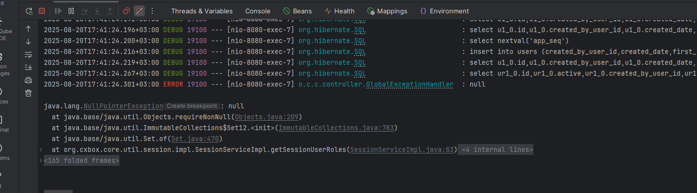

#### Исправлено: некорректное поведение getCurrentValue с @JsonSerialize { #fixed-incorrect-behavior-of-getcurrentvalue-with-jsonserialize }
Исправлено некорректное поведение getCurrentValue для полей с аннотацией @JsonSerialize.

=== "после"
    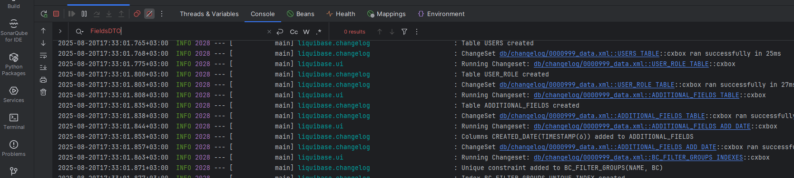
=== "до"
    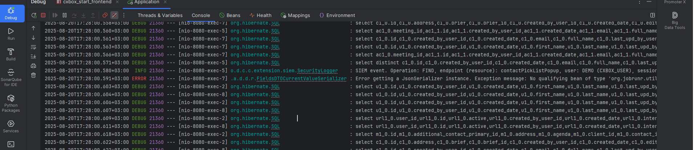

#### Исправлено: изменена логика для аннотации @ElementCollection { #fixed-logic-for-elementcollection-annotation-has-been-changed }
Изменена логика поиска полей в базе данных с аннотацией @ElementCollection:

Если поле DTO помечено @SearchParameter(name = "joinTable.elementCollectionField"), при фильтрации выполняется join сущностей, присутствующих в цепочке.

Пример запроса для count:
```sql
select count(rt_1.id)
    from root_entity rt_1
where rt_1.id in ((select rt_2.id
        from root_entity rt_2
            join join_table jt on jt.id = rt_2.join_table_id
            join element_collection_table ect on jt.id = ect.join_table_id
            where ect.value in ))
```
#### Прочие изменения { #other-changes_2 }
См. [журнал изменений cxbox 4.0.0-M19](https://github.com/CX-Box/cxbox/releases/tag/cxbox-4.0.0-M19).

### CXBOX [документация](https://doc.cxbox.org/ru/) { #cxbox-documentation }

#### Добавлено: виджет GroupingHierarchy — Aggregate { #added-widget-groupinghierarchy-aggregate }
Добавлено описание режима Aggregate виджета `GroupingHierarchy` [Aggregate](https://doc.cxbox.org/ru/widget/type/groupinghierarchy/groupinghierarchy/#data-aggregation)

#### Добавлено: множественная загрузка файлов { #added-multi-upload-files }
Добавлено описание [множественной загрузки файлов](https://doc.cxbox.org/ru/widget/type/property/multiupload/multiupload/).

