# 2.0.16

* [cxbox/demo 2.0.16 git](https://github.com/CX-Box/cxbox-demo/tree/v.2.0.16), [примечания к релизу](https://github.com/CX-Box/cxbox-demo/releases/tag/v.2.0.16)

* [cxbox/core 4.0.0-M20 git](https://github.com/CX-Box/cxbox/tree/cxbox-4.0.0-M20), [примечания к релизу](https://github.com/CX-Box/cxbox/releases/tag/cxbox-4.0.0-M20), [maven](https://central.sonatype.com/artifact/org.cxbox/cxbox-starter-parent/4.0.0-M20)

* [cxbox-ui/core 2.7.1 git](https://github.com/CX-Box/cxbox-ui/tree/2.7.1), [примечания к релизу](https://github.com/CX-Box/cxbox-ui/releases/tag/2.7.1), [npm](https://www.npmjs.com/package/@cxbox-ui/core/v/2.7.1)

* [cxbox/code-samples 2.0.16 git](https://github.com/CX-Box/cxbox-code-samples/tree/v.2.0.16), [примечания к релизу](https://github.com/CX-Box/cxbox-code-samples/releases/tag/v.2.0.16)  


## **Ключевые обновления октября, ноября 2025** { #key-updates-october-november-2025 }

### CXBOX ([Демо](https://demo.cxbox.org)) { #cxbox-demo }

#### Добавлено: CalendarList — НОВЫЙ тип виджета! { #added-calendarlist-new-widget-type }
<!-- CXBOX-756 -->  
Добавлен новый виджет CalendarList, позволяющий просматривать события и управлять ими в трёх режимах отображения: месяц, неделя и день.
Виджет поддерживает переключение режимов отображения, прокрутку дат и переход из режима месяца/недели в режим дня при нажатии на конкретную дату.
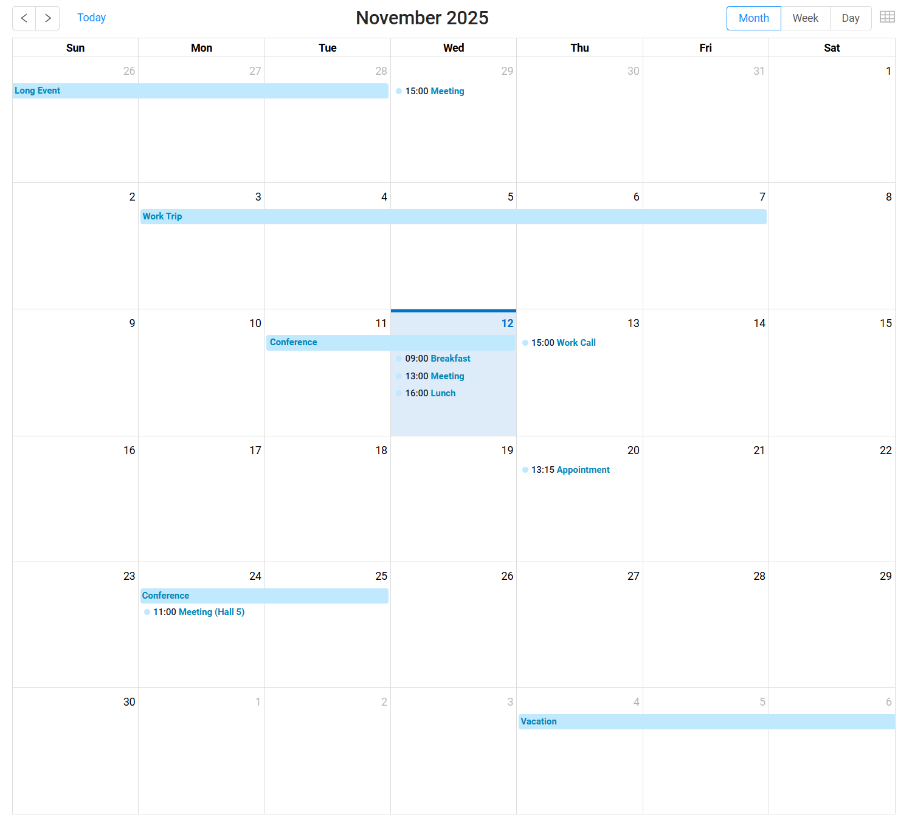
Основная функциональность:
=== "Поддержка действий"
    Полная поддержка действий (всех типов scope). Редактируйте события прямо в календаре!
    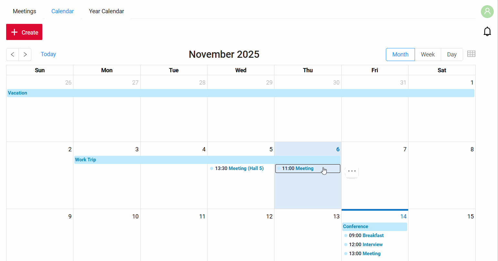
=== "Фильтрация"
    Поддерживается фильтрация (+ фильтрация по дополнительным полям).
    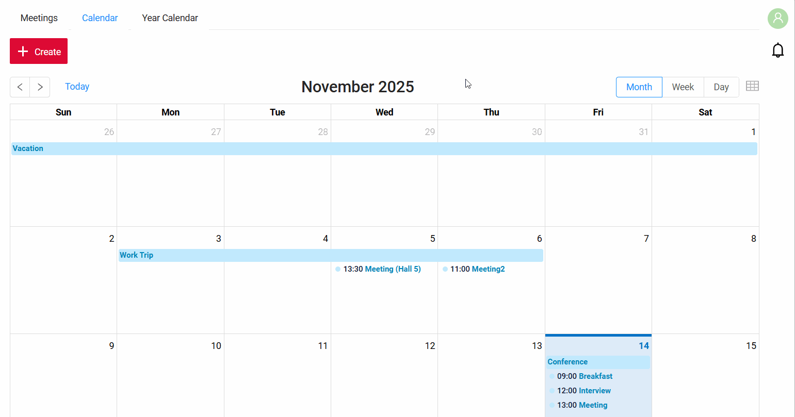
=== "Навигация"
    Можно перемещаться по месяцам/неделям/дням.
    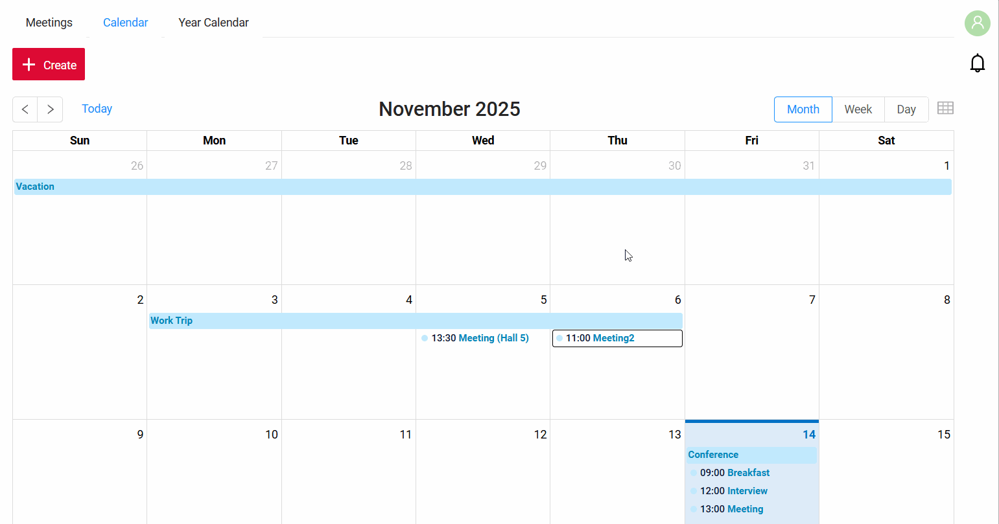
=== "drillDown"
    Доступна функция drillDown.
    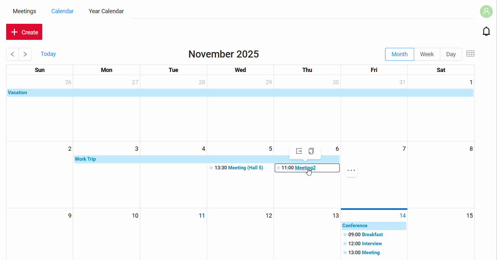
=== "Календарь-таблица"
    Можно переключаться между режимами календаря и таблицы, чтобы анализировать данные в табличном виде.
    

!!! warning "Внимание"
    Для оптимального отображения рекомендуем не передавать длинные значения.

!!! info 
    Подробная статья о CalendarList скоро появится в официальной документации — следите за новостями!

#### Добавлено: CalendarYearList — НОВЫЙ тип виджета! { #added-calendaryearlist-new-widget-type }
<!-- CXBOX-756 -->  
Добавлен виджет CalendarYearList, предназначенный для отображения событий в годовом обзоре.
Для оптимального отображения рекомендуется группировать данные на бэкенде по количеству событий в день.
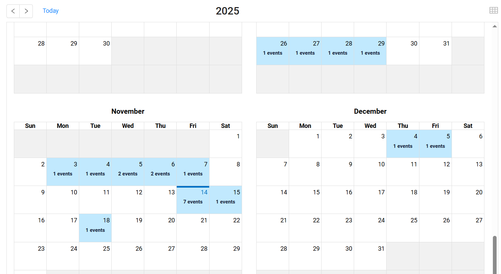

Основная функциональность такая же, как у CalendarList:

* полная поддержка действий (всех типов scope)
* фильтрация (+ фильтрация по дополнительным полям)
* навигация по годам
* поддержка drillDown
* переключение календарь-таблица

!!! info 
    Подробная статья о CalendarYearList скоро появится в официальной документации — следите за новостями!

#### Добавлено: [поле fileUpload](https://doc.cxbox.org/ru/widget/fields/field/fileUpload/fileUpload/) — поддержка предпросмотра аудио { #added-fileupload-field-audio-preview-support }
<!-- CXBOX-781 -->  
В поле fileUpload добавлена поддержка предпросмотра аудиофайлов. Теперь пользователи могут загружать и воспроизводить аудиофайлы (mp3, wav, m4a) прямо в интерфейсе, не скачивая их. Встроенный плеер поддерживает все стандартные функции, включая воспроизведение/паузу, перемотку и управление скоростью воспроизведения.
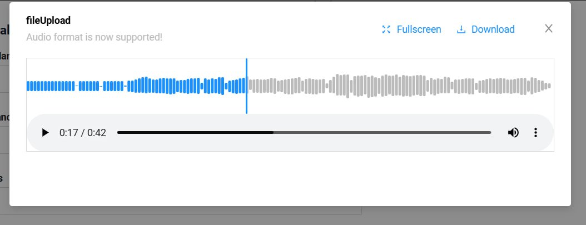

<!-- #### Добавлено: компактные настройки виджета (иконка шестерёнки)
Улучшено отображение иконки шестерёнки для более компактной компоновки виджета. Иконка перенесена из области над таблицей в заголовок таблицы.
=== "После"
=== "До"

Также в меню шестерёнки перенесены несколько параметров — включая переключение между табличным режимом и режимом диаграммы, а также элементы Collapse columns, Expand columns (НОВОЕ) и Default (НОВОЕ) для виджета GroupingHierarchy, — чтобы всё было в одном месте.
=== "После"
=== "До"
--> 

#### Добавлено: postAction showMessage — поддержка таймаута { #added-showmessage-postaction-timeout-support }
<!-- CXBOX-786 -->  
Добавлена возможность задать таймаут для postAction showMessage. По истечении таймаута сообщение автоматически исчезает. Если таймаут не задан, сообщение остаётся видимым, пока пользователь не закроет его вручную.
=== "После"
    
=== "До"
    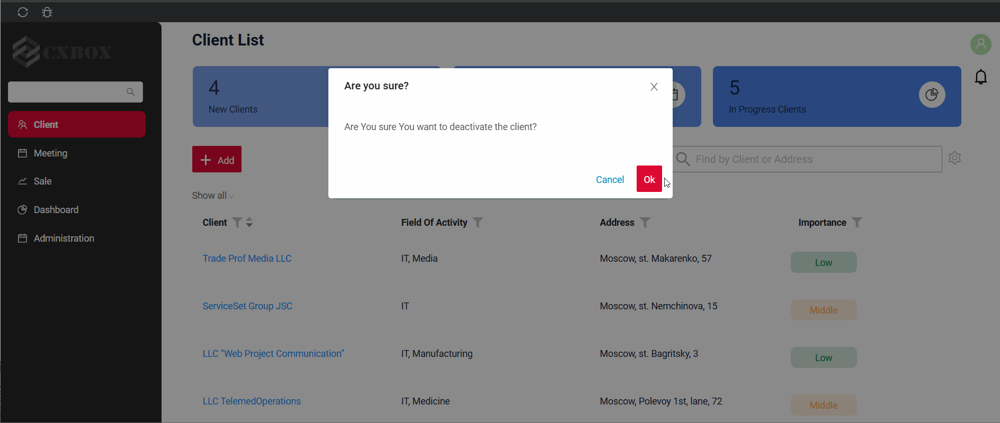

#### Добавлено: единое отображение полей (+отображение недоступного состояния) { #added-unified-field-display-disabled-state-display }
<!-- CXBOX-1086 -->
Унифицировано отображение всех типов полей: размер и цвет шрифта, отступы, отображение недоступного состояния и т. д. По умолчанию цвет шрифта недоступных полей теперь чёрный, но его можно изменить для всех полей, настроив константу прозрачности.

=== "После"
    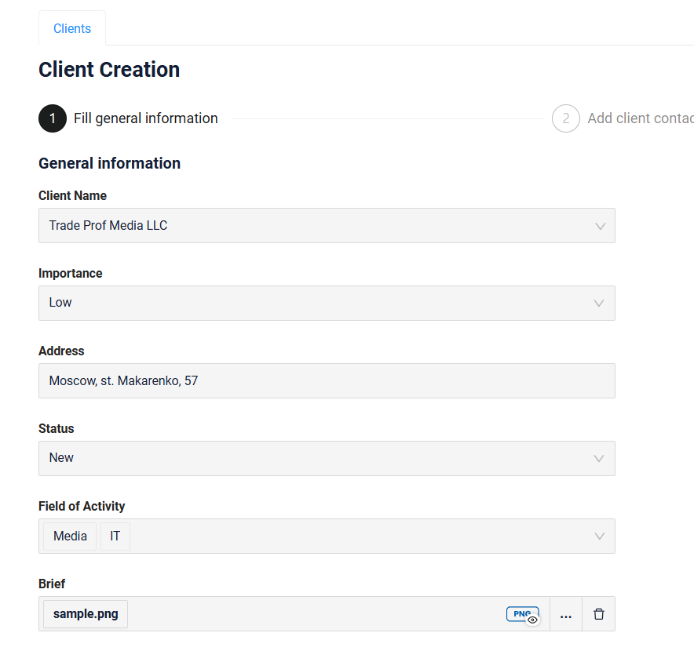
=== "До"
    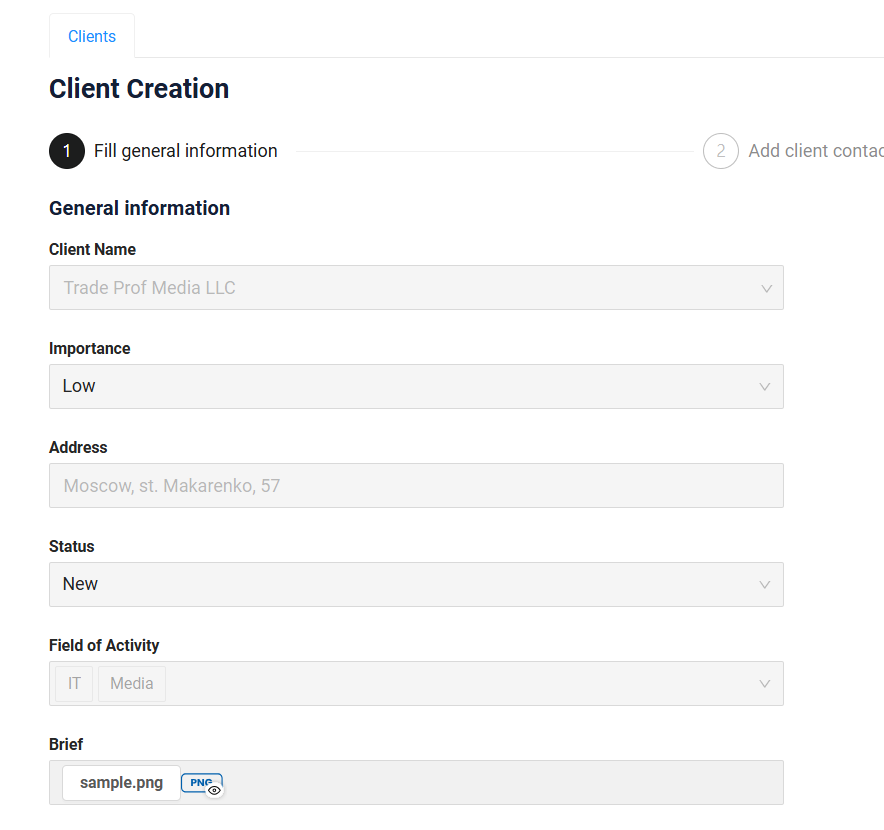

!!! info 
    Для проектов, обновляющихся до версии 2.0.16!
    Если хотите сохранить серый цвет текста для недоступных полей, задайте следующую константу фронтенда: WHEN_EDITABLE_FIELD_IS_DISABLED_THEN_FONT_OPACITY = 0.35.

#### Добавлено: числовые поля — выравнивание по правому краю и улучшенное расположение иконок { #added-numeric-fields-right-alignment-and-improved-icon-layout }
<!-- CXBOX-915 -->  
Обновлено выравнивание числовых типов полей ([money](https://doc.cxbox.org/ru/widget/fields/field/money/money/), [number](https://doc.cxbox.org/ru/widget/fields/field/number/number/), [percent](https://doc.cxbox.org/ru/widget/fields/field/percent/percent/)). Иконки фильтра и сортировки для числовых полей теперь отображаются слева от заголовка поля. Теперь заголовки и значения всех типов полей выровнены единообразно.

=== "После"
    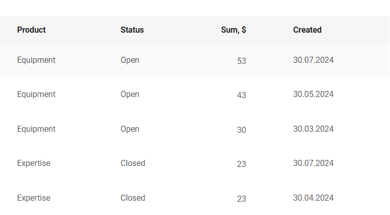
=== "До"
    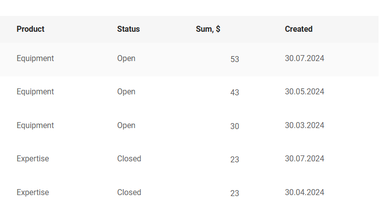

#### Добавлено: [виджет StatsBlock](https://doc.cxbox.org/ru/widget/type/statblocks/statblocks/) — выделение рамкой { #added-statsblock-widget-border-highlight }
<!-- CXBOX-1040 -->
Для единообразия с Pie1D в виджет StatsBlock добавлено выделение рамкой.
Рамка появляется при наведении и при выборе блока в связке родитель–потомок, что упрощает определение активного блока.

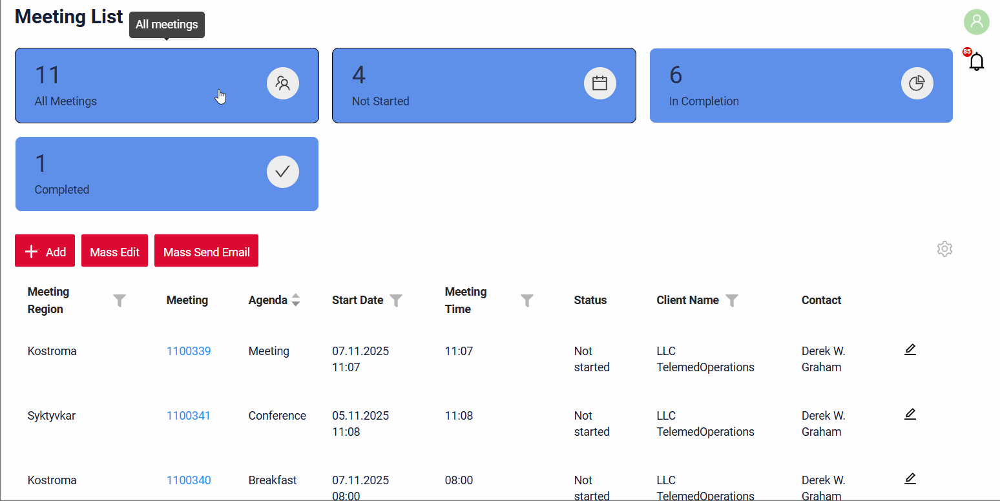  

#### Добавлено: улучшенная логика динамического скрытия полей setHidden { #added-improved-logic-for-dynamic-sethidden-field-visibility }
<!-- CXBOX-1043 -->
Уточнено, как работает параметр setHidden в зависимости от типа виджета.

Поведение по типам виджетов:

* Form и подобные виджеты (отображающие одну запись): setHidden применяется как ожидается, позволяя динамически скрывать поля.
* List и подобные виджеты (отображающие несколько записей): setHidden не применяется.

!!! info
    Динамический setHidden влияет только на текущую выбранную строку, поэтому поддерживается только в виджетах, отображающих одну запись (например, Form, Info и т. д.). Для многострочных виджетов (List, GroupingHierarchy и т. д.) setHidden не применяется, чтобы поля неожиданно не исчезали и не появлялись при переключении страниц или выборе других строк.

#### Добавлено: единое поведение сортировки { #added-unified-sorting-behavior }
<!-- CXBOX-1089 -->  
Поведение сортировки приведено в соответствие с поведением фильтрации. Теперь при переходах через drilldown или переключении между экранами применённая сортировка сохраняется. Сортировка сбрасывается только при обновлении страницы.

#### Исправлено: группа действий — сброс фокуса после действия { #fixed-action-group-focus-reset-after-action }
<!-- CXBOX-1047 -->  
Исправлена проблема, при которой действие внутри группы действий оставалось визуально в фокусе после выполнения. Теперь состояние фокуса корректно сбрасывается после завершения действия.
=== "После"
    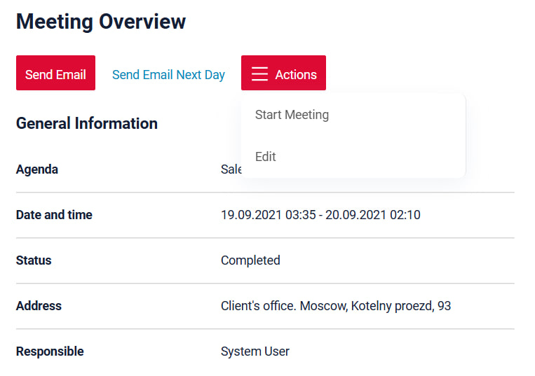
=== "До"
    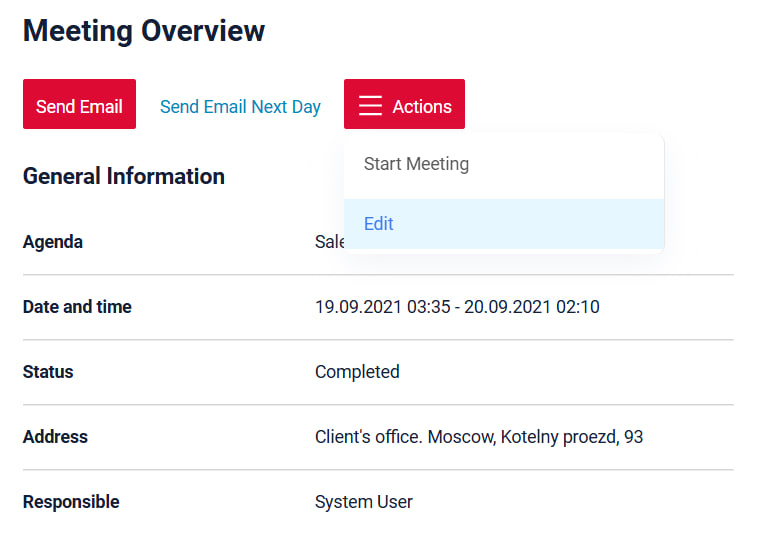

#### Добавлено: новая проверка виджета inline-редактирования { #added-new-inline-edit-widget-validation }
<!-- CXBOX-1069  -->
Добавлена проверка того, что виджет inline-редактирования относится к тому же бизнес-компоненту,
что и его родительский виджет PickList или Assoc. При нарушении этого правила в консоль браузера выводится сообщение об ошибке.

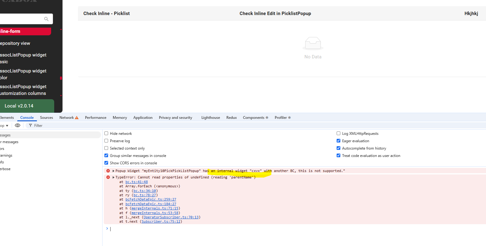  

#### Исправлено: поведение предпросмотра и удаления файлов { #fixed-file-preview-and-deletion-behavior }
<!-- CXBOX-608 -->  
Улучшена логика предпросмотра и удаления файлов для более последовательного пользовательского опыта. Теперь при переключении между файлами в режиме предпросмотра, если для строки нет файла, отображается понятное сообщение "There is no file in this row". Также уточнено поведение удаления: после удаления файл полностью убирается из интерфейса и больше не может быть скачан.

#### Прочие изменения { #other-changes }
см. [журнал изменений cxbox-demo](https://github.com/CX-Box/cxbox-demo/releases/tag/v.2.0.16)

### CXBOX ([Core Ui](https://github.com/CX-Box/cxbox-ui/releases/tag/2.7.1))  
Выпущена новая версия CORE UI 2.7.1.

#### Добавлено: более понятные сообщения валидации для скрытых или недоступных обязательных полей { #added-improved-clarity-of-validation-messages-for-hidden-or-disabled-required-fields }
<!-- CXBOX-1044 -->
В предыдущем релизе были добавлены сообщения валидации для случаев, когда обязательные поля пусты, потому что они скрыты или недоступны.
В этом обновлении сообщения стали ещё информативнее — теперь они также содержат ключи затронутых полей, что упрощает понимание того, каких обязательных значений не хватает.
=== "После"
    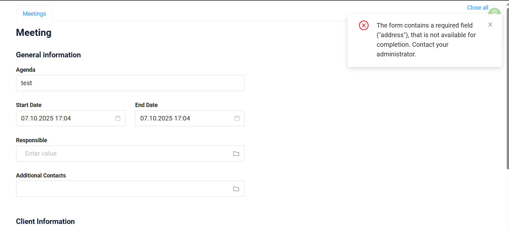
=== "До"
    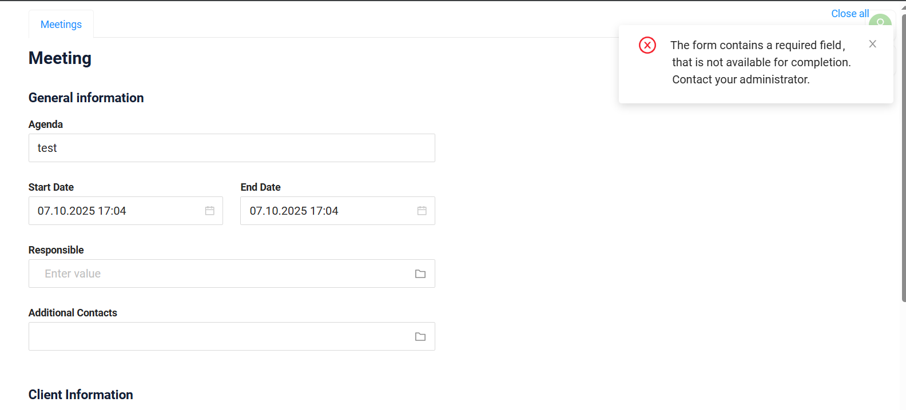  

#### Исправлено: ленивая загрузка для picklist { #fixed-lazy-loading-for-picklists }
<!-- CXBOX-1069  -->
Реализована ленивая загрузка для picklist.

Теперь данные запрашиваются только при:

* Открытии всплывающего окна
* Выполнении CRUD-операций с его содержимым

=== "После"
    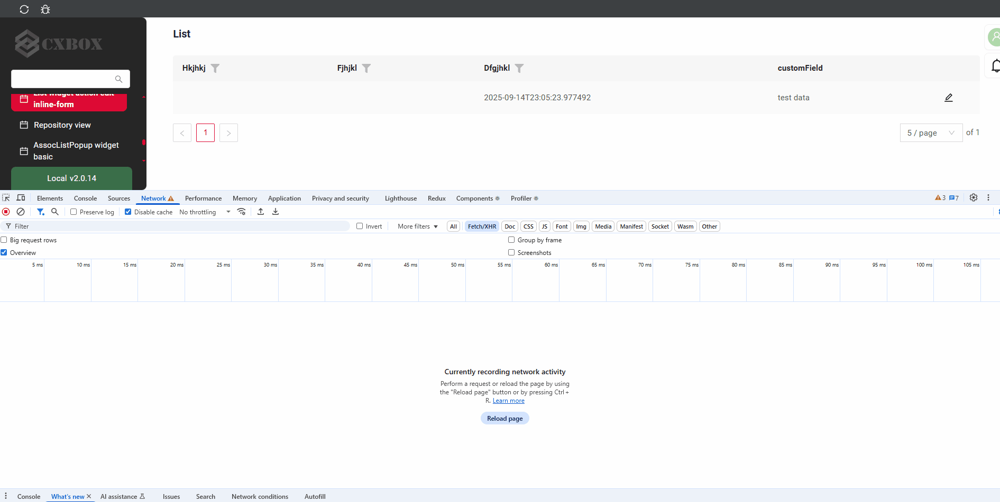
=== "До"
    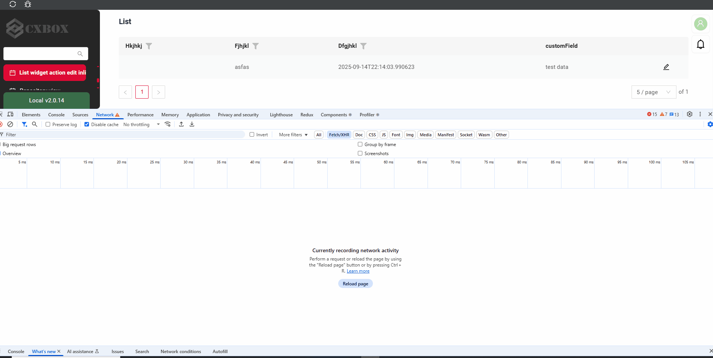

Функция count() больше не вызывается при открытии inline picklist.

=== "После"
    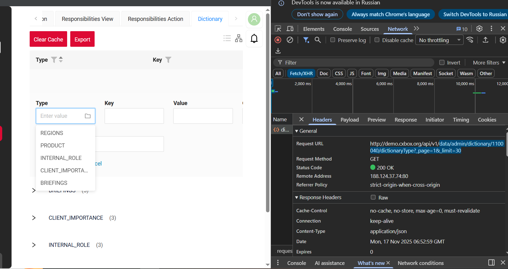
=== "До"
    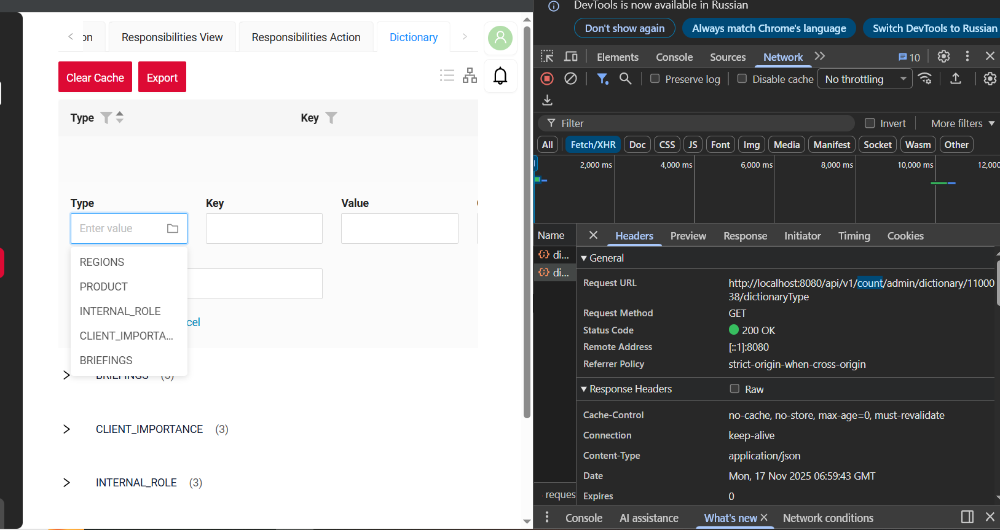

#### Прочие изменения { #other-changes_1 }
См. [журнал изменений cxbox-ui 2.7.1](https://github.com/CX-Box/cxbox-ui/releases/tag/2.7.1).


### CXBOX 4.0.0-M20 ([Core](https://github.com/CX-Box/cxbox/tree/cxbox-4.0.0-M20))

Выпущена новая версия CORE 4.0.0-M20.
<!-- CXBOX-1070 -->
#### Исправлено: обновлена версия зависимостей spring-boot { #fixed-update-dependencies-version-spring-boot }

spring-boot.version : 3.3.11 -> 3.3.13

<!-- CXBOX-1058 -->
#### Исправлено: обновлён механизм логирования бизнес-ошибок { #fixed-the-mechanism-for-logging-business-errors-has-been-updated }

Добавлена константа для управления уровнем логирования бизнес-ошибок.


1) Если константа задана:

* Используется уровень логирования, указанный в константе.
* Если уровень вывода логов ниже уровня из константы, ошибка не логируется.
* Если уровень вывода логов выше или равен, ошибка логируется с уровнем, заданным в константе.

2) Если константа не задана:

* Используется уровень логирования по умолчанию для всего проекта.

```yaml
logging:
    global-handler:
        business-exception:
            log-level: debug
```


#### Прочие изменения { #other-changes_2 }
См. [журнал изменений cxbox 4.0.0-M20](https://github.com/CX-Box/cxbox/releases/tag/cxbox-4.0.0-M20).

### CXBOX [документация](https://doc.cxbox.org/ru/) { #cxbox-documentation }

#### Добавлено: поддержка сокращения длинных значений { #added-support-for-truncating-long-values }
<!-- CXBOX-1094  -->
Добавлено описание [поддержки сокращения длинных значений](https://doc.cxbox.org/ru/widget/fields/field/text/text/#support-for-truncating-long-values).

#### Добавлено: выделение текущего элемента (плитки) { #added-highlighting-functionality-for-the-current-item-tile }
<!-- CXBOX-1078  -->
Добавлено описание [функции выделения текущего элемента (плитки)](https://doc.cxbox.org/ru/widget/type/statblocks/statblocks/#highlighting-functionality).

#### Добавлено: описание Widget Header { #added-description-widget-header }
<!-- CXBOX-1061  -->
Добавлено описание [Widget Header](https://doc.cxbox.org/ru/widget/type/headerwidget/headerwidget/).


#### Добавлено: описание взаимодействия фронтенда и бэкенда { #added-description-frontend-backend-interaction }

[Взаимодействие фронтенда и бэкенда](https://doc.cxbox.org/ru/basic/frontbackinteraction/)

CXBox предоставляет стандартизированный и унифицированный механизм API для взаимодействия фронтенда и бэкенда.
В этой статье мы рассмотрим, как устроен этот механизм, и изучим основные методы API, на которых он основан.

На этой странице описано соответствие между элементами интерфейса и REST-вызовами.