# 2.0.17

* [cxbox/demo 2.0.17 git](https://github.com/CX-Box/cxbox-demo/tree/v.2.0.17), [примечания к релизу](https://github.com/CX-Box/cxbox-demo/releases/tag/v.2.0.17)

* [cxbox/core 4.0.0-M22 git](https://github.com/CX-Box/cxbox/tree/cxbox-4.0.0-M22), [примечания к релизу](https://github.com/CX-Box/cxbox/releases/tag/cxbox-4.0.0-M22), [maven](https://central.sonatype.com/artifact/org.cxbox/cxbox-starter-parent/4.0.0-M22)

* [cxbox-ui/core 2.8.0 git](https://github.com/CX-Box/cxbox-ui/tree/2.8.0), [примечания к релизу](https://github.com/CX-Box/cxbox-ui/releases/tag/2.8.0), [npm](https://www.npmjs.com/package/@cxbox-ui/core/v/2.8.0)

* [cxbox/code-samples 2.0.17 git](https://github.com/CX-Box/cxbox-code-samples/tree/v.2.0.17), [примечания к релизу](https://github.com/CX-Box/cxbox-code-samples/releases/tag/v.2.0.17)  

## **Ключевые обновления января, февраля 2026** { #key-updates-january-february-2026 }

### CXBOX ([Демо](https://demo.cxbox.org)) { #cxbox-demo }

#### Добавлено: новогодняя атмосфера в приложении { #added-new-year-atmosphere-in-the-application }
<!-- CXBOX-1212 -->  
Мы добавили возможность создать в приложении праздничную новогоднюю атмосферу. В меню приложения можно включить эффект падающего снега.

Эффект управляется конфигурационным параметром.
Подробнее см. [Новогодняя атмосфера](/ru/features/happynewyear/happynewyear/)

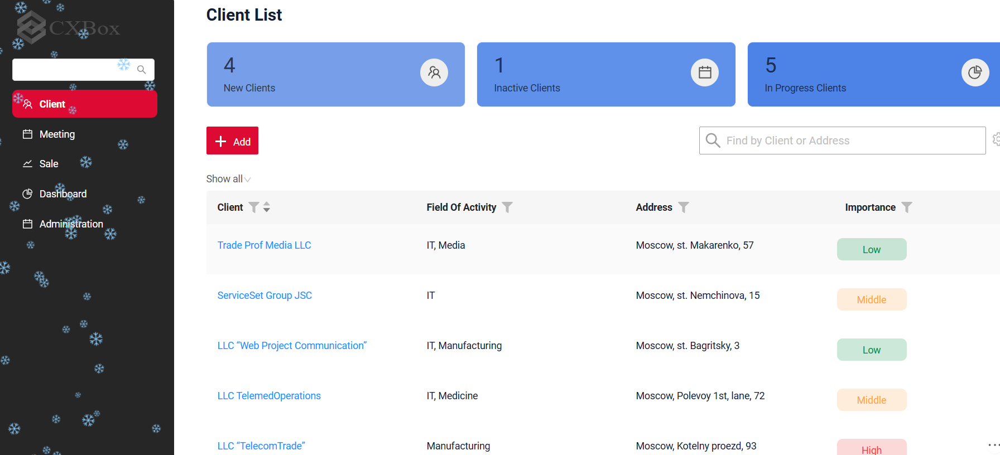

#### Добавлено: RelationGraph — НОВЫЙ тип виджета! { #added-relationgraph-new-widget-type }
<!-- CXBOX-1157 -->  
Добавлен виджет RelationGraph для визуализации связей между узлами в виде структурированного графа.

Основная функциональность:

* Переключение между графом и таблицей
* Поддержка родитель–потомок
* Поддержка DrillDown
* Настройка цветов узлов и рёбер
* Настраиваемое направление графа (сверху вниз, слева направо и т. д.)
* Настраиваемые тексты узлов, подписи и стили рёбер

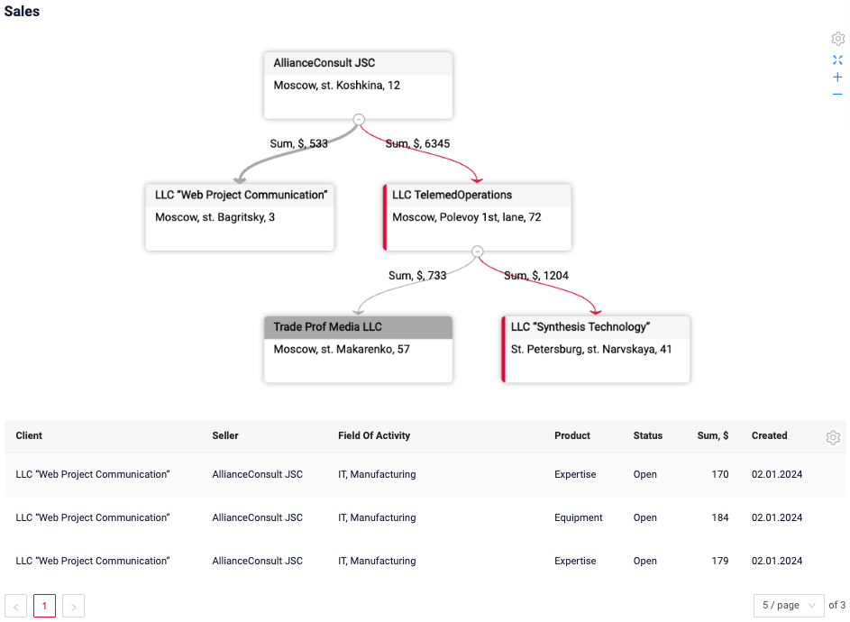

!!! warning "Внимание"
    1. Если к одному узлу ведут несколько связей и некоторые из них пропускают промежуточные узлы, граф может отображаться не так, как ожидается. Поэтому по возможности не рекомендуем использовать такие структуры данных.
    2. Виджет автоматически переключается в табличный режим, если в данных обнаружены циклические связи или дублирующиеся соединения.

!!! info  
    Подробная статья о RelationGraph скоро появится в официальной документации — следите за новостями!
 
#### Добавлено: CardList — НОВЫЙ тип виджета! { #added-cardlist-new-widget-type }
<!-- CXBOX-901 -->
Добавлен новый виджет CardList для удобного предпросмотра файлов и управления ими.
Все загруженные файлы отображаются в виде карточек предпросмотра, что позволяет легко просматривать, редактировать, добавлять или удалять элементы прямо в виджете.

Основная функциональность:

* Предпросмотр файлов в виде карточек
* Поддержка действий
* Поддержка DrillDown
* Настраиваемый размер карточек
* 
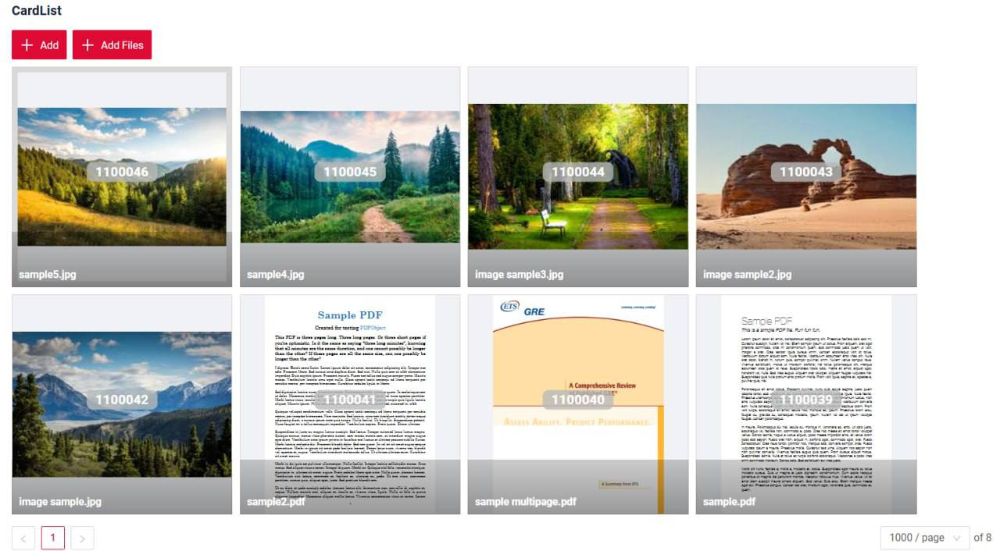

!!! info  
    Подробная статья о CardList скоро появится в официальной документации — следите за новостями!

#### Добавлено: CardCarouselList — НОВЫЙ тип виджета! { #added-cardcarousellist-new-widget-type }
<!-- CXBOX-901 -->
Добавлен новый виджет CardCarouselList с функциональностью, похожей на CardList, но в виде карусели.
Карточки расположены в горизонтальной прокручиваемой ленте, а выбранный элемент крупно отображается сверху для удобного просмотра.

Основная функциональность:

* Навигация по карусели (прокрутка вперёд/назад)
* Поддержка действий
* Поддержка DrillDown
* Настраиваемый размер карточек

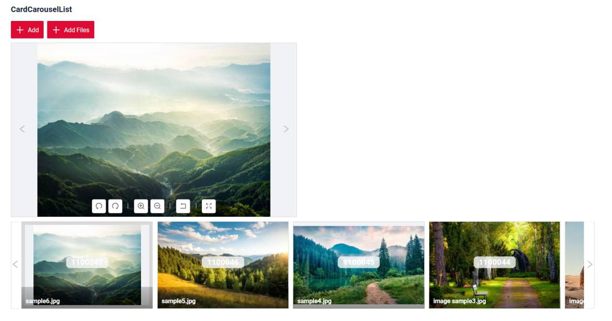

!!! info 
    Подробная статья о CardCarouselList скоро появится в официальной документации — следите за новостями!

#### Добавлено: экспорт в Excel в виде обычной кнопки { #added-export-to-excel-as-a-regular-button }
<!-- CXBOX-816 --> 
Добавлена возможность отображать экспорт в Excel в виде обычной кнопки. Для этого достаточно указать новый `PostAction.exportToExcel` для кнопки BC.
??? Example "Пример"
    ```java
       .action(act -> act						
            .scope(ActionScope.BC)
            .withPreAction(PreAction.confirm(cf -> cf.text("Export to Excel?" )))
            .action("customExportToExcel", "Custom export to excel" )
            .invoker((bc, data) -> new ActionResultDTO<MyExampleDTO>()
            .setAction(PostAction.exportToExcel()))
    ```
=== "Экспорт в кнопке"
    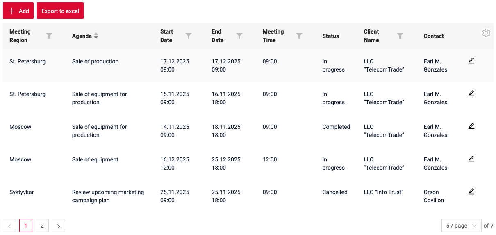
=== "Экспорт в options"
    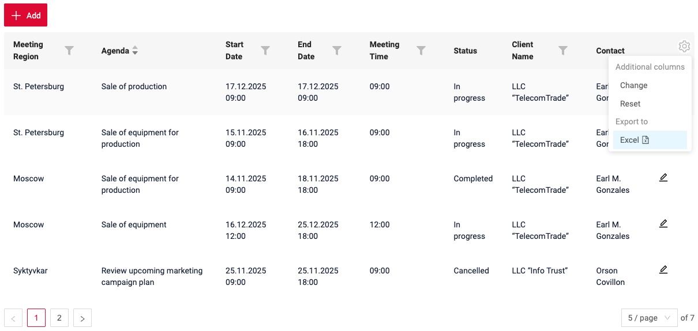

#### Добавлено: виджеты AssocListPopup и PickListPopup — поддержка `gridWidth` { #added-assoclistpopup-and-picklistpopup-widget-gridwidth-support }
<!-- CXBOX-715 -->
Добавлена поддержка `gridWidth` для AssocListPopup и PickListPopup, как это было сделано для FormPopup в [v2.0.9](https://doc.cxbox.org/ru/new/version209/?h=grid#added-formpopup-widget-gridwidth-support). Теперь шириной можно управлять через `view.json -> widgets -> gridWidth`, чтобы содержимое во всплывающем окне отображалось адекватно.

=== "После"
    Теперь размером можно управлять с помощью `gridWidth`, чтобы содержимое полностью отображалось во всплывающем окне.
    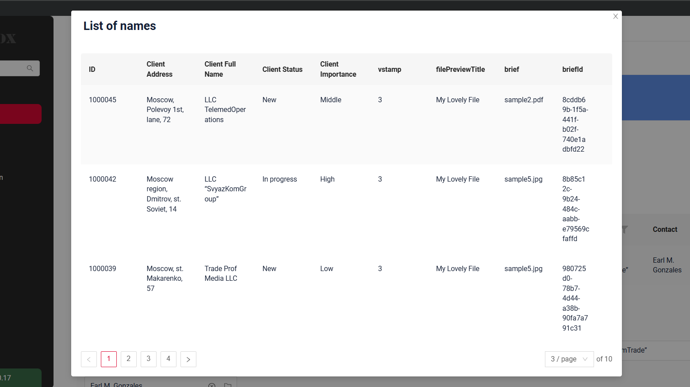
=== "До"
    Размер всплывающего окна AssocListPopup и PickListPopup был постоянным, значение `gridWidth` игнорировалось.
    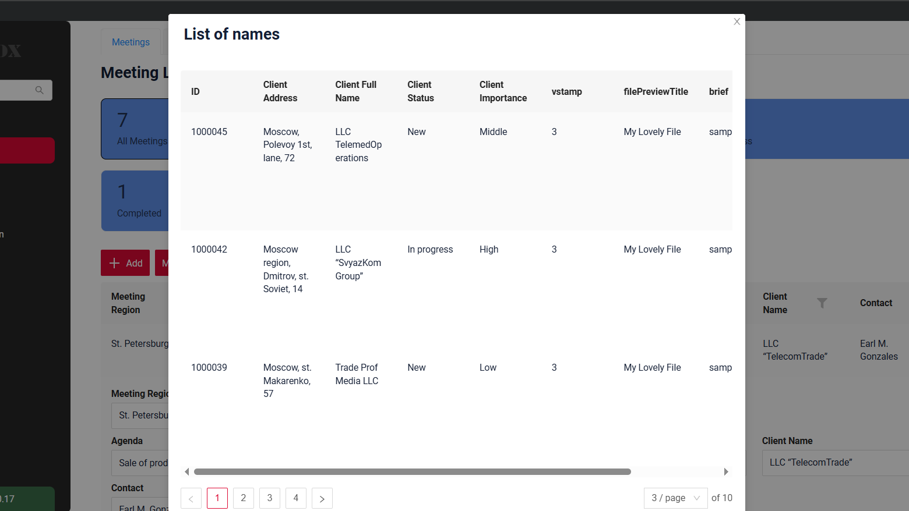

**Внимание!** До этого релиза значение gridWidth игнорировалось, то есть размер всплывающего виджета был постоянным. Чтобы сохранить прежние размеры окон, задайте `gridWidth = 16`.

#### Добавлено: поддержка альтернативной пагинации { #added-alternative-pagination-support }
<!-- CXBOX-1118 -->  
Добавлена возможность получать общее количество строк по запросу через новый параметр `alternativeType`. Нажав кнопку, пользователь может запросить общее количество строк. После активации количество остаётся доступным при фильтрации и переходе по страницам и сбрасывается только после обновления страницы.
??? Example "Пример"
    ```java
       "options": {
        "pagination": {
          "alternativeType": "nextAndPreviousWithCount" 
          "type": "nextAndPreviousSmart"  
        }
      }
    ```
=== "После"
    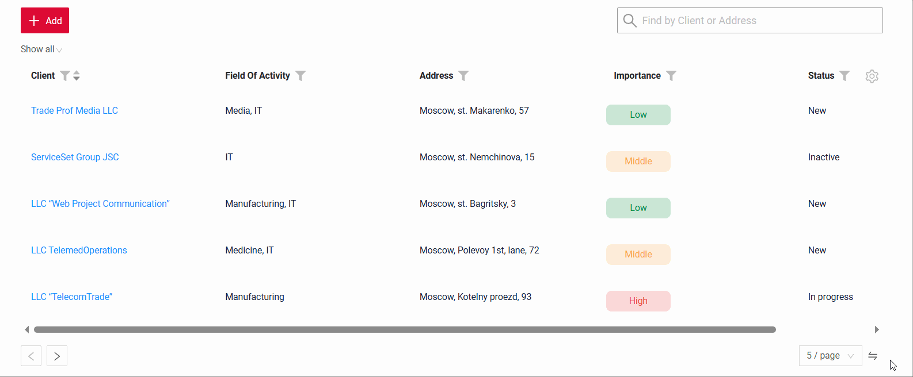  
    По умолчанию можно оставить производительный режим пагинации ([nextAndPreviousWithHasNext](https://doc.cxbox.org/ru/widget/type/property/pagination/pagination/?h=next#nextandpreviouswithhasnext)/ [nextAndPreviousSmart](https://doc.cxbox.org/ru/widget/type/property/pagination/pagination/?h=next#nextandprevioussmart)) и переключаться на [nextAndPreviousWithCount](https://doc.cxbox.org/ru/widget/type/property/pagination/pagination/?h=next#default-nextandpreviouswithcount) только когда нужен подсчёт записей.
=== "До"
    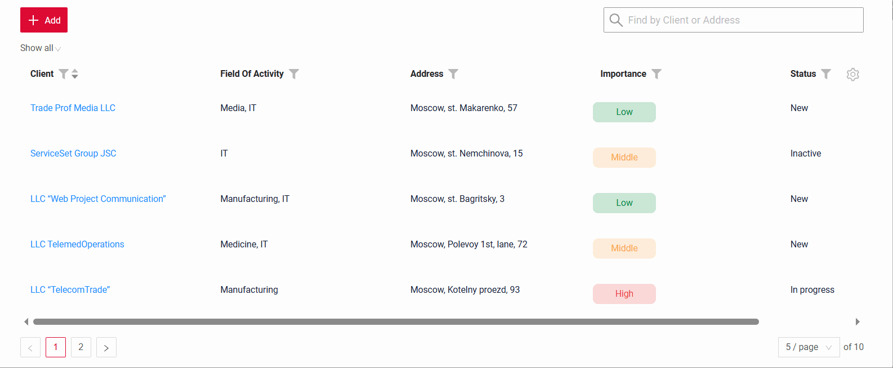  
    Чтобы отображать общее количество строк, можно только указать тип пагинации [nextAndPreviousWithCount](https://doc.cxbox.org/ru/widget/type/property/pagination/pagination/?h=next#default-nextandpreviouswithcount), который отправляет запрос /count и может влиять на производительность.

#### Добавлено: поддержка .ogg, .aac и .flac { #added-support-for-ogg-aac-and-flac }
<!-- CXBOX-1234 --> 
Добавлена поддержка форматов .ogg, .aac и .flac.

=== ".ogg"
    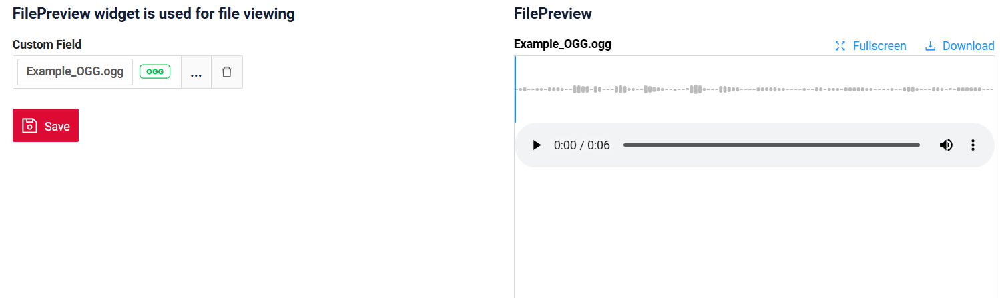
=== ".aac"
    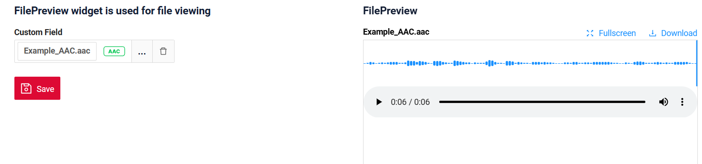
=== ".flac"
    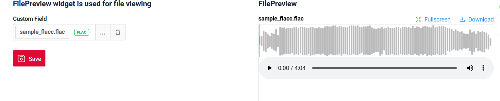

#### Добавлено: экспорт в Excel поддерживает все типы полей { #added-export-to-excel-support-all-types-fields }

Также добавлена поддержка экспорта в Excel для следующих типов полей:

* [multivalue](https://doc.cxbox.org/widget/fields/field/multivalue/multivalue/)
* [multivalueHover](https://doc.cxbox.org/widget/fields/field/multivalueHover/multivalueHover/)
* [multipleSelect](https://doc.cxbox.org/widget/fields/field/multipleSelect/multipleSelect/)
* [fileUpload](https://doc.cxbox.org/widget/fields/field/fileUpload/fileUpload/)
* [money с валютой](https://doc.cxbox.org/ru/widget/fields/field/money/money/#currency)
* [suggestionPickList](https://doc.cxbox.org/widget/fields/field/suggestionpicklist/suggestionPickList/)

#### Исправлено: в CalendarYearList кнопки отображаются корректно в зависимости от типа { #fixed-calendaryearlist-the-buttons-are-displayed-correctly-depending-on-the-type }
<!-- CXBOX-1149 --> 

Для типа *CalendarYearList* кнопки отображаются корректно в зависимости от типа — *record* или *BC*

=== "После"
    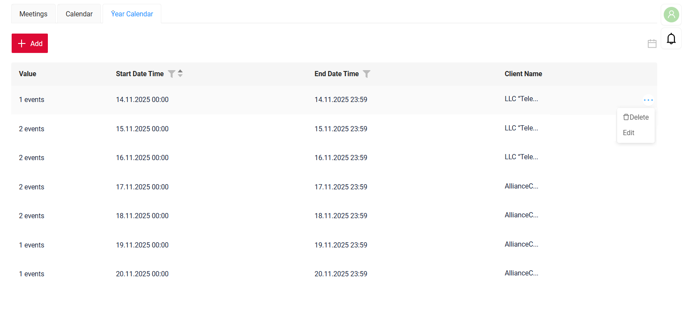
=== "До"
    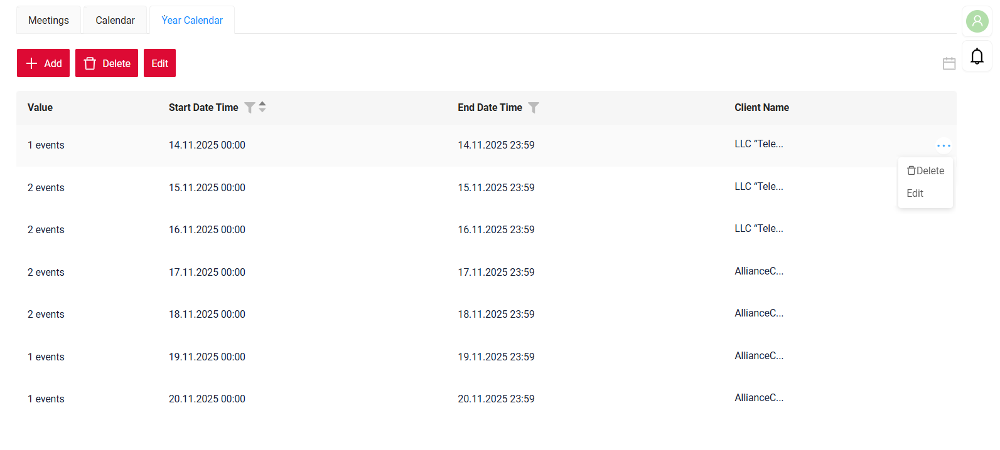

#### Исправлено: обновление меню настроек { #fixed-settings-menu-update }
<!-- CXBOX-985 -->  
Иконка настроек (шестерёнка) перенесена в заголовок таблицы и размещена справа, над меню с тремя точками. Это экономит место, когда у таблицы нет действий, PDQ или полнотекстового поиска.

=== "После"
    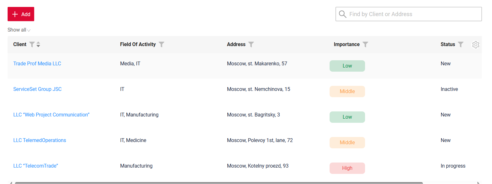
=== "До"
    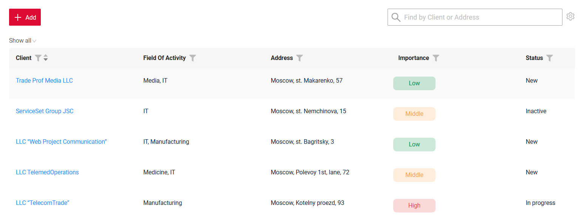

Иконка переключения режима просмотра (диаграмма / таблица) перенесена в меню настроек.
=== "После"
    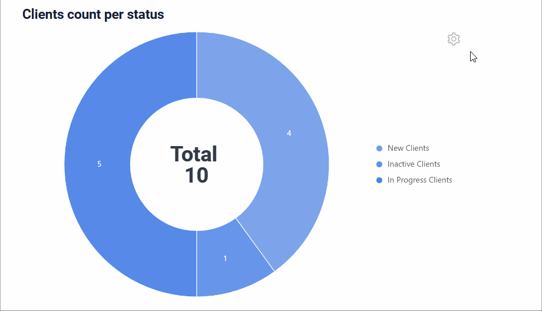
=== "До"
    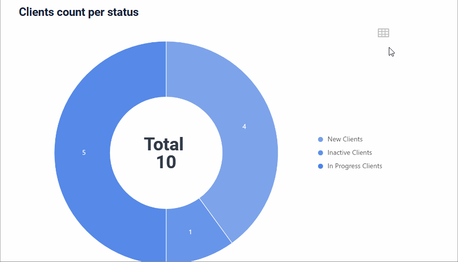

Функция **Collapse columns** перенесена в меню настроек.
=== "После"
    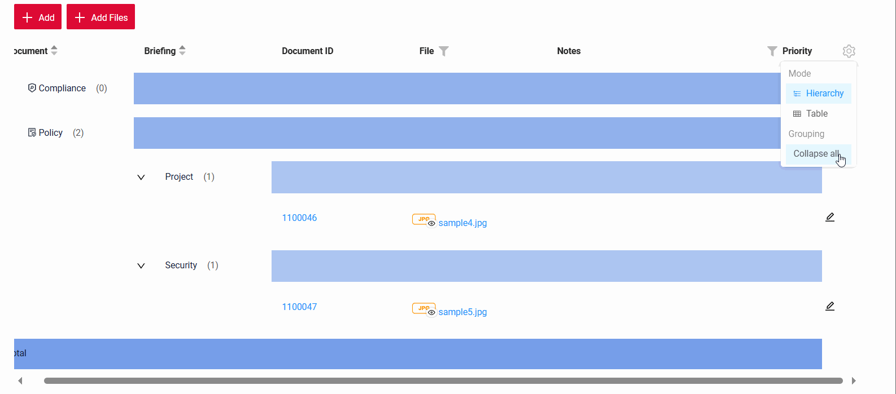 
=== "До"
    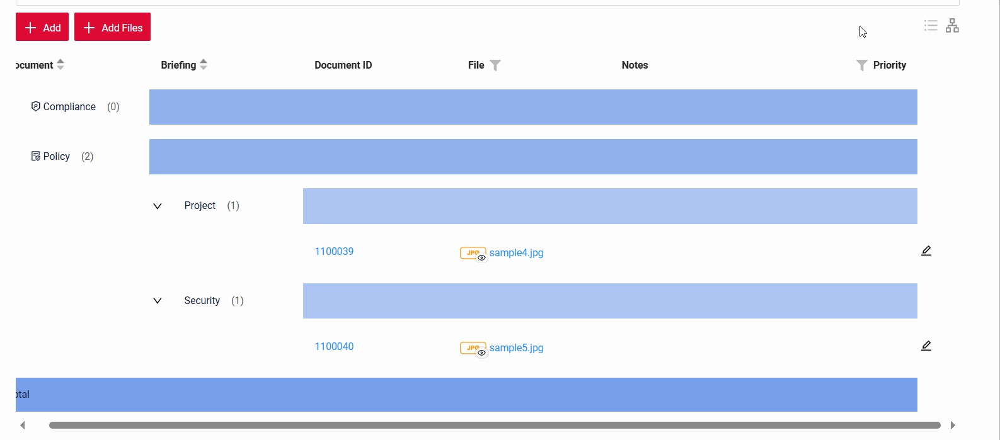 


#### Исправлено: числовые поля на всю ширину { #fixed-full-width-numeric-fields }
<!-- CXBOX-1203 -->  
Улучшено отображение полей следующих типов:

* [number](https://doc.cxbox.org/widget/fields/field/number/number/)
* [percent](https://doc.cxbox.org/widget/fields/field/percent/percent/)
* [money](https://doc.cxbox.org/widget/fields/field/money/money/)

Поле ввода теперь занимает всю ширину колонки таблицы.

=== "После"
    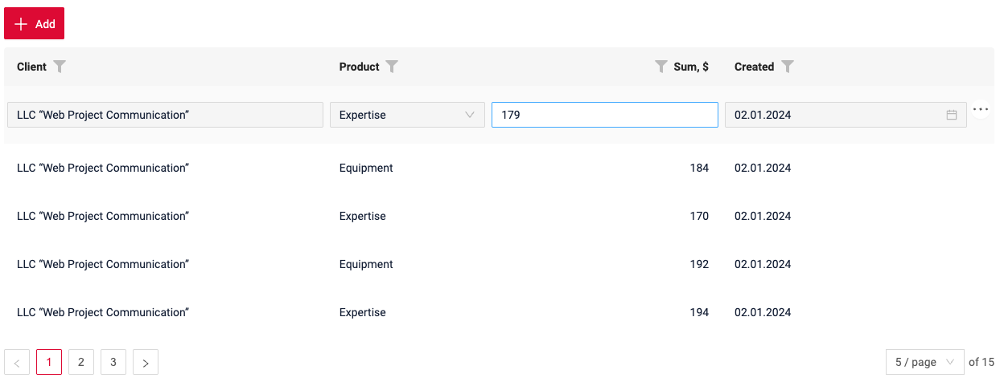
=== "До"
    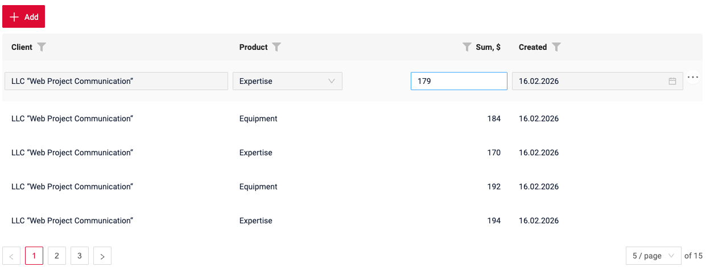

#### Исправлено: улучшено пустое состояние GroupingHierarchy { #fixed-groupinghierarchy-empty-state-improvement }
<!-- CXBOX-1146 -->  
Для виджета GroupingHierarchy добавлено отображение прокрутки для случаев, когда данных нет и иерархия по умолчанию не задана.

=== "После"
    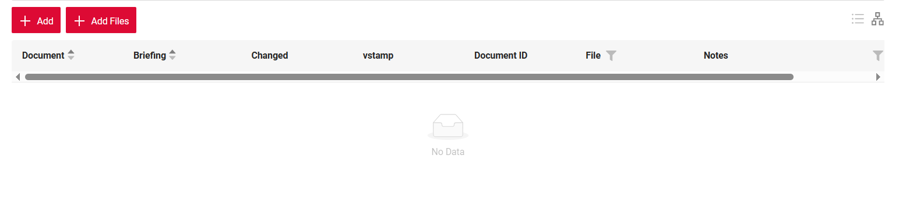
=== "До"
    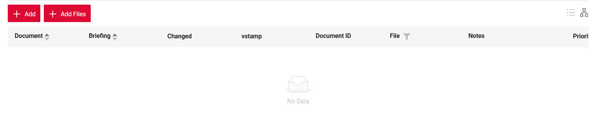

#### Исправлено: адаптивная ширина группы действий { #fixed-adaptive-action-group-width }
<!-- CXBOX-1179 -->  
Улучшено отображение группы действий: ширина окна с подписями кнопок теперь автоматически подстраивается под содержимое.

=== "После"
    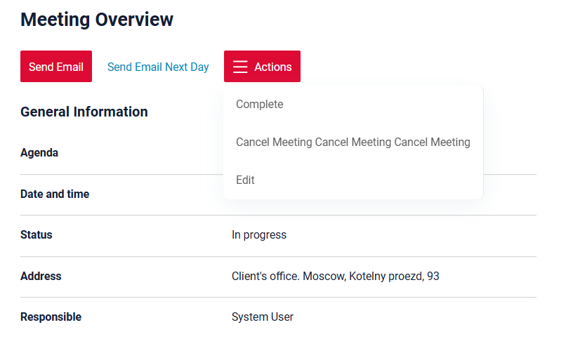
=== "До"
    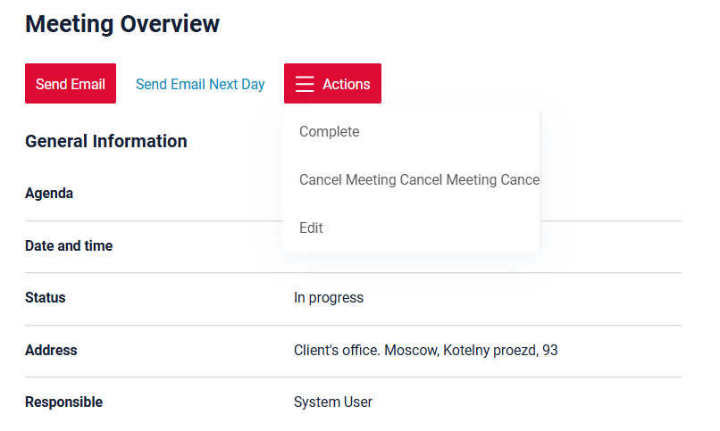

#### Исправлено: улучшенная прокрутка больших списков { #fixed-improved-scrolling-for-large-lists }
<!-- CXBOX-1188 --> 
Улучшено поведение прокрутки и стрелок при большом количестве значений в dictionary.

=== "После"
    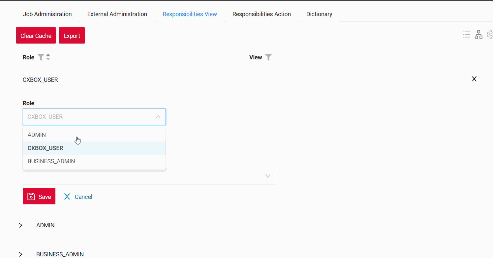
=== "До"
    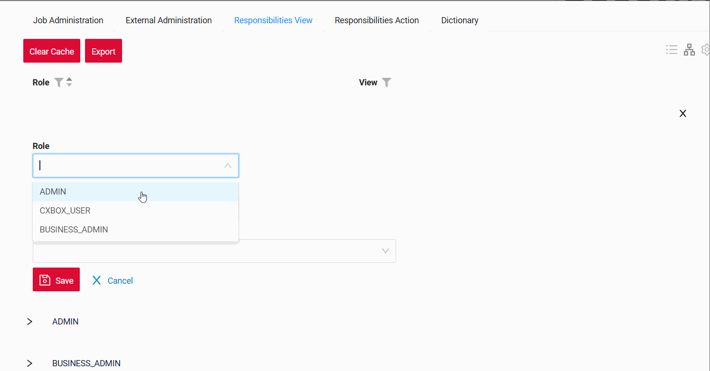
    
#### Исправлено: отображение иконки шестерёнки { #fixed-gear-icon-display-fix }
<!-- CXBOX-1192 --> 
Исправлено поведение иконки шестерёнки, когда на виджете нет кнопок, — теперь иконка отображается.

=== "После"
    
=== "До"
    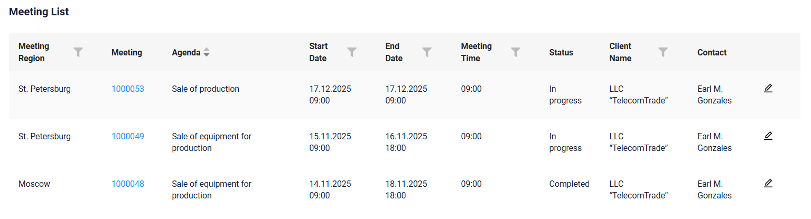

#### Исправлено: выделение обязательного поля multivalue { #fixed-fixed-the-highlighting-of-required-multivalue-field }
<!-- CXBOX-1138 --> 
Исправлено выделение обязательного поля [multivalue](https://doc.cxbox.org/ru/widget/fields/field/multivalue/multivalue/) в виджете List при inlineForm-редактировании. Это обеспечивает визуальное единообразие с другими типами полей, которые также выделяются в виджете List над формой редактирования.

=== "После"
    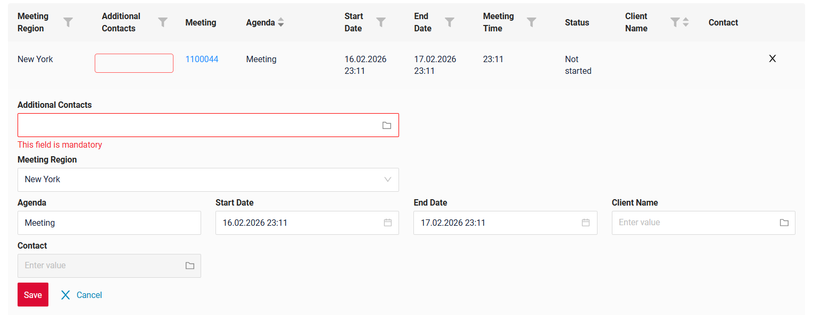
=== "До"
    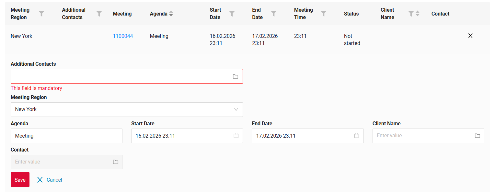  

#### Исправлено: отображение фильтров Multivalue, multivalueHover и pickList { #fixed-multivaluemultivaluehover-picklist-filter-display-fix }
<!-- CXBOX-1145 --> 
Исправлено отображение фильтров для полей [multivalue](https://doc.cxbox.org/ru/widget/fields/field/multivalue/multivalue/), [multivalueHover](https://doc.cxbox.org/ru/widget/fields/field/multivalueHover/multivalueHover/) и [pickList](https://doc.cxbox.org/ru/widget/fields/field/pickList/pickList/): выбранные значения теперь отображаются корректно независимо от того, присутствуют ли они на выбранной странице.

=== "После"
    === "первая страница"
        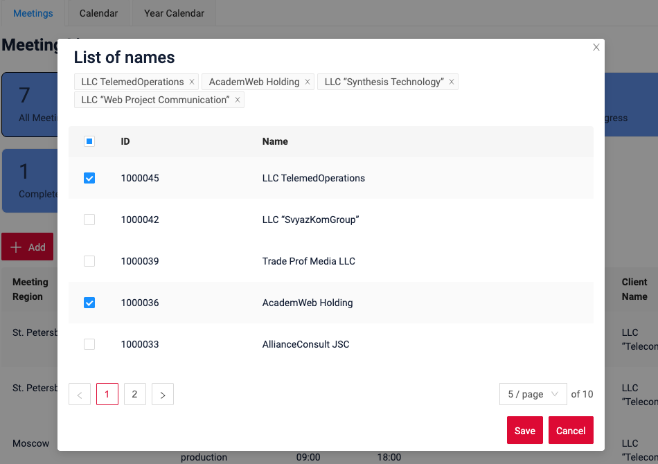  
    === "вторая страница"
        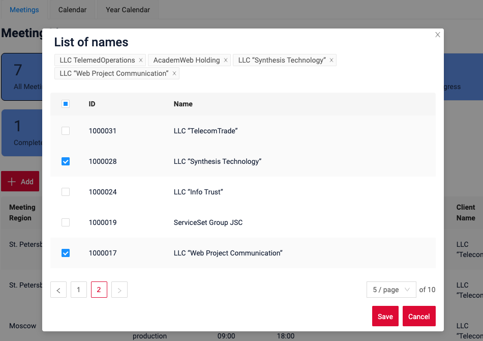
=== "До"
    === "первая страница"
        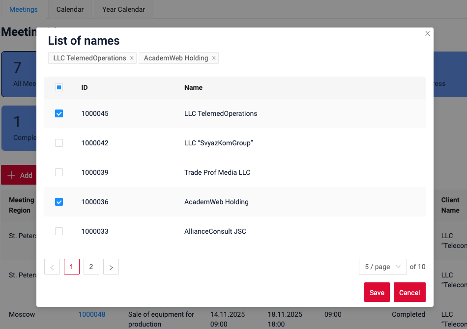  
    === "вторая страница"
        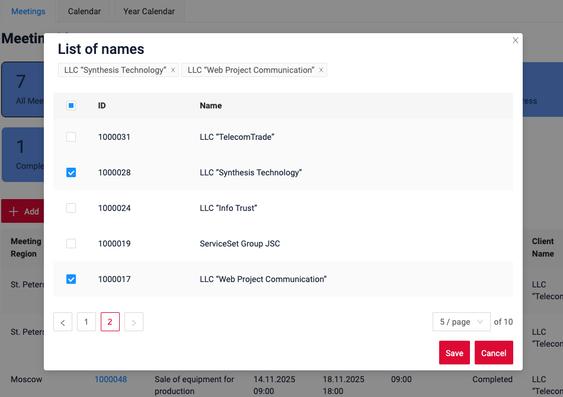  

!!! info  
    Есть ограничение при использовании предопределённых фильтров следующих типов: multivalue, pickList и multivalueHover. Когда такие фильтры предопределены, в тегах фильтра отображаются значения id. Когда фильтр редактируется вручную (например, при добавлении значений через picklist), теги отображаются по стандартным правилам. Это поведение вызвано ограничением фронтенда: фронтенд не может получить отображаемые имена для тегов фильтра, если записи, указанные в предопределённом фильтре, находятся на разных страницах всплывающего окна picklist и не загружены в текущем контексте UI.
    

#### Прочие изменения { #other-changes }
см. [журнал изменений cxbox-demo](https://github.com/CX-Box/cxbox-demo/releases/tag/v.2.0.17)

### CXBOX ([Core Ui](https://github.com/CX-Box/cxbox-ui/releases/tag/2.8.0))  
Выпущена новая версия CORE UI 2.8.0.

#### Добавлено: необязательные обновления через WebSocket { #added-optional-websocket-updates }
<!-- CXBOX-1060 --> 

Добавлена возможность отключить вызовы WebSocket с фронтенда. Счётчик колокольчика уведомлений по-прежнему отображается, но обновляется только при перезагрузке страницы.

Поведение запросов WebSocket в зависимости от featureSettings

* webSocketNotificationEnabled: false → запросы WebSocket отключены
* webSocketNotificationEnabled: true → запросы WebSocket включены
* Если параметр не задан → запросы WebSocket включены по умолчанию

#### Исправлено: оптимизирована работа ... { #fixed-optimized-functionality-for }
 <!-- CXBOX-1111 --> 
Удалён запрос, выполнявшийся при нажатии на ... — запрос GET /api/v1/row-meta/id больше не отправляется.
 
=== "После"
    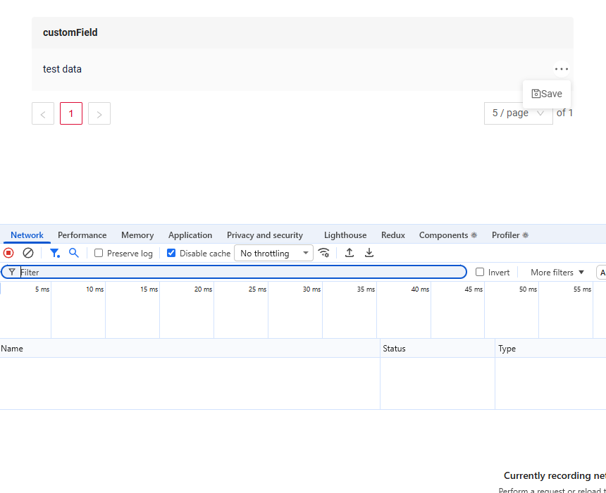
=== "До"
    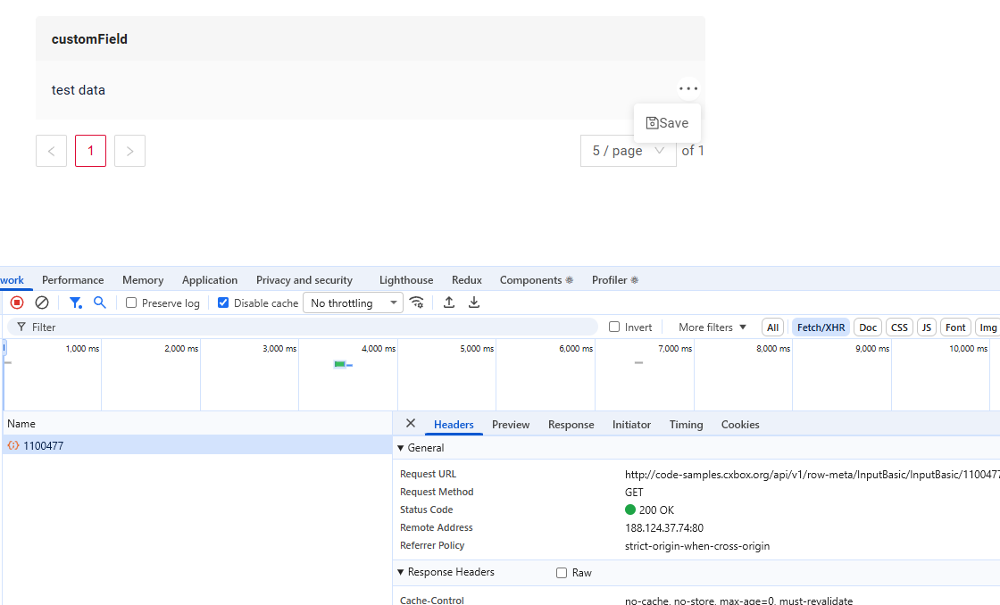

#### Прочие изменения { #other-changes_1 }
См. [журнал изменений cxbox-ui 2.8.0](https://github.com/CX-Box/cxbox-ui/releases/tag/2.8.0).


### CXBOX 4.0.0-M22 ([Core](https://github.com/CX-Box/cxbox/tree/cxbox-4.0.0-M22))

Выпущена новая версия CORE 4.0.0-M22.
#### Добавлено: параметр новогодней атмосферы { #added-parameter-new-year-atmosphere }
<!-- CXBOX-1212 -->  
Добавлен новый параметр `UiProperties`: `seasonalEffectsEnabled`.

При значении `true` в области меню включается эффект снегопада.

#### Добавлено: параметр WebSocket { #added-parameter-websocket }
<!-- CXBOX-1060 --> 
Добавлен новый параметр `UiProperties`: `webSocketNotificationEnabled`.

При значении `false` фронтенд гарантированно не взаимодействует через WebSocket, поэтому функциональность WebSocket на бэкенде можно безопасно удалить.

#### Добавлено: новый PostAction exportToExcel { #added-new-postaction-exporttoexcel }
<!-- CXBOX-1060 --> 
Добавлена возможность добавить кнопку Export to Excel как обычную кнопку.
 
#### Прочие изменения { #other-changes_2 }
См. [журнал изменений cxbox 4.0.0-M22](https://github.com/CX-Box/cxbox/releases/tag/cxbox-4.0.0-M22).

### CXBOX [документация](https://doc.cxbox.org/ru/) { #cxbox-documentation }
#### Добавлено: описание новогодней атмосферы в приложении { #added-description-new-year-atmosphere-in-the-application }
<!-- CXBOX-1212 -->   
Добавлено описание того, как создать праздничную [новогоднюю атмосферу](/ru/features/happynewyear/happynewyear/) в приложении.

#### Добавлено: описание массовых операций (Bulk operations) { #added-description-bulk-operations-mass-operations }
<!-- CXBOX-1079  -->
Добавлено описание [массовых операций](https://doc.cxbox.org/ru/widget/type/property/massoperations/massoperations)

`Bulk operations` (массовые операции) — механизм, позволяющий пользователю выполнить одно действие сразу над большим количеством строк таблицы. Вместо обработки каждой строки по отдельности пользователь выбирает набор данных и применяет к нему общую операцию — обновление, удаление, смену статусов, пересчёт значений и другие типовые сценарии.

#### Добавлено: описание кнопок вперёд/назад/обновить { #added-description-forwardbackrefresh-buttons }
<!-- CXBOX-1163 -->   
Описано поведение [кнопок браузера вперёд/назад/обновить](https://doc.cxbox.org/ru/navigation/browsernavigationbuttons/browsernavigationbuttons/).

#### Добавлено: описание виджета Steps { #added-description-widget-steps }
<!-- CXBOX-562 CXBOX-1065 -->  
Добавлено описание [виджета Steps](https://doc.cxbox.org/ru/widget/type/steps/steps/)

#### Добавлено: описание поиска экранов в левом меню { #added-description-screen-search-in-left-menu }
<!-- CXBOX-1221 -->   
Добавлено описание [поиска экранов в левом меню](https://doc.cxbox.org/ru/navigation/screen/screen/#screen-search-in-left-menu)

#### Добавлено: описание переноса названий экранов в левом меню { #added-description-screen-name-wrapping-in-left-menu }
<!-- CXBOX-1221 -->   
Добавлено описание [переноса названий экранов в левом меню](https://doc.cxbox.org/ru/navigation/screen/screen/#screen-name-wrapping-in-left-menu)

#### Добавлено: описание setHidden { #added-description-sethidden }
<!-- CXBOX-1155 -->   
Добавлено описание [setHidden](https://doc.cxbox.org/ru/environment/meta/buildrowdependentmeta/sethidden/sethidden/)

#### Добавлено: описание новых свойств Time { #added-description-new-properties-time }
<!-- CXBOX-1222 -->   
Добавлено описание новых свойств [time](https://doc.cxbox.org/ru/widget/fields/field/time/time/)

#### Добавлено: описание ограничения при использовании предопределённых фильтров { #added-description-a-limitation-when-using-predefined-filters }
<!-- CXBOX-1145 -->  
Есть ограничение при использовании предопределённых фильтров следующих типов: multivalue, pickList и multivalueHover.

* Когда такие фильтры предопределены, в тегах фильтра отображаются значения id.
* Когда фильтр редактируется вручную (например, при добавлении значений через picklist), теги отображаются по стандартным правилам.

* подробнее см. [фильтры](https://doc.cxbox.org/ru/widget/type/property/filtration/filtration/#by-filter-group)

#### Добавлено: описание поведения сортировки { #added-description-to-the-sorting-behavior }
<!-- CXBOX-1089 --> 
Обратите внимание на поведение сортировки:

* Если пользователь не задал сортировку, применяется сортировка по умолчанию, если она определена.
* Если пользователь применил сортировку, она сохраняется при переходах через drill-down или между экранами.

подробнее см. [сортировка](https://doc.cxbox.org/ru/widget/type/property/sorting/sorting/#type-sorting)
#### Добавлено: рекомендации для Spring Data JPA 3.5.1 по запросам с пользовательскими типами Hibernate { #added-recommendations-for-spring-data-jpa-351-queries-involving-hibernate-custom-types }
<!-- CXBOX-1068  -->
Начиная со Spring Data JPA 3.5.1, запросы с пользовательскими типами Hibernate
(например, объектами-значениями, похожими на справочники) могут перестать работать, когда Spring Data переписывает JPQL-запросы в проекции на основе конструктора.

Рекомендации по решению проблемы приведены [здесь](https://doc.cxbox.org/ru/environment/jparepository/jparepository/#spring-data-jpa-351-regression-with-converted-entity-properties)

#### Добавлено: рекомендации для Spring Data JPA 3.5.1: проблема с пользовательскими типами Hibernate { #added-recommendations-for-spring-data-jpa-351-custom-hibernate-types-issue }
<!-- CXBOX-1176  -->
Начиная со Spring Data JPA 3.5.1, поддержка пользовательских типов Hibernate в запросах нарушена, когда Spring Data переписывает запросы в проекции на основе конструктора.

Рекомендации по решению проблемы приведены [здесь](https://doc.cxbox.org/ru/environment/jparepository/jparepository/#spring-data-jpa-351-custom-hibernate-types-issue)
 