# 2.0.18

* [cxbox/demo 2.0.18 git](https://github.com/CX-Box/cxbox-demo/tree/v.2.0.18), [примечания к релизу](https://github.com/CX-Box/cxbox-demo/releases/tag/v.2.0.18)

* [cxbox/core 4.0.0-M24 git](https://github.com/CX-Box/cxbox/tree/cxbox-4.0.0-M24), [примечания к релизу](https://github.com/CX-Box/cxbox/releases/tag/cxbox-4.0.0-M24), [maven](https://central.sonatype.com/artifact/org.cxbox/cxbox-starter-parent/4.0.0-M24)

* [cxbox-ui/core 2.8.1 git](https://github.com/CX-Box/cxbox-ui/tree/2.8.1), [примечания к релизу](https://github.com/CX-Box/cxbox-ui/releases/tag/2.8.1), [npm](https://www.npmjs.com/package/@cxbox-ui/core/v/2.8.1)

* [cxbox/code-samples 2.0.18 git](https://github.com/CX-Box/cxbox-code-samples/tree/v.2.0.18), [примечания к релизу](https://github.com/CX-Box/cxbox-code-samples/releases/tag/v.2.0.18)  

## **Ключевые обновления марта–мая 2026** { #key-updates-march-may-2026 }

### CXBOX ([Демо](https://demo.cxbox.org)) { #cxbox-demo }

#### Добавлено: richText — НОВЫЙ тип поля! { #added-richtext-new-field-type }
<!-- CXBOX-1286 -->  
Добавлен новый тип поля richText с поддержкой расширенного форматирования текста. Поле поддерживает заголовки, цвет шрифта, начертания (полужирный, курсив, подчёркнутый, зачёркнутый) и многое другое.
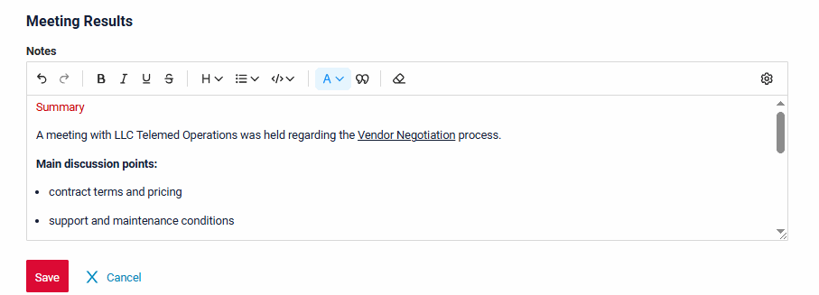  

Поле richText также поддерживает переключение между режимами WYSIWYG <-> Markdown.
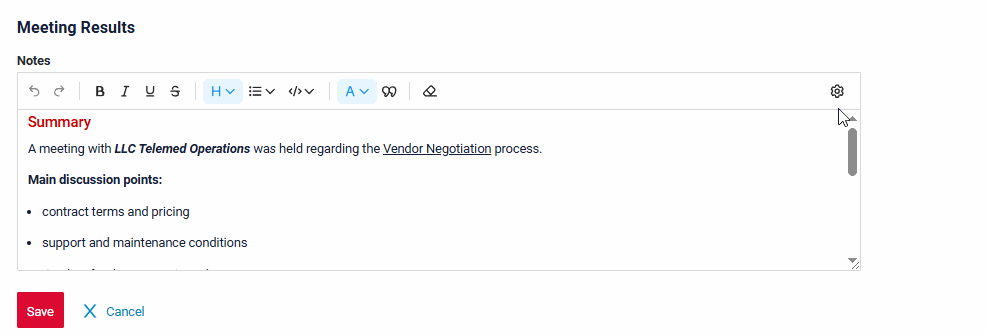

Технические подробности и ограничения см. в разделе [Core](/ru/new/version2018/#added-richtext-new-field-type_1) ниже.

!!! info
    Подробная статья о richText скоро появится в официальной документации — следите за новостями!

#### Добавлено: подписание и шифрование в один клик с КриптоПро (КЭП) { #added-single-click-signing-and-encryption-with-cryptopro-qes }
<!-- CXBOX-970 -->  
Теперь пользователи могут подписывать и шифровать документы в CXBox в один клик с помощью локально установленного КриптоПро. Больше не нужно вручную скачивать файлы, подписывать их в КриптоПро, загружать подписи обратно в CXBox и нажимать Save.

В примерах ниже сравнивается процесс подписания с включённой интеграцией с КриптоПро и без неё:
=== "С интеграцией (1 клик)"
    === "Подпись"
        <video controls width="800">
        <source src="/new/v2.0.18/WithSign.mp4" type="video/mp4">
        </video>  
    === "Проверка подписи"
        <video controls width="800">
        <source src="/new/v2.0.18/WithSignVerification.mp4" type="video/mp4">
        </video>
=== "Без интеграции (несколько ручных шагов)"
    === "Подпись"
        <video controls width="800">
        <source src="/new/v2.0.18/WithoutSign.mp4" type="video/mp4">
        </video>
    === "Проверка подписи"
        <video controls width="800">
        <source src="/new/v2.0.18/WithoutSignVerification.mp4" type="video/mp4">
        </video>

!!! info  
    В обоих случаях для подписания используется одно и то же локально установленное ПО КриптоПро. Интеграция лишь автоматизирует вызов КриптоПро через плагин браузера, поэтому и ПО КриптоПро, и плагин браузера должны быть установлены локально. Подробнее см. [Подписание и шифрование](/ru/features/sign/sign).

#### Добавлено: поддержка локализации { #added-localization-support }
<!-- CXBOX-1248 --> 
Добавлена поддержка локализации элементов UI, справочников и перечислений.

Система поддерживает локализацию для:

* Статический текст
* Локализация данных

Подробнее см. [Локализация](/ru/features/locale/locale)

=== "Французский"
    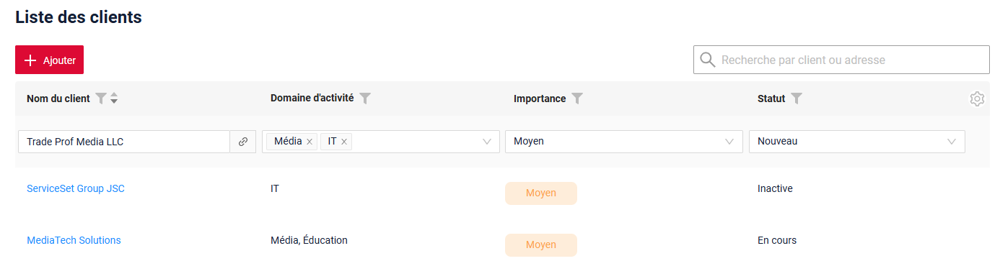
=== "Английский"
    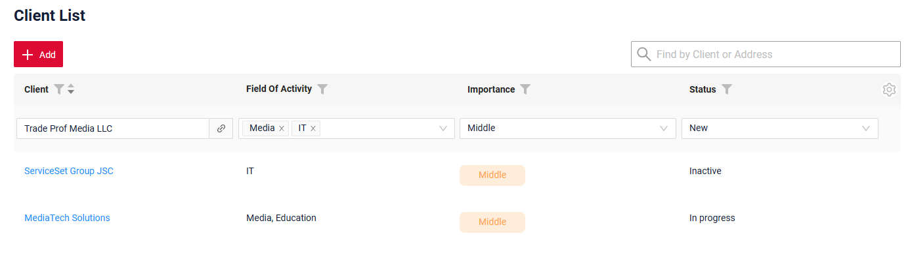  

#### Добавлено: виджет RelationGraph — поддержка отображения циклических данных { #added-relationgraph-widget-display-support-for-cyclic-data }
<!-- CXBOX-1249 -->  
В виджет RelationGraph добавлена поддержка отображения циклических связей, как направленных, так и ненаправленных циклов.

* **Направленные циклы** — стрелки образуют петлю и возвращаются к начальному узлу.

* **Ненаправленные циклы** — между узлами есть связи, но стрелки не образуют петлю.

=== "Направленный цикл"
    === "После"
        Теперь виджет поддерживает циклические связи в данных и не переключается в табличный режим.
        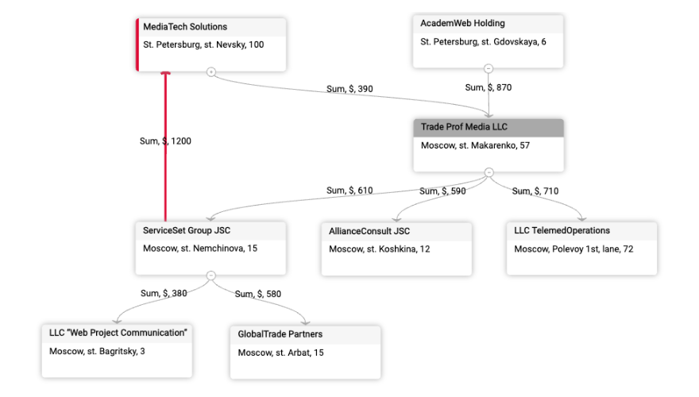
    === "До"
        Виджет не поддерживал циклические связи в данных и переключался в табличный режим.
        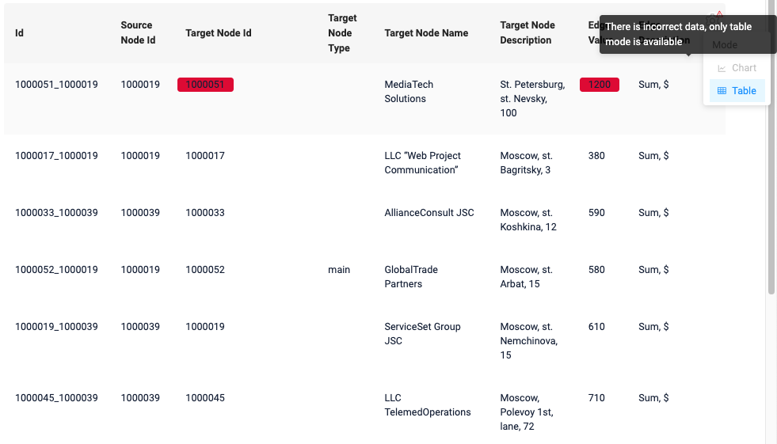  
=== "Ненаправленный цикл"
    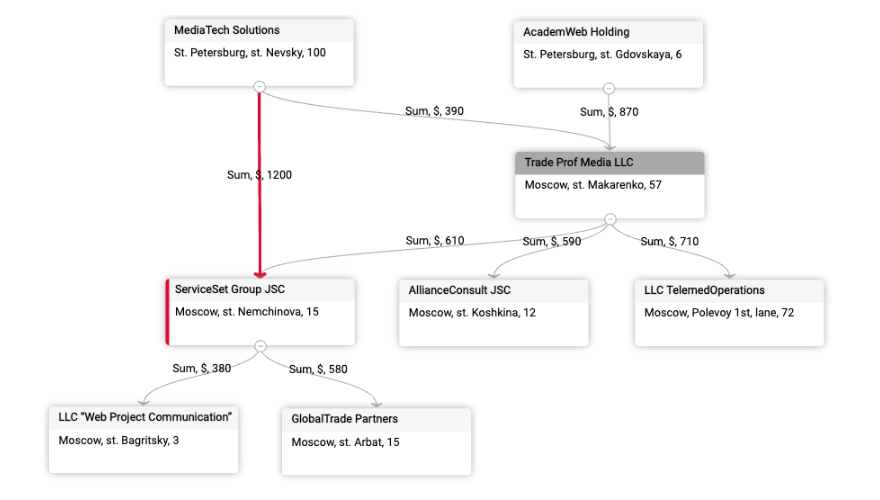  

!!! info
    Как упоминалось в предыдущем релизе, циклические структуры данных по-прежнему не рекомендуются, так как в некоторых случаях граф может отображаться не так, как ожидается.

#### Добавлено: предупреждения при навигации браузера { #added-browser-navigation-warnings }
<!-- CXBOX-1164 -->
Добавлена поддержка предупреждений при переходе с помощью кнопок браузера «Назад»/«Вперёд», чтобы предотвратить случайную потерю данных при работе с приложением.
При использовании этих кнопок браузер может восстановить устаревшее состояние страницы, что может привести к потере несохранённых изменений. Подробнее см. [Кнопки навигации браузера](https://doc.cxbox.org/ru/navigation/browsernavigationbuttons/browsernavigationbuttons/).

Теперь, если пользователь взаимодействовал с приложением, система может показать предупреждение перед уходом со страницы. Текст предупреждения можно настроить.

Это поведение управляется глобальной настройкой. По умолчанию она равна false.

Технические детали настройки см. в разделе [Core](/ru/new/version2018/#added-browser-navigation-warnings_1) ниже.
=== "false (по умолчанию)"
    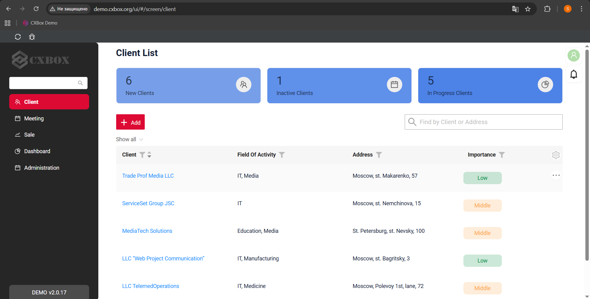
=== "true"
    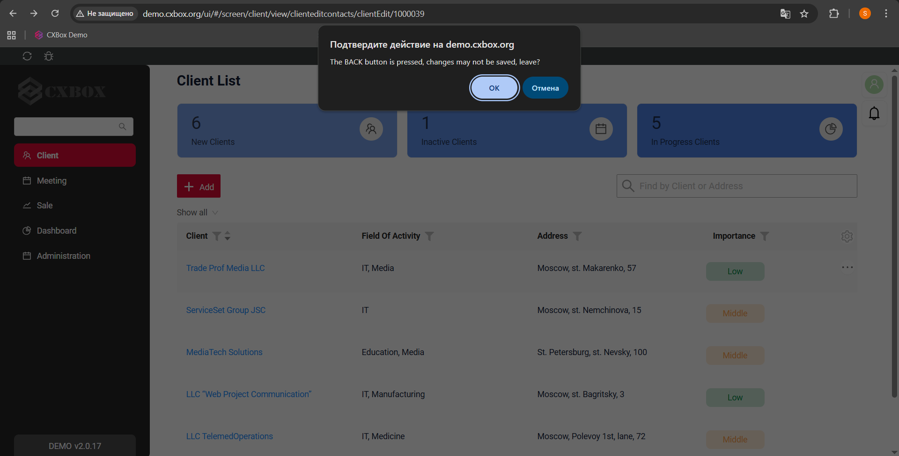  

!!! info 
    1. Предупреждение не отображается при возврате на начальную страницу браузера.
    2. Предупреждения не отображаются для кнопки браузера «Обновить». Обновлять страницу во время работы с приложением не рекомендуется.

#### Исправлено: подпись пользователя — улучшен перенос текста { #fixed-user-label-improved-text-wrapping }
<!-- CXBOX-1276 -->
Улучшено отображение имён пользователей: добавлен перенос слов для длинных значений. Если имя не помещается в подпись, оно корректно переносится и видно полностью.
=== "После"
    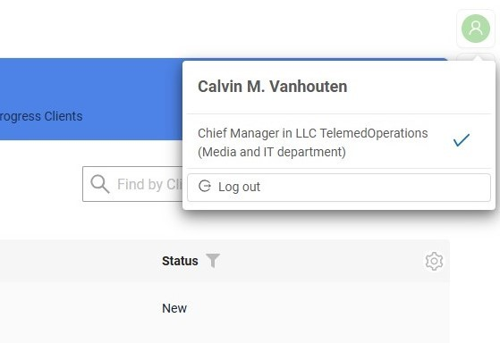
=== "До"
    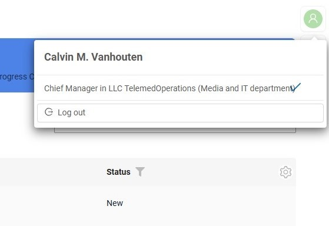  

#### Исправлено: поле fileUpload — улучшен предпросмотр файлов в виджете Info { #fixed-fileupload-field-improved-file-preview-display-for-info-widget }
<!-- CXBOX-1288 -->
Обновлена логика предпросмотра [fileUpload](https://doc.cxbox.org/ru/widget/fields/field/fileUpload/fileUpload/) в виджете [Info](https://doc.cxbox.org/ru/widget/type/info/info/). Теперь файлы корректно открываются в режиме предпросмотра прямо из виджета.

=== "После"
    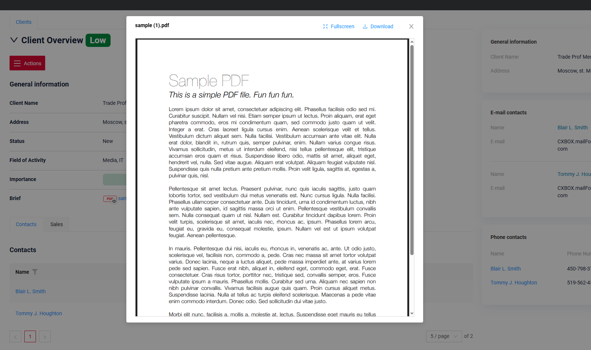
=== "До"
    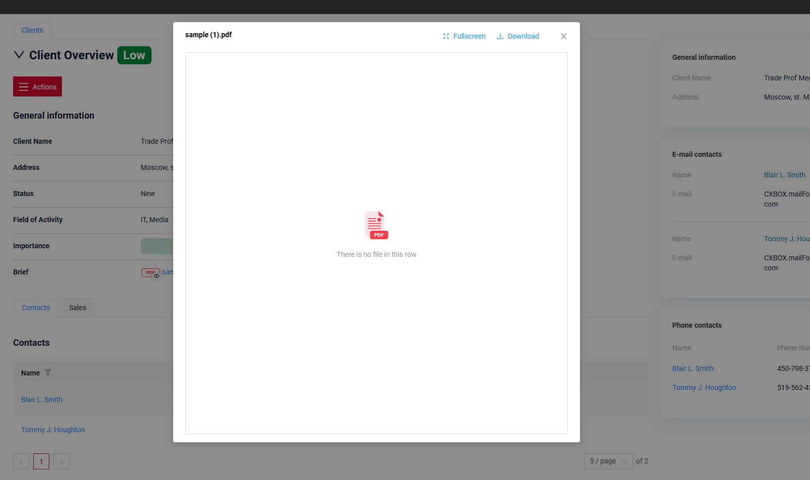  

#### Прочие изменения { #other-changes }
см. [журнал изменений cxbox-demo](https://github.com/CX-Box/cxbox-demo/releases/tag/v.2.0.18)

### CXBOX ([Core Ui](https://github.com/CX-Box/cxbox-ui/releases/tag/2.8.1))  
Выпущена новая версия CORE UI 2.8.1.

#### Добавлено: keycloak-js заменён на oidc-client-ts { #added-keycloak-js-replaced-with-oidc-client-ts }
<!-- CXBOX-1223 --> 
Библиотека keycloak-js заменена на oidc-client-ts для поддержки различных реализаций OpenID Connect (OIDC).
В отличие от keycloak-js, ориентированной только на Keycloak, oidc-client-ts предлагает универсальный подход к интеграции с OIDC-совместимыми провайдерами, включая Keycloak.

#### Добавлено: обработка null для force-active полей multivalue { #added-null-handling-for-multivalue-forceactive-fields }
<!-- CXBOX-1261 --> 
Добавлена обработка null для полей multivalue при изменении значения поля `forceActive` (/row-meta, /data).

Раньше фронтенд корректно обрабатывал поля multivalue, только когда бэкенд возвращал в ответе массив. Теперь для AnySource-сущностей можно также возвращать `null`.

=== "null"
    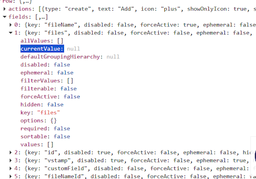
=== "[]"
    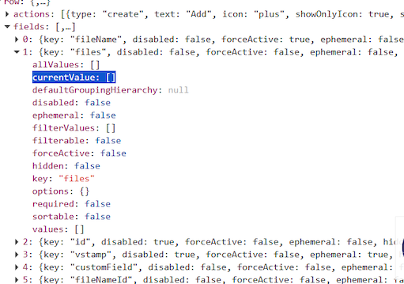

#### Прочие изменения { #other-changes_1 }
См. [журнал изменений cxbox-ui 2.8.1](https://github.com/CX-Box/cxbox-ui/releases/tag/2.8.1).

### CXBOX 4.0.0-M24 ([Core](https://github.com/CX-Box/cxbox/tree/cxbox-4.0.0-M24))
Выпущена новая версия CORE 4.0.0-M24.
#### Добавлено: richText — НОВЫЙ тип поля! { #added-richtext-new-field-type_1 }
<!-- CXBOX-1286 -->
Добавлена поддержка нового типа поля richText. Поле поддерживает форматированное содержимое в режимах WYSIWYG и Markdown.
!!! warning "Внимание"
    Максимальный поддерживаемый размер содержимого поля richText — **8 000 символов**.

Обзор возможностей и примеры использования см. в разделе [Demo](/ru/new/version2018/#added-richtext-new-field-type) выше.

#### Добавлено: предупреждения при навигации браузера { #added-browser-navigation-warnings_1 }
Добавлена новая глобальная настройка `browserNavigationWarnEnabled` для управления предупреждениями при навигации браузера.
1) true — навигация браузера «Назад»/«Вперёд» перехватывается и отображается предупреждение
2) false (по умолчанию) — навигация браузера работает как обычно

Текст предупреждения настраивается на фронтенде.
Обзор возможностей см. в разделе [Demo](/ru/new/version2018/#added-browser-navigation-warnings) выше.

#### Исправлено: восстановлена поддержка Oracle { #fixed-restored-oracle-support }
<!-- CXBOX-730 --> 
Поддержка Oracle восстановлена.

Для поддержки Oracle переименованы поля:

* ADDITIONAL_FIELDS.VIEW → ADDITIONAL_FIELDS.VIEW_NAME
* USER_ROLE.MAIN → USER_ROLE.MAIN_FLG
* RESPONSIBILITIES_ACTION.VIEW → USER_ROLE.VIEW_NAME 

#### Исправлено: дублирование действий в панели отладки { #fixed-duplicate-actions-in-debug-panel }
<!-- CXBOX-1256 -->
В панели отладки отображались дублирующиеся кнопки действий, когда `widgetActionGroupsEnabled` был равен `false`, а полномочия загружались из стандартного файла `RESPONSIBILITIES_ACTION.csv` через Liquibase. Проблема возникала, когда одно и то же действие (кнопка) было назначено нескольким ролям одного пользователя.

=== "После"
    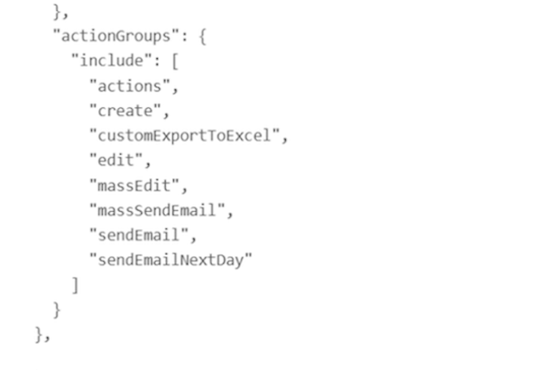
=== "До"
    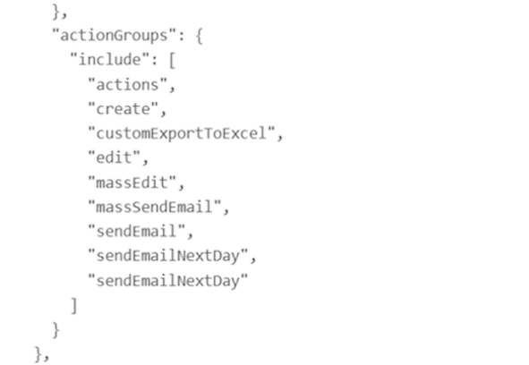

#### Исправлено: ответ API для родительского BC со скрытыми полями { #fixed-api-response-for-parent-bc-with-hidden-fields }
<!-- CXBOX-1242 --> 
Улучшена обработка ответа API для родительского BC без видимых полей.

Раньше, если ни одно поле родительского BC не было добавлено в виджеты на экране, необходимые данные не попадали в ответ API. Теперь система корректно возвращает данные, даже если у родительского BC нет видимых полей.

Добавлен параметр `includeIdWhenNoFieldsInWidgetsOnBc` (по умолчанию true).

=== "После"
    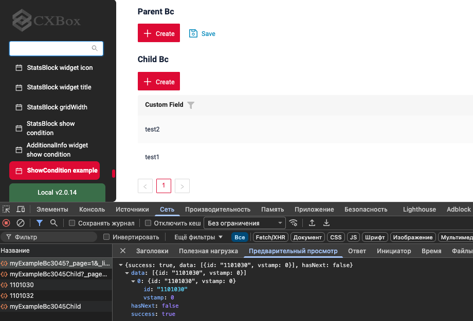
=== "До"
    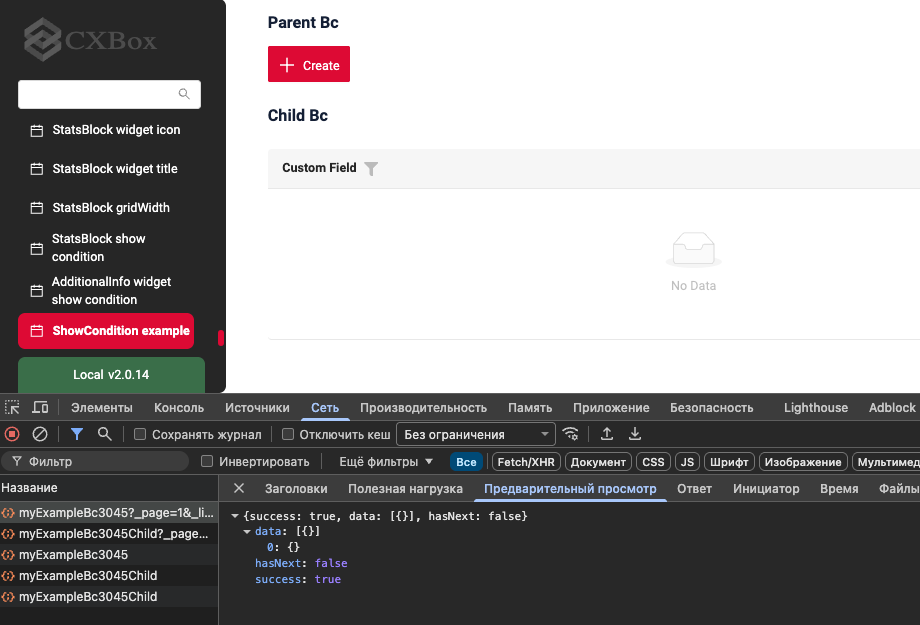

#### Исправлено: проверка уникальности при сохранении имени фильтра { #fixed-uniqueness-check-when-saving-a-filter-name }
<!-- CXBOX-1268 --> 
Улучшена проверка имён пользовательских фильтров, чтобы не допустить дублирования имён при сохранении фильтров.

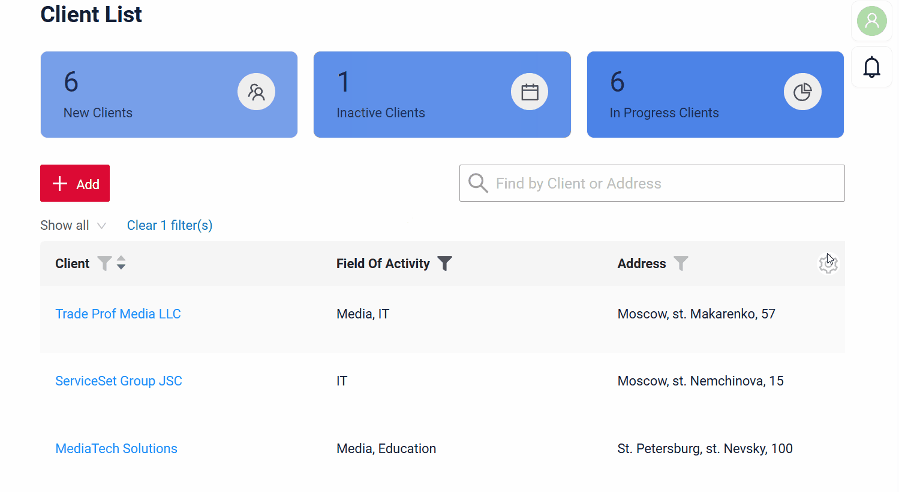  

#### Прочие изменения { #other-changes_2 }
См. [журнал изменений cxbox 4.0.0-M24](https://github.com/CX-Box/cxbox/releases/tag/cxbox-4.0.0-M24).

### CXBOX [документация](https://doc.cxbox.org/ru/) { #cxbox-documentation }

#### Добавлено: описание локализации { #added-localization-description }
<!-- CXBOX-1248 -->  
Добавлено описание [локализации](https://doc.cxbox.org/ru/features/locale/locale/).

#### Добавлено: подписание и шифрование { #added-signing-and-encrypting }
<!-- CXBOX-1294 -->  
Добавлено руководство по настройке поддержки подписания и шифрования документов с помощью ПО КриптоПро. См. [Подписание и шифрование](https://doc.cxbox.org/ru/features/sign/sign/).