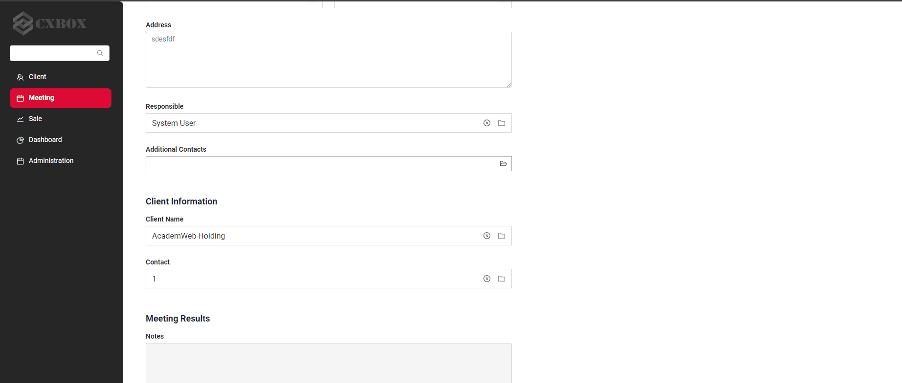
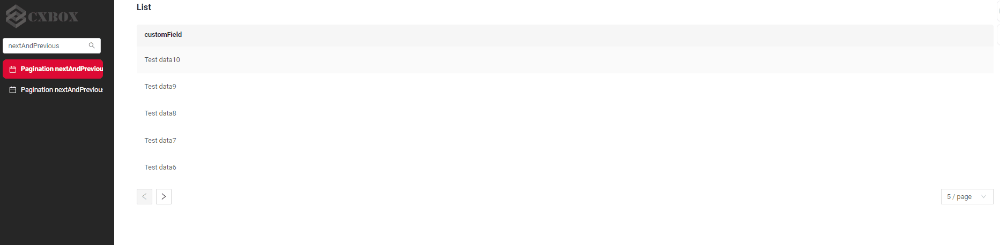
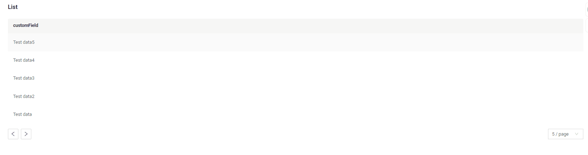

# v2.0.2

* [cxbox/demo 2.0.2 git](https://github.com/CX-Box/cxbox-demo/tree/v.2.0.2), [примечания к релизу](https://github.com/CX-Box/cxbox-demo/releases/tag/v.2.0.2)

* [cxbox/core 4.0.0-M4 git](https://github.com/CX-Box/cxbox/tree/cxbox-4.0.0-M4), [примечания к релизу](https://github.com/CX-Box/cxbox/releases/tag/cxbox-4.0.0-M4), [maven](https://central.sonatype.com/artifact/org.cxbox/cxbox-starter-parent)

* [cxbox-ui/core 2.0.0 git](https://github.com/CX-Box/cxbox-ui/tree/2.0.0), [примечания к релизу](https://github.com/CX-Box/cxbox-ui/releases/tag/2.0.0), [npm](https://www.npmjs.com/package/@cxbox-ui/core)

## **Ключевые обновления июля 2024** { #key-updates-july-2024 }
### CXBOX ([Демо](https://github.com/CX-Box/cxbox-demo), [Примеры кода](https://github.com/CX-Box/cxbox-code-samples)) { #cxbox-demo-code-samples }
####  Создание строки во всплывающем окне PickList { #creating-a-line-in-the-picklist-popup }

Добавлена возможность создать строку прямо во всплывающем окне picklist при нажатии "Add".
#### Добавлены новые режимы пагинации { #added-new-pagination-modes }
Стрелки навигации и блок настройки лимита убираются, если количество записей меньше лимита.
Режимы пагинации:

1) nextAndPreviousWithHasNext [:material-play-circle: Живой пример]({{ external_links.code_samples }}/ui/#/screen/myexample3861/view/myexample3860list){:target="_blank"} ·

   Логика доступности кнопки Next:

   * Если hasNext (из /data) равен true, кнопка Next доступна.
   * Если hasNext (из /data) равен false, кнопка Next неактивна.

2) nextAndPreviousSmart   [:material-play-circle: Живой пример]({{ external_links.code_samples }}/ui/#/screen/myexample3861){:target="_blank"} ·

 

   Логика доступности кнопки Next:
   Если количество записей, полученных из /data, меньше _limit, кнопка Next неактивна.

   Недостатки этого режима:

   * Если количество записей кратно _limit, произойдёт один переход на страницу без записей, так как невозможно определить, последняя ли это страница.
   * Если количество записей кратно _limit, запрос следующей страницы будет отправлен, даже если её не существует. Если этот запрос возвращает ошибку, её нужно обработать блоком try {} catch {}.

3) По умолчанию nextAndPreviousWithCount
   Функциональность не изменилась.
#### Прочие изменения { #other-changes }
см. [журнал изменений cxbox-demo](https://github.com/CX-Box/cxbox-demo/releases/tag/v.2.0.2)

см. [журнал изменений cxbox-code-samples](https://github.com/CX-Box/cxbox-code-samples/releases/tag/v2.0.2)

### <a id="CXBOXUI">CXBOX</a> ([Core Ui](https://github.com/CX-Box/cxbox-ui))
#### Исправлено сохранение настроек { #fixed-saving-settings }
Исправлена проблема с сохранением настроек при добавлении в meta параметра add.fields.
### <a id="CXBOXCORE">CXBOX 4.0.0-M4</a>  ([Core](https://github.com/CX-Box/cxbox))
#### Экспорт heap dump { #heap-dump-export }
Исправлен экспорт heap dump через actuator
#### Добавлен явный Qualifier { #added-an-explicit-qualifier }
Исправлен конфликт между мапперами (cxboxObjectMapper и businessComponentMapper)
#### Прочие изменения { #other-changes_1 }
см. [журнал изменений cxbox](https://github.com/CX-Box/cxbox/releases/tag/cxbox-4.0.0-M4)
