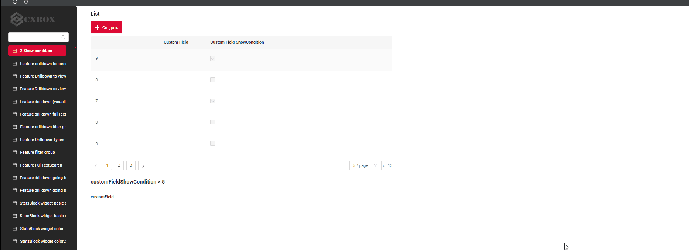
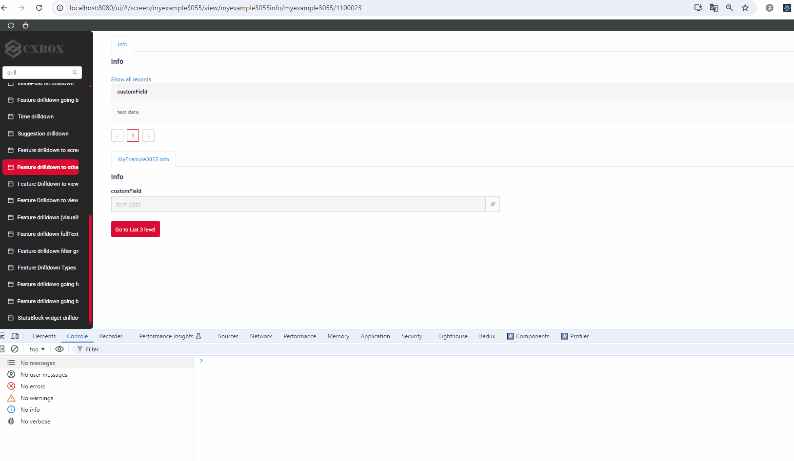
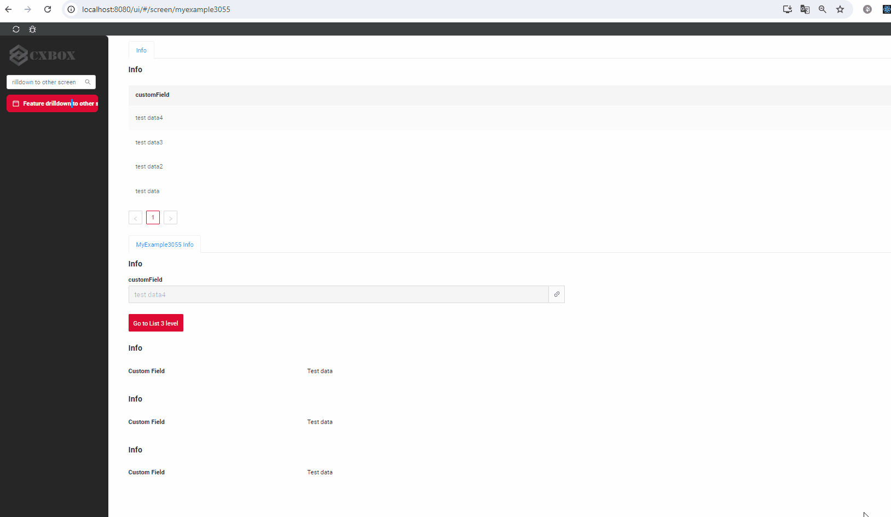
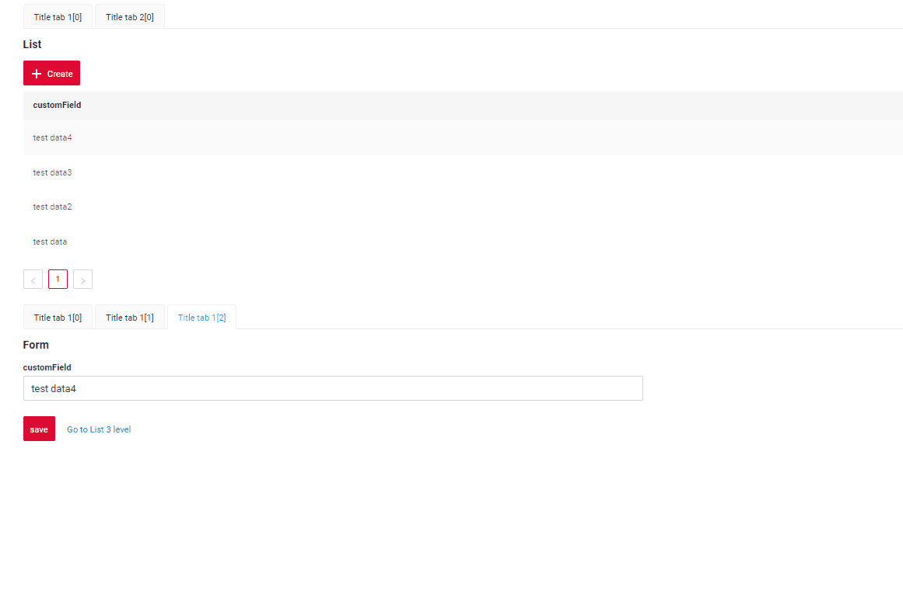

# v2.0.3

* [cxbox/demo 2.0.3 git](https://github.com/CX-Box/cxbox-demo/tree/v.2.0.3), [примечания к релизу](https://github.com/CX-Box/cxbox-demo/releases/tag/v.2.0.3)

* [cxbox/core 4.0.0-M5 git](https://github.com/CX-Box/cxbox/tree/cxbox-4.0.0-M5), [примечания к релизу](https://github.com/CX-Box/cxbox/releases/tag/cxbox-4.0.0-M5), [maven](https://central.sonatype.com/artifact/org.cxbox/cxbox-starter-parent)

* [cxbox-ui/core 2.0.0 git](https://github.com/CX-Box/cxbox-ui/tree/2.0.0), [примечания к релизу](https://github.com/CX-Box/cxbox-ui/releases/tag/2.0.0), [npm](https://www.npmjs.com/package/@cxbox-ui/core)


## **Ключевые обновления августа 2024** { #key-updates-august-2024 }
### <a id="CXBOXCORE">CXBOX 4.0.0-M5</a>  ([Core](https://github.com/CX-Box/cxbox))
#### Изменены зависимости { #dependencies-have-been-changed }
* org.springframework.boot/spring-boot-starter-parent обновлён до 3.2.5 с 3.2.4
* удалена зависимость org.apache.commons/commons-text
* удалены зависимости de.odysseus.juel/*
* удалена зависимость commons-io/commons-io
* удалена зависимость org.glassfish/javax.el
* убрано использование класса java.security.AccessController
* удалён файл пайплайна jenkins ci (вместо него используется GitHub CI)
* удалена зависимость liquibase-maven-plugin
* удалена зависимость com.google.auto.service/auto-service
* jacoco-maven-plugin обновлён до 0.8.11 с 0.8.14
* удалена зависимость com.sun.xml.bind/jaxb-impl
* удалена зависимость com.sun.xml.bind/jaxb-core
* из cxbox-starter-parent удалены зависимость maven-gpg-plugin и профиль release (они больше не видны в проектах заказчиков, что уменьшает путаницу)
* исправлена папка файла dependency-review-config
* удалена зависимость com.google/guava
* удалена зависимость commons-collections4
* версией зависимости commons-lang3 теперь управляет spring-boot

Теперь в cxbox core явно заданы версии только 2 зависимостей
```xml
    <hibernate-commons-annotations.version>6.0.6.Final</hibernate-commons-annotations.version>
    <javapoet.version>1.13.0</javapoet.version>
``` 
Версиями всех остальных зависимостей теперь управляет
```xml
<parent>
    <groupId>org.springframework.boot</groupId>
    <artifactId>spring-boot-starter-parent</artifactId>
    <version>3.2.5</version>
</parent>
```
поэтому для всех зависимостей (кроме javapoet и hibernate-commons-annotations):

* уровень ядра: проблемы безопасности теперь легко решаются простым обновлением версии spring-boot в ядре
* уровень проекта: версии зависимостей можно переопределять на уровне проекта, как в обычном spring-boot приложении ([см.](https://docs.spring.io/spring-pulsar/reference/appendix/override-boot-dependencies.html))

#### Прочие изменения { #other-changes }
см. [журнал изменений cxbox](https://github.com/CX-Box/cxbox/releases/tag/cxbox-4.0.0-M5)


### CXBOX ([Демо](https://github.com/CX-Box/cxbox-demo)) { #cxbox-demo }
#### Фронтенд. Изменены зависимости { #front-dependencies-have-been-changed }
* axios:   1.6.0
* rc-select: 14.11.0
* @types/lodash.debounce: 4.0.9

#### Новая версия ядра { #new-version-core }
Новая версия ядра CXBOX 4.0.0-M5

#### Добавлен пример интеграции с SIEM { #added-siem-integration-example }


Добавлен пример логирования `CrudmaAction` вместе со связанными данными.
####  Исправлены ошибки showCondition. { #fixed-errors-for-showcondition }


Исправлена ошибка, возникавшая, когда на экране было два виджета одного BC с showCondition, один из которых был скрыт, а другой видим
#### Исправлены ошибки при переходах через drilldown. { #fixed-errors-encountered-during-drilldown-transitions }
1)  Исправлена ошибка, возникавшая после переключения вкладок при переходе на экран по ссылке с другого экрана, когда у исходной и целевой ссылок были разные BC.



2) Исправлена ошибка, возникавшая при переходе между экранами по ссылке, когда исходный и целевой экраны содержали несколько наборов виджетов на основе разных BC.



#### Добавлена возможность перейти на скрытый view внутри вкладок. { #added-the-ability-to-switch-to-a-hidden-view-within-tabs }


Добавлена возможность перейти на скрытый view внутри вкладок.

#### Прочие изменения { #other-changes_1 }
см. [журнал изменений cxbox-demo](https://github.com/CX-Box/cxbox-demo/releases/tag/v.2.0.3)
 