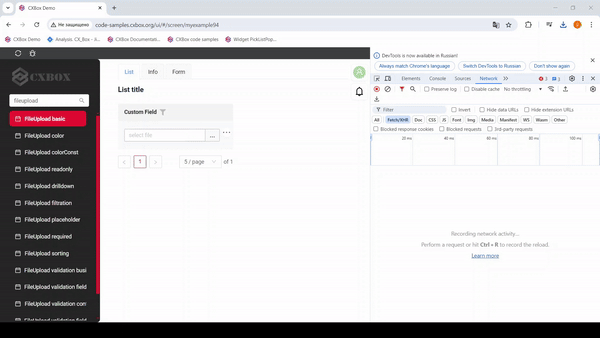
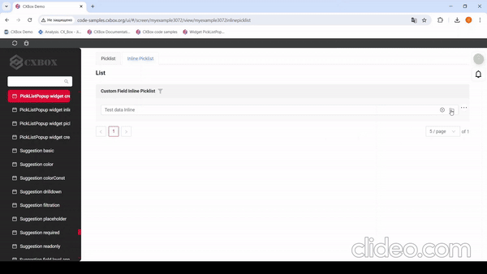
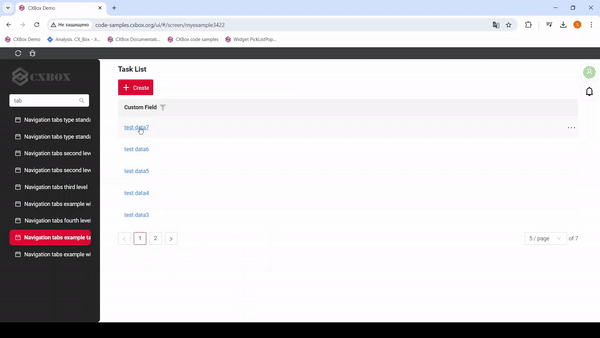
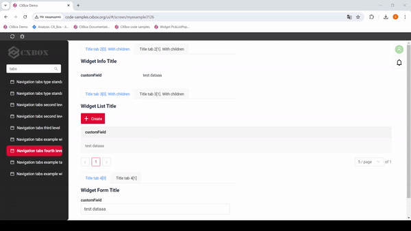
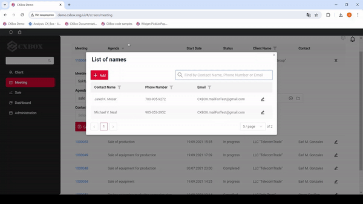

# v2.0.4

* [cxbox/demo 2.0.4 git](https://github.com/CX-Box/cxbox-demo/tree/v2.0.4), [примечания к релизу](https://github.com/CX-Box/cxbox-demo/releases/tag/v2.0.4)

* [cxbox/core 4.0.0-M6 git](https://github.com/CX-Box/cxbox/tree/cxbox-4.0.0-M6), [примечания к релизу](https://github.com/CX-Box/cxbox/releases/tag/cxbox-4.0.0-M6), [maven](https://central.sonatype.com/artifact/org.cxbox/cxbox-starter-parent/4.0.0-M6)

* [cxbox-ui/core 2.0.0 git](https://github.com/CX-Box/cxbox-ui/tree/2.0.0), [примечания к релизу](https://github.com/CX-Box/cxbox-ui/releases/tag/2.0.0), [npm](https://www.npmjs.com/package/@cxbox-ui/core/v/2.0.0)

## **Ключевые обновления августа 2024** { #key-updates-august-2024 }
### CXBOX ([Демо](https://github.com/CX-Box/cxbox-demo)) { #cxbox-demo }
#### Новая версия ядра { #new-version-core }
Новая версия ядра CXBOX 4.0.0-M6

#### Авторизация в File API { #file-api-authorization }


Добавлено: загрузка файлов теперь доступна только авторизованным пользователям. При загрузке одного или нескольких файлов передаётся токен авторизации. В противном случае загрузка файлов недоступна. Та же логика применяется к предпросмотру и скачиванию файлов.
#### Создание строки во всплывающем окне InlinePickList { #creating-a-line-in-the-inlinepicklist-popup }



Добавлено: расширена возможность создания новой строки в полях [picklist](https://doc.cxbox.org/ru/widget/fields/field/pickList/pickList/) и [inline-picklist](https://doc.cxbox.org/ru/widget/fields/field/inlinePickList/inlinePickList/). Теперь новую строку в picklist/inline-picklist можно создать во время редактирования/создания родителя (принудительное сохранение родителя больше не выполняется. В результате обязательные поля больше не блокируют создание строки в picklist, изменения родителя можно корректно отменить даже после создания новой строки в picklist и т. д.). Добавлен новый специальный метод для получения поля родительского DTO одной строкой кода

#### Функциональность вкладок { #tab-functionality }

Добавлено: введён тег type для разных схем вкладок (так же, как типы полей и виджетов). Схема вкладок по умолчанию теперь имеет type='standard'. Несколько исправлений в ней:

1) Исправлено: ошибка при переходе между экранами по ссылке на связанную сущность на том же экране



2) Исправлено: работа вкладок третьего уровня



[Полнотекстовый поиск](https://doc.cxbox.org/ru/widget/type/property/filtration/filtration/#by-fulltextsearch)

3) Исправлено: отображение по умолчанию скрытого view первого уровня

Добавлено ограничение на отображение скрытых views в навигации. Теперь, если в метаданных указан скрытый view, он не отображается при открытии экрана.
Для корректной работы приложения необходимо соблюдать правило: на каждом уровне навигации (aggregate или single) должен быть хотя бы один видимый view.

#### Добавлен полнотекстовый поиск во всплывающих окнах (pickListPopup и inlinePickList) { #added-fulltext-search-option-in-pop-up-picklistpopup-and-inlinepicklist }



Добавлена строка поиска. Когда пользователь вводит текст в поле полнотекстового поиска, виджет фильтрует строки, соответствующие запросу (критерии поиска настраиваются и обычно проверяют, есть ли соответствующее значение хотя бы в одной колонке). Это помогает пользователям быстро находить нужную информацию.

#### Прочие изменения { #other-changes }
см. [журнал изменений cxbox-demo](https://github.com/CX-Box/cxbox-demo/releases/tag/v.2.0.4)

### <a id="CXBOXCORE">CXBOX 4.0.0-M6</a>  ([Core](https://github.com/CX-Box/cxbox))
#### Создание новой записи прямо во всплывающем окне (picklist, inlinePicklist и т. д.) { #creation-of-new-record-directly-in-popup-picklist-inlinepicklist-and-so-on }
* Добавлено: в abstractAnySourceResponseService и AbstractResponseService появился новый метод ```getParentField(<PARENT_DTO>_.<parent_field>, bc)``` для получения поля DTO родительского bc одной строкой кода
* Добавлено: поддержка создания новых записей прямо во всплывающих окнах (picklist и т. д.) без принудительного сохранения родительского bc. Для сервисов таких окон можно использовать AbstractAnySourceResponseService и AbstractResponseService с единственным ограничением — для получения значений родителя нужно использовать новый метод ```getParentField``` вместо ```repository.findById(bc.getParentIdAsLong())```
* Исправлено: BcStateAware теперь очищает кеш только для конкретного bc (в рамках сессии пользователя) по завершении запроса терминального действия (вместо всего кеша сессии пользователя)
#### Сортировка LOV в выпадающих списках фильтра и редактирования по display_order { #lov-sorting-in-filter-and-edit-dropdowns-by-displayorder }
* Добавлено: java doc для методов ```setDictionaryTypeWithAllValues``` и ```setAllFilterValuesByLovType```, описывающий, что эти методы сортируют элементы по display_order, затем по key. Удалены дублирующие методы ```setAllFilterValuesByLovTypeOrdered``` и ```setDictionaryTypeWithAllValuesOrdered```
* Исправлено: сигнатура метода ```setAllFilterValuesByLovType``` — удалён лишний аргумент fields
* Исправлено: сигнатура метода ```setDictionaryTypeWithAllValues``` — удалён лишний аргумент fields
* Исправлено: загрузчик справочников LOV:
  СТАЛО: сортировка элементов по display_order, затем по key (display_order может быть null)
  БЫЛО: сортировка элементов по display_order (display_order не мог быть null)


#### Прочие изменения { #other-changes_1 }
см. [журнал изменений cxbox](https://github.com/CX-Box/cxbox/releases/tag/cxbox-4.0.0-M6)

