# 2.0.5

* [cxbox/demo 2.0.5 git](https://github.com/CX-Box/cxbox-demo/tree/v2.0.5), [примечания к релизу](https://github.com/CX-Box/cxbox-demo/releases/tag/v2.0.5)

* [cxbox/core 4.0.0-M8 git](https://github.com/CX-Box/cxbox/tree/cxbox-4.0.0-M8), [примечания к релизу](https://github.com/CX-Box/cxbox/releases/tag/cxbox-4.0.0-M8), [maven](https://central.sonatype.com/artifact/org.cxbox/cxbox-starter-parent/4.0.0-M8)

* [cxbox-ui/core 2.2.0 git](https://github.com/CX-Box/cxbox-ui/tree/2.2.0), [примечания к релизу](https://github.com/CX-Box/cxbox-ui/releases/tag/2.2.0), [npm](https://www.npmjs.com/package/@cxbox-ui/core/v/2.2.0)

## **Ключевые обновления сентября 2024** { #key-updates-september-2024 }

### CXBOX ([Core Ui](https://github.com/CX-Box/cxbox-ui))
#### Переработано сохранение контекста для вкладок { #redesign-of-saving-context-for-tabs }
Если смена view вызвана переключением вкладок:

1. Пагинация, данные и rowMeta остаются без изменений. Данные запрашиваются, только если они ещё не загружены или изменился курсор родительского bc. Повторного запроса данных для всех bc больше не будет.
2. При получении данных для родительского bc дополнительная проверка удаляет из store устаревшие данные дочерних bc.
3. Сокращена частота вызовов bcChangeCursors.

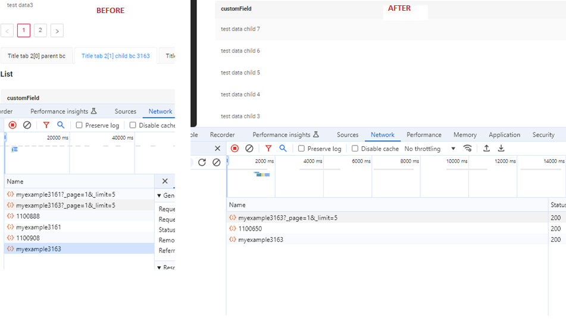

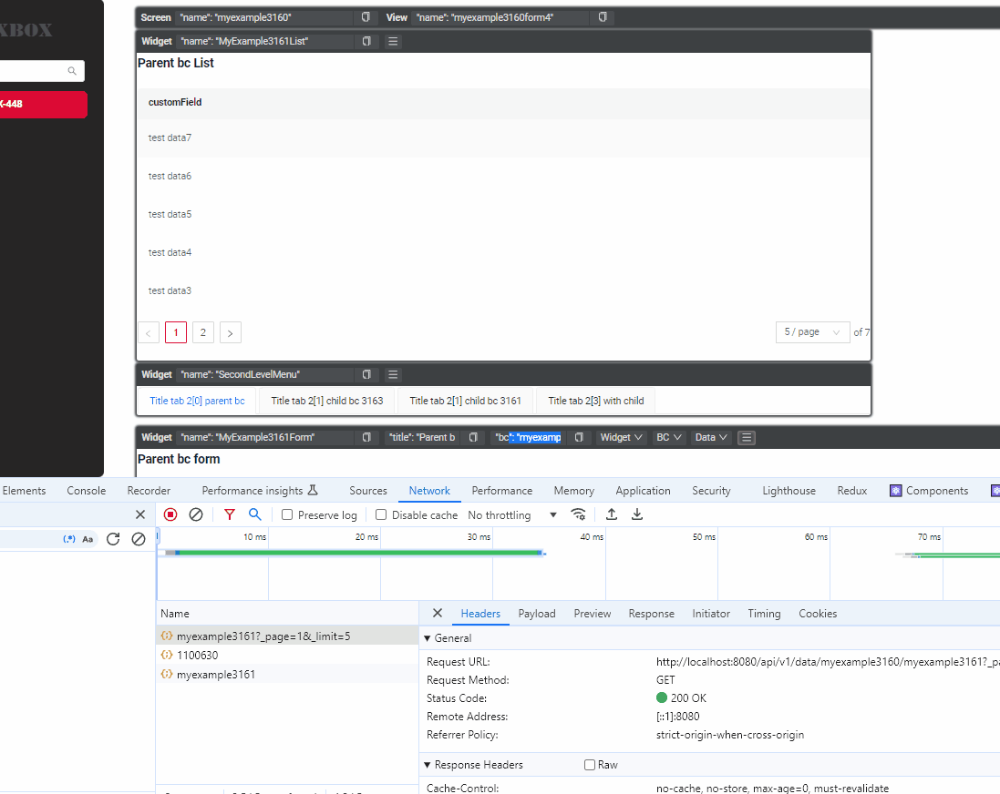

### CXBOX ([Демо](https://github.com/CX-Box/cxbox-demo)) { #cxbox-demo }
#### Новая версия ядра { #new-version-core }
Новая версия ядра CXBOX 4.0.0-M8

#### Исправлены роли пользователя { #fixed-user-roles }
Исправлено отображение нескольких ролей и возможность переключения между ними.

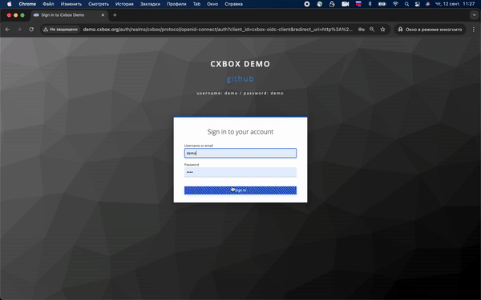

#### Исправлена обработка заголовка Content-Disposition { #fixed-content-disposition-header-handling }
Исправлена обработка заголовка `Content-Disposition`, чтобы файл корректно отображался при предпросмотре.
    *Внесённые изменения:*
Фронтенд: теперь передаётся корректный заголовок `Content-Disposition`.
Бэкенд: контроллер `cxbox` обновлён для обработки параметра `inline`.
Заголовок устанавливается так:
- `Content-Disposition`: `inline` при `preview=true`.
- `Content-Disposition`: `attachment` при `preview=false` или по умолчанию.
   *Результат:*
Для запросов предпросмотра файлов заголовок будет `inline`.
Для скачивания файлов или при отсутствии параметра заголовок будет `attachment`.

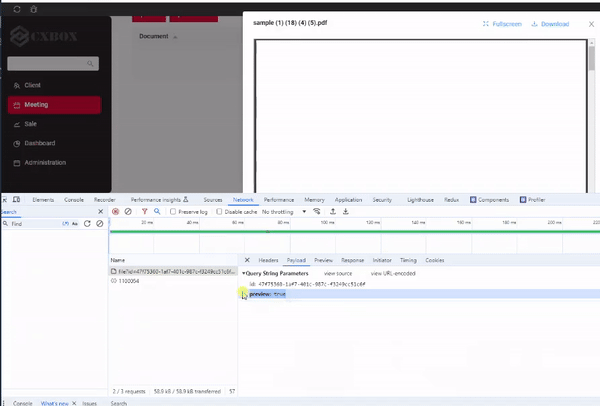

#### Добавлена настройка текста в PreAction.Confirm для кнопок и заголовка { #added-text-customization-in-preactionconfirm-for-buttons-and-title }
Добавлена возможность задавать собственный текст для заголовка и кнопок подтверждения.

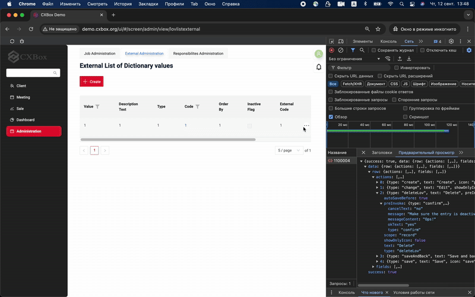

#### Обновлена логика ширины цветового выделения текста { #updated-the-logic-of-text-colorization-width }
Обновлена логика цветового выделения текста. Теперь, если строка длиннее 100 пикселей, выделение динамически подстраивается под длину строки, и текст не выходит за пределы выделенной области.

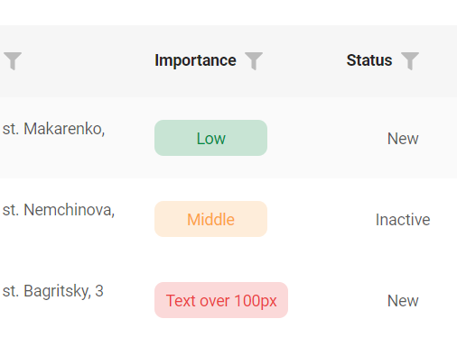

#### Исправлено выравнивание полей в многоколоночном виджете формы { #fixed-fields-alignment-in-the-multi-column-form-widget }
Исправлена проблема выравнивания полей в многоколоночном виджете формы. Теперь поля корректно выровнены по колонкам.

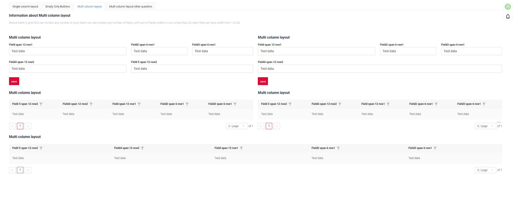

#### Исправлено отображение колонок группировки в Grouping Hierarchy (режим виджета списка) { #fixed-the-display-of-grouping-columns-in-grouping-hierarchy-list-widget-mode }
Добавлено условие, гарантирующее корректное отображение скрытых в иерархическом режиме полей в режиме виджета списка.

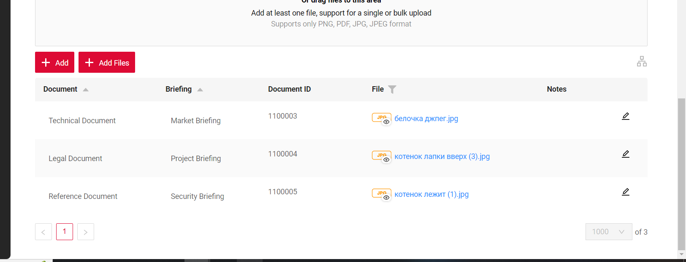

###  CXBOX 4.0.0-M8  ([Core](https://github.com/CX-Box/cxbox))
#### В BaseEntity добавлен SuperBuilder { #added-superbuilder-to-baseentity }
Аннотация `@SuperBuilder` добавлена в классы `BaseEntity` и `AbstractEntity`, чтобы привести их в соответствие с классами DTO, где эта аннотация уже использовалась.

#### Добавлены методы setHidden, setNotHidden, hidden { #added-the-sethiddensetnothidden-hidden-method }
Поведение метода `hidden` стандартизировано в соответствии с работой метода `required`.
   **Было:**
    ```java
    fields.get(MyDTO_.fullName).setHidden(false);  
    ```  
   **Стало:**
    ```java
    fields.setHidden(MyDTO_.fullName);
    ```  

Старые методы помечены как `deprecated`.

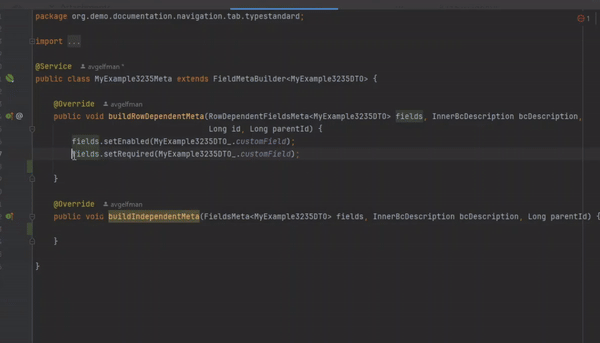  

#### Flush и setWithFirstLevelCache возвращают сущность { #flush-and-setwithfirstlevelcache-return-the-entity }

Изменена логика метода сохранения при создании и обновлении сущностей.
Вместо метода `flush(bc)` теперь используется упрощённый вариант без параметров `flush()`. Это позволяет подставлять результат прямо в оператор return, а метод автоматически определяет, нужно ли выполнить обновление или создание.

   **Критические изменения:**
Если класс реализует интерфейс `AnySourceBaseDAO`, тип возвращаемого значения нужно изменить с void на тип сущности, чтобы метод мог вернуть объект после выполнения `flush()`.

   **Было:**
    ```java
    this.getBaseDao().flush(bc);
    ```  
   **Стало:**
    ```java
    this.getBaseDao().flush();
    ```

Это упрощает код и позволяет подставлять метод прямо в `return`, при этом тип операции (создание или обновление) по-прежнему определяется автоматически.

#### Добавлен generic-метод setCurrentValue { #added-the-setcurrentvalue-generics-method }

Методы `setCurrentValue` в DTO теперь используют generics, что улучшает проверку типов и гарантирует соответствие передаваемых значений ожидаемым типам, помогая избежать ошибок, связанных с типами.

**Изменения:**
   *Было:*
    ```java
    fields.get(final DtoField<? super T, ?> field).setCurrentValue(Object object);
    ```

   *Стало:*
    ```java
    fields.setCurrentValue(final DtoField<? super T, E> field, E value);
    ```  

####  Добавлена возможность отключить сортировку для поля { #added-the-ability-to-disable-sorting-for-a-field }

Добавлена возможность управлять сортировкой полей таблицы, включая или отключая сортировку для каждого поля отдельно.

!!! info 
    По умолчанию параметр `sortEnabledDefault` равен `false`. Чтобы включить сортировку во всём проекте, задайте `sortEnabledDefault = true` в `MetaConfigurationProperties`.

*Изменения:*
    1. Управление сортировкой на уровне полей: поведением сортировки можно управлять для каждого поля независимо. Включить сортировку для конкретных полей можно методом `fields.enableSort()` на бэкенде. Если для поля задано sortable=true, появляется иконка сортировки, позволяющая пользователю добавлять или менять сортировку. Если sortable=false, иконка скрыта или неактивна.
    2. Сортировка по умолчанию: поля с сортировкой по умолчанию остаются активными, даже если они не sortable. Пользователь видит сортировку, но не может её изменить, если поле не sortable.
    3. Сортировка по нескольким полям:
        - Через настройки по умолчанию можно сортировать по нескольким полям, но в UI сортировку можно применить только к одному sortable-полю.
        - Иконки сортировки для sortable и не-sortable полей визуально различаются.

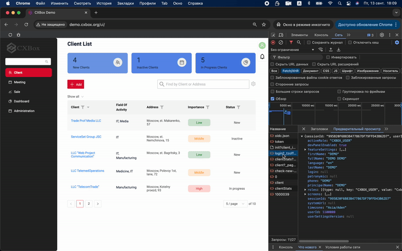

#### Добавлен API action builder на основе лямбд { #added-lambda-based-action-builder-api }

При использовании старого API частой ошибкой было забыть метод .add() и потерять действие без каких-либо ошибок компиляции или выполнения. Ещё одной частой проблемой было плохое визуальное разделение действий. Новый API на основе лямбд решает обе проблемы:

**Изменения:**
*Было:*
```java
	@Override
public Actions<DashboardFilterDTO> getActions() {

	return Actions.<DashboardFilterDTO>builder()
			.action("filter", "Apply Filters")
			.invoker((bc, dto) -> new ActionResultDTO<>())
			.available(bc -> true).withAutoSaveBefore()
			.add()
			.build();
}
```

*Стало:*
```java
@Override
public Actions<DashboardFilterDTO> getActions() {
	return Actions.<DashboardFilterDTO>builder()
			.action(act -> act
					.action("filter", "Apply Filters")
					.invoker((bc, dto) -> new ActionResultDTO<>())
					.available(bc -> true).withAutoSaveBefore()
			)
			.build();
}
```
 
#### Прочие изменения { #other-changes }
см. [журнал изменений cxbox](https://github.com/CX-Box/cxbox/releases/tag/cxbox-4.0.0-M8)

### CXBOX [документация](https://doc.cxbox.org/ru/) { #cxbox-documentation }
#### Добавлено описание вкладок { #added-description-tabs }

Добавлено описание функциональности вкладок и подробные инструкции по созданию и организации разных уровней вкладок на экране.

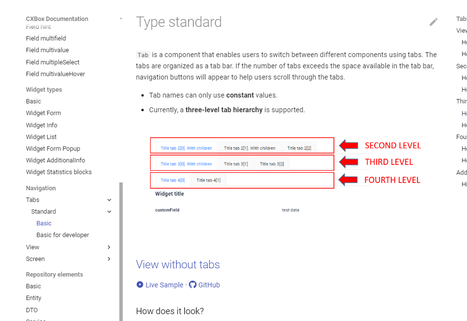

[Основы](https://doc.cxbox.org/ru/navigation/tabs/standard/basic/tab/)
[Основы для разработчика](https://doc.cxbox.org/ru/navigation/tabs/standard/basicdevelop/tabfordevelop/)


 