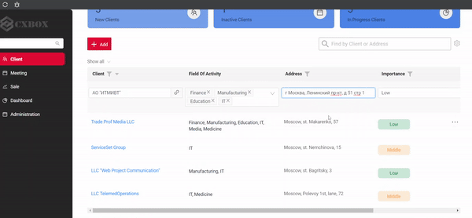
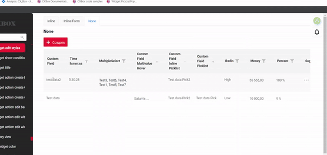
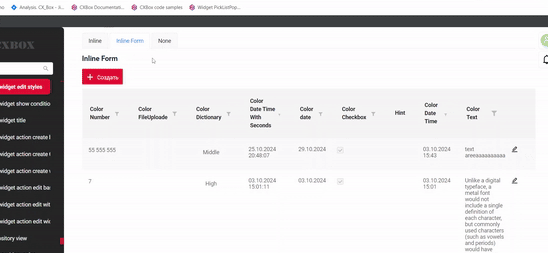

# 2.0.6

* [cxbox/demo 2.0.6 git](https://github.com/CX-Box/cxbox-demo/tree/v.2.0.6), [примечания к релизу](https://github.com/CX-Box/cxbox-demo/releases/tag/v.2.0.6)  

* [cxbox-ui/core 2.3.0 git](https://github.com/CX-Box/cxbox-ui/tree/2.3.0), [примечания к релизу](https://github.com/CX-Box/cxbox-ui/releases/tag/2.3.0), [npm](https://www.npmjs.com/package/@cxbox-ui/core/v/2.3.0)  

## **Ключевые обновления сентября, октября 2024** { #key-updates-september-october-2024 }
### <a id="CXBOXUI">CXBOX</a> ([Core Ui](https://github.com/CX-Box/cxbox-ui))
#### Изменён формат редактирования строк { #changed-the-editing-row-format }
1. **Редактирование строки одним кликом.** Теперь строка переходит в режим редактирования по одному клику (раньше требовался двойной клик).
**Все поля редактируемые.** Когда строка переходит в режим редактирования, все редактируемые поля строки одновременно переходят в режим редактирования. Раньше одновременно можно было редактировать только одно поле.

  

2. **Настраиваемое выделение строк.** Добавлена возможность настраивать цвета выделения строк для разных состояний, например при наведении и активной строки, прямо на фронтенде.

3. **Новый атрибут `style`.** В параметры edit и create в метаданных добавлен новый атрибут style.
Поддерживаемые значения:
   • `inline`: строка переходит в режим inline-редактирования.
   • `inlineForm`: открывается дополнительный виджет для редактирования строки.
   •  *НОВОЕ!* `none`: строка остаётся в режиме readOnly. Рекомендуется для строк с нередактируемыми полями, чтобы они не переходили в режим редактирования по клику.

Указанный style имеет приоритет над наличием имени виджета. Это означает, что если объявлено имя виджета и любое значение атрибута `style`, кроме `inlineForm`, применится объявленное значение `style`, и виджет не откроется.

### CXBOX ([Демо](https://github.com/CX-Box/cxbox-demo)) { #cxbox-demo }
#### Новая версия Core UI { #new-version-core-ui }
Core UI обновлён до версии 2.3.0.
#### Новая версия keycloak { #new-version-keycloak }
keycloak обновлён с версии 12.0.3 до версии 12.0.4.
#### Прочие изменения { #other-changes }
см. [журнал изменений cxbox-demo](https://github.com/CX-Box/cxbox-demo/releases/tag/v.2.0.6)
  
